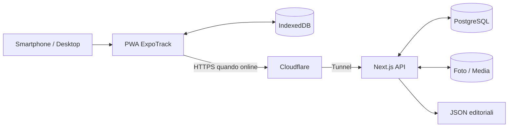

# ExpoTrack

## Specifica corrente del web mobile da fiera

La [specifica UI mobile](docs/27_Specifiche_UI_Mobile.md) recepisce le risposte A1–A9 e prevale sui precedenti flussi mobile: editor unico prodotto 05 (08 sospeso), salvataggio automatico locale e poi server, nessuna modalità bozza o conferma Salva finale, LWW per record con revisioni server e protezione delle cancellazioni. Stella stand = interesse; stand personali e budget per categoria inclusi in fiera; fotografie solo prodotto, con originale conservato; descrizione unica senza limite funzionale di testo. Tutti i mockup sono abbinati e le parti superate sono indicate nel documento 27. I documenti tecnici riportano il relativo aggiornamento normativo; esempi precedenti incompatibili non sono istruzioni di implementazione mobile. Desktop, confronto ed export restano fuori dalla revisione grafica corrente.


**La tua guida personale alle fiere: stand, prodotti, appunti e fotografie, anche senza connessione.**

> **Stato del progetto:** progettazione e documentazione tecnica completate come *bozza di specifica*.  
> **Pilota:** EICMA 2026.  
> **Destinazione:** applicazione web privata, mobile-first, installabile come PWA, utilizzabile da te e tuo padre.  
> **Questo repository, per ora, è un progetto documentale:** non contiene un'app già funzionante, né database creati, né file JSON editoriali definitivi.

---

## 1. Cos'è ExpoTrack

ExpoTrack è un'applicazione privata pensata per organizzare una visita a una fiera, registrare ciò che interessa e conservare le osservazioni fatte durante la giornata.

Il primo utilizzo previsto è **EICMA 2026**, ma l'architettura è **multi-evento**: una stessa installazione potrà ospitare altre fiere senza riscrivere l'app.

L'esperienza è costruita attorno a quattro elementi:

1. **Profili personali:** selezioni all'avvio chi sta usando l'app, senza creare un account interno.
2. **Stand:** consulti il catalogo, individui quelli che ti interessano, assegni priorità e annoti cosa vedere.
3. **Prodotti:** registri moto, caschi, guanti, accessori e qualsiasi altro prodotto osservato, con prezzi, voti, foto, note e questionari.
4. **Offline-first:** puoi usare l'app in fiera anche senza una connessione affidabile; i dati confermati si sincronizzano quando Internet torna disponibile.

L'app è prevista su un **server Debian/Linux privato**, tramite Docker e Cloudflare Tunnel.

### 1.1 Obiettivo pratico

Arrivare in fiera con una lista personale di stand e cose da vedere; durante la visita registrare rapidamente informazioni e fotografie; al ritorno confrontare i prodotti da desktop ed esportare un riepilogo PDF o JSON.

### 1.2 Cosa ExpoTrack non è

- Non è una piattaforma commerciale multi-tenant.
- Non è un social network né un catalogo e-commerce.
- Non gestisce prenotazioni o acquisti.
- **Non include mappe, percorsi o itinerari interni alla fiera** nella v1.
- Non richiede account, password o PIN applicativi nella v1.
- Non garantisce un'autenticazione distinta per ogni profilo.
- Non prevede importazione da JSON né esportazione Excel nella v1.
- Non contiene dati ufficiali già verificati sulle posizioni degli stand EICMA 2026.

---

## 2. Stato e perimetro della documentazione

Questa documentazione descrive **come costruire ExpoTrack**, non una soluzione già implementata. Gli esempi TypeScript, SQL, JSON, API e Docker Compose contenuti nei documenti sono contratti e proposte tecniche da verificare prima di usarli in produzione.

**Non sono ancora stati creati:**

- l'app Next.js;
- il backend e le API;
- il database PostgreSQL;
- gli object store IndexedDB;
- i container Docker definitivi;
- i file JSON editoriali completi;
- un catalogo EICMA con posizioni degli stand ufficialmente verificate;
- i test eseguibili e la pipeline CI.

La realizzazione effettiva sarà una fase successiva.

---

## 3. Funzionalità previste

### 3.1 Profili

All'apertura l'utente sceglie un profilo. I profili iniziali sono:

- `me`: **Io**;
- `father`: **Papà**.

La scelta viene ricordata sul dispositivo, per esempio con una preferenza locale/cookie. È sempre possibile cambiare profilo.

Ogni profilo possiede dati personali separati: interessi, priorità, stati degli stand, note, prodotti, fotografie, preferiti e risposte ai questionari. Si potranno creare anche profili aggiuntivi dall'app.

**Limite di sicurezza:** la separazione è **logica**, non una verifica dell'identità. Una persona che ha accesso all'app può selezionare un altro profilo. Per proteggere l'accesso esterno all'intera applicazione si consiglia Cloudflare Access.

### 3.2 Eventi e stand

Il catalogo degli stand è condiviso e definito tramite JSON editoriali, con:

- identificativo stabile;
- nome;
- descrizione facoltativa;
- categorie multiple;
- padiglione e posizione **soltanto quando verificati**.

Gli stand aggiunti direttamente dall'app sono **personali**, visibili nel profilo che li ha creati. Gli stand del catalogo JSON non sono eliminabili dalla UI.

Per ogni stand, ciascun profilo può mantenere:

- presenza nella propria lista di interessi;
- priorità da **1 a 10**;
- elenco delle cose da vedere (`whatToSee`);
- stato di visita;
- note;
- fotografie;
- prodotti osservati.

**Stati previsti:** `Da visitare`, `Visitato`, `Da rivedere`.

Il catalogo può essere molto più ampio della lista personale: **uno stand nel catalogo non è automaticamente un interesse da conteggiare nella dashboard**.

### 3.3 Prodotti

Un prodotto viene registrato nel contesto di uno stand e di un profilo. Comprende:

| Campo | Regola |
|---|---|
| Nome | Obbligatorio |
| Stand | Obbligatorio |
| Categoria/sottocategoria | **Una sola, obbligatoria** |
| Prezzo | Facoltativo |
| Valutazione generale | Facoltativa, **1–10** |
| Preferito | Sì/no |
| Note | Facoltative |
| Fotografie | Multiple |
| Questionario | Facoltativo, se definito per profilo/categoria |

La categoria del prodotto diventa **immutabile al primo salvataggio esplicito**, anche se il dispositivo è offline. Gli altri campi restano modificabili secondo le regole di dominio.

Il prezzo è un dato osservato, **non una spesa sostenuta**.

### 3.4 Questionari

I questionari sono definiti separatamente per profilo e categoria/sottocategoria. Non esiste un questionario globale condiviso obbligatorio.

Tipi di domanda previsti:

1. Testo.
2. Numero.
3. Sì/no.
4. Scelta singola.
5. Scelta multipla.
6. Valutazione da 1 a 10.

**Tutte le domande sono facoltative.** Le risposte devono restare interpretabili anche quando la definizione JSON del questionario cambia.

### 3.5 Dashboard

La dashboard mostra, per il profilo ed evento selezionati:

- stand da visitare;
- stand visitati;
- stand da rivedere;
- prodotti registrati;
- prodotti preferiti;
- anteprima degli stand prioritari;
- eventuali budget per categoria/sottocategoria;
- stato della sincronizzazione.

Le statistiche sono cliccabili e aprono la lista pertinente già filtrata.

### 3.6 Ricerca, filtri e ordinamenti

**Stand:** nome, categoria, padiglione, priorità e stato visita.

**Prodotti:** nome, categoria, stand, preferiti e altri criteri definiti nei documenti di dettaglio.

Sono previsti ordinamenti per nome, priorità e padiglione dove applicabili. **I filtri e gli ordinamenti temporanei vengono ripristinati ai valori iniziali quando si riapre la schermata**, salvo i casi in cui si arriva dalla dashboard con un filtro intenzionalmente preimpostato.

### 3.7 Confronto prodotti

Su desktop è prevista una vista affiancata per prodotti appartenenti alla **stessa categoria esatta** e allo stesso profilo/evento, con:

- fotografie;
- prezzo;
- valutazione generale;
- note;
- preferiti;
- risposte ai questionari.

La proposta iniziale è **massimo quattro prodotti** per confronto, da confermare. Non viene eletto automaticamente un vincitore.

### 3.8 Esportazioni

Per ciascun profilo/evento:

- **PDF:** riepilogo per categoria/sottocategoria e schede dettagliate dei prodotti, con fotografie, note e risposte ai questionari;
- **JSON:** dati strutturati e versionati, per archivio/consultazione.

È possibile esportare **tutte** le categorie oppure **solo alcune**.

Non sono previste importazione, Excel o archivio ZIP completo nella v1. Un export JSON non garantisce di contenere i file originali delle fotografie.

---

## 4. Esperienza mobile-first

ExpoTrack nasce per essere usato mentre si cammina tra gli stand, spesso con una mano sola.

### 4.1 Navigazione principale

La navigazione mobile prevista ha quattro voci fisse:

| Voce | Funzione |
|---|---|
| **Dashboard** | Statistiche e accessi rapidi |
| **Stand** | Catalogo, interessi e stati visita |
| **Prodotti** | Elenco e gestione prodotti |
| **Profilo** | Cambio profilo, impostazioni ed esportazioni |

L'intestazione mostra il profilo corrente e un indicatore dello stato di sincronizzazione.

### 4.2 Stati di salvataggio visibili

L'interfaccia deve distinguere chiaramente:

- **Bozza:** modifiche memorizzate localmente, ma non confermate.
- **Salvato sul dispositivo:** l'utente ha premuto **Salva**; dati confermati in IndexedDB.
- **In attesa di sincronizzazione:** modifiche confermate ancora da inviare.
- **Sincronizzato:** server aggiornato e conferma ricevuta.
- **Errore o conflitto:** richiesta di attenzione senza cancellazione dei dati.

**Autosave della bozza ≠ pressione di Salva ≠ sincronizzazione completata.**

---

## 5. Architettura tecnologica

| Livello | Tecnologia proposta | Responsabilità |
|---|---|---|
| Frontend | Next.js, React, TypeScript | UI mobile/desktop |
| Stile | Tailwind CSS + componenti personalizzati | Interfaccia responsive |
| Offline | PWA, Service Worker, IndexedDB | Lettura, bozze e dati confermati offline |
| Backend | Route Handler/API Next.js | Validazione, accesso DB, sync e media |
| Database | PostgreSQL | Persistenza server |
| Media | Volume persistente Docker | Fotografie |
| Deployment | Docker Compose su Debian/Linux | Esecuzione e aggiornamenti |
| Accesso remoto | Cloudflare Tunnel | Collegamento HTTPS verso server privato |
| Protezione perimetro | Cloudflare Access, se abilitato | Limitazione degli accessi all'app |

Il frontend non deve collegarsi direttamente a PostgreSQL.

### 5.1 Schema concettuale



### 5.2 Multi-evento

Gli eventi sono definiti in `config/app.json`; ciascun evento può puntare a un file di catalogo stand dedicato.

Gli ID degli eventi devono essere stabili. Le entità personali devono sempre essere contestualizzate con **profilo ed evento** per evitare contaminazioni.

---

## 6. Configurazione JSON

Il progetto privilegia la **configurabilità da file JSON** per i dati editoriali, senza dover modificare codice applicativo.

### 6.1 Struttura prevista

```text
config/
├── app.json
├── profiles.json
├── pavilions.json
├── categories.json
├── events/
│   └── eicma-2026-stands.json
├── interests/
│   ├── me.json
│   └── father.json
└── questionnaires/
    ├── me.json
    └── father.json
```

**Questi percorsi sono previsti dalla specifica: non significano che i file siano già stati compilati.**

### 6.2 Responsabilità di ciascun file

| File | Contenuto |
|---|---|
| `app.json` | Nome app, locale, evento predefinito, elenco eventi e riferimenti |
| `profiles.json` | Profili iniziali, colore, icona, abilitazione e budget |
| `pavilions.json` | Padiglioni per evento |
| `categories.json` | Gerarchia di categorie e sottocategorie |
| `events/eicma-2026-stands.json` | Catalogo stand dell'evento |
| `interests/me.json` | Interessi e priorità iniziali del profilo `me` |
| `interests/father.json` | Interessi e priorità iniziali del profilo `father` |
| `questionnaires/me.json` | Questionari del profilo `me` per categoria |
| `questionnaires/father.json` | Questionari del profilo `father` per categoria |

### 6.3 Regole di configurazione

- Ogni file deve avere una versione di schema.
- Gli ID devono essere stabili, univoci nel proprio ambito e verificati.
- I riferimenti incrociati devono essere validati prima della pubblicazione.
- Le configurazioni devono essere aggiornate come snapshot coerenti.
- Le modifiche personali nell'app non devono essere sovrascritte da nuovi seed JSON.
- Gli ID editoriali già usati da prodotti o note non devono essere rimossi senza una migrazione.
- Padiglioni e numeri stand EICMA devono essere inseriti **solo dopo verifica**, mai inventati.

### 6.4 Perché non esiste `products.json`

I prodotti sono **osservazioni raccolte durante la fiera**, quindi record dinamici in IndexedDB/PostgreSQL, non dati editoriali del catalogo.

---

## 7. Persistenza e funzionamento offline

### 7.1 Due archivi con responsabilità diverse

**PostgreSQL** conserva i dati personali confermati e già sincronizzati sul server.

**IndexedDB** conserva localmente:

- snapshot delle configurazioni;
- dati dinamici già scaricati;
- bozze;
- prodotti e modifiche confermate offline;
- fotografie locali;
- coda di sincronizzazione;
- informazioni sui conflitti.

Il Service Worker gestisce asset e cache necessarie al funzionamento PWA; non sostituisce IndexedDB.

### 7.2 Salvataggio di un prodotto offline

```text
Compilo il prodotto
   ↓
Bozza aggiornata automaticamente in IndexedDB
   ↓
Premo "Salva"
   ↓
Validazione del record
   ↓
Transazione locale: prodotto + operazione in outbox
   ↓
Conferma: "Salvato sul dispositivo"
   ↓
Ritorna la connessione
   ↓
Invio idempotente al server
   ↓
PostgreSQL conferma la nuova revisione
   ↓
Stato: "Sincronizzato"
```

La categoria viene bloccata al passaggio **Salva**, non all'arrivo della risposta server.

### 7.3 Chiusura improvvisa e quota browser

Dopo una transazione IndexedDB completata, il dato dovrebbe rimanere disponibile anche dopo la chiusura dell'app. Tuttavia **non si può garantire conservazione assoluta**: il browser può esaurire la quota o eliminare dati, e un dispositivo può guastarsi o andare perso.

L'app deve segnalare i fallimenti di scrittura e non mostrare «Salvato» quando la transazione non è stata completata.

### 7.4 Sincronizzazione

La sincronizzazione è automatica quando possibile, con comando manuale per ritentare.

- Ogni operazione usa un identificativo idempotente.
- Il server usa revisioni per evitare sovrascritture.
- I conflitti tra dispositivi vengono **risolti manualmente**, mantenendo le versioni.
- Le eliminazioni usano tombstone per evitare ricomparse involontarie.
- Le foto seguono un percorso di upload separato.
- Non è garantito il completamento della sincronizzazione quando il browser è chiuso.

---

## 8. Sicurezza e privacy

### 8.1 Accesso esterno

Il server resta privato e non deve esporre PostgreSQL su Internet. Cloudflare Tunnel fornisce il collegamento remoto, ma **non autentica da solo chi accede**.

Per limitare l'app a poche persone si raccomanda **Cloudflare Access** o un controllo equivalente.

### 8.2 Profili senza login

La scelta di un profilo nell'app non costituisce autenticazione. Anche se tutti i dati sono filtrati per profilo, chi può aprire ExpoTrack può selezionare un profilo diverso.

Se in futuro servirà una privacy rigorosa tra persone, andranno aggiunte autorizzazioni basate su identità verificate.

### 8.3 Protezione dei dati

- API con validazione server-side.
- Query parametrizzate e privilegi DB minimi.
- Foto fuori dalle directory statiche pubbliche.
- Limiti e validazione degli upload.
- Niente credenziali nei JSON editoriali o nel bundle frontend.
- Backup coerenti di database, media e configurazioni.
- Gestione attenta dei dati locali su dispositivi condivisi.

Le decisioni e i test sono approfonditi in [`docs/25-security.md`](docs/25-security.md).

---

## 9. Organizzazione prevista del progetto

La struttura di riferimento, ancora da realizzare, è indicativamente:

```text
ExpoTrack/
├── README.md
├── docs/
│   ├── 00-overview.md
│   ├── 01-architecture.md
│   ├── ...
│   └── 26-testing.md
├── config/
│   ├── app.json
│   ├── profiles.json
│   ├── pavilions.json
│   ├── categories.json
│   ├── events/
│   ├── interests/
│   └── questionnaires/
├── src/
│   ├── app/
│   ├── components/
│   ├── features/
│   ├── lib/
│   └── ...
├── public/
├── tests/
├── migrations/
├── Dockerfile
└── compose.yaml
```

I nomi delle cartelle applicative e la suddivisione effettiva sono definiti più nel dettaglio in [`docs/02-project-structure.md`](docs/02-project-structure.md). Questa struttura **non è un albero di file già generati**.

---

## 10. Indice completo della documentazione

La specifica è divisa in **27 documenti tecnici** più questo README principale, per un totale di **28 documenti**.

### 10.1 Fondamenti e struttura

| Documento | Descrizione |
|---|---|
| [`00-overview.md`](docs/00-overview.md) | Visione del prodotto, obiettivi e requisiti |
| [`01-architecture.md`](docs/01-architecture.md) | Architettura generale e flussi |
| [`02-project-structure.md`](docs/02-project-structure.md) | Struttura di cartelle, moduli e responsabilità |

### 10.2 Configurazioni editoriali

| Documento | Descrizione |
|---|---|
| [`03-app-config.md`](docs/03-app-config.md) | `app.json`, eventi e impostazioni generali |
| [`04-profiles-config.md`](docs/04-profiles-config.md) | Profili iniziali e budget |
| [`05-pavilions-config.md`](docs/05-pavilions-config.md) | Padiglioni per evento |
| [`06-categories-config.md`](docs/06-categories-config.md) | Categorie gerarchiche |
| [`07-stands-config.md`](docs/07-stands-config.md) | Catalogo stand condiviso |
| [`08-products-config.md`](docs/08-products-config.md) | Modello dei prodotti dinamici |
| [`09-interests-config.md`](docs/09-interests-config.md) | Interessi personali, priorità e cose da vedere |
| [`10-questionnaires-config.md`](docs/10-questionnaires-config.md) | Questionari per profilo e categoria |
| [`11-visit-statuses-config.md`](docs/11-visit-statuses-config.md) | Stati di visita degli stand |

### 10.3 Dati, API e interfaccia

| Documento | Descrizione |
|---|---|
| [`12-database.md`](docs/12-database.md) | PostgreSQL, IndexedDB, vincoli e revisioni |
| [`13-backend-api.md`](docs/13-backend-api.md) | Contratti HTTP e API Next.js |
| [`14-frontend-ui.md`](docs/14-frontend-ui.md) | UI responsive, navigazione e componenti |
| [`15-dashboard.md`](docs/15-dashboard.md) | Dashboard, statistiche e filtri rapidi |
| [`16-stand-management.md`](docs/16-stand-management.md) | Catalogo e gestione degli stand |
| [`17-product-management.md`](docs/17-product-management.md) | CRUD prodotti e regole di salvataggio |
| [`18-questionnaire-engine.md`](docs/18-questionnaire-engine.md) | Rendering, validazione e versionamento domande |

### 10.4 Offline, sincronizzazione e funzionalità avanzate

| Documento | Descrizione |
|---|---|
| [`19-offline-storage.md`](docs/19-offline-storage.md) | IndexedDB, cache PWA, bozze e persistenza |
| [`20-synchronization.md`](docs/20-synchronization.md) | Push/pull, outbox, revisioni e conflitti |
| [`21-photo-management.md`](docs/21-photo-management.md) | Foto, compressione, storage e upload |
| [`22-comparison.md`](docs/22-comparison.md) | Confronto prodotti su desktop |
| [`23-export.md`](docs/23-export.md) | Esportazioni PDF e JSON |

### 10.5 Esercizio e qualità

| Documento | Descrizione |
|---|---|
| [`24-deployment.md`](docs/24-deployment.md) | Docker, server Debian, Tunnel, backup |
| [`25-security.md`](docs/25-security.md) | Accesso, privacy, protezione API e media |
| [`26-testing.md`](docs/26-testing.md) | Strategia di test, CI e criteri di rilascio |

**Nota:** i link sono relativi alla struttura finale prevista del progetto. Quando si assemblano i documenti in un repository, i file devono essere collocati nei percorsi indicati.

---

## 11. Decisioni già stabilite

Queste scelte costituiscono la base funzionale e non devono essere cambiate implicitamente durante l'implementazione.

| Area | Decisione |
|---|---|
| Nome progetto | ExpoTrack |
| Prima fiera | EICMA 2026 |
| Architettura | Multi-evento |
| Frontend | Next.js, React, TypeScript |
| UI | Tailwind CSS, componenti personalizzati |
| Persistenza server | PostgreSQL |
| Persistenza locale | IndexedDB |
| Esperienza | Mobile-first, PWA, offline-first |
| Hosting | Server Debian/Linux privato con Docker |
| Accesso remoto | Cloudflare Tunnel |
| Account interni | Non previsti in v1 |
| Profili iniziali | `me`, `father` |
| Stand editoriali | JSON condiviso |
| Stand creati dall'app | Privati del profilo |
| Priorità stand | 1–10 |
| Stati visita | Da visitare, Visitato, Da rivedere |
| Categoria prodotto | Esattamente una, immutabile dopo Salva |
| Questionari | Specifici per profilo/categoria, facoltativi |
| Foto | Multiple, salvabili offline |
| Bozze | Autosalvate localmente |
| Conferma | Pulsante **Salva** |
| Sync | Automatica online + comando manuale |
| Conflitti | Risoluzione manuale |
| Confronto | Desktop, stessa categoria |
| Export | PDF e JSON |
| Mappe/itinerari | Non previsti in v1 |
| Excel/importazione | Non previsti in v1 |

---

## 12. Decisioni ancora aperte

La documentazione include **proposte** tecniche che richiedono conferma. Non vanno interpretate come decisioni definitive.

| Decisione | Proposta attuale | Da verificare |
|---|---|---|
| Accesso remoto | Cloudflare Access | Identità autorizzate, durata sessione |
| ORM/database access | Da scegliere | Prisma, Drizzle, SQL diretto o altro |
| PostgreSQL | Versione recente supportata, 16+ proposta | Compatibilità ambiente |
| Questionari nelle sottocategorie | Matching esatto | Eventuale ereditarietà |
| Confronto prodotti | Massimo 4 | Limite e UX |
| Stand personale con prodotti | Bloccare eliminazione finché referenziato | Eventuale riassegnazione |
| Categoria prodotto | Immutabile dopo Salva | Regola già funzionale, dettaglio DB/API |
| Collegamento prodotto-stand | Verificare se modificabile | Impatto su dati collegati |
| Gestione foto | Compressione e miniature | Limiti/formati/qualità |
| Backup | DB + media + configurazioni | Frequenza, retention, cifratura |
| Sincronizzazione | Revisioni + idempotenza | Contratto definitivo |
| Restore server | Identificatore generazione/epoch | Compatibilità client offline |
| Migrazioni JSON | Snapshot versionati | Politica ID rimossi |
| Budget | Per categoria/sottocategoria | Calcolo e visualizzazione |

**Prima di iniziare a programmare**, è opportuno chiudere le decisioni che modificano schema dati, API o UX.

---

## 13. Ordine consigliato per lo sviluppo

### Fase 0 — Revisione della specifica

- Leggere i documenti nell'ordine dell'indice.
- Consolidare i nomi di campi e stati usati in più documenti.
- Chiudere le decisioni aperte.
- Preparare un registro delle decisioni architetturali (ADR) o una checklist di approvazione.
- Stabilire cosa è obbligatorio per il primo utilizzo a EICMA e cosa può arrivare dopo.

**Criterio di uscita:** modelli, API e semantica offline non presentano contraddizioni irrisolte.

### Fase 1 — Scaffold tecnico

- Inizializzare Next.js, TypeScript e Tailwind CSS.
- Configurare linting, formattazione e test.
- Predisporre Docker Compose e PostgreSQL.
- Impostare struttura cartelle e variabili d'ambiente.
- Creare pipeline minima CI.

**Criterio di uscita:** app vuota avviabile localmente e in Docker, con healthcheck.

### Fase 2 — JSON e catalogo

- Implementare schemi e validatori.
- Caricare eventi, profili, padiglioni, categorie e stand.
- Implementare versionamento/snapshot.
- Predisporre interessi iniziali e questionari.
- Aggiungere **solo dati EICMA verificati**.

**Criterio di uscita:** catalogo consultabile e validazione dei riferimenti completa.

### Fase 3 — Profili, stand e dashboard

- Selezione profilo.
- Liste e filtri stand.
- Priorità, cose da vedere e stati visita.
- Note e stand personali.
- Dashboard con contatori coerenti.

**Criterio di uscita:** visita organizzabile con dati locali anche prima della gestione prodotti.

### Fase 4 — Prodotti e questionari

- CRUD prodotti.
- Categoria unica e immutabile.
- Prezzo, voto, note e preferiti.
- Motore questionari.
- Fotografie.
- Lista e dettaglio prodotto.

**Criterio di uscita:** osservazioni complete registrabili durante la fiera.

### Fase 5 — Offline-first e sincronizzazione

- IndexedDB e PWA.
- Bozze autosalvate.
- Commit locale atomico su **Salva**.
- Outbox idempotente.
- Push/pull con revisioni.
- Risoluzione conflitti.
- Upload fotografie e disponibilità offline.

**Criterio di uscita:** flusso completo testato con connessione assente/intermittente e due dispositivi.

### Fase 6 — Confronto ed export

- Confronto desktop stessa categoria.
- Export PDF per categorie.
- Export JSON.
- Verifica dei dati storici e delle fotografie.

**Criterio di uscita:** risultati della visita consultabili e condivisibili come file.

### Fase 7 — Sicurezza e rilascio

- Protezione Cloudflare Access, se scelta.
- Hardening Docker, API, database e media.
- Backup e restore testato.
- Test end-to-end e regressione.
- Simulazione completa della visita.
- Rilascio controllato sul server privato.

**Criterio di uscita:** checklist `26-testing.md` soddisfatta, senza difetti bloccanti.

---

## 14. Percorso minimo di utilizzo per EICMA

Un flusso reale di riferimento per validare il prodotto:

1. Prima della fiera si configurano gli stand verificati e gli interessi per `me` e `father`.
2. Sul telefono si apre ExpoTrack e si seleziona il proprio profilo.
3. La dashboard mostra gli stand prioritari e quelli ancora da visitare.
4. Si apre uno stand e si consultano le cose da vedere.
5. Durante la visita si registra un prodotto, con categoria, eventuale prezzo, foto e note.
6. Si compilano, se utili, le domande del questionario personale.
7. Si preme **Salva**, anche in assenza di rete.
8. Si cambia lo stato dello stand in **Visitato** o **Da rivedere**.
9. Tornata la connessione, l'app sincronizza; eventuali conflitti sono mostrati senza sovrascritture automatiche.
10. A casa, su desktop, si confrontano i prodotti della stessa categoria e si esporta il PDF riepilogativo.

Il flusso deve funzionare **senza** mappe o itinerari, che sono esclusi dal perimetro v1.

---

## 15. Qualità e test

La strategia di qualità è definita in [`docs/26-testing.md`](docs/26-testing.md) e comprende:

- unit test per validatori e regole di dominio;
- integration test per API e PostgreSQL;
- end-to-end per le schermate principali;
- test PWA/IndexedDB offline;
- simulazioni con due dispositivi e modifiche concorrenti;
- test di idempotenza, revisioni, tombstone e ripristino;
- test di upload e disponibilità offline delle fotografie;
- test di esportazione PDF/JSON;
- test di accesso e sicurezza;
- test di migrazione e rollback.

Un test particolarmente importante è la **simulazione della giornata in fiera con rete intermittente**, in cui prodotti, fotografie, note e questionari vengono creati offline e sincronizzati successivamente.

---

## 16. Regole per chi implementerà ExpoTrack

### 16.1 Non cambiare i requisiti in modo implicito

Non aggiungere login, mappe, importazioni, Excel o altri moduli non previsti solo perché comuni in applicazioni simili.

### 16.2 Non inventare dati editoriali

Gli esempi possono usare ID fittizi chiaramente etichettati. Padiglioni, numeri di stand e presenze degli espositori EICMA devono essere verificati prima di entrare nella configurazione reale.

### 16.3 Preservare i dati offline

Le bozze e le operazioni pendenti non devono essere cancellate durante aggiornamenti, migrazioni, cambio profilo, sessioni Cloudflare scadute o retry falliti.

### 16.4 Mantenere i confini

- JSON: configurazione editoriale.
- PostgreSQL: dati dinamici sincronizzati.
- IndexedDB: stato locale e offline.
- Media storage: file fotografie.
- API: validazione e sincronizzazione.

### 16.5 Documentare le scelte

Se un'implementazione differisce da una proposta tecnica presente nei documenti, registrare la decisione e aggiornare la documentazione correlata.

---

## 17. Glossario essenziale

| Termine | Significato |
|---|---|
| **Evento** | Una specifica fiera, ad esempio EICMA 2026 |
| **Profilo** | Contesto personale selezionato nell'app |
| **Stand editoriale** | Stand definito nel catalogo JSON |
| **Stand personale** | Stand creato dall'app per un profilo |
| **Interesse** | Stand che un profilo vuole seguire |
| **Priorità** | Importanza personale dello stand, da 1 a 10 |
| **What to see** | Elenco di cose da vedere o chiedere allo stand |
| **Stato visita** | Da visitare, Visitato, Da rivedere |
| **Prodotto** | Oggetto osservato e registrato durante la visita |
| **Questionario** | Domande facoltative per profilo e categoria |
| **Bozza** | Modifiche locali non ancora confermate |
| **Salva** | Conferma esplicita che scrive il dato localmente |
| **Outbox** | Coda locale di operazioni da sincronizzare |
| **Revisione** | Versione di un record usata per gestire concorrenza |
| **Conflitto** | Modifiche concorrenti da risolvere manualmente |
| **Tombstone** | Traccia versionata di un'eliminazione |
| **Snapshot editoriale** | Insieme coerente di JSON validati |
| **PWA** | Web app installabile con funzionalità offline |
| **Cloudflare Tunnel** | Canale verso il server senza porte inbound pubbliche |
| **Cloudflare Access** | Controllo di accesso al servizio, separato dai profili |

---

## 18. Prossimo passo dopo la documentazione

Con questo README, la **struttura della documentazione prevista è completa: 28 documenti**.

Prima di generare codice o JSON reali, la prossima attività consigliata è una **revisione trasversale delle specifiche** per:

1. identificare eventuali divergenze tra modelli TypeScript, JSON, schema SQL e contratti API;
2. chiudere le decisioni aperte che influiscono sullo schema;
3. fissare l'MVP utilizzabile per EICMA;
4. definire un backlog implementativo ordinato per dipendenze.

Soltanto dopo questa revisione si passa alla creazione effettiva del repository applicativo e dei file di configurazione.

---

**ExpoTrack — Progetto documentato per l'implementazione, non ancora sviluppato.**
