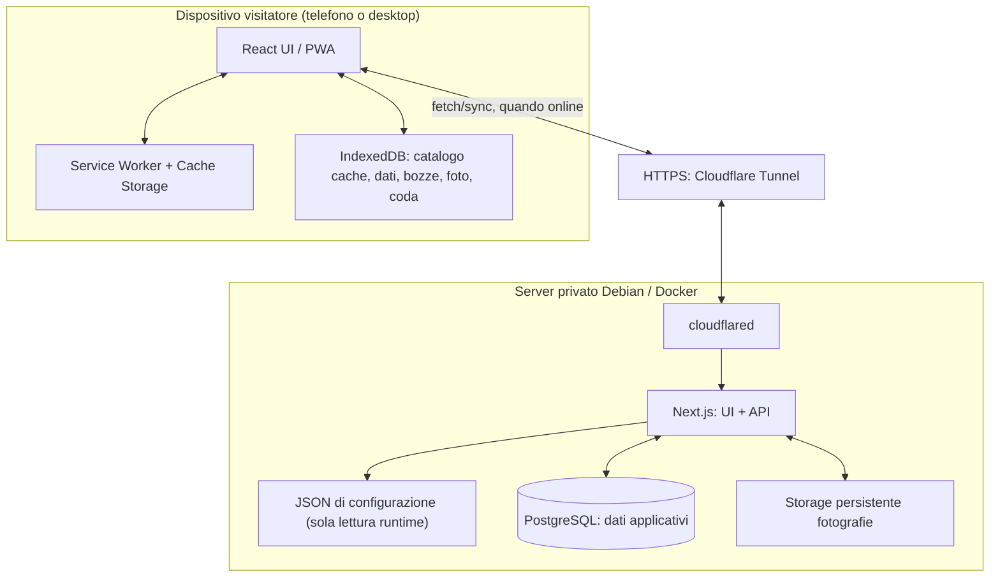
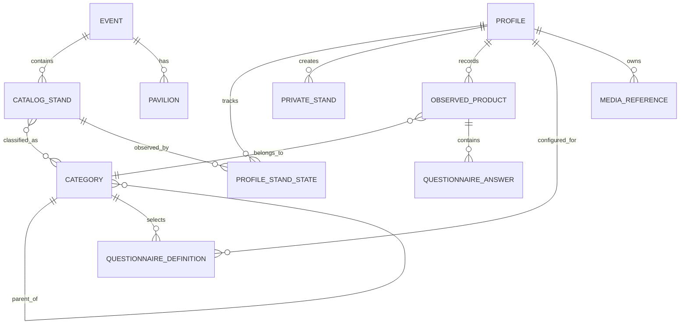
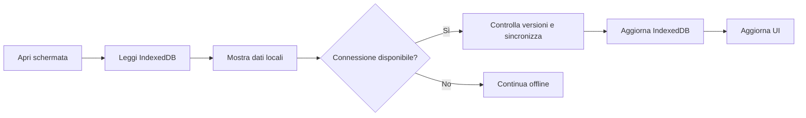
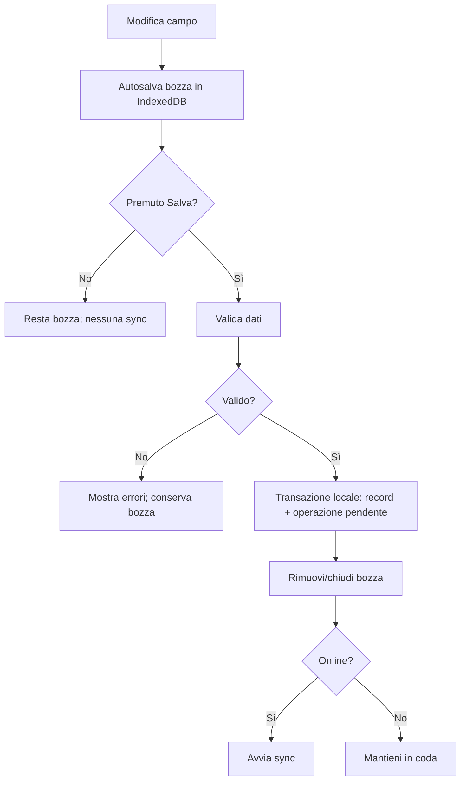
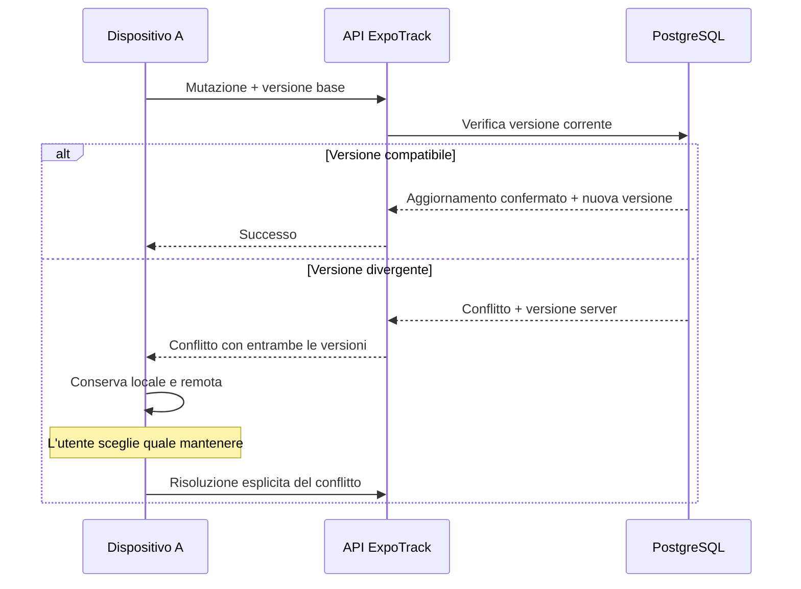
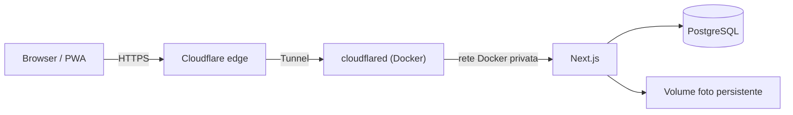

# 01 — Architettura tecnica di ExpoTrack

## Aggiornamento mobile — risposte A1–A9

**Contratto vigente per il web mobile da fiera:** [specifica UI mobile, risposte A1–A9](27_Specifiche_UI_Mobile.md#10-risposte-di-revisione-recepite). Questo aggiornamento prevale sui paragrafi, diagrammi, pseudocodice e casi di test precedenti incompatibili. In particolare, gli esempi con `drafts`, conferma finale «Salva», dettaglio mobile 08, foto stand o scelta manuale del conflitto descrivono la progettazione precedente e non vanno implementati nel mobile. Le parti compatibili e le funzioni desktop/post-fiera mantengono il proprio ambito.

Il repository locale persiste automaticamente input, record validi e outbox. Non introdurre DraftRepository o store drafts; dati invalidi restano recuperabili localmente ma non sono mutazioni server. La sync è automatica, LWW per record in ordine di accettazione server, con idempotenza e tombstone protette.


> **Stato:** specifica architetturale per la v1  
> **Dipende da:** [`../README.md`](../README.md), [`00-overview.md`](00-overview.md)  
> **Successivo:** [`02-project-structure.md`](02-project-structure.md)  
> **Evento pilota:** EICMA 2026; architettura riutilizzabile per altre fiere.

## 1. Scopo e perimetro

Questo documento stabilisce **come si distribuiscono le responsabilità** tra browser/PWA, server Next.js, PostgreSQL, file JSON e storage fotografico, e definisce i flussi tecnici necessari per rispettare i requisiti funzionali.

Non sostituisce i contratti dettagliati di database, API, sincronizzazione o schemi JSON. Quando un aspetto non è ancora stato deciso, viene marcato **DA DEFINIRE** con il documento responsabile.

### Decisioni già vincolanti

- Next.js + React + TypeScript per UI e API nella stessa applicazione.
- Tailwind CSS e componenti personalizzati; niente shadcn o MUI.
- PostgreSQL sul server, IndexedDB sul dispositivo.
- PWA mobile-first, offline-first; Docker su Debian/Linux; Cloudflare Tunnel.
- Nessun login o PIN interno nella v1; Cloudflare Access eventualmente in futuro.
- Cataloghi, profili iniziali, interessi iniziali e questionari definiti in JSON modulari.
- Dati raccolti dai visitatori personali e dinamici, **non** scritti nei JSON.
- Salvataggio mobile automatico locale e outbox per valori validi, senza modalità bozza o conferma Salva finale; input invalidi conservati localmente secondo §5.1 del documento 27.
- Concorrenza mobile LWW per record in ordine di accettazione server; revisioni monotone, idempotenza e protezione delle tombstone.
- Stand creati nell'app privati del profilo; catalogo JSON comune.
- Una sola categoria per prodotto, immutabile dopo il primo salvataggio.
- Questionari solo per combinazione profilo/categoria configurata.
- Export JSON/PDF per profilo; nessun import, nessun Excel.

## 2. Vista d'insieme



**Principio operativo:** la UI legge prioritariamente dai dati locali per poter funzionare offline. Il server è il punto di sincronizzazione e persistenza condivisa tra dispositivi, **non** l'unica fonte necessaria per ogni schermata.

Il service worker e IndexedDB hanno ruoli diversi: il primo gestisce asset e richieste cacheabili; IndexedDB gestisce record strutturati, bozze, code e metadati delle fotografie.

## 3. Responsabilità dei componenti

| Componente | Responsabilità | Non deve fare |
|---|---|---|
| UI React | Navigazione, form, dashboard, filtri, confronto, avvisi e conferme | Salvare direttamente in PostgreSQL |
| Servizi client | Lettura/scrittura IndexedDB, bozza, comandi di salvataggio, coda, sync | Sincronizzare bozze non confermate |
| Service worker | Shell PWA e asset statici; cache selettiva secondo policy | Essere l'unico archivio dei dati personali |
| IndexedDB | Cache del catalogo, dati del profilo, bozze, operazioni pendenti, metadati/media offline | Essere trattato come storage illimitato o infallibile |
| API Next.js | Validare input, applicare regole di dominio, sincronizzare, leggere/esportare dati | Accettare senza verifica `profileId`/`categoryId` |
| PostgreSQL | Persistenza di profili dinamici, visite, prodotti, risposte, metadati e versioni | Contenere immagini binarie per scelta implicita |
| JSON | Definizioni editoriali versionate e referenziabili | Conservare note, foto o risposte inserite nell'app |
| Storage foto | File binari, versioni e riferimenti per profilo/prodotto/stand | Usare file effimeri dentro il container |
| Cloudflare Tunnel | Pubblicare un endpoint HTTPS verso il servizio privato | Autenticare automaticamente gli utenti |

### 3.1 Confini di responsabilità

Il frontend **non** deve conoscere credenziali PostgreSQL, percorsi fisici del server o segreti Cloudflare. Le API espongono operazioni applicative, non query SQL arbitrarie. Il server deve convalidare ogni mutazione anche se il client ha già validato il form.

### 3.2 Applicazione singola, servizi separati

La v1 usa **una codebase Next.js** per frontend e API, non microservizi distinti. PostgreSQL e il processo `cloudflared` restano servizi/container separati. Lo storage foto può iniziare con un volume persistente, se la specifica `21-photo-management.md` lo confermerà.

Questa scelta evita un backend aggiuntivo e riduce la complessità operativa per pochi utenti.

## 4. Organizzazione logica del software

La struttura di directory concreta sarà definita in `02-project-structure.md`. I **moduli logici** consigliati sono:

1. **Event catalog** — eventi, padiglioni, stand condivisi, categorie.
2. **Profiles** — profili JSON iniziali, profili dinamici, selezione locale.
3. **Interests & visits** — priorità, cose da vedere, stato, note/foto stand.
4. **Products** — prodotti personali, prezzo, voto, preferiti, foto, note.
5. **Questionnaires** — definizioni JSON, matching, risposte e rendering.
6. **Offline repository** — IndexedDB, migrazioni e bozze.
7. **Sync engine** — operazioni confermate, retry, versioni, conflitti.
8. **Media** — acquisizione, compressione se prevista, cache e upload foto.
9. **Dashboard & search** — aggregazioni, filtri, ordinamenti.
10. **Exports** — JSON e due PDF per profilo.
11. **Configuration loader** — parsing, validazione e versione del catalogo.

Per ogni modulo separare: **tipi/contratti**, **logica di dominio**, **persistenza**, **interfaccia**. Evitare che componenti React contengano logica di versionamento, migrazione o risoluzione conflitti.

## 5. Configurazione JSON: sorgente editoriale

### 5.1 Organizzazione prevista

```text
config/
├── app.json
├── profiles.json
├── pavilions.json
├── categories.json
├── events/
│   └── eicma-2026-stands.json
├── interests/
│   ├── me.json
│   └── father.json
└── questionnaires/
    ├── me.json
    └── father.json
```

Questi sono **percorsi proposti**, da confermare nei documenti `03`–`11`; i file non sono ancora creati. Le definizioni di prodotti osservati e gli stati personali **non richiedono un JSON di dati statici**: appartengono al modello dinamico.

### 5.2 Caricamento e validazione

All'avvio server o durante la fase di build/deploy, il caricatore deve:

1. leggere i file configurati;
2. validare struttura, tipi, identificativi e riferimenti incrociati;
3. segnalare errori con file e percorso del campo;
4. evitare di distribuire configurazioni incoerenti;
5. pubblicare al client un **snapshot coerente** con un identificativo di versione.

La scelta tra validazione in build, all'avvio o entrambe sarà fissata in `03-app-config.md`. La libreria di schema non è ancora scelta; è raccomandata una validazione runtime tipizzata.

### 5.3 Modifiche ai JSON

I JSON sono aggiornati dall'amministratore tramite repository/deployment, non dai form di visita. Aggiornare un JSON non deve eliminare o sovrascrivere note, foto, prodotti e risposte già salvati.

**Problema da progettare:** cosa succede quando viene rimosso o rinominato un ID usato da dati dinamici. Il comportamento deve essere esplicito: non cancellare riferimenti silenziosamente; prevedere validazioni e migrazioni.

### 5.4 Più eventi

L'architettura deve includere un identificativo `eventId` nei record che dipendono dall'evento. Il meccanismo per selezionare l'evento corrente, la sua configurazione e la separazione dei dati tra eventi è **DA DEFINIRE** in `03-app-config.md` e `12-database.md`.

Non inserire stringhe `eicma-2026` in condizioni di business logic: usarle come valori configurati.

## 6. Modello concettuale dei dati

Le entità seguenti sono **concettuali**, non tabelle definitive:



**Nota:** un prodotto può riferirsi a uno stand del catalogo **oppure** a uno stand privato. Il diagramma non rappresenta ancora questo riferimento polimorfico; il vincolo esatto sarà specificato in `12-database.md`.

### 6.1 Profili JSON e profili dinamici

Il sistema deve presentare un elenco logico unificato, mantenendo distinta l'origine:

- **configured**: definito in `profiles.json`, ID stabile, attivazione/disattivazione via JSON;
- **dynamic**: creato dall'app, salvato in database e sincronizzato.

La modifica/eliminazione dall'app è prevista per i profili **dynamic**. Non trasformare implicitamente i profili JSON in record modificabili dall'interfaccia.

### 6.2 Separazione personale

Ogni dato dinamico deve essere associato in modo non ambiguo al profilo proprietario e, quando pertinente, all'evento. Le query e gli endpoint devono essere sempre **scoped** al profilo richiesto.

Questo evita contaminazioni accidentali, **ma non è sicurezza**: in assenza di autenticazione, chi usa l'app può scegliere un altro profilo.

### 6.3 Invarianti di dominio

- `priority` di uno stand personale: intero 1–10 quando valorizzato.
- `visitStatus`: `to_visit`, `visited`, `revisit` (nomi tecnici provvisori; etichette italiane definitive).
- `product.rating`: intero 1–10 quando valorizzato.
- `product.categoryId`: esattamente uno e **immutabile dopo la prima conferma**.
- `product.price`: un solo importo opzionale; valuta/precisione da definire.
- Questionario: definizione legata a profilo e categoria; nessun fallback globale automatico.
- Foto e note: facoltative, multiple foto per stand/prodotto.
- Stand privato: proprietario unico; non diventa stand condiviso dopo la sincronizzazione.
- Le risposte appartengono al prodotto e al profilo, non ai JSON.

## 7. Architettura client offline-first

### 7.1 Livelli di archiviazione

**Cache Storage/service worker**: HTML shell, JS, CSS, icone e risorse statiche secondo strategia compatibile con Next.js.

**IndexedDB**:
- snapshot catalogo/configurazioni necessari offline;
- profili e dati locali utilizzabili;
- record confermati e relative versioni;
- Salvataggio mobile automatico locale e outbox per valori validi, senza modalità bozza o conferma Salva finale; input invalidi conservati localmente secondo §5.1 del documento 27.
- coda delle mutazioni da sincronizzare;
- media e metadati necessari offline, con politica di capacità da definire;
- informazioni sullo stato dell'ultima sincronizzazione.

**Memoria React**: stato temporaneo UI, selezione e filtri. I filtri **non** vanno ripristinati automaticamente dopo la riapertura.

### 7.2 Lettura dei dati



**Regola:** non bloccare la consultazione offline in attesa di una chiamata API. Se manca il primo snapshot e non c'è rete, mostrare uno stato esplicito «contenuti non ancora disponibili offline», non un elenco vuoto ingannevole.

### 7.3 Scrittura: bozza e conferma



Il commit locale del record e l'inserimento in coda devono essere **atomici** ove possibile (transazione IndexedDB), per evitare dati confermati ma mai sincronizzati.

### 7.4 Navigazione con modifiche non salvate

- Avvertire prima di abbandonare una schermata con bozza modificata.
- Non cancellare la bozza quando l'utente lascia la schermata.
- Mantenere separati i draft per profilo, evento, tipo di entità e record.
- Cambio profilo: non mostrare la bozza del profilo precedente nel nuovo.
- Non fare affidamento esclusivo sull'evento `beforeunload`, che non copre tutti i casi mobile/PWA.

### 7.5 Limiti offline

Il dispositivo può esaurire spazio o cancellare storage sotto pressione. La v1 deve gestire esplicitamente errori di quota e informare l'utente. La disponibilità offline richiede almeno una prima apertura/preparazione con rete.

**DA DEFINIRE:** politiche di cache, download preventivo, spazio riservato alle foto, gestione degli aggiornamenti service worker e migrazioni IndexedDB (`19-offline-storage.md`, `21-photo-management.md`).

## 8. Sincronizzazione e versionamento

### 8.1 Modello generale

La sincronizzazione scambia **operazioni confermate** e aggiornamenti remoti, non bozze.

Per ciascuna mutazione il client deve poter trasmettere almeno, concettualmente:

- identificativo univoco dell'operazione, per retry idempotenti;
- `eventId` e `profileId` quando applicabili;
- tipo di entità e ID stabile del record;
- operazione (creazione/modifica/eliminazione);
- versione base osservata dal client;
- dati della mutazione.

I nomi precisi, la forma degli endpoint e il modello di versione saranno definiti in `13-backend-api.md` e `20-synchronization.md`.

### 8.2 Regole non negoziabili

1. **Solo Salva** produce mutazioni sincronizzabili.
2. Ritentare una richiesta non deve duplicare prodotti, stand o fotografie.
3. Nessuna modifica remota deve sovrascrivere silenziosamente una modifica locale concorrente.
4. I conflitti restano risolvibili anche dopo chiusura/riapertura.
5. La perdita di rete non deve cancellare operazioni pendenti.
6. Le eliminazioni richiedono una strategia esplicita per dispositivi rimasti offline.
7. Il client deve poter distinguere dati sincronizzati, in attesa, in errore e bozze.

### 8.3 Gestione del conflitto



**Non implementare «vince l'ultimo salvataggio».** La gestione di modifiche indipendenti a campi diversi, conflitti su foto e conflitti di eliminazione è **DA DEFINIRE** nel documento `20-synchronization.md`.

### 8.4 Avvio della sincronizzazione

Trigger previsti:
- ritorno online;
- comando manuale dell'utente;
- normale attività dell'app quando la connessione è disponibile.

La capacità di sincronizzare **con l'app completamente chiusa** non è garantita: background sync dipende dal browser e dal sistema operativo. La specifica non deve promettere sincronizzazione continua in background.

## 9. API e server

### 9.1 Scelta applicativa

Usare API server-side di Next.js (ad esempio Route Handlers) nello stesso progetto della UI. Tutte le operazioni persistenti passano attraverso il server.

Ambiti API da documentare:
- bootstrap evento/catalogo e relative versioni;
- profili dinamici;
- preferenze e stati stand;
- stand personali;
- prodotti e risposte;
- upload/download fotografie;
- sincronizzazione e conflitti;
- esportazioni.

Non fissare ancora i path esatti: sono competenza di `13-backend-api.md`.

### 9.2 Validazione e integrità

Il server deve validare:
- tipi, dimensioni, campi richiesti e valori ammessi;
- appartenenza di stand, categoria, prodotto e profilo all'evento;
- proprietà logica di stand/prodotto rispetto al profilo dichiarato;
- immutabilità della categoria dopo il primo salvataggio;
- esistenza e compatibilità delle domande;
- versione base e idempotenza delle mutazioni.

**Importante:** il controllo di appartenenza al profilo evita errori applicativi, ma non dimostra che il chiamante sia davvero quella persona senza un sistema di autenticazione.

### 9.3 Database

PostgreSQL è l'archivio condiviso dei dati dinamici. Prevedere concettualmente:
- vincoli di integrità e chiavi;
- versioni dei record e metadati di modifica;
- tracciamento delle operazioni idempotenti;
- conservazione delle informazioni necessarie a risolvere conflitti;
- eliminazioni propagate in modo sicuro;
- backup del database.

Schema definitivo, indici e migrazioni: `12-database.md`.

## 10. Gestione delle fotografie

### 10.1 Requisiti

- Più fotografie facoltative per stand e prodotto.
- Proprietà personale delle fotografie.
- Visualizzazione offline dopo salvataggio locale.
- Upload ritentabile e collegamento coerente al record.
- Nessuna perdita silenziosa se l'upload fallisce.

### 10.2 Separazione file/metadati

Architettura consigliata, **da confermare**:
- metadati e relazioni in PostgreSQL;
- file binari in un volume Docker persistente, non nel filesystem effimero dell'immagine;
- copie locali necessarie in IndexedDB per la consultazione offline.

La strategia esatta (Blob, dimensioni massime, compressione, miniature, checksum, deduplicazione, cleanup e recupero errori) sarà definita in `21-photo-management.md`.

### 10.3 Sincronizzazione media

Il record e le foto possono arrivare al server in tempi diversi. L'interfaccia deve indicare lo stato di caricamento dei media separatamente quando utile. Non segnalare «tutto sincronizzato» se foto confermate sono ancora pendenti.

## 11. Dashboard, ricerca, confronto ed export

### 11.1 Dashboard

Le statistiche sono calcolate sul **profilo attivo e sull'evento corrente**. I riepiloghi sono cliccabili e aprono liste filtrate. La formula dell'avanzamento e il trattamento dello stato «da rivedere» saranno specificati in `15-dashboard.md`.

### 11.2 Ricerca e filtri

Per un'esperienza offline, la ricerca su stand e prodotti deve funzionare sui dati locali. Le prestazioni per cataloghi ampi richiedono indici IndexedDB e/o indici di ricerca in memoria; la scelta verrà documentata.

I filtri e gli ordinamenti non persistono alla riapertura dell'app. La selezione del profilo, invece, persiste sul dispositivo.

### 11.3 Confronto

Disponibile soltanto su desktop; la UI mobile non deve proporre una tabella affiancata inutilizzabile. Confronta prodotti della stessa categoria e dello stesso profilo, con prezzi, voti e risposte. Non assumere che i questionari di profili diversi siano comparabili.

### 11.4 Esportazione

- JSON: dati del solo profilo selezionato; **nessun import/ripristino**.
- PDF riassuntivo: prodotti raggruppati per categoria/sottocategoria.
- PDF dettagliato: schede con foto, note, valutazioni e risposte.
- Filtraggio per categorie prima dell'export.
- Nessun Excel.

**DA DEFINIRE:** generazione PDF client o server, modalità offline dell'export, limiti di dimensione, inclusione delle fotografie e schema JSON esportato (`23-export.md`).

## 12. Deployment e rete

### 12.1 Topologia proposta



**Proposta minima di servizi**:
- `web`: Next.js;
- `db`: PostgreSQL;
- `cloudflared`: tunnel verso `web` (oppure tunnel già presente sul server, riutilizzato).

Volumi persistenti per PostgreSQL e fotografie; credenziali in variabili d'ambiente/segreti, **mai** nei JSON pubblicati al client.

### 12.2 Cloudflare Tunnel non è un login

Il tunnel espone un endpoint HTTPS senza aprire porte inbound sul router, ma **non** limita automaticamente chi può visitarlo. L'app v1, senza login/PIN né Access, è accessibile a chiunque raggiunga l'URL e permette di selezionare altri profili.

- Non inserire informazioni sensibili.
- `robots.txt` e `noindex` possono scoraggiare l'indicizzazione, ma **non** sono controlli di accesso.
- Cloudflare Access può essere aggiunto in futuro come protezione esterna, senza cambiare la logica dei profili interni.
- Considerare limiti anti-abuso, protezioni delle API e backup già nella v1 (`25-security.md`).

### 12.3 Operatività

Il deploy deve prevedere:
- healthcheck;
- backup e procedura di ripristino server (indipendente dall'export JSON utente);
- migrazioni database controllate;
- gestione degli aggiornamenti PWA e compatibilità dati;
- log utili, evitando di registrare dati personali o foto;
- verifica della persistenza dopo riavvio/ricreazione dei container.

I comandi e il `docker-compose.yml` definitivo saranno documentati in `24-deployment.md`.

## 13. Flussi end-to-end

### 13.1 Prima apertura online

1. Browser carica l'app tramite HTTPS/Cloudflare Tunnel.
2. Service worker viene registrato se supportato.
3. L'app scarica/valida uno snapshot di configurazione pubblicabile.
4. Salva i dati necessari in IndexedDB.
5. Carica i profili configurati e quelli dinamici disponibili.
6. L'utente sceglie un profilo, se non già selezionato.
7. L'app apre la dashboard del profilo attivo.
8. Un controllo di sincronizzazione recupera eventuali dati personali remoti.

### 13.2 Visita senza rete

1. L'utente apre uno stand dalla cache locale.
2. Modifica lo stato e aggiunge note/foto.
3. L'autosalvataggio conserva una bozza.
4. Premendo **Salva**, il client conferma localmente e registra un'operazione pendente.
5. L'interfaccia mostra lo stato offline/in attesa.
6. Al ritorno della rete la coda viene inviata.
7. Il server valida e conferma, oppure segnala un conflitto.
8. Il client aggiorna stato e versioni senza perdere dati.

### 13.3 Aggiornamento configurazione

1. L'amministratore modifica i JSON nel repository.
2. Il deploy valida i file e i riferimenti.
3. Viene pubblicata una nuova versione coerente del catalogo.
4. Il client online la riceve e aggiorna la cache.
5. Le entità dinamiche mantengono i loro ID e non vengono cancellate.
6. Se emergono riferimenti incompatibili, viene applicata una strategia di migrazione/compatibilità **esplicitamente documentata**, non una rimozione implicita.

### 13.4 Cambio profilo

1. L'utente seleziona un profilo nella sezione Profilo.
2. L'app gestisce eventuali bozze aperte del profilo corrente senza perderle.
3. Aggiorna la selezione locale del profilo.
4. Carica solo i dati del profilo scelto, oltre al catalogo condiviso.
5. Apre la dashboard e aggiorna nome/colore in intestazione.
6. Le code di sincronizzazione restano correttamente associate ai rispettivi profili.

## 14. Errori e casi limite da gestire

| Scenario | Comportamento minimo |
|---|---|
| Primo accesso offline, nessuna cache | Stato esplicito e richiesta di connessione iniziale |
| IndexedDB non disponibile | Errore chiaro; non promettere salvataggio offline |
| Quota storage esaurita | Segnalare il problema; non dichiarare salvata una bozza non persistita |
| JSON invalido | Bloccare pubblicazione/uso della configurazione incoerente e segnalare il file |
| Stand/categoria referenziato non più disponibile | Non cancellare i dati dinamici; attivare strategia di compatibilità |
| Richiesta API duplicata dopo timeout | Evitare duplicazione tramite idempotenza |
| Foto salvata ma upload incompleto | Conservare stato pendente e riprovare |
| Conflitto modifica/modifica | Conservare entrambe le versioni e chiedere scelta |
| Conflitto modifica/eliminazione | Non applicare automaticamente una cancellazione distruttiva |
| Cambio profilo con bozza aperta | Avviso e conservazione bozza sotto il profilo originario |
| Server non raggiungibile | Continuare con i dati locali, se disponibili |
| Riapertura app | Dashboard; filtri e ordinamenti predefiniti; profilo ricordato |
| Profilo dinamico eliminato su altro dispositivo | Gestione coerente di dati e code offline, da definire |
| Browser chiuso durante upload/sync | Ripresa robusta quando l'app viene riaperta |

## 15. Requisiti non funzionali e verifiche

### 15.1 Obiettivi qualitativi

- Salvataggio mobile automatico locale e outbox per valori validi, senza modalità bozza o conferma Salva finale; input invalidi conservati localmente secondo §5.1 del documento 27.
- **Usabilità:** i flussi di visita sono pratici su smartphone.
- **Prestazioni:** elenco stand e prodotti utilizzabile offline senza attese di rete.
- **Manutenibilità:** moduli separati, contratti tipizzati, validazione JSON e test.
- **Portabilità:** deployment riproducibile con Docker.
- **Estendibilità:** supporto a nuove fiere tramite configurazione.
- **Trasparenza:** stati di salvataggio e sincronizzazione comprensibili.

Non vengono fissati SLA o soglie numeriche inventate: eventuali target misurabili saranno definiti in `26-testing.md`.

### 15.2 Criteri di accettazione architetturali

- [ ] La UI non richiede una connessione attiva per consultare dati già caricati.
- Salvataggio mobile automatico locale e outbox per valori validi, senza modalità bozza o conferma Salva finale; input invalidi conservati localmente secondo §5.1 del documento 27.
- [ ] **Salva** registra atomicamente record confermato e operazione pendente.
- [ ] Le API validano vincoli di dominio e riferimenti, indipendentemente dal client.
- [ ] I dati personali sono filtrati per profilo ed evento in ogni livello.
- [ ] Gli stand privati non diventano pubblici dopo la sincronizzazione.
- [ ] Un nuovo profilo dinamico non riceve questionari inventati.
- [ ] Un prodotto salvato non può cambiare categoria tramite UI o API.
- [ ] Le richieste ritentate non creano duplicati.
- [ ] I conflitti non attivano sovrascritture automatiche.
- [ ] Foto e database persistono dopo ricreazione dei container.
- [ ] Le foto salvate localmente restano consultabili offline, nei limiti dichiarati.
- [ ] L'app indica chiaramente offline, in attesa, sincronizzato ed errore.
- [ ] Il deploy valida i JSON e non cancella dati dinamici.
- [ ] Il sistema non tratta Cloudflare Tunnel come controllo di accesso.
- [ ] La documentazione non promette sync con app chiusa su tutti i browser.
- [ ] Il confronto è disponibile solo nella UI desktop.
- [ ] L'export non mescola i dati di profili diversi.
- [ ] Si può aggiungere un altro evento senza cambiare le regole di business.

## 16. Decisioni tecniche aperte (non bloccanti per questa specifica)

| Tema | Decisione da formalizzare | Documento |
|---|---|---|
| Repository | Convenzioni, package manager, directory, moduli | `02-project-structure.md` |
| JSON | Schemi, versioni, loader e identificativi | `03`–`11` |
| Multi-evento | Evento corrente e separazione dati | `03-app-config.md`, `12-database.md` |
| DB | ORM/query layer, tabelle, migrazioni, versioni | `12-database.md` |
| API | Endpoint, payload, paginazione, idempotenza | `13-backend-api.md` |
| Offline | Libreria IndexedDB, service worker, migrazioni e cache | `19-offline-storage.md` |
| Sync | Algoritmo, tombstone, retry, risoluzione dei conflitti | `20-synchronization.md` |
| Foto | Storage binario, dimensioni, compressione, sincronizzazione | `21-photo-management.md` |
| Export | Schema JSON, generazione PDF e disponibilità offline | `23-export.md` |
| Deploy | Compose, tunnel, backup e aggiornamenti | `24-deployment.md` |
| Sicurezza | Controlli minimi senza autenticazione; Access futuro | `25-security.md` |

**Regola:** le scelte consigliate ma non ancora approvate sono indicate come *proposte* o *DA DEFINIRE*. Non trasformarle in vincoli impliciti.

---

## 17. Collegamenti

- [`../README.md`](../README.md) — visione generale e indice.
- [`00-overview.md`](00-overview.md) — requisiti e scenari funzionali.
- [`02-project-structure.md`](02-project-structure.md) — **prossimo documento**, struttura concreta del progetto.
- `12-database.md`, `13-backend-api.md`, `19-offline-storage.md`, `20-synchronization.md`, `21-photo-management.md`, `24-deployment.md`, `25-security.md` — specifiche dei sottosistemi.

> **Conclusione:** ExpoTrack è una singola applicazione Next.js con storage locale offline-first e un server di sincronizzazione PostgreSQL. I JSON definiscono il catalogo e i questionari; i dati raccolti rimangono personali e dinamici. La correttezza del salvataggio, l'isolamento logico dei profili e la risoluzione esplicita dei conflitti prevalgono sulla semplicità apparente dell'implementazione.
