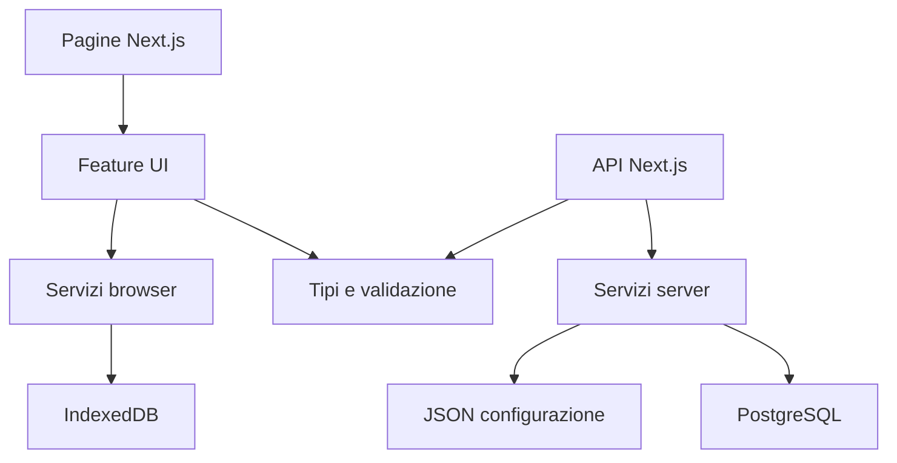

# 02 — Struttura del progetto ExpoTrack

> **Stato:** specifica tecnica della struttura del repository (v1).  
> **Documenti di riferimento:** [README principale](../README.md), [00 — Overview](00-overview.md), [01 — Architecture](01-architecture.md).  
> **Documento successivo:** [03 — App Config](03-app-config.md).

## 1. Obiettivo

Questo documento definisce **come organizzare il codice, la documentazione, i file JSON e l'infrastruttura** di ExpoTrack. È la struttura da realizzare progressivamente: l'elenco non implica che i file siano già stati creati.

ExpoTrack è una sola applicazione **Next.js + React + TypeScript**, con API integrate, UI Tailwind personalizzata, PostgreSQL sul server, IndexedDB offline e distribuzione Docker tramite Cloudflare Tunnel.

Regole fondamentali:

1. `README.md` principale nella root.
2. Specifiche tecniche modulari in `docs/`.
3. Configurazioni editoriali JSON in `config/`.
4. Codice Next.js in `src/`, separato per funzionalità.
5. Dati creati dagli utenti **mai scritti nei JSON**: IndexedDB e PostgreSQL.
6. Una sola codebase full-stack, senza backend aggiuntivo.
7. Nessun accesso diretto a PostgreSQL dal browser.
8. Nessun hardcoding delle regole specifiche di EICMA: ExpoTrack deve supportare altre fiere.

## 2. Struttura completa proposta

```text
ExpoTrack/
├── README.md
├── docs/
│   ├── 00-overview.md
│   ├── 01-architecture.md
│   ├── 02-project-structure.md
│   ├── 03-app-config.md
│   ├── 04-profiles-config.md
│   ├── 05-pavilions-config.md
│   ├── 06-categories-config.md
│   ├── 07-stands-config.md
│   ├── 08-products-config.md
│   ├── 09-interests-config.md
│   ├── 10-questionnaires-config.md
│   ├── 11-visit-statuses-config.md
│   ├── 12-database.md
│   ├── 13-backend-api.md
│   ├── 14-frontend-ui.md
│   ├── 15-dashboard.md
│   ├── 16-stand-management.md
│   ├── 17-product-management.md
│   ├── 18-questionnaire-engine.md
│   ├── 19-offline-storage.md
│   ├── 20-synchronization.md
│   ├── 21-photo-management.md
│   ├── 22-comparison.md
│   ├── 23-export.md
│   ├── 24-deployment.md
│   ├── 25-security.md
│   └── 26-testing.md
├── config/
│   ├── app.json
│   ├── profiles.json
│   ├── pavilions.json
│   ├── categories.json
│   ├── events/
│   │   └── eicma-2026-stands.json
│   ├── interests/
│   │   ├── me.json
│   │   └── father.json
│   └── questionnaires/
│       ├── me.json
│       └── father.json
├── public/
│   ├── icons/
│   └── manifest.webmanifest        # Alternativa a src/app/manifest.ts
├── src/
│   ├── app/
│   │   ├── layout.tsx
│   │   ├── page.tsx
│   │   ├── globals.css
│   │   ├── (app)/
│   │   │   ├── layout.tsx
│   │   │   ├── dashboard/page.tsx
│   │   │   ├── stands/page.tsx
│   │   │   ├── stands/[standId]/page.tsx
│   │   │   ├── products/page.tsx
│   │   │   ├── products/[productId]/page.tsx
│   │   │   └── profile/page.tsx
│   │   ├── api/v1/
│   │   │   ├── bootstrap/route.ts
│   │   │   ├── profiles/route.ts
│   │   │   ├── stands/route.ts
│   │   │   ├── products/route.ts
│   │   │   ├── sync/route.ts
│   │   │   ├── media/route.ts
│   │   │   └── exports/route.ts
│   │   └── manifest.ts            # Alternativa al manifest statico
│   ├── components/
│   │   ├── ui/
│   │   ├── layout/
│   │   ├── forms/
│   │   └── feedback/
│   ├── features/
│   │   ├── events/
│   │   ├── profiles/
│   │   ├── stands/
│   │   ├── interests/
│   │   ├── products/
│   │   ├── questionnaires/
│   │   ├── dashboard/
│   │   ├── comparison/
│   │   ├── exports/
│   │   └── media/
│   ├── lib/
│   │   ├── config/
│   │   ├── db/
│   │   ├── offline/
│   │   ├── sync/
│   │   ├── api/
│   │   ├── validation/
│   │   └── utils/
│   ├── hooks/
│   └── types/
├── tests/
│   ├── unit/
│   ├── integration/
│   ├── e2e/
│   └── fixtures/
├── scripts/
│   └── validate-config.ts
├── docker/
├── Dockerfile
├── compose.yaml
├── .dockerignore
├── .gitignore
├── .env.example
├── next.config.ts
├── tsconfig.json
├── eslint.config.mjs
├── postcss.config.mjs
├── package.json
└── <lockfile del package manager scelto>
```

I file `route.ts` mostrano **ambiti API indicativi**, non endpoint definitivi. Il prefisso `/api/v1` è una proposta da formalizzare in `13-backend-api.md`. In Next.js `(app)` è un route group che non appare nell'URL; `[standId]` e `[productId]` sono segmenti dinamici. Il manifest statico e `manifest.ts` sono alternative: implementarne una sola.

## 3. Responsabilità delle cartelle

| Cartella | Responsabilità | Non deve contenere |
|---|---|---|
| `docs/` | Specifiche, contratti e criteri di accettazione | Dati di visita |
| `config/` | JSON editoriali e iniziali | Note, foto, risposte, prodotti osservati |
| `src/app/` | Routing, pagine, layout e API Next.js | Interi motori di sincronizzazione |
| `src/components/ui/` | Componenti Tailwind generici | Query DB |
| `src/components/layout/` | Header, barra inferiore, shell | Logica di dominio |
| `src/features/` | Funzionalità e componenti specifici | Credenziali server |
| `src/lib/config/` | Loader, validazione, snapshot config | Modifiche dinamiche utenti |
| `src/lib/db/` | Accesso server-only a PostgreSQL | Import in componenti client |
| `src/lib/offline/` | IndexedDB, bozze, storage locale | Accesso a PostgreSQL |
| `src/lib/sync/` | Coda, versioni, conflitti, retry | Salvataggio di bozze non confermate |
| `src/lib/api/` | Client HTTP e contratti API | Segreti |
| `tests/` | Test automatizzati | Dati reali personali |
| `scripts/` | Validazione config e attività operative | Cancellazioni implicite |
| `docker/` | Documentazione e file infrastrutturali | Credenziali versionate |

## 4. Struttura delle feature

Ogni feature ha una responsabilità funzionale. Per esempio:

```text
src/features/products/
├── components/
│   ├── ProductForm.tsx
│   ├── ProductCard.tsx
│   └── ProductList.tsx
├── hooks/
│   └── useProducts.ts
├── domain/
│   ├── product-types.ts
│   └── product-rules.ts
├── data/
│   └── product-repository.ts
└── index.ts
```

Creare solo i file effettivamente necessari. Una feature può dipendere da tipi e servizi condivisi, ma non deve importare il database direttamente dal client.

### 4.1 Confini di dipendenza



Regole:

- `src/lib/db` deve essere **server-only**.
- `src/lib/offline` usa IndexedDB **solo nel browser**.
- I moduli di dominio e validazione condivisi non devono dipendere da `window`, React o PostgreSQL.
- Evitare dipendenze circolari e import da file `page.tsx` verso le feature.
- I Route Handlers devono essere sottili: parsing, validazione, servizio, risposta.

## 5. Organizzazione dei JSON

| File | Contenuto | Documento |
|---|---|---|
| `app.json` | Impostazioni globali ed eventi | `03-app-config.md` |
| `profiles.json` | Profili iniziali, colore, icona, abilitazione | `04-profiles-config.md` |
| `pavilions.json` | Padiglioni e identificativi | `05-pavilions-config.md` |
| `categories.json` | Gerarchia delle categorie | `06-categories-config.md` |
| `events/eicma-2026-stands.json` | Catalogo stand condiviso | `07-stands-config.md` |
| `interests/me.json` | Priorità e cose da vedere del profilo `me` | `09-interests-config.md` |
| `interests/father.json` | Priorità e cose da vedere del profilo `father` | `09-interests-config.md` |
| `questionnaires/me.json` | Questionari del profilo `me` | `10-questionnaires-config.md` |
| `questionnaires/father.json` | Questionari del profilo `father` | `10-questionnaires-config.md` |

**Non** usare un `products.json` editoriale per i prodotti registrati dagli utenti: sono dati personali dinamici. Analogamente, gli stati di visita individuali non sono configurazioni statiche. I documenti `08-products-config.md` e `11-visit-statuses-config.md` definiscono i relativi modelli e vincoli, senza imporre file JSON aggiuntivi.

### 5.1 Caricamento e validazione

Lo strato `src/lib/config/` deve:

1. leggere i file JSON;
2. validare tipi e campi obbligatori;
3. verificare ID univoci e riferimenti incrociati;
4. rilevare categorie cicliche;
5. verificare che interessi e questionari puntino a profili e categorie esistenti;
6. restituire errori con percorso del file e campo;
7. produrre uno snapshot coerente e versionato per il client offline.

Il comando proposto sarà `npm run config:validate`, implementato tramite `scripts/validate-config.ts`. La libreria di schema e il formato preciso della versione saranno decisi nei documenti `03`–`11`.

### 5.2 Versioni da distinguere

- **Versione software:** release dell'app.
- **Versione schema JSON:** compatibilità della struttura.
- **Versione contenuti evento:** catalogo, categorie, interessi e questionari.

Aggiornare un JSON **non deve cancellare o sovrascrivere** dati dinamici. La gestione di ID rimossi/rinominati richiede una strategia esplicita di migrazione.

## 6. Routing e UI

| Schermata | Percorso indicativo | Scopo |
|---|---|---|
| Ingresso | `/` | Selezione iniziale profilo o dashboard |
| Dashboard | `/dashboard` | Pagina predefinita all'apertura |
| Stand | `/stands` | Ricerca, filtri e ordinamento |
| Stand dettaglio | `/stands/[standId]` | Stato, note, foto, prodotti |
| Prodotti | `/products` | Lista generale personale |
| Prodotto dettaglio | `/products/[productId]` | Scheda e questionario |
| Profilo | `/profile` | Cambio, creazione e gestione profili |

**Da definire:** gestione dell'evento corrente e URL multi-evento. Non codificare EICMA negli URL di business.

### 6.1 Navigazione

La barra inferiore mobile è fissa e contiene **Dashboard, Stand, Prodotti, Profilo**. L'header mostra sempre nome/colore del profilo e stato sincronizzazione. I filtri non persistono alla riapertura; il profilo selezionato sì.

### 6.2 Componenti UI

Componenti generici possibili: `Button`, `Dialog`, `Card`, `TextField`, `Select`, `RatingInput`, `PhotoPicker`. Sono componenti **personalizzati Tailwind**, non shadcn o MUI. Prevedere accessibilità da tastiera, etichette e messaggi di errore. Il colore del profilo non deve essere l'unico indicatore della sua identità.

### 6.3 Client e server component

Usare `"use client"` soltanto dove necessario per interazioni, IndexedDB e API browser. Nessun modulo che usa `window` o `navigator` deve essere eseguito durante il rendering server. Le query PostgreSQL e la lettura di segreti restano sul server.

## 7. Persistenza e sincronizzazione

### 7.1 Tre livelli distinti

| Livello | Contenuto | Regola |
|---|---|---|
| Bozza IndexedDB | Modifiche autosalvate | Non sincronizzare |
| Record confermato IndexedDB | Dato dopo pulsante **Salva** | Inserire in coda |
| PostgreSQL | Dati condivisi tra dispositivi | Aggiornare tramite API/versioni |

Il commit del record confermato e l'inserimento nella coda locale devono avvenire atomicamente dove possibile. I conflitti devono conservare entrambe le versioni fino a scelta manuale.

### 7.2 Moduli offline proposti

```text
src/lib/offline/
├── database.ts
├── migrations.ts
├── repositories/
├── drafts.ts
├── pending-operations.ts
└── storage-status.ts

src/lib/sync/
├── sync-engine.ts
├── operation-queue.ts
├── conflict-store.ts
├── conflict-resolution.ts
├── retry-policy.ts
└── sync-status.ts
```

Questi nomi sono indicativi. I contratti saranno definiti in `19-offline-storage.md` e `20-synchronization.md`.

### 7.3 Fotografie

Le fotografie multiple di stand/prodotti devono essere disponibili offline dopo il salvataggio locale e sincronizzate quando possibile. Sul server usare storage persistente, non il filesystem effimero del container. La scelta fra volume locale e altre soluzioni, la compressione e i limiti saranno fissati in `21-photo-management.md`.

## 8. Convenzioni di sviluppo

| Elemento | Convenzione |
|---|---|
| Componenti React | `PascalCase.tsx` |
| Hook | `useNome.ts` |
| Moduli di servizio | `kebab-case.ts` |
| Variabili/funzioni | `camelCase` |
| Tipi/interfacce | `PascalCase` |
| JSON e cartelle editoriali | nomi stabili in kebab-case |
| Codice e campi JSON | inglese |
| Documentazione e UI v1 | italiano |
| Import interni | alias `@/` verso `src/` |
| TypeScript | modalità `strict` |
| Export | nominati, salvo convenzioni Next.js |

Esempio **parziale** di alias:

```json
{
  "compilerOptions": {
    "baseUrl": ".",
    "paths": {
      "@/*": ["./src/*"]
    }
  }
}
```

Non usare `any` senza motivazione. Validare JSON e payload API a runtime: TypeScript da solo non protegge dai dati esterni.

### 8.1 Package manager e dipendenze

Il package manager non è stato ancora scelto. Gli esempi usano `npm` come convenzione, non come decisione definitiva. Mantenere un solo lockfile.

Da definire nei documenti pertinenti: ORM/query builder, validatore runtime, libreria IndexedDB, integrazione PWA, gestione immagini, PDF e framework test. Evitare dipendenze non necessarie.

## 9. Variabili d'ambiente e segreti

Usare `.env.example` con soli segnaposto. Per esempio:

```dotenv
# Esempio illustrativo, non configurazione finale
DATABASE_URL=postgresql://user:password@db:5432/expotrack
MEDIA_STORAGE_PATH=/data/media
APP_BASE_URL=https://example.invalid
```

Non versionare `.env` reali, token Cloudflare o password. Non usare `NEXT_PUBLIC_` per segreti. I JSON di configurazione pubblicabili non devono contenere credenziali.

**Sicurezza:** Cloudflare Tunnel rende raggiungibile l'app via HTTPS, ma non fornisce autenticazione. Senza Access, chi conosce il link può selezionare profili e accedere ai dati. La separazione per `profileId` è logica, non una garanzia di privacy.

## 10. Docker e distribuzione

Topologia prevista:

```text
Browser / PWA
    │ HTTPS
Cloudflare
    │ Tunnel
cloudflared
    │ rete privata Docker
Next.js (web)
    ├── PostgreSQL (db + volume persistente)
    └── Storage fotografie (volume persistente)
```

`cloudflared` potrà essere nel Compose di ExpoTrack oppure riutilizzare il tunnel già presente sul server: da decidere in `24-deployment.md`.

Requisiti di deploy:

- database non esposto pubblicamente;
- volumi persistenti per PostgreSQL e foto;
- healthcheck e log;
- migrazioni controllate;
- backup server indipendente dall'export JSON dell'utente;
- configurazione dei segreti fuori dal repository;
- strategia di aggiornamento della PWA e compatibilità IndexedDB.

## 11. Test e qualità

Organizzazione proposta:

```text
tests/
├── unit/
├── integration/
├── e2e/
└── fixtures/
```

Scenari minimi:

- profili indipendenti e stand privati;
- profilo dinamico senza questionari automatici;
- categoria prodotto immutabile dopo primo salvataggio;
- bozze non sincronizzate;
- salvataggio offline e sincronizzazione successiva;
- retry idempotenti;
- conflitti senza sovrascrittura automatica;
- JSON invalidi rifiutati con errore comprensibile;
- export solo del profilo selezionato;
- doppia conferma eliminazione profilo;
- dashboard all'apertura e filtri resettati;
- persistenza foto e DB dopo ricreazione container.

Gli strumenti e i criteri quantitativi saranno definiti in `26-testing.md`.

## 12. Workflow di implementazione per step

Per ogni funzionalità:

1. Leggere il README principale e le specifiche interessate.
2. Risolvere eventuali decisioni ancora aperte.
3. Definire schemi e tipi.
4. Creare i JSON di esempio **solo dopo** averne documentato il contratto.
5. Implementare validazione, persistenza e servizi.
6. Implementare API e UI.
7. Scrivere test sui criteri di accettazione.
8. Aggiornare la documentazione quando cambia una decisione.

Ordine consigliato:

- **Fondamenta:** Next.js, Tailwind, config, DB/API.
- **Consultazione:** profili, categorie, catalogo stand, dashboard.
- **Raccolta:** stand personali, prodotti, questionari, foto.
- **Offline:** IndexedDB, bozze, PWA, sincronizzazione e conflitti.
- **Analisi e distribuzione:** confronto desktop, export, Docker e test.

La progettazione di versioni e sincronizzazione deve iniziare insieme al modello dati, anche se l'implementazione completa arriva dopo.

## 13. Errori architetturali da evitare

| Errore | Perché è sbagliato |
|---|---|
| Salvare prodotti osservati in `config/products.json` | Mescola dati dinamici e configurazione |
| Salvare bozze solo in React state | Si perdono alla chiusura |
| Sincronizzare a ogni digitazione | Viola il salvataggio esplicito |
| Usare `localStorage` per foto | Inadeguato per file e dati strutturati |
| Mettere SQL nel frontend | Espone dettagli e credenziali |
| Trattare Tunnel come login | Chi conosce l'URL può accedere |
| Salvare foto nel container senza volume | Si perdono al redeploy |
| Applicare «ultima scrittura vince» | Può cancellare modifiche concorrenti |
| Hardcodare `eicma-2026` nella logica | Impedisce riuso su altre fiere |
| Duplicare tipi e validazioni | Introduce contratti incoerenti |
| Lasciare modificare `categoryId` via API | Rompe i questionari e i vincoli |

## 14. Decisioni tecniche demandate ai prossimi documenti

| Tema | Documento |
|---|---|
| `app.json`, versioni e multi-evento | `03-app-config.md` |
| Profili e attributi | `04-profiles-config.md` |
| Padiglioni, categorie, stand | `05`–`07` |
| Modello prodotti e stati visita | `08`, `11`, `12` |
| Interessi e questionari | `09`, `10`, `18` |
| ORM, tabelle e migrazioni | `12-database.md` |
| Endpoint, payload e idempotenza | `13-backend-api.md` |
| Design responsive e dashboard | `14`, `15` |
| IndexedDB e PWA | `19-offline-storage.md` |
| Sync, retry, conflitti e cancellazioni | `20-synchronization.md` |
| Media e quote | `21-photo-management.md` |
| Formati export e generazione PDF | `23-export.md` |
| Compose, backup e tunnel | `24-deployment.md` |
| Protezioni e Access futuro | `25-security.md` |
| Framework e criteri test | `26-testing.md` |

Non introdurre come requisito una scelta che in questa tabella risulta ancora aperta.

## 15. Criteri di accettazione

- [ ] README principale nella root; specifiche in `docs/`.
- [ ] JSON editoriali separati in `config/`.
- [ ] Nessun dato dinamico scritto nei JSON.
- [ ] Un'unica applicazione Next.js per UI e API.
- [ ] Accesso PostgreSQL solo lato server.
- [ ] IndexedDB e API browser usati solo lato client.
- [ ] Componenti UI separati da logica di dominio e persistenza.
- [ ] Schemi runtime condivisi e validazione dei riferimenti JSON.
- [ ] Bozze e coda di sincronizzazione distinti.
- [ ] Nessuna sincronizzazione prima di **Salva**.
- [ ] Foto e database persistenti oltre la vita dei container.
- [ ] Test per profili, offline, conflitti e immutabilità categoria.
- [ ] Nessun comportamento EICMA hardcoded.
- [ ] Nessuna assunzione che Cloudflare Tunnel autentichi i visitatori.
- [ ] Tutte le scelte ancora aperte rinviate alla specifica corretta.

---

## 16. Prossimo step

Il documento **[`03-app-config.md`](03-app-config.md)** definirà in dettaglio `config/app.json`: campi obbligatori/facoltativi, configurazione degli eventi, valori predefiniti, esempi, validazioni, versionamento e gestione degli errori.

**Solo dopo aver definito questo contratto creeremo `config/app.json` come esempio concreto.**
