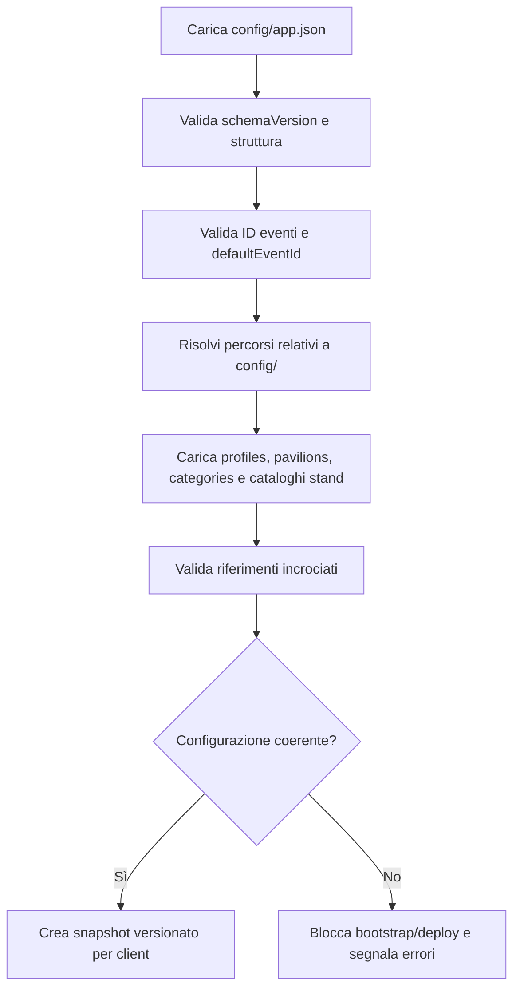

# 03 — Configurazione generale (`config/app.json`)

## Aggiornamento mobile — risposte A1–A9

**Contratto vigente per il web mobile da fiera:** [specifica UI mobile, risposte A1–A9](27_Specifiche_UI_Mobile.md#10-risposte-di-revisione-recepite). Questo aggiornamento prevale sui paragrafi, diagrammi, pseudocodice e casi di test precedenti incompatibili. In particolare, gli esempi con `drafts`, conferma finale «Salva», dettaglio mobile 08, foto stand o scelta manuale del conflitto descrivono la progettazione precedente e non vanno implementati nel mobile. Le parti compatibili e le funzioni desktop/post-fiera mantengono il proprio ambito.

Per il mobile sync sempre automatica più comando manuale, foto su Wi-Fi e rete mobile e LWW fisso: non esporre toggle di disattivazione, scelta rete o policy conflitti. Tema automatico/chiaro/scuro; cambio evento esclusivamente nelle impostazioni. Nessun limite funzionale di caratteri per la descrizione prodotto.


> **Progetto:** ExpoTrack · **Versione del contratto:** `1` · **Stato:** specifica proposta per l'implementazione v1  
> **Documenti precedenti:** [`00-overview.md`](00-overview.md), [`01-architecture.md`](01-architecture.md), [`02-project-structure.md`](02-project-structure.md)  
> **Documento successivo:** [`04-profiles-config.md`](04-profiles-config.md)

## 1. Obiettivo

`config/app.json` è il **punto di ingresso della configurazione editoriale** di ExpoTrack. Indica quale evento mostrare inizialmente, quali eventi sono disponibili e dove trovare i file JSON dedicati ai rispettivi cataloghi.

Questo file **non** contiene dati raccolti dai visitatori, password, token, fotografie o risposte ai questionari. Il suo compito è collegare i moduli della configurazione e definire poche impostazioni generali.

Il contratto presentato qui è una **proposta tecnica concreta**, compatibile con le decisioni funzionali già confermate. I campi non ancora discussi con l'utente sono contrassegnati come *proposti*; potranno essere rivisti prima di sviluppare il loader.

### 1.1 Principi invarianti

- ExpoTrack deve supportare fiere diverse da EICMA.
- Ogni file JSON ha una responsabilità distinta.
- Cataloghi e configurazioni sono condivisi; dati di visita e prodotti osservati sono personali.
- L'app parte dalla dashboard del profilo attivo.
- Il profilo selezionato è ricordato localmente, non scelto da `app.json`.
- Nessun login/PIN interno nella v1; Cloudflare Access è un possibile sviluppo futuro.
- Non aggiungere configurazioni che fingano di fornire autenticazione.
- Le modifiche editoriali non devono cancellare dati dinamici già salvati.

## 2. Posizione e ruolo

```text
ExpoTrack/
├── README.md
├── docs/
│   └── 03-app-config.md
└── config/
    ├── app.json                         ← file descritto qui
    ├── profiles.json
    ├── pavilions.json
    ├── categories.json
    ├── events/
    │   └── eicma-2026-stands.json
    ├── interests/
    │   ├── me.json
    │   └── father.json
    └── questionnaires/
        ├── me.json
        └── father.json
```

`app.json` può riferirsi ai file condivisi e al catalogo stand dell'evento. Le associazioni specifiche profilo → file interessi/questionari vengono risolte dal modulo profili e dai documenti `04`, `09` e `10`: **non duplicarle** qui.

## 3. Schema JSON proposto

### 3.1 Esempio completo valido

```json
{
  "schemaVersion": 1,
  "app": {
    "name": "ExpoTrack",
    "defaultLocale": "it-IT",
    "defaultEventId": "eicma-2026"
  },
  "configFiles": {
    "profiles": "profiles.json",
    "pavilions": "pavilions.json",
    "categories": "categories.json"
  },
  "events": [
    {
      "id": "eicma-2026",
      "name": "EICMA 2026",
      "standsFile": "events/eicma-2026-stands.json",
      "enabled": true
    }
  ]
}
```

Questo esempio è **una proposta di contratto**, non la dichiarazione che `config/app.json` esista già. Non include padiglioni, numeri stand o date inventati.

### 3.2 Tabella dei campi

| Percorso | Tipo | Obbligatorio | Regola |
|---|---|---|---|
| `schemaVersion` | intero | Sì | Deve essere `1` per il contratto qui definito |
| `app` | oggetto | Sì | Contenitore impostazioni generali |
| `app.name` | stringa | Sì | Nome non vuoto; valore consigliato `ExpoTrack` |
| `app.defaultLocale` | stringa | Sì | Per v1 supportato `it-IT` |
| `app.defaultEventId` | stringa | Sì | ID di un evento esistente e abilitato |
| `configFiles` | oggetto | Sì | Riferimenti ai JSON condivisi |
| `configFiles.profiles` | stringa | Sì | Percorso relativo a `config/` |
| `configFiles.pavilions` | stringa | Sì | Percorso relativo a `config/` |
| `configFiles.categories` | stringa | Sì | Percorso relativo a `config/` |
| `events` | array | Sì | Almeno un evento |
| `events[].id` | stringa | Sì | ID stabile, univoco, formato slug |
| `events[].name` | stringa | Sì | Etichetta leggibile, non vuota |
| `events[].standsFile` | stringa | Sì | Percorso del catalogo stand, relativo a `config/` |
| `events[].enabled` | booleano | No | Default proposto `true` |

**Politica v1 proposta:** rifiutare proprietà sconosciute nel validatore di configurazione, così gli errori di battitura non passano inosservati. Nuovi campi richiedono aggiornamento dello schema e della documentazione.

### 3.3 Campi volutamente esclusi

| Campo NON previsto | Motivo |
|---|---|
| `currentProfileId` | È una preferenza locale del dispositivo |
| `users`, `passwords`, `pins` | Nessun login/PIN interno |
| `cloudflareToken` | È un segreto infrastrutturale |
| `databaseUrl` | È una variabile d'ambiente server |
| `products`, `answers`, `notes` | Sono dati dinamici personali |
| `visitStatuses` | Sono stati personali dinamici |
| `syncQueue` | È gestita da IndexedDB |
| `mapRoute`, `itinerary` | L'app non gestisce percorsi |
| `globalQuestionnaire` | Non esistono questionari comuni |
| `sharedStandPriority` | Le priorità sono personali |

Non introdurre un campo solo per replicare una decisione già codificata nelle regole di dominio (ad esempio rendere modificabile la categoria di un prodotto).

## 4. Identificativi degli eventi

### 4.1 Formato

Per `events[].id` usare uno **slug stabile**:

- caratteri ammessi: `a-z`, `0-9` e trattino `-`;
- deve iniziare e terminare con lettera o cifra;
- nessuno spazio, accento o maiuscola;
- massimo consigliato: 64 caratteri.

Regex proposta:

```regex
^[a-z0-9](?:[a-z0-9-]{0,62}[a-z0-9])?$
```

Esempi validi: `eicma-2026`, `fiera-artigianato-2027`. Esempi non validi: `EICMA 2026`, `../secrets`, `fiera_2027`.

### 4.2 Stabilità

Una volta che un evento ha dati dinamici, il suo `id` non va cambiato. Se cambia il nome visualizzato, aggiornare `name`, **non** `id`.

Il `eventId` dovrà essere associato a stand personali, prodotti, stati visita e risposte per impedire mescolanze tra fiere.

### 4.3 Eventi abilitati

`enabled: false` significa che l'evento non deve essere proposto per nuove consultazioni nell'interfaccia. **Non significa cancellare i dati dell'evento**.

Il comportamento esatto per dati locali di un evento disabilitato e per utenti che lo hanno già aperto è una decisione da formalizzare nei moduli eventi, database e sincronizzazione. Non eliminare record automaticamente.

## 5. Multi-evento: comportamento previsto

### 5.1 Versione iniziale

Con un solo evento abilitato, ExpoTrack lo carica automaticamente e mostra la dashboard del profilo selezionato. Non è necessario un selettore di evento.

### 5.2 Eventi futuri

Il contratto supporta più elementi in `events`, per esempio:

```json
{
  "schemaVersion": 1,
  "app": {
    "name": "ExpoTrack",
    "defaultLocale": "it-IT",
    "defaultEventId": "eicma-2026"
  },
  "configFiles": {
    "profiles": "profiles.json",
    "pavilions": "pavilions.json",
    "categories": "categories.json"
  },
  "events": [
    {
      "id": "eicma-2026",
      "name": "EICMA 2026",
      "standsFile": "events/eicma-2026-stands.json",
      "enabled": true
    },
    {
      "id": "altra-fiera-2027",
      "name": "Altra fiera 2027",
      "standsFile": "events/altra-fiera-2027-stands.json",
      "enabled": true
    }
  ]
}
```

Il secondo evento è **solo un esempio fittizio di sintassi**; il file indicato dovrebbe esistere prima del deploy.

**Decisione di UI ancora aperta:** come l'utente sceglierà tra più eventi abilitati (selettore nella sezione Profilo, header o pagina dedicata). `app.defaultEventId` è solo il valore iniziale di fallback e **non** impone automaticamente una UI.

### 5.3 Ambito di padiglioni e categorie

Nella struttura attuale, `pavilions.json` e `categories.json` sono condivisi a livello di applicazione. Questo è coerente con l'evento pilota, ma per più fiere potrebbe servire:

- catalogo padiglioni per evento;
- categorie condivise tra eventi oppure specializzate per evento.

**Da decidere prima di aggiungere un secondo evento reale.** Non duplicare in `app.json` riferimenti per evento finché non è definito il contratto di `05-pavilions-config.md` e `06-categories-config.md`.

## 6. Percorsi dei file: sicurezza e portabilità

Tutti i percorsi sono relativi alla directory `config/`, **non** alla root del repository e **non** a un URL pubblico.

Validazione obbligatoria:

1. vietare percorsi assoluti (`/etc/...`, `C:\...`);
2. vietare `..` e traversal, anche dopo normalizzazione;
3. usare separatori `/` nei JSON;
4. accettare solo file `.json`;
5. risolvere e verificare il percorso reale dentro `config/` (considerando anche eventuali symlink);
6. richiedere l'esistenza del file;
7. leggere i file soltanto sul server o durante la build, mai tramite un endpoint arbitrario che accetta percorsi forniti dall'utente.

**Esempio valido:** `events/eicma-2026-stands.json`.

**Esempio vietato:** `../../.env`.

I file JSON di configurazione possono essere esposti al client **solo come snapshot validato e filtrato** tramite API; non è necessario pubblicare la cartella `config/` come directory statica.

## 7. Caricamento e inizializzazione

### 7.1 Flusso del server



### 7.2 Snapshot di bootstrap

L'API di bootstrap dovrebbe fornire al client:

- dati dell'app non sensibili;
- elenco degli eventi abilitati;
- ID dell'evento iniziale;
- configurazione valida necessaria all'evento selezionato;
- identificativo di versione dello snapshot.

**Non** includere segreti, variabili server o dati personali di altri profili per il solo fatto che sono presenti nei file locali.

La forma definitiva della risposta API sarà definita in `13-backend-api.md`.

### 7.3 Comportamento offline

Dopo il primo caricamento online, lo snapshot necessario deve essere conservato in IndexedDB per consultazione offline.

- **Con cache valida:** usare la configurazione locale e aggiornare quando possibile.
- **Senza cache e senza rete:** mostrare un errore esplicito; non simulare un catalogo vuoto.
- **Nuova configurazione disponibile:** validare lo snapshot e sostituirlo in modo atomico, preservando dati e bozze personali.
- **Snapshot incompatibile:** non cancellare la cache precedente prima di avere una strategia di migrazione.

Non usare il file `app.json` come luogo in cui salvare la selezione del profilo o lo stato corrente della connessione.

## 8. Versionamento della configurazione

### 8.1 `schemaVersion`

`schemaVersion` è la versione della **struttura di `app.json`**, non dell'evento e non della release Next.js.

- `1`: schema definito in questo documento.
- Versione mancante: errore.
- Versione non supportata: errore esplicito.
- Evoluzioni incompatibili: introdurre un nuovo valore e documentare la migrazione.

### 8.2 Versione dei contenuti

È consigliato calcolare **lato server** un hash deterministico dello snapshot editoriale completo, comprendendo i file referenziati. Questo hash non deve essere scritto manualmente in `app.json`.

L'hash può consentire al client di capire se deve aggiornare la cache. I dettagli di hashing, canonicalizzazione, migrazione e compatibilità restano di competenza di `19-offline-storage.md` e `20-synchronization.md`.

### 8.3 Aggiornamenti senza perdita dati

Un cambio editoriale può modificare nome di uno stand o aggiungere domande, ma non deve cancellare prodotti, note o risposte esistenti.

Rimuovere un ID già usato richiede una migrazione o una politica di compatibilità esplicita. Non eliminare silenziosamente dati dinamici riferiti a vecchi ID.

## 9. Validazione: regole esatte

### 9.1 Validazioni strutturali

| Regola | Esito in caso di violazione |
|---|---|
| Root è un oggetto JSON | Errore |
| `schemaVersion === 1` | Errore |
| `app` e `configFiles` sono oggetti | Errore |
| `events` è array non vuoto | Errore |
| `app.name` e `app.defaultLocale` non vuoti | Errore |
| `app.defaultLocale === "it-IT"` per v1 | Errore |
| `app.defaultEventId` non vuoto | Errore |
| Ogni evento ha ID, nome, standsFile validi | Errore |
| Gli ID evento sono univoci | Errore |
| `defaultEventId` punta a evento abilitato | Errore |
| Tutti i percorsi sono sicuri ed esistono | Errore |
| Proprietà sconosciute (politica proposta) | Errore |

### 9.2 Validazioni incrociate

Il validatore generale dovrà inoltre verificare:

- gli ID profilo iniziali sono univoci;
- categorie e sottocategorie non hanno cicli;
- gli stand referenziano categorie e padiglioni esistenti;
- gli interessi referenziano profili e stand validi;
- i questionari referenziano profili e categorie validi.

**Attenzione:** i contratti dettagliati di questi file sono definiti nei README `04`–`10`. `03-app-config.md` definisce **quando e perché** effettuare la validazione incrociata, non sostituisce tali schemi.

### 9.3 Errori leggibili

Un errore deve riportare almeno:

- percorso del file;
- percorso JSON del campo;
- codice e messaggio comprensibile.

Esempio:

```text
CONFIG_INVALID_REFERENCE
File: config/app.json
Campo: $.app.defaultEventId
Valore: "evento-sconosciuto"
Problema: nessun evento abilitato con questo ID.
```

Esempio:

```text
CONFIG_UNSAFE_PATH
File: config/app.json
Campo: $.events[0].standsFile
Problema: il percorso esce dalla cartella config/.
```

Il deploy non deve proseguire con configurazioni incoerenti. Un server già in esecuzione deve mantenere l'ultimo snapshot valido finché il nuovo non è stato validato completamente, ove tecnicamente possibile.

## 10. Gestione delle impostazioni: cosa è configurabile e cosa no

### 10.1 In `app.json`

- nome visualizzato dell'app;
- lingua predefinita supportata;
- elenco eventi e evento iniziale;
- riferimenti ai file editoriali condivisi.

### 10.2 In altri JSON

- profili, nomi, colori, icone e budget: `profiles.json`;
- padiglioni: `pavilions.json`;
- categorie: `categories.json`;
- stand: file per evento;
- priorità e cose da vedere: file interessi per profilo;
- domande e tipi di risposta: file questionari per profilo.

### 10.3 Nel database/IndexedDB

- profili creati nell'app;
- profilo selezionato sul dispositivo;
- stati visita, note e fotografie;
- prodotti osservati, voti e preferiti;
- risposte ai questionari;
- bozze e coda di sincronizzazione;
- conflitti e risoluzioni.

### 10.4 Nell'ambiente server

- credenziali PostgreSQL;
- token e configurazione Cloudflare Tunnel;
- percorsi fisici e credenziali dello storage media;
- segreti, log e configurazioni operative.

## 11. Implementazione consigliata del loader

### 11.1 File proposti

```text
src/lib/config/
├── app-schema.ts
├── app-loader.server.ts
├── paths.server.ts
├── validate-references.server.ts
├── snapshot.server.ts
└── config-types.ts

scripts/
└── validate-config.ts

tests/
├── unit/config/
└── fixtures/config/
```

Il suffisso `.server.ts` è una convenzione organizzativa; applicare anche un controllo `server-only` dove opportuno per impedire import accidentali nel client.

### 11.2 Tipi TypeScript di riferimento

```ts
export interface AppConfig {
  schemaVersion: 1;
  app: {
    name: string;
    defaultLocale: "it-IT";
    defaultEventId: string;
  };
  configFiles: {
    profiles: string;
    pavilions: string;
    categories: string;
  };
  events: Array<{
    id: string;
    name: string;
    standsFile: string;
    enabled?: boolean;
  }>;
}
```

**Importante:** questo tipo è un contratto statico, non sostituisce la validazione runtime. Il loader deve normalizzare `enabled` al valore predefinito proposto `true`, in modo che il resto dell'app non debba gestire `undefined`.

### 11.3 Pseudocodice

```ts
// Pseudocodice, non implementazione pronta
function loadAppConfiguration() {
  const appConfig = parseAndValidateAppJson("config/app.json");
  const normalized = applyDocumentedDefaults(appConfig);
  validateUniqueEventIds(normalized.events);
  validateDefaultEvent(normalized);
  const referencedFiles = resolveAndValidatePaths(normalized);
  const catalogs = loadAndValidateReferencedJson(referencedFiles);
  validateCrossReferences(normalized, catalogs);
  return createVersionedSnapshot(normalized, catalogs);
}
```

Non introdurre fallback nascosti: in caso di JSON invalido, l'errore deve essere visibile.

### 11.4 Comandi consigliati

```bash
npm run config:validate
npm run dev
npm run build
```

`config:validate` è uno script **da implementare**, non già disponibile. Il package manager resta da scegliere.

## 12. Test da prevedere

| ID | Scenario | Risultato atteso |
|---|---|---|
| APP-001 | Esempio completo del §3 | Configurazione valida |
| APP-002 | `schemaVersion` assente | Errore |
| APP-003 | `schemaVersion: 99` | Versione non supportata |
| APP-004 | `events: []` | Errore |
| APP-005 | Due eventi con stesso ID | Errore |
| APP-006 | `defaultEventId` inesistente | Errore |
| APP-007 | Evento predefinito disabilitato | Errore |
| APP-008 | Percorso `../../.env` | Errore percorso non sicuro |
| APP-009 | Percorso JSON inesistente | Errore con nome file |
| APP-010 | `enabled` omesso | Normalizzato a `true` |
| APP-011 | Proprietà sconosciuta | Errore (politica proposta) |
| APP-012 | Nuovo snapshot valido | Cache aggiornata senza perdere dati personali |
| APP-013 | Nuovo snapshot invalido | Non sostituire quello valido |
| APP-014 | Primo avvio senza rete/cache | Errore chiaro, non elenco vuoto |
| APP-015 | Evento diverso da EICMA | Nessuna regola applicativa dipendente dal nome EICMA |
| APP-016 | Cambio nome evento, ID invariato | Associazioni dinamiche preservate |
| APP-017 | ID evento modificato con dati preesistenti | Richiede migrazione; niente cancellazione automatica |

## 13. Decisioni ancora da formalizzare

Questo documento **propone**, ma non considera già approvati dall'utente:

1. il nome esatto dei campi `schemaVersion`, `configFiles`, `defaultEventId` e `standsFile`;
2. `enabled: true` come default per un evento;
3. politica di rifiuto dei campi sconosciuti;
4. slug e limite di lunghezza per gli ID;
5. snapshot versionato tramite hash server-side;
6. modalità di scelta evento quando ne sono disponibili più di uno;
7. se categorie e padiglioni debbano diventare specifici per evento in futuro.

Sono decisioni tecniche ragionevoli per una v1 semplice, ma **vanno confermate prima di considerare lo schema definitivo**.

## 14. Criteri di accettazione del modulo

- [ ] Esiste un solo `config/app.json` come entry point editoriale.
- [ ] Il JSON non contiene dati personali dinamici né segreti.
- [ ] È possibile definire più eventi senza modificare la logica di business.
- [ ] L'evento predefinito esiste ed è abilitato.
- [ ] I file referenziati esistono e restano sotto `config/`.
- [ ] La validazione rileva ID duplicati e riferimenti non validi.
- [ ] Il loader rifiuta configurazioni non supportate o malformate.
- [ ] La configurazione valida viene distribuita come snapshot coerente.
- [ ] Il client può conservarla offline.
- [ ] L'aggiornamento editoriale non elimina dati personali.
- [ ] L'app apre la dashboard del profilo attivo.
- [ ] Nessuna funzionalità presume che Cloudflare Tunnel autentichi gli utenti.

---

## 15. Prossimo documento

**[`04-profiles-config.md`](04-profiles-config.md)** descriverà `config/profiles.json`: identificativi stabili, nome, colore, icona, stato di abilitazione, budget per categoria/sottocategoria, distinzione tra profili configurati e creati nell'app, regole di validazione e riferimenti ai questionari personali.

Dopo aver approvato questo schema, sarà possibile creare il **primo JSON di esempio reale**, `config/app.json`, senza mescolare configurazioni e dati dinamici.
