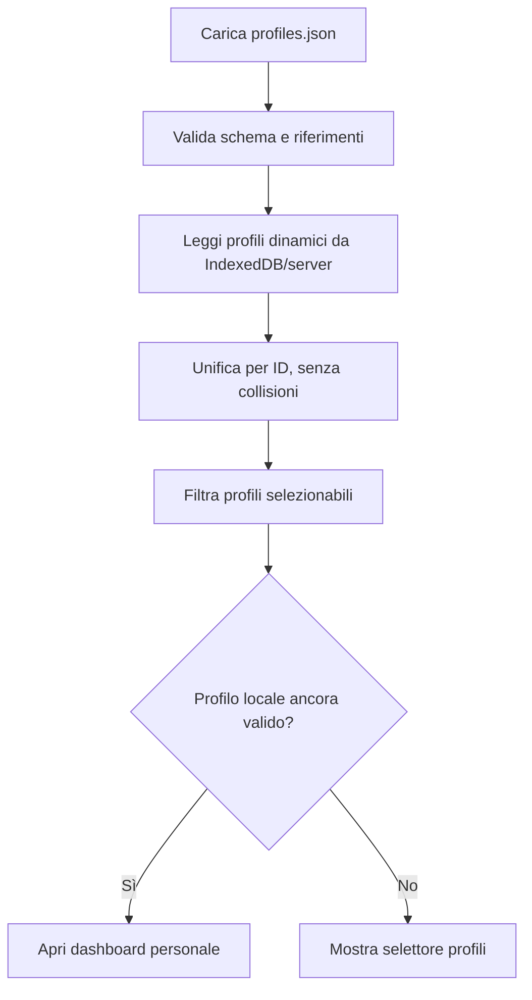

# 04 — Configurazione dei profili (`config/profiles.json`)

## Aggiornamento mobile — risposte A1–A9

**Contratto vigente per il web mobile da fiera:** [specifica UI mobile, risposte A1–A9](27_Specifiche_UI_Mobile.md#10-risposte-di-revisione-recepite). Questo aggiornamento prevale sui paragrafi, diagrammi, pseudocodice e casi di test precedenti incompatibili. In particolare, gli esempi con `drafts`, conferma finale «Salva», dettaglio mobile 08, foto stand o scelta manuale del conflitto descrivono la progettazione precedente e non vanno implementati nel mobile. Le parti compatibili e le funzioni desktop/post-fiera mantengono il proprio ambito.

Nome, colore e avatar dei profili JSON sono in sola lettura; profili personali modificabili per nome/colore con icona utente standard. Eliminare selettore icone, descrizione profilo e reset personalizzazioni. Cambio profilo immediato dopo commit locale. Budget per categoria disponibili a entrambi i tipi di profilo con override persistenti e sincronizzati, non solo come estensione futura.


> **Progetto:** ExpoTrack · **Contratto proposto:** versione `1` · **Stato:** specifica tecnica per la v1  
> **Documenti di riferimento:** [`00-overview.md`](00-overview.md), [`01-architecture.md`](01-architecture.md), [`02-project-structure.md`](02-project-structure.md), [`03-app-config.md`](03-app-config.md)  
> **Documento successivo:** [`05-pavilions-config.md`](05-pavilions-config.md)

---

## 1. Scopo

`config/profiles.json` definisce **i profili iniziali configurati dall'amministratore**. Per ciascuno specifica identità visuale, disponibilità nell'app e, facoltativamente, budget di riferimento per categoria o sottocategoria.

ExpoTrack distingue rigorosamente due origini:

- **Profilo configurato (`configured`)**: definito in questo JSON, gestito modificando il file e ridistribuendo la configurazione.
- **Profilo dinamico (`dynamic`)**: creato dall'interfaccia, persistito in IndexedDB/PostgreSQL, senza necessità di modificare il JSON.

I profili **non sono account autenticati**. Selezionare un profilo serve a lavorare sui suoi dati, non a dimostrare l'identità di chi lo utilizza.

### 1.1 Decisioni funzionali già confermate

1. Profili iniziali `me` e `father`, con ID stabili.
2. Ogni profilo possiede nome, colore, icona e flag `enabled`.
3. Un profilo disabilitato è nascosto dal selettore, **senza cancellarne i dati**.
4. Budget facoltativi per **categoria e sottocategoria**, non un budget totale.
5. L'utente può creare nuovi profili dall'app.
6. Un profilo creato dall'app parte senza interessi o questionari predefiniti, ma vede il catalogo stand comune.
7. Un profilo dinamico può impostare proprie preferenze e registrare stand/prodotti.
8. Questionari **soltanto** se definiti in JSON per quello specifico profilo e categoria/sottocategoria.
9. I dati personali (prodotti, note, fotografie, risposte, preferiti, stati di visita) sono separati per profilo.
10. La selezione viene ricordata sul dispositivo; all'apertura si mostra la dashboard personale.
11. Nome e colore del profilo attivo sono sempre visibili nell'header.
12. Cambio profilo dalla sezione **Profilo**.
13. Nessun login/PIN interno; Cloudflare Access è un possibile sviluppo futuro.
14. L'eliminazione di un profilo **dinamico** richiede doppia conferma.

### 1.2 Cosa non fa questo file

Non memorizza il profilo attualmente selezionato, i dati della visita, le risposte, gli stand creati manualmente, i prodotti osservati o le credenziali. Non definisce neppure direttamente le domande dei questionari o le priorità dei singoli stand: queste hanno file separati.

---

## 2. Posizione nella struttura

```text
ExpoTrack/
├── README.md
├── docs/
│   ├── 04-profiles-config.md
│   ├── 09-interests-config.md
│   └── 10-questionnaires-config.md
└── config/
    ├── app.json
    ├── profiles.json               ← questo documento
    ├── categories.json
    ├── interests/
    │   ├── me.json
    │   └── father.json
    └── questionnaires/
        ├── me.json
        └── father.json
```

`app.json` individua il file profili tramite `configFiles.profiles`, come previsto da [`03-app-config.md`](03-app-config.md). I file degli interessi e dei questionari sono indipendenti e collegati attraverso l'**ID stabile del profilo**, non tramite il nome visualizzato.

---

## 3. Contratto JSON proposto

### 3.1 Esempio completo

```json
{
  "schemaVersion": 1,
  "profiles": [
    {
      "id": "me",
      "name": "Io",
      "color": "#C62828",
      "icon": "user-round",
      "enabled": true,
      "budgets": [
        {
          "categoryId": "helmets",
          "amount": 350,
          "currency": "EUR"
        },
        {
          "categoryId": "motorcycle-gloves",
          "amount": 150,
          "currency": "EUR"
        }
      ]
    },
    {
      "id": "father",
      "name": "Papà",
      "color": "#1565C0",
      "icon": "user-round",
      "enabled": true,
      "budgets": []
    }
  ]
}
```

**Attenzione agli esempi:** nomi visualizzati, colori, icone, categorie e importi sono **illustrativi**, non preferenze o spese confermate. Gli ID `helmets` e `motorcycle-gloves` sono segnaposto: per un JSON effettivamente valido devono essere presenti in `config/categories.json`. Se non si conoscono ancora gli ID, usare `budgets: []` o omettere il campo. Il contratto sarà finalizzato insieme a quello delle categorie.

### 3.2 Esempio minimo senza budget

```json
{
  "schemaVersion": 1,
  "profiles": [
    {
      "id": "me",
      "name": "Io",
      "color": "#C62828",
      "icon": "user-round",
      "enabled": true
    },
    {
      "id": "father",
      "name": "Papà",
      "color": "#1565C0",
      "icon": "user-round",
      "enabled": true
    }
  ]
}
```

Questa versione non richiede che esistano categorie specifiche ed è adatta alla **prima implementazione del loader**.

### 3.3 Tabella dei campi

| Campo | Tipo | Obbligatorio | Regola |
|---|---|---|---|
| `schemaVersion` | intero | Sì | Deve valere `1` per questo contratto |
| `profiles` | array | Sì | Elenco dei profili configurati, senza ID duplicati |
| `profiles[].id` | stringa | Sì | ID stabile, unico globalmente tra profili configurati e dinamici |
| `profiles[].name` | stringa | Sì | Nome visualizzato, non vuoto |
| `profiles[].color` | stringa | Sì | Colore CSS in formato esadecimale `#RRGGBB` |
| `profiles[].icon` | stringa | Sì | Identificativo icona supportata dall'interfaccia |
| `profiles[].enabled` | booleano | Sì | `true` visibile nel selettore; `false` nascosto |
| `profiles[].budgets` | array | No | Elenco facoltativo, default `[]` |
| `profiles[].budgets[].categoryId` | stringa | Sì, se presente | Categoria o sottocategoria esistente |
| `profiles[].budgets[].amount` | numero | Sì, se presente | Importo maggiore o uguale a zero, precisione monetaria |
| `profiles[].budgets[].currency` | stringa | Sì, se presente | `EUR` per la v1 proposta |

**Scelte tecniche proposte, da confermare:** colore esadecimale, convenzione degli identificativi icona, valuta `EUR` e politica dei campi sconosciuti. Le decisioni già confermate riguardano la presenza di colore/icona e budget per categoria, non i nomi esatti dei campi.

### 3.4 Perché un array `budgets`

Un array consente di associare un budget a una categoria o sottocategoria tramite `categoryId`, senza duplicare l'albero delle categorie nel profilo.

Esempio concettuale:

```json
{
  "categoryId": "helmets",
  "amount": 350,
  "currency": "EUR"
}
```

Il budget è un **riferimento per valutare prodotti osservati**, non un limite di spesa obbligatorio, né un saldo da scalare. ExpoTrack non è un carrello acquisti.

**Da decidere in `06-categories-config.md` e `17-product-management.md`:** se un prodotto in una sottocategoria senza budget proprio possa mostrare, come riferimento, il budget della categoria padre. Non assumere ereditarietà automatica finché la regola non è approvata.

---

## 4. Identificativi e stabilità

### 4.1 ID tecnici

L'ID del profilo è una chiave di collegamento usata in:

- prodotti e stand personali;
- preferenze e stati di visita;
- note, fotografie e risposte;
- bozze IndexedDB;
- coda di sincronizzazione;
- export personali;
- file di interessi e questionari.

**Non cambiare l'ID** di un profilo dopo aver iniziato a usarlo. È possibile cambiare il nome visualizzato mantenendo lo stesso ID.

### 4.2 Formato proposto

Usare ID slug, ad esempio `me`, `father`, `friend-luca`, con lettere minuscole, numeri e trattini. Per i profili dinamici l'app deve generare ID stabili **globalmente univoci**, per esempio con un prefisso `usr-` e un UUID/ULID, senza usare il nome come chiave.

**Regola fondamentale:** un ID dinamico non deve poter collidere con un ID presente in `profiles.json`. La creazione offline deve evitare collisioni anche tra dispositivi.

### 4.3 Nomi e colori

- Il nome serve per riconoscere rapidamente il profilo.
- Il colore è un aiuto visivo, ma l'header deve sempre mostrare anche il nome.
- Due profili possono avere nomi simili; l'ID deve comunque essere diverso.
- Il nome visualizzato non deve essere usato per risolvere file JSON, riferimenti o permessi.
- Il colore deve essere leggibile anche in tema chiaro/scuro, secondo le regole UI da definire in `14-frontend-ui.md`.

### 4.4 Icone

La proprietà `icon` è un identificativo di icona dell'app, **non** un URL esterno e non un frammento HTML/SVG arbitrario. Per la v1 si propone un set controllato di nomi supportati.

Se un'icona non è disponibile, il validatore deve segnalarlo oppure applicare un fallback documentato; **non** eseguire contenuto arbitrario proveniente dal JSON.

---

## 5. Profili configurati e profili creati dall'app

### 5.1 Differenze operative

| Aspetto | Profilo configurato | Profilo dinamico |
|---|---|---|
| Origine | `config/profiles.json` | Interfaccia ExpoTrack |
| Persistenza definizione | Repository/configurazione | IndexedDB + PostgreSQL |
| Catalogo stand comune | Sì | Sì |
| Interessi iniziali JSON | Possibili | Nessuno per impostazione iniziale |
| Questionari | Solo se esiste JSON dedicato | Solo se successivamente esiste JSON dedicato |
| Note, prodotti, foto, visite | Personali | Personali |
| Modifica nome/colore | Via JSON | Dall'app |
| Abilitazione/disabilitazione | Via JSON | Gestione dinamica da specificare |
| Eliminazione dall'app | No | Sì, con doppia conferma |
| ID | Stabile definito nel file | Generato dall'app, stabile |
| Login/PIN | No | No |

### 5.2 Creazione di un profilo dinamico

Flusso proposto:

1. L'utente apre **Profilo**.
2. Seleziona **Aggiungi profilo**.
3. Inserisce un nome e, se desiderato, sceglie colore e icona.
4. L'app genera un ID tecnico stabile.
5. L'utente conferma con **Salva**.
6. Il profilo viene salvato localmente e messo in coda di sincronizzazione.
7. Il nuovo profilo compare nel selettore.
8. Quando selezionato, mostra la dashboard personale e il catalogo condiviso.

Non vengono creati automaticamente file JSON, questionari, priorità o prodotti.

### 5.3 Profili dinamici e questionari

La regola è tassativa: **nessun questionario generico o comune**.

Il motore cerca una definizione esplicita riferita a:

- ID del profilo attivo;
- categoria/sottocategoria del prodotto.

Se non esiste, **la sezione questionario non compare**.

Un nuovo profilo dinamico può utilizzare questionari **solo dopo** che l'amministratore abbia predisposto un file JSON riferito al suo ID, secondo il contratto di `10-questionnaires-config.md`.

Non copiare automaticamente le domande di `me` o `father` nel nuovo profilo.

### 5.4 Interessi iniziali e preferenze successive

Gli interessi iniziali di un profilo configurato provengono da file separati (`config/interests/<profileId>.json` come convenzione proposta).

Le modifiche effettuate nell'app sono dati dinamici. **Non riscrivere** il JSON di interessi quando l'utente cambia una priorità o un elemento «da vedere».

Per un profilo dinamico gli interessi partono vuoti e possono essere aggiunti dall'interfaccia.

**Decisione di dettaglio da definire in `09-interests-config.md`:** precedenza tra valore iniziale JSON e valore personale salvato quando l'amministratore aggiorna il JSON dopo la visita.

---

## 6. Budget per categoria e sottocategoria

### 6.1 Significato

Un budget rappresenta un **prezzo di riferimento personale**. Per esempio, quando si registra un casco con un prezzo, l'interfaccia può mostrare la differenza rispetto al budget della relativa categoria.

Non esiste un budget complessivo della fiera e non è necessario sommare i prezzi dei prodotti osservati: osservare un prodotto non significa acquistarlo.

### 6.2 Regole di validazione

- `categoryId` deve esistere in `config/categories.json`.
- Un profilo non può definire due budget per lo stesso `categoryId`.
- L'importo deve essere un numero finito e non negativo.
- Per la v1 proposta, gli importi sono in euro e hanno al massimo due cifre decimali.
- I budget non modificano i prezzi dei prodotti.
- L'assenza di budget è valida e non produce errori nell'interfaccia.

**Nota tecnica:** nei calcoli monetari convertire gli importi in centesimi interi o utilizzare un tipo decimale adeguato; evitare confronti con errori di floating point.

### 6.3 Categorie annidate

Le categorie possono avere una gerarchia a più livelli. Ogni budget punta a un **singolo nodo** tramite ID.

Esempio illustrativo:

```text
Abbigliamento
└── Caschi
    ├── Integrali
    └── Modulari
```

Se esistono budget su «Caschi» e «Integrali», la scelta di quale visualizzare per un casco integrale dipende da una regola di priorità **ancora da specificare**. Proposta ragionevole: budget più specifico, con eventuale fallback al padre, ma **non considerarla approvata**.

### 6.4 Budget nell’uso mobile in fiera

Budget disponibili per profili JSON e personali in Profilo → Budget per categoria (11a), senza imporli durante la creazione del profilo. Override per `(profileId, categoryId)`, condivisi tra eventi come nel contratto attuale. Importo non negativo, valuta esplicita, euro con massimo due decimali; nessun budget totale o somma come spesa.

Salvataggio automatico locale e sync. Modifica di un seed JSON tramite override, non scrittura del file. Rimuovere override ripristina il seed; per escluderlo usare un override esplicito «Nessun budget». Default mobile: matching esatto categoria, nessuna eredità automatica dal padre. In 05 mostrare budget e differenza rispetto al prezzo quando disponibili. Nessun mockup dedicato necessario per includere la funzione.

## 7. Selezione e cambio profilo

### 7.1 Primo avvio

1. L'app carica il catalogo e l'elenco unificato dei profili disponibili.
2. Se il dispositivo non ha ancora un profilo selezionato, mostra il selettore.
3. L'utente sceglie un profilo.
4. L'app ricorda localmente l'ID selezionato.
5. Si apre la **dashboard** di quel profilo.

La scelta non richiede password o PIN.

### 7.2 Aperture successive

Se l'ID selezionato è ancora valido e disponibile, viene riutilizzato automaticamente e l'app apre la dashboard. **Non** ripristinare filtri e ordinamenti delle liste dalla sessione precedente.

Se il profilo è stato disabilitato o eliminato, chiedere di sceglierne un altro; **non** mostrare automaticamente i dati di un profilo diverso sotto il vecchio nome.

### 7.3 Cambio profilo

Dalla sezione Profilo:

1. selezionare il nuovo profilo;
2. se esistono bozze non confermate, avvertire l'utente e conservarle;
3. cambiare contesto attivo;
4. mostrare la dashboard del nuovo profilo;
5. aggiornare nome e colore nell'intestazione.

Le bozze, le code pendenti e i conflitti rimangono associati al **profilo di origine**.

### 7.4 Dispositivo condiviso

Senza login, chi usa lo stesso telefono può selezionare qualsiasi profilo abilitato. La separazione evita errori e mescolanze involontarie, ma **non costituisce protezione dei dati**.

---

## 8. Profili disabilitati

### 8.1 `enabled: false`

Per un profilo configurato:

```json
{
  "id": "father",
  "name": "Papà",
  "color": "#1565C0",
  "icon": "user-round",
  "enabled": false
}
```

Effetti richiesti:

- il profilo non compare tra quelli selezionabili per una nuova sessione;
- dati e fotografie restano conservati;
- gli altri profili non acquisiscono i suoi dati;
- la riabilitazione con lo **stesso ID** deve consentire di ritrovare i dati precedenti.

**Non eliminare** righe database, media o code di sincronizzazione quando un profilo viene disabilitato.

### 8.2 Modifiche al JSON

- Cambiare `name`, `color`, `icon`: aggiorna la presentazione, non i dati.
- Cambiare `enabled`: cambia la selezionabilità, non la proprietà dei record.
- Rimuovere un profilo dal JSON: **operazione potenzialmente incompatibile**, diversa da `enabled: false`.
- Cambiare `id`: **operazione non sicura** senza migrazione esplicita.

Se l'amministratore vuole nascondere temporaneamente un profilo, deve usare `enabled: false`, non cancellarlo dal file.

---

## 9. Eliminazione dei profili dinamici

### 9.1 Conferma

L'eliminazione dall'app riguarda **solo i profili dinamici**. È richiesta una doppia conferma esplicita, perché la cancellazione può coinvolgere:

- preferenze e stati visita;
- stand personali;
- prodotti;
- note e risposte;
- fotografie;
- bozze e code locali;
- record sul server.

### 9.2 Gestione distribuita

L'eliminazione non deve limitarsi a nascondere il profilo nel selettore. Deve essere propagata in modo coerente ai dispositivi, considerando quelli temporaneamente offline.

**Da definire in `12-database.md` e `20-synchronization.md`:**

- uso di tombstone/versioni per eliminazioni;
- trattamento delle modifiche offline pendenti;
- conservazione temporanea per risolvere conflitti;
- pulizia definitiva dei file media;
- comportamento se un altro dispositivo è offline durante l'eliminazione.

Non promettere eliminazione istantanea da dispositivi non connessi.

### 9.3 Profili configurati

Non offrire il pulsante **Elimina** per i profili provenienti da `profiles.json`. Per nasconderli, usare `enabled: false`; per eventuali rimozioni definitive occorre una procedura amministrativa separata e documentata.

---

## 10. Validazione del JSON

### 10.1 Controlli strutturali

| ID | Controllo | Risultato se non valido |
|---|---|---|
| PRO-001 | JSON valido con root oggetto | Errore |
| PRO-002 | `schemaVersion` supportata (`1`) | Errore |
| PRO-003 | `profiles` array | Errore |
| PRO-004 | ID obbligatori e univoci | Errore |
| PRO-005 | Nome non vuoto | Errore |
| PRO-006 | Colore nel formato previsto | Errore |
| PRO-007 | Icona appartenente al set supportato | Errore |
| PRO-008 | `enabled` booleano | Errore |
| PRO-009 | `budgets` array se presente | Errore |
| PRO-010 | Nessun budget duplicato per categoria | Errore |
| PRO-011 | Importo budget valido | Errore |
| PRO-012 | Valuta supportata | Errore |
| PRO-013 | Categoria budget esistente | Errore |
| PRO-014 | Nessun ID riservato o in collisione | Errore |

**Politica proposta:** rifiutare proprietà sconosciute per individuare errori di battitura. La policy deve essere coerente con `03-app-config.md`.

### 10.2 Riferimenti incrociati

Il validatore generale deve verificare:

- ogni `categoryId` usato nei budget esiste in `categories.json`;
- ogni file di interessi/questionari per profilo configurato usa un ID valido;
- gli ID dei profili dinamici non collidono con quelli configurati;
- l'eventuale rimozione di un ID già referenziato è trattata come modifica incompatibile, non come cancellazione automatica.

**Nota:** un profilo dinamico può essere creato dopo il deploy e non è presente in `profiles.json`. Il validatore dei questionari dedicati a profili dinamici deve quindi consultare anche l'elenco dinamico o applicare una politica esplicita di risoluzione dei riferimenti. **Da formalizzare in `10-questionnaires-config.md`**; non rifiutare indiscriminatamente ogni ID non presente nel JSON iniziale.

### 10.3 Esempi di errore

```text
CONFIG_DUPLICATE_PROFILE_ID
File: config/profiles.json
Campo: $.profiles[1].id
Problema: ID "me" già utilizzato.
```

```text
CONFIG_UNKNOWN_CATEGORY
File: config/profiles.json
Campo: $.profiles[0].budgets[0].categoryId
Problema: categoria "helmets" non presente in categories.json.
```

```text
CONFIG_INVALID_COLOR
File: config/profiles.json
Campo: $.profiles[0].color
Problema: atteso colore nel formato #RRGGBB.
```

---

## 11. Implementazione TypeScript consigliata

### 11.1 Modello di configurazione

```ts
export interface ConfiguredProfile {
  id: string;
  name: string;
  color: string;
  icon: string;
  enabled: boolean;
  budgets?: Array<{
    categoryId: string;
    amount: number;
    currency: "EUR";
  }>;
}

export interface ProfilesConfig {
  schemaVersion: 1;
  profiles: ConfiguredProfile[];
}
```

**Queste interfacce non validano i dati a runtime.** Usare uno schema di validazione reale nel loader.

### 11.2 Modello applicativo unificato

```ts
export type ProfileSource = "configured" | "dynamic";

export interface AppProfile {
  id: string;
  source: ProfileSource;
  name: string;
  color: string;
  icon: string;
  enabled: boolean;
  budgets: Array<{
    categoryId: string;
    amount: number;
    currency: "EUR";
  }>;
}
```

`source` è un attributo **normalizzato del modello applicativo**, non un campo necessario dentro `profiles.json`.

### 11.3 Moduli suggeriti

```text
src/lib/config/
├── profiles-schema.ts
├── profiles-loader.server.ts
└── validate-references.server.ts

src/features/profiles/
├── components/
│   ├── ProfilePicker.tsx
│   ├── ProfileHeader.tsx
│   ├── ProfileCreateForm.tsx
│   └── ProfileDeleteDialog.tsx
├── domain/
│   ├── profile-types.ts
│   └── profile-rules.ts
├── data/
│   └── profile-repository.ts
└── hooks/
    └── useActiveProfile.ts
```

I nomi dei file sono indicativi. Le regole di persistenza e sincronizzazione saranno dettagliate nei documenti `12`, `13`, `19` e `20`.

### 11.4 Flusso di bootstrap



**Nessun merge implicito** tra un profilo dinamico e uno configurato con lo stesso ID. La collisione è un errore da risolvere.

---

## 12. Interazione con gli altri moduli

| Documento | Dipendenza |
|---|---|
| `03-app-config.md` | Percorso di `profiles.json` e bootstrap |
| `06-categories-config.md` | Esistenza delle categorie dei budget |
| `09-interests-config.md` | Priorità e cose da vedere per profilo |
| `10-questionnaires-config.md` | Domande per profilo e categoria |
| `12-database.md` | Persistenza dei profili dinamici |
| `13-backend-api.md` | Creazione, modifica, eliminazione e sincronizzazione |
| `14-frontend-ui.md` | Selettore, header, cambio profilo |
| `15-dashboard.md` | Statistiche del solo profilo attivo |
| `19-offline-storage.md` | Profilo ricordato e bozze isolate |
| `20-synchronization.md` | Operazioni offline e conflitti |
| `23-export.md` | Export limitato al profilo |
| `25-security.md` | Limiti della separazione senza autenticazione |

### 12.1 Separazione per evento

I profili sono identità utilizzabili su più fiere. I **dati di visita** devono essere separati per coppia `(profileId, eventId)`. Il nome e il colore del profilo possono restare gli stessi tra eventi.

**Da definire:** se in futuro i budget e gli interessi iniziali debbano essere specifici per evento. Nella v1, gli interessi sugli stand sono già legati al catalogo dell'evento; non associare arbitrariamente budget globali a tutti gli eventi senza una regola documentata.

---

## 13. Casi limite e comportamento atteso

| Scenario | Comportamento |
|---|---|
| Primo avvio, profili disponibili | Mostrare selettore |
| Profilo ricordato valido | Aprire dashboard personale |
| Profilo ricordato disabilitato | Richiedere nuova selezione, conservare dati |
| Profilo configurato rinominato | Usare nuovo nome, mantenere ID e dati |
| Profilo configurato rimosso dal JSON | Segnalare incompatibilità, non cancellare dati |
| Profilo dinamico creato offline | Generare ID unico, salvare localmente, sincronizzare dopo |
| Due profili con lo stesso nome | Distinguerli per ID e presentazione |
| ID dinamico uguale a ID configurato | Errore, nessuna fusione |
| Cambio profilo con bozza aperta | Avvertire e conservare la bozza originale |
| Profilo dinamico senza questionari JSON | Non mostrare sezione questionario |
| Profilo con budget assenti | Mostrare normalmente prodotti e schede |
| Categoria budget rimossa | Errore/migrazione esplicita, nessuna perdita silenziosa |
| Eliminazione profilo dinamico | Doppia conferma e gestione della sync |
| App offline con catalogo cache | Consentire selezione e uso dei profili disponibili |
| Nessun profilo selezionabile | Stato esplicito; consentire creazione profilo se possibile |

---

## 14. Test e criteri di accettazione

### 14.1 Test automatici suggeriti

- [ ] `profiles.json` minimo del §3.2 valido.
- [ ] Due ID configurati identici vengono rifiutati.
- [ ] Nome vuoto, colore invalido o icona non supportata producono errori.
- [ ] Un budget riferito a categoria inesistente viene rifiutato.
- [ ] Due budget sulla stessa categoria dello stesso profilo vengono rifiutati.
- [ ] Un profilo `enabled: false` non compare nel selettore.
- [ ] Disabilitare un profilo non elimina prodotti, note, foto o risposte.
- [ ] Rinominare un profilo non altera i riferimenti ai suoi dati.
- [ ] Un profilo dinamico può essere creato offline con ID univoco.
- [ ] Il profilo dinamico vede il catalogo condiviso e parte senza interessi.
- [ ] Il profilo dinamico senza JSON dedicato non vede questionari.
- [ ] Un profilo dinamico non eredita questionari da altri profili.
- [ ] Un cambio profilo non mescola bozze, prodotti, preferiti o foto.
- [ ] La selezione del profilo persiste sul dispositivo.
- [ ] All'apertura viene mostrata la dashboard del profilo ricordato.
- [ ] Un profilo configurato non è eliminabile dall'interfaccia.
- [ ] Un profilo dinamico richiede doppia conferma per l'eliminazione.
- [ ] Un ID duplicato tra configurazione e database non viene fuso.
- [ ] L'export include soltanto i dati del profilo selezionato.
- [ ] Le API non trattano `profileId` come prova di identità.

### 14.2 Definizione di completamento

Il modulo profili è pronto quando:

1. il loader legge e valida il JSON;
2. l'app unifica profili configurati e dinamici senza collisioni;
3. la selezione viene ricordata localmente;
4. nome e colore sono visibili nell'header;
5. ogni query e scrittura è associata al profilo corretto;
6. i profili dinamici possono essere creati;
7. l'eliminazione dinamica è coerente con la sincronizzazione;
8. la mancanza di questionari dedicati non viene compensata con domande generiche.

---

## 15. Decisioni tecniche ancora aperte

Le seguenti scelte sono **proposte, non decisioni funzionali già confermate**:

| Tema | Proposta | Da definire con |
|---|---|---|
| Formato colore | `#RRGGBB` | `14-frontend-ui.md` |
| Set di icone | Identificativi controllati | `14-frontend-ui.md` |
| Importi budget | EUR, due decimali | `06-categories-config.md`, `17-product-management.md` |
| Ereditarietà budget | Nodo più specifico, fallback padre | `06`, `17` |
| Formato ID dinamici | Prefisso `usr-` + UUID/ULID | `12-database.md` |
| Profili dinamici disabilitabili | Da valutare | `14-frontend-ui.md` |
| Questionari per profili dinamici | Risoluzione ID dedicati | `10-questionnaires-config.md` |
| Rimozione profili configurati | Migrazione amministrativa | `12-database.md` |
| Budget tra più eventi | Ambito per evento da chiarire | `03`, `06`, `12` |
| Eliminazione distribuita | Tombstone e pulizia media | `20`, `21` |

Non inventare comportamenti non concordati in fase di implementazione.

---

## 16. Prossimo step

**[`05-pavilions-config.md`](05-pavilions-config.md)** definirà `config/pavilions.json`: identificativi dei padiglioni, nomi, eventuali descrizioni, relazioni con eventi e stand, validazione e comportamento in presenza di informazioni incomplete.

**Nota operativa:** dopo l'approvazione del contratto profili si potrà creare `config/profiles.json` reale; gli esempi di budget dovranno usare solo categorie effettivamente definite in `categories.json`.
