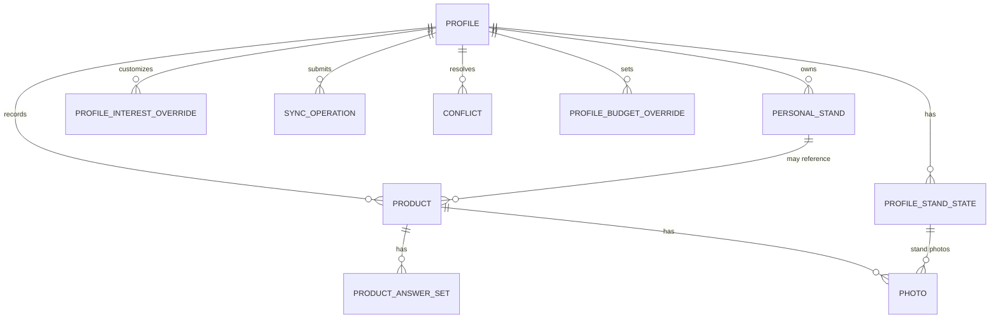

# 12 — Database PostgreSQL e persistenza locale IndexedDB

> **Progetto:** ExpoTrack · **Stato:** specifica architetturale proposta per v1 · **Documento:** `docs/12-database.md`  
> **Precedenti:** `00-overview.md` → `11-visit-statuses-config.md`  
> **Successivo:** [`13-backend-api.md`](13-backend-api.md)  
> **Ambito:** dati personali e dinamici, integrità referenziale, versioni, migrazioni, offline, sincronizzazione e storage delle foto.

---

## 1. Obiettivo

Definire un modello dati solido per ExpoTrack, una PWA privata per fiere, inizialmente EICMA 2026, utilizzata da più profili selezionabili senza login.

L'architettura combina:

1. **JSON editoriali**: definizioni condivise e versionate di eventi, profili iniziali, padiglioni, categorie, stand, interessi iniziali e questionari.
2. **PostgreSQL**: fonte persistente server-side dei record personali *confermati e sincronizzati*.
3. **IndexedDB**: copia locale offline dei cataloghi e dei record personali, bozze e coda operazioni.
4. **Storage media**: file fotografici conservati localmente e poi caricati sul server; PostgreSQL memorizza metadati e riferimenti, non i blob come impostazione predefinita.

Non creare un database SQL per duplicare automaticamente ogni file JSON editoriale: mantenere distinta la **configurazione** dai **dati raccolti**.

### 1.1 Requisiti consolidati

- Next.js/React/TypeScript; PostgreSQL; IndexedDB; Docker su server Debian/Linux; Cloudflare Tunnel.
- Offline-first: dopo bootstrap, lettura e modifica possibili senza connessione.
- Profili `me` e `father` configurati da JSON, altri creabili nell'app.
- Nessun login, PIN o autenticazione interna nella v1; selezione profilo memorizzata localmente.
- Stand editoriali condivisi; stand creati dall'app **privati del profilo**.
- Priorità personali 1–10, cose da vedere, stato stand, note e foto.
- Stato visita `to_visit` predefinito, `visited`, `revisit`.
- Prodotti personali collegati a uno stand; una sola categoria immutabile dal primo salvataggio; prezzo facoltativo, voto 1–10, preferiti, note, foto e questionari.
- Questionari definiti per profilo e categoria; domande tutte facoltative; nessun questionario di fallback.
- Bozze autosalvate localmente; **Salva** conferma e mette in coda la sync.
- Conflitti tra dispositivi sullo stesso profilo **risolti manualmente**; conservare entrambe le versioni.
- Eliminazioni esplicite con conferma, senza perdita silenziosa di dati collegati.

### 1.2 Decisioni di progetto proposte, non ancora approvate

Il presente documento propone **PostgreSQL 16+**, migrazioni SQL versionate, ID UUID per record dinamici, revisioni numeriche monotone lato server, **tombstone** per eliminazioni, **outbox locale** e **idempotency key** per ogni mutazione. Queste sono scelte tecniche raccomandate, non requisiti già decisi dall'utente.

---

## 2. Mappa delle responsabilità

| Tipo di dato | JSON | PostgreSQL | IndexedDB | File media |
|---|---:|---:|---:|---:|
| Eventi, padiglioni, categorie | Sì | No, salvo snapshot storico opzionale | Cache | No |
| Stand editoriali | Sì | No, salvo indice/cache derivata opzionale | Cache | No |
| Profili iniziali | Sì | Identità/riferimenti runtime opzionali | Cache | No |
| Profili creati nell'app | No | Sì | Sì | No |
| Interessi iniziali | Sì | Override soltanto | Cache seed + override | No |
| Questionari e domande | Sì | Snapshot storico raccomandato | Cache | No |
| Stand personali | No | Sì | Sì | No |
| Stato visita, priorità, cose da vedere, note | No | Sì | Sì | No |
| Prodotti osservati | No | Sì | Sì | No |
| Risposte ai questionari | No | Sì | Sì | No |
| Metadati fotografie | No | Sì | Sì | No |
| File fotografie | No | Riferimenti | Blob/cache offline | Sì |
| Bozze non confermate | No | **No** | Sì | Foto temporanee |
| Operazioni pendenti | No | Registro idempotenza | Sì | Upload pendenti |
| Conflitti irrisolti | No | Versioni e stato | Sì | Versioni media ove necessario |

**Nota:** non usare un JSON editoriale come contenitore dei dati di visita.

---

## 3. Identità degli oggetti e riferimenti

### 3.1 Eventi e profili

Gli ID editoriali sono stringhe stabili (`eicma-2026`, `me`, `father`). Gli ID dei profili creati nell'app devono essere univoci e non collidere con gli ID editoriali.

**Proposta:** prefisso `usr-` più UUID per profili dinamici. L'ID, non il nome visualizzato, è la chiave stabile.

### 3.2 Stand: due origini

Gli stand hanno due provenienze:

- `catalog`: record definito nel JSON dell'evento; chiave logica `(event_id, stand_id)`.
- `personal`: record creato dall'utente; ID UUID, `event_id` e `owner_profile_id`.

Per le relazioni dinamiche si raccomanda una chiave discriminata:

```text
stand_source = 'catalog' | 'personal'
stand_id     = identificativo tecnico
event_id     = evento
profile_id   = profilo proprietario del dato
```

Quando `stand_source='personal'`, il riferimento è valido solo se lo stand appartiene a `profile_id`.

**Importante:** una FK PostgreSQL non può verificare direttamente l'esistenza di uno stand in un file JSON. Questa integrità va controllata al livello applicativo, con snapshot catalogo validato, e gestita durante gli aggiornamenti editoriali.

### 3.3 Prodotti

Ogni prodotto ha un UUID generato localmente, un `profile_id`, un `event_id`, un riferimento allo stand e un `category_id` singolo.

La categoria viene **congelata al primo Salva locale**, non alla sincronizzazione server. L'API deve poi rifiutare qualsiasi tentativo di cambiarla.

### 3.4 ID e chiavi per l'offline

Gli ID devono essere generabili **senza connessione**. Non usare ID sequenziali PostgreSQL come unica identità client, perché richiederebbero rimappature al primo sync.

---

## 4. Diagramma logico delle entità



Il diagramma rappresenta le relazioni **dinamiche**; gli stand editoriali e le categorie non sono tabelle obbligatorie. Il collegamento da prodotto a stand editoriale è una **referenza logica** validata contro la configurazione.

---

## 5. Schema relazionale proposto

### 5.1 Convenzioni generali

- Nomi SQL in `snake_case`.
- Timestamp `timestamptz` in UTC; formattazione locale `it-IT` in UI.
- UUID per entità dinamiche.
- `revision bigint NOT NULL` per concorrenza ottimistica, incrementata server-side.
- `deleted_at timestamptz NULL` per tombstone dove necessario.
- `created_at`, `updated_at` per audit e ordinamento, **non** per decidere automaticamente il vincitore di un conflitto.
- Unicità e FK dove PostgreSQL può applicarle; validazione applicativa dove la referenza è a JSON.

### 5.2 Tabella `profiles`

**Proposta:** tabella di proiezione runtime dei profili, anche se alcuni sono definiti nel JSON. Serve per FK, referenze e profili dinamici.

| Colonna | Tipo | Significato |
|---|---|---|
| `id` | `text` PK | ID stabile (`me`, `father`, `usr-...`) |
| `source` | `text` | `config` o `dynamic` |
| `name` | `text` | Nome mostrato |
| `color` | `text` | Colore UI |
| `icon` | `text` | Icona |
| `enabled` | `boolean` | Disponibilità |
| `created_at` | `timestamptz` | Creazione |
| `updated_at` | `timestamptz` | Ultima modifica |
| `revision` | `bigint` | Versione |
| `deleted_at` | `timestamptz` | Solo profili dinamici eliminabili |

I profili JSON vanno **riconciliati** al bootstrap senza sovrascrivere i dati personali. Disabilitare un profilo non cancella prodotti o note. I profili configurati non possono essere eliminati dalla UI.

**Scelta aperta:** mantenere i budget dei profili JSON solo in configurazione, con override dinamici in una tabella dedicata.

### 5.3 Tabella `personal_stands`

| Colonna | Tipo | Vincoli |
|---|---|---|
| `id` | `uuid` | PK |
| `owner_profile_id` | `text` | FK `profiles.id` |
| `event_id` | `text` | Evento valido in `app.json` |
| `name` | `text` | Non vuoto |
| `description` | `text` | Facoltativo |
| `hall_id` | `text` | Facoltativo, validato per evento |
| `booth` | `text` | Facoltativo |
| `category_ids` | `jsonb` | Array di ID categoria validati |
| `created_at`, `updated_at` | `timestamptz` | Non null |
| `revision` | `bigint` | Positivo |
| `deleted_at` | `timestamptz` | Tombstone |

La scelta `category_ids jsonb` è una **semplificazione proposta**: alternativa più normalizzata è `personal_stand_categories` con una riga per categoria. Se servono query SQL frequenti per categoria, preferire la tabella ponte.

### 5.4 Tabella `profile_stand_states`

Un record di stato personale per profilo, evento e stand.

| Colonna | Tipo | Vincoli |
|---|---|---|
| `id` | `uuid` | PK tecnico |
| `profile_id` | `text` | FK profilo |
| `event_id` | `text` | Evento |
| `stand_source` | `text` | `catalog` / `personal` |
| `stand_id` | `text` | ID stand |
| `visit_status` | `text` | `to_visit`, `visited`, `revisit` |
| `notes` | `text` | Facoltative |
| `created_at`, `updated_at` | `timestamptz` | Non null |
| `revision` | `bigint` | Concorrenza |
| `deleted_at` | `timestamptz` | Eventuale reset/tombstone |

**Vincolo:** unicità `(profile_id, event_id, stand_source, stand_id)` per lo stato corrente. Non usare `NULL` per rappresentare uno stand editoriale.

Se non esiste alcuna riga, lo stato **effettivo** è `to_visit`. Una riga con `to_visit` esplicito è distinta dall'assenza, per audit e sincronizzazione.

### 5.5 Tabella `profile_interest_overrides`

Gli interessi iniziali vengono dal JSON per profilo. La tabella conserva **soltanto gli override** utente, inclusi svuotamenti espliciti.

| Colonna | Tipo | Significato |
|---|---|---|
| `id` | `uuid` PK | Identità record |
| `profile_id` | `text` | Profilo |
| `event_id` | `text` | Evento |
| `stand_source` | `text` | Origine stand |
| `stand_id` | `text` | Riferimento |
| `priority_mode` | `text` | `inherit`, `set`, `clear` |
| `priority_value` | `smallint` | 1–10 solo se `set` |
| `what_to_see_mode` | `text` | `inherit`, `replace`, `clear` |
| `what_to_see_items` | `jsonb` | Lista di stringhe, anche vuota |
| `revision` | `bigint` | Concorrenza |
| `updated_at` | `timestamptz` | Ultima modifica |
| `deleted_at` | `timestamptz` | Tombstone |

Questa modellazione **distingue chiaramente** «nessun override» da «ho cancellato volontariamente la priorità» e «ho svuotato la lista». Un aggiornamento del seed JSON non deve ripristinare un valore cancellato volontariamente.

**Attenzione:** se i documenti `09-interests-config.md` adottano una rappresentazione di override diversa, mantenere la stessa semantica e riconciliare il contratto prima di implementare.

### 5.6 Tabella `products`

| Colonna | Tipo | Vincoli |
|---|---|---|
| `id` | `uuid` | PK |
| `profile_id` | `text` | FK profilo |
| `event_id` | `text` | Evento |
| `stand_source` | `text` | `catalog`/`personal` |
| `stand_id` | `text` | Riferimento |
| `name` | `text` | Non vuoto |
| `category_id` | `text` | **Obbligatoria e immutabile** |
| `price_amount_minor` | `bigint` | Nullable, ≥0 |
| `price_currency` | `char(3)` | `EUR` se prezzo presente |
| `rating` | `smallint` | Nullable, 1–10 |
| `is_favorite` | `boolean` | Default false |
| `notes` | `text` | Facoltative |
| `created_at`, `updated_at` | `timestamptz` | Non null |
| `revision` | `bigint` | Concorrenza |
| `deleted_at` | `timestamptz` | Tombstone |

Il prezzo in centesimi evita errori binari di floating point. Un prezzo assente è `NULL`, diverso da `0`.

**Integrità:** `category_id` deve essere verificato contro `categories.json` e bloccato dopo il primo salvataggio. È possibile implementare un trigger SQL per impedire aggiornamenti a `category_id`, oltre alla validazione di dominio/API.

### 5.7 Tabella `product_answer_sets`

Una risposta salvata deve restare interpretabile quando cambia il JSON del questionario.

| Colonna | Tipo | Significato |
|---|---|---|
| `id` | `uuid` | PK |
| `product_id` | `uuid` | FK prodotto |
| `profile_id` | `text` | Profilo proprietario |
| `questionnaire_id` | `text` | ID definizione |
| `questionnaire_version` | `integer` | Versione usata |
| `answers` | `jsonb` | Mappa `questionId → valore` |
| `definition_snapshot` | `jsonb` | **Proposta:** copia immutabile delle domande/opzioni pertinenti |
| `revision` | `bigint` | Versione |
| `updated_at` | `timestamptz` | Modifica |
| `deleted_at` | `timestamptz` | Eventuale cancellazione |

Per la v1 è ragionevole prevedere **un answer set corrente per prodotto/questionario**, con storico recuperabile tramite revisioni o tabella di conflitto.

Non memorizzare risposte obbligatorie inventate: tutte le domande sono facoltative e le chiavi non compilate possono essere omesse.

**Scelta proposta:** conservare lo snapshot della definizione per preservare l'interpretazione storica. Se il volume fosse eccessivo, alternativa: tabella versionata `questionnaire_definitions_history` e riferimento alla versione. Non usare il JSON corrente come unica fonte per interpretare risposte vecchie.

### 5.8 Tabella `photos`

Le foto possono essere associate a **uno stand personale/editoriale nel contesto del profilo** oppure a **un prodotto**.

| Colonna | Tipo | Vincoli |
|---|---|---|
| `id` | `uuid` | PK |
| `profile_id` | `text` | Proprietario |
| `event_id` | `text` | Evento |
| `owner_type` | `text` | `stand` o `product` |
| `product_id` | `uuid` | Presente solo se `owner_type=product` |
| `stand_source` | `text` | Presente solo per foto stand |
| `stand_id` | `text` | Presente solo per foto stand |
| `storage_key` | `text` | Percorso opaco server |
| `mime_type` | `text` | MIME validato |
| `byte_size` | `bigint` | ≥0 |
| `sha256` | `text` | Hash opzionale/consigliato |
| `width`, `height` | `integer` | Metadati facoltativi |
| `created_at`, `updated_at` | `timestamptz` | Timestamp |
| `revision` | `bigint` | Versione |
| `deleted_at` | `timestamptz` | Tombstone |

**Regola di integrità:** esattamente uno tra riferimento prodotto e riferimento stand deve essere valorizzato. Implementare `CHECK` SQL coerente con `owner_type`.

La foto deve restare accessibile offline **dopo il salvataggio locale**: la cache binaria non può essere soltanto un URL remoto.

### 5.9 Tabella `profile_budget_overrides` (opzionale)

Se l'app consentirà modifiche ai budget configurati nel JSON:

| Colonna | Tipo | Significato |
|---|---|---|
| `id` | `uuid` | PK |
| `profile_id` | `text` | Profilo |
| `category_id` | `text` | Categoria/sottocategoria |
| `amount_minor` | `bigint` | Importo non negativo |
| `currency` | `char(3)` | `EUR` |
| `revision` | `bigint` | Concorrenza |
| `updated_at` | `timestamptz` | Modifica |

Non introdurre un budget totale: il requisito è **budget per categoria/sottocategoria**. L'ereditarietà tra categoria padre e figlia è ancora da decidere.

---

## 6. Esempio SQL di base

**SQL illustrativo, non migrazione definitiva.** Il DDL completo sarà definito e testato prima dell'implementazione.

```sql
CREATE TABLE products (
    id uuid PRIMARY KEY,
    profile_id text NOT NULL REFERENCES profiles(id),
    event_id text NOT NULL,
    stand_source text NOT NULL
        CHECK (stand_source IN ('catalog', 'personal')),
    stand_id text NOT NULL,
    name text NOT NULL CHECK (length(btrim(name)) > 0),
    category_id text NOT NULL,
    price_amount_minor bigint
        CHECK (price_amount_minor IS NULL OR price_amount_minor >= 0),
    price_currency char(3),
    rating smallint
        CHECK (rating IS NULL OR rating BETWEEN 1 AND 10),
    is_favorite boolean NOT NULL DEFAULT false,
    notes text,
    created_at timestamptz NOT NULL DEFAULT now(),
    updated_at timestamptz NOT NULL DEFAULT now(),
    revision bigint NOT NULL DEFAULT 1 CHECK (revision >= 1),
    deleted_at timestamptz,
    CONSTRAINT product_price_currency_check CHECK (
        (price_amount_minor IS NULL AND price_currency IS NULL)
        OR
        (price_amount_minor IS NOT NULL AND price_currency = 'EUR')
    )
);
```

### 6.1 Protezione della categoria

Un trigger SQL può impedire la modifica di `category_id`:

```sql
CREATE OR REPLACE FUNCTION reject_product_category_change()
RETURNS trigger
LANGUAGE plpgsql
AS $$
BEGIN
    IF NEW.category_id IS DISTINCT FROM OLD.category_id THEN
        RAISE EXCEPTION
            'Product category cannot change after creation';
    END IF;
    RETURN NEW;
END;
$$;

CREATE TRIGGER trg_product_category_immutable
BEFORE UPDATE ON products
FOR EACH ROW
EXECUTE FUNCTION reject_product_category_change();
```

Questo non sostituisce la validazione nel client: la categoria è bloccata **già al primo Salva offline**. Il trigger protegge soltanto lo stato server.

### 6.2 Revisione ottimistica

```sql
UPDATE products
SET
    name = $1,
    notes = $2,
    updated_at = now(),
    revision = revision + 1
WHERE id = $3
  AND profile_id = $4
  AND revision = $5
  AND deleted_at IS NULL
RETURNING *;
```

Se l'update non restituisce righe, distinguere:

- prodotto inesistente;
- profilo non coerente;
- prodotto eliminato;
- **conflitto di revisione**.

Non trattare ogni update a zero righe come conflitto senza verificare il caso.

---

## 7. Indici e query

### 7.1 Indici consigliati

```sql
CREATE INDEX idx_products_profile_event
    ON products (profile_id, event_id)
    WHERE deleted_at IS NULL;

CREATE INDEX idx_products_stand
    ON products (profile_id, event_id, stand_source, stand_id)
    WHERE deleted_at IS NULL;

CREATE INDEX idx_products_favorites
    ON products (profile_id, event_id, is_favorite)
    WHERE deleted_at IS NULL;

CREATE INDEX idx_products_category
    ON products (profile_id, event_id, category_id)
    WHERE deleted_at IS NULL;
```

Per `profile_stand_states`, creare indice/constraint unico sulla chiave logica. Per `photos`, indicizzare il riferimento al proprietario.

### 7.2 Ricerca

Per un uso privato e un volume contenuto, la ricerca per nome può essere eseguita sul dataset locale in IndexedDB.

Se in futuro servono ricerche server-side complesse, valutare indici trigram (`pg_trgm`) o full-text, ma **non sono un prerequisito v1**.

### 7.3 Conteggi dashboard

Per profilo/evento:

- prodotti: numero di prodotti attivi;
- preferiti: prodotti attivi con `is_favorite=true`;
- stand: unione di stand editoriali e personali attivi;
- stati visita: per ogni stand visibile, override se presente, altrimenti `to_visit`.

La somma dei contatori `to_visit + visited + revisit` deve corrispondere al numero di stand visibili. Non conteggiare due volte stand duplicati o tombstone.

---

## 8. Integrità referenziale verso JSON editoriali

PostgreSQL non ha FK native verso i file `config/*.json`.

### 8.1 Strategia consigliata

1. All'avvio, caricare e validare uno **snapshot editoriale coerente**.
2. Verificare le referenze `event_id`, `category_id`, `hall_id` e `stand_id` prima di accettare scritture.
3. Conservare la versione/hash dello snapshot usato dal client.
4. Al sync, verificare compatibilità con lo snapshot server attuale.
5. Se un ID editoriale è stato rimosso, **non eliminare automaticamente** i record dinamici collegati.

### 8.2 Rinomine

Una rinomina con ID invariato non deve modificare chiavi nei dati personali.

### 8.3 Rimozioni e migrazioni

Una categoria o uno stand editoriale può essere referenziato da dati raccolti. La rimozione deve essere preceduta da:

- ricerca delle referenze;
- definizione della migrazione o di un alias storico;
- test con dati offline non ancora sincronizzati;
- distribuzione compatibile dello snapshot;
- monitoraggio degli errori.

Per la v1 si propone una **politica conservativa**: impedire la pubblicazione di una configurazione che rimuova ID ancora referenziati, salvo migrazione esplicita.

---

## 9. IndexedDB: database locale

### 9.1 Nome e versione

Nome proposto: `expotrack-local`, con **versione dello schema IndexedDB** indipendente dalle versioni JSON e dalle migrazioni PostgreSQL.

### 9.2 Object store suggeriti

| Store | Chiave | Contenuto |
|---|---|---|
| `config_snapshots` | `snapshotId` | Snapshot editoriali validati e hash |
| `profiles` | `profileId` | Cache profili e dati dinamici |
| `personal_stands` | `id` | Stand personali |
| `stand_states` | `id` | Stati, note |
| `interest_overrides` | `id` | Priorità e cose da vedere |
| `products` | `id` | Prodotti confermati |
| `answer_sets` | `id` | Risposte confermate |
| `photo_metadata` | `id` | Metadati e stato upload |
| `photo_blobs` | `id` | Blob foto disponibili offline |
| `drafts` | `draftId` | Bozze autosalvate |
| `outbox` | `operationId` | Mutazioni da sincronizzare |
| `conflicts` | `conflictId` | Versioni da confrontare |
| `sync_meta` | `key` | Cursor, snapshot, ultimi esiti |

Non serve duplicare ogni tabella PostgreSQL 1:1: IndexedDB ha esigenze differenti e conserva anche bozze e blob.

### 9.3 Indici locali

Indicizzare almeno:

- `products` per `(profileId, eventId)`;
- `products` per `(profileId, eventId, categoryId)`;
- `products` per `(profileId, eventId, standRef)`, con chiave serializzata non ambigua;
- `personal_stands` per `(ownerProfileId, eventId)`;
- `stand_states` per `(profileId, eventId)`;
- `outbox` per stato e ordine di invio;
- `drafts` per `(profileId, eventId, entityType, entityId)`.

La ricerca per nome può avvenire in memoria dopo aver caricato l'insieme limitato di record del profilo/evento.

### 9.4 Partizionamento logico

IndexedDB è condiviso da tutti i profili dello stesso origin/browser. Per evitare contaminazioni, ogni chiave di bozza, query e cache personale deve includere **profileId** ed **eventId**.

Cambiare profilo deve invalidare la vista corrente e ricaricare i dati nel nuovo perimetro. Non riutilizzare risultati di query memorizzati per il profilo precedente.

---

## 10. Bozze e pulsante Salva

### 10.1 Regola essenziale

**Autosave della bozza ≠ salvataggio confermato ≠ sincronizzazione.**

Le modifiche a un modulo devono essere persistite localmente nella store `drafts`, ma **non** entrare in `outbox` finché l'utente non preme **Salva**.

### 10.2 Modello di bozza proposto

```ts
interface LocalDraft {
  draftId: string;
  profileId: string;
  eventId: string;
  entityType: "product" | "stand" | "standState" | "interest";
  entityId: string;
  baseRevision: string | null;
  payload: unknown;
  updatedAt: string;
}
```

La bozza può contenere modifiche incomplete (per esempio prodotto senza nome) e **non deve essere validata con le stesse regole del record confermato** fino a Salva.

### 10.3 Commit locale atomico

Alla pressione di Salva:

1. validare il record;
2. verificare l'eventuale immutabilità di categoria;
3. aprire una transazione IndexedDB su record + outbox + drafts;
4. salvare la nuova versione locale confermata;
5. aggiungere l'operazione all'outbox;
6. rimuovere o archiviare la bozza;
7. chiudere la transazione;
8. mostrare «Salvato sul dispositivo»;
9. tentare la sincronizzazione se online.

**Non** mostrare successo prima che la transazione locale sia completata.

### 10.4 Uscita con bozza

Mostrare un avviso di modifiche non confermate, ma conservare la bozza. Se il browser non permette un prompt personalizzato in chiusura, non promettere che comparirà sempre.

### 10.5 Quota storage

IndexedDB e Cache Storage possono essere soggetti a limiti e cancellazioni da parte del browser. Prevedere:

- monitoraggio quota;
- messaggi quando il salvataggio fallisce;
- richiesta di storage persistente quando supportata;
- compressione foto ragionevole;
- strategia di backup server una volta sincronizzati.

**Offline non equivale a garanzia assoluta contro la perdita fisica del dispositivo.**

---

## 11. Outbox e operazioni idempotenti

### 11.1 Struttura operazione

```json
{
  "operationId": "f7c1c816-0000-4000-8000-000000000001",
  "profileId": "me",
  "eventId": "eicma-2026",
  "entityType": "product",
  "entityId": "d3b9ed8e-0000-4000-8000-000000000001",
  "action": "upsert",
  "baseRevision": 4,
  "payload": {
    "name": "Prodotto dimostrativo"
  },
  "queuedAt": "2026-10-27T12:00:00.000Z"
}
```

Gli ID sono **fittizi** e il payload è **parziale**. La forma finale sarà definita in `13-backend-api.md` e `20-synchronization.md`.

### 11.2 Proprietà necessarie

- `operationId` globalmente univoco;
- invio ripetibile senza duplicare l'effetto;
- stato `pending`, `in_flight`, `synced`, `failed`, `conflict`;
- retry con backoff;
- ordine coerente per operazioni dipendenti;
- conservazione degli errori;
- nessuna eliminazione di un'operazione non confermata.

### 11.3 Registro idempotenza server

Tabella proposta `sync_operations`:

| Campo | Significato |
|---|---|
| `operation_id` UUID PK | Identificativo client |
| `profile_id` | Profilo |
| `entity_type`, `entity_id` | Oggetto |
| `request_hash` | Payload canonico |
| `result_status` | Esito |
| `result_payload` JSONB | Risposta riproducibile |
| `processed_at` | Timestamp |

Se il client ritenta lo **stesso** `operationId` con lo **stesso** payload, il server restituisce l'esito già registrato. Se cambia il payload mantenendo lo stesso ID, rispondere con errore di idempotenza.

---

## 12. Revisioni e risoluzione manuale dei conflitti

### 12.1 Perché i timestamp non bastano

Due dispositivi possono avere orologi diversi e lavorare offline. Non decidere automaticamente quale modifica vince usando `updated_at`.

### 12.2 Optimistic concurrency

Ogni record server ha `revision`. Il client invia la revisione da cui è partita la modifica.

- Revisione uguale: modifica accettata, `revision + 1`.
- Revisione diversa: conflitto, nessuna sovrascrittura automatica.
- Record eliminato nel frattempo: conflitto con tombstone o errore specifico, non ricreazione implicita.

### 12.3 Tabella `sync_conflicts`

| Colonna | Significato |
|---|---|
| `id` UUID PK | ID conflitto |
| `profile_id`, `event_id` | Perimetro |
| `entity_type`, `entity_id` | Oggetto |
| `operation_id` | Mutazione coinvolta |
| `base_revision` | Revisione usata dal client |
| `local_payload` JSONB | Versione proposta dal dispositivo |
| `server_payload` JSONB | Versione attuale server |
| `status` | `unresolved`, `resolved` |
| `resolution` JSONB | Scelta/risultato |
| `created_at`, `resolved_at` | Audit |

Per foto e payload voluminosi, memorizzare **riferimenti immutabili ai media**, non blob nel JSON del conflitto.

### 12.4 Risoluzione

L'utente confronta entrambe le versioni e sceglie quale conservare. La risoluzione deve essere una **nuova mutazione versionata**, così un terzo dispositivo non può essere sovrascritto in modo inconsapevole.

Non cancellare versioni non risolte e non applicare merge automatici non richiesti.

### 12.5 Casi speciali

- Due dispositivi cambiano lo stato visita dello stesso stand.
- Due dispositivi modificano note dello stesso prodotto.
- Un dispositivo elimina un prodotto mentre l'altro aggiunge una foto.
- Una modifica viene fatta a un profilo diverso: **non è un conflitto**, sono perimetri distinti.
- Una modifica locale riguarda un ID editoriale rimosso: **errore di compatibilità**, da distinguere da un conflitto di revisione.

---

## 13. Eliminazioni e tombstone

### 13.1 Principio

Un'eliminazione sincronizzata non deve far «risorgere» un record da un dispositivo offline rimasto indietro.

### 13.2 Tombstone

Usare `deleted_at` e revisioni per mantenere la conoscenza dell'eliminazione fino a quando è sicuro compattare lo storico.

Le query normali escludono i record eliminati, ma il protocollo di sync deve poter comunicare la tombstone ai dispositivi.

### 13.3 Prodotti e foto

Eliminare un prodotto richiede conferma. La cancellazione delle foto associate deve essere coordinata, senza eliminare prematuramente i file se esistono conflitti o operazioni pendenti.

### 13.4 Stand personali con prodotti

**Decisione ancora aperta:** impedire l'eliminazione finché esistono prodotti, offrire riassegnazione o eliminare in cascata dopo doppia conferma. La raccomandazione prudente è **bloccare l'eliminazione con prodotti associati** nella v1, salvo esplicita decisione diversa.

### 13.5 Profili dinamici

La cancellazione di un profilo creato dall'app richiede doppia conferma. Definire un processo che gestisca prodotti, foto, bozze, sync pendenti e tombstone. I profili JSON non possono essere eliminati dall'app.

---

## 14. Media storage e backup

### 14.1 Layout server proposto

```text
/data/expotrack/
├── postgres/
├── media/
│   └── <profile-id>/
│       └── <event-id>/
│           └── <photo-id>.<ext>
└── backups/
```

Il percorso è indicativo. Non usare direttamente il nome originale della foto come chiave storage; validare MIME, estensione e contenuto.

### 14.2 Separazione media/DB

PostgreSQL memorizza metadati e chiavi opache. I binari possono risiedere in un volume Docker persistente.

### 14.3 Backup coerente

Il backup deve includere **sia il database sia i media** in uno stato recuperabile coerente. Salvare soltanto PostgreSQL lascerebbe foto mancanti; salvare soltanto i media perderebbe associazioni e note.

### 14.4 Restore

Testare il ripristino su ambiente separato. Documentare retention, cifratura dei backup e permessi dei volumi in `24-deployment.md` e `25-security.md`.

---

## 15. Migrazioni

### 15.1 Tre versionamenti distinti

1. **Schema PostgreSQL**: migrazioni SQL versionate.
2. **Schema IndexedDB**: upgrade del database browser.
3. **Schema JSON**: `schemaVersion` dei file editoriali.

Non confondere questi numeri.

### 15.2 Migrazioni PostgreSQL

Usare migrazioni riproducibili, transazionali quando possibile, testate su un database di staging con dati realistici.

Una modifica distruttiva deve avere:

- backup verificato;
- analisi delle dipendenze;
- percorso di rollback o piano di ripristino;
- gestione dei client offline con schema precedente.

### 15.3 Migrazioni IndexedDB

Durante l'upgrade:

- non cancellare `outbox`, `drafts` o `conflicts`;
- gestire l'eventuale fallimento;
- testare il passaggio da versioni precedenti;
- non richiedere una connessione attiva per migrare dati locali.

### 15.4 Compatibilità fra versioni

Un client PWA può rimanere aperto o offline mentre il server viene aggiornato. Definire un intervallo di versioni API supportate e bloccare con messaggio esplicito solo operazioni realmente incompatibili.

---

## 16. Sicurezza e isolamento logico

### 16.1 Limite fondamentale

**Selezionare un profilo non autentica una persona.** Il server può applicare coerenza logica di `profile_id`, ma non può dimostrare che chi ha scelto `father` sia davvero il padre.

### 16.2 Cloudflare

Cloudflare Tunnel **non è** un sistema di controllo accessi. Per limitare l'accesso all'app, valutare Cloudflare Access o altre protezioni di perimetro, secondo `25-security.md`.

### 16.3 Database

- PostgreSQL non esposto pubblicamente.
- Credenziali via secret/variabili d'ambiente, non JSON editoriale o codice client.
- Ruolo applicativo con privilegi minimi.
- Connessioni e backup protetti.
- Query parametrizzate.
- Validazione server di ogni payload.
- Nessuna esposizione dei percorsi filesystem dei media.

### 16.4 RLS

La Row-Level Security può offrire una difesa aggiuntiva, ma **senza autenticazione non costituisce isolamento fra persone**: il profilo scelto dal client non è una prova d'identità. Non dichiarare «sicurezza per utente» basandosi soltanto su `profile_id` o RLS.

---

## 17. Prestazioni e dimensionamento

Il progetto è privato, con pochi profili e un catalogo di dimensioni limitate. Preferire semplicità e correttezza a ottimizzazioni premature.

### 17.1 Query

- Indici su `(profile_id, event_id)` per tutte le entità personali.
- Paginazione per liste potenzialmente lunghe.
- Aggregazioni dashboard con filtri di profilo/evento.
- Evitare query N+1 per prodotti e foto.
- Cache locale dei JSON editoriali.

### 17.2 Foto

Le fotografie saranno probabilmente la componente più pesante. Definire limiti, compressione e miniature in `21-photo-management.md`, tenendo conto di dispositivi mobili e connessioni intermittenti.

### 17.3 Manutenzione

Monitorare dimensioni DB, volumi media, numero di operazioni pendenti, conflitti irrisolti, errori di sync e backup.

---

## 18. Esempi di flusso end-to-end

### 18.1 Primo accesso

1. Il client carica snapshot editoriali validati.
2. Memorizza catalogo e profili in IndexedDB.
3. L'utente seleziona `me` o `father`.
4. Il client carica i dati dinamici del profilo/evento.
5. La dashboard calcola gli stati effettivi degli stand.
6. Se non esiste un override di stato, lo stand risulta `to_visit`.

### 18.2 Nuovo prodotto offline

1. Il profilo `me` apre uno stand editoriale.
2. Inserisce nome e categoria, eventualmente prezzo e voto.
3. Ogni modifica aggiorna `drafts`.
4. Premendo **Salva**, la transazione locale scrive `products` e `outbox`.
5. La categoria viene congelata.
6. Il prodotto è visibile immediatamente nel dettaglio stand e nella lista prodotti.
7. Al ritorno della rete, la mutazione viene inviata con ID idempotente.
8. Il server verifica i riferimenti, scrive PostgreSQL e restituisce la revisione.
9. Il client marca l'operazione come sincronizzata.

### 18.3 Due dispositivi modificano la stessa nota

1. Dispositivo A e B caricano `revision=7`.
2. A salva una nota e sincronizza: server passa a `revision=8`.
3. B salva offline una nota diversa basata su `revision=7`.
4. B torna online: il server segnala conflitto.
5. B mostra versione locale e versione server, conservandole.
6. L'utente sceglie la versione finale.
7. La scelta produce una nuova revisione.

### 18.4 Aggiornamento editoriale

1. Viene aggiornato il nome di uno stand JSON, ma non il suo ID.
2. Il server valida e pubblica un nuovo snapshot.
3. Il client lo scarica atomicamente.
4. I prodotti e le note personali restano associati allo stesso ID.
5. Se uno stand è stato rimosso, non cancellare automaticamente i riferimenti: richiedere migrazione/compatibilità.

---

## 19. Errori e codici suggeriti

| Codice | Situazione |
|---|---|
| `DB_CONSTRAINT_VIOLATION` | Vincolo SQL violato |
| `ENTITY_NOT_FOUND` | Record inesistente |
| `PROFILE_SCOPE_MISMATCH` | Perimetro profilo incoerente |
| `EVENT_SCOPE_MISMATCH` | Evento incoerente |
| `UNKNOWN_CATALOG_STAND` | Stand editoriale sconosciuto |
| `UNKNOWN_CATEGORY` | Categoria non definita |
| `CATEGORY_IMMUTABLE` | Tentativo di cambiare categoria prodotto |
| `INVALID_PRICE` | Prezzo non valido |
| `INVALID_RATING` | Voto fuori 1–10 |
| `REVISION_CONFLICT` | Versione server diversa |
| `ENTITY_DELETED` | Record eliminato |
| `IDEMPOTENCY_KEY_REUSED` | Stessa chiave, payload diverso |
| `LOCAL_STORAGE_UNAVAILABLE` | IndexedDB non disponibile |
| `LOCAL_STORAGE_QUOTA_EXCEEDED` | Quota esaurita |
| `SYNC_DEPENDENCY_PENDING` | Dipendenza non ancora sincronizzata |
| `EDITORIAL_SNAPSHOT_INCOMPATIBLE` | Catalogo aggiornato non compatibile |

Il contratto HTTP definitivo appartiene a `13-backend-api.md`.

---

## 20. Test: PostgreSQL

| ID | Scenario | Risultato |
|---|---|---|
| DB-01 | Inserimento prodotto valido | Successo |
| DB-02 | Prodotto senza nome | Rifiutato |
| DB-03 | Prezzo assente | Accettato |
| DB-04 | Prezzo zero | Accettato |
| DB-05 | Prezzo negativo | Rifiutato |
| DB-06 | Rating `1` e `10` | Accettati |
| DB-07 | Rating `0`, `11` | Rifiutati |
| DB-08 | Categoria modificata dopo creazione | Rifiutata |
| DB-09 | Doppio stato per stesso profilo/evento/stand | Vincolo unico |
| DB-10 | Stesso stand con stati di profili diversi | Consentito |
| DB-11 | Prodotto collegato a stand personale altrui | Rifiutato dal dominio/API |
| DB-12 | `revision` obsoleta | Conflitto |
| DB-13 | Retry stessa operazione | Nessun doppio effetto |
| DB-14 | Retry stessa chiave con payload diverso | Errore |
| DB-15 | Eliminazione prodotto | Tombstone visibile alla sync |
| DB-16 | Rinomina stand editoriale | Riferimenti preservati |
| DB-17 | Foto con due proprietari | Rifiutata |
| DB-18 | Risposta questionario versione precedente | Interpretabile |
| DB-19 | Profilo JSON disabilitato | Dati preservati |
| DB-20 | Backup e restore con media | Ripristino coerente |

---

## 21. Test: IndexedDB e offline

| ID | Scenario | Risultato |
|---|---|---|
| OFF-01 | Primo bootstrap online | Snapshot salvato |
| OFF-02 | Avvio offline dopo bootstrap | Catalogo disponibile |
| OFF-03 | Bozza incompleta | Conservata, non sincronizzata |
| OFF-04 | Uscita dalla scheda | Avviso e bozza preservata |
| OFF-05 | Salva offline | Record e outbox nella stessa transazione |
| OFF-06 | Salva fallisce per quota | Nessun falso successo |
| OFF-07 | Primo Salva prodotto | Categoria bloccata |
| OFF-08 | Cambio profilo | Bozze isolate |
| OFF-09 | Due dispositivi, modifiche concorrenti | Conflitto manuale |
| OFF-10 | Retry dopo timeout | Idempotente |
| OFF-11 | App chiusa | Nessuna garanzia di sync in background |
| OFF-12 | Aggiornamento JSON invalido | Snapshot precedente preservato |
| OFF-13 | Upgrade IndexedDB | Outbox e bozze conservate |
| OFF-14 | Foto salvata offline | Disponibile senza rete |
| OFF-15 | Eliminazione offline | Tombstone in outbox |
| OFF-16 | Eliminazione da altro dispositivo | Non ricreare automaticamente |
| OFF-17 | Seed interesse aggiornato | Override utente preservato |
| OFF-18 | Priorità esplicitamente cancellata | Seed non ripristinato |
| OFF-19 | Stand senza stato salvato | `to_visit` effettivo |
| OFF-20 | Riapertura app | Filtri reset, profilo ricordato |

---

## 22. Test: integrità, sicurezza e migrazioni

| ID | Scenario | Risultato |
|---|---|---|
| INT-01 | Categoria inesistente nel catalogo | Scrittura rifiutata |
| INT-02 | Stand editoriale inesistente | Scrittura rifiutata |
| INT-03 | Stand personale di altro profilo | Scrittura rifiutata |
| INT-04 | ID stand identici in eventi diversi | Nessuna collisione |
| INT-05 | ID categoria rimosso con prodotti attivi | Migrazione richiesta |
| INT-06 | ID stand rimosso con note | Nessuna cancellazione silenziosa |
| INT-07 | Nuovo profilo dinamico | ID non collidente |
| INT-08 | Eliminazione profilo JSON | Vietata |
| INT-09 | Eliminazione profilo dinamico | Doppia conferma |
| INT-10 | API senza prova d'identità | Limite di sicurezza documentato |
| INT-11 | PostgreSQL esposto pubblicamente | Configurazione rifiutata in deploy |
| INT-12 | Ripristino DB senza media | Test segnala incompletezza |
| INT-13 | Client offline su schema precedente | Compatibilità o errore esplicito |
| INT-14 | Aggiornamento SQL distruttivo | Backup e piano migrazione richiesti |
| INT-15 | Query dashboard | Totali coerenti con stand visibili |

---

## 23. Questioni aperte da risolvere prima dell'implementazione

| Tema | Proposta | Documento di finalizzazione |
|---|---|---|
| ORM/query layer | Valutare Prisma, Drizzle o SQL diretto; nessuno imposto | `13-backend-api.md` |
| Versione PostgreSQL | 16+ | `24-deployment.md` |
| Profili JSON in SQL | Proiezione runtime per FK | `12`, `13` |
| Budget | Override opzionali per categoria | `04`, `12` |
| Interesse cancellato | Modalità esplicita `clear` | `09`, `12` |
| Questionario storico | Snapshot definizione per answer set | `10`, `18` |
| Ereditarietà questionari | Matching esatto proposto, non approvato | `10`, `18` |
| Identità stand personale | UUID; reference discriminata | `07`, `12` |
| Stand prodotto dopo primo Salva | Proposta: immutabile | `17-product-management.md` |
| Stand personale con prodotti | Proposta: bloccare eliminazione | `16`, `17` |
| Prezzo | Cent in `bigint`, `EUR` | `08`, `13` |
| Revisione | `bigint` incrementale | `13`, `20` |
| Tombstone retention | Definire in funzione dei client offline | `20` |
| Photo storage | Volume Docker persistente | `21`, `24` |
| Backup | DB + media coerenti | `24` |
| Sicurezza accessi | Eventuale Cloudflare Access | `25` |

Le decisioni ancora aperte **non devono essere trasformate in vincoli irreversibili** senza una revisione congiunta dei documenti interessati.

---

## 24. Criteri di accettazione

- [ ] JSON editoriali separati dai dati dinamici.
- [ ] Profili iniziali e dinamici con ID stabili.
- [ ] Stand editoriali condivisi e stand personali isolati.
- [ ] Stato assente interpretato come `to_visit`.
- [ ] Override interessi distinguono assenza, valore e cancellazione volontaria.
- [ ] Ogni prodotto ha un solo profilo, evento, stand e categoria.
- [ ] Categoria prodotto immutabile dal primo Salva locale.
- [ ] Prezzo facoltativo distinto da zero.
- [ ] Voto generale facoltativo e separato dal questionario.
- [ ] Questionari storici restano interpretabili.
- [ ] Foto salvate offline e referenziate correttamente.
- [ ] Bozze mai sincronizzate prima di Salva.
- [ ] Commit locale di record + outbox atomico.
- [ ] Retry idempotenti.
- [ ] Conflitti concorrenti conservano entrambe le versioni.
- [ ] Tombstone impediscono resurrezioni silenziose.
- [ ] Aggiornamenti JSON non cancellano dati personali.
- [ ] Database non esposto pubblicamente.
- [ ] Limiti dell'assenza di autenticazione documentati.
- [ ] Backup include PostgreSQL e media.
- [ ] Migrazioni PostgreSQL, IndexedDB e JSON versionate separatamente.
- [ ] Test di ripristino, offline e concorrenza superati.

---

## 25. Prossimo documento

**[`13-backend-api.md`](13-backend-api.md)** definirà le API Next.js per bootstrap editoriale, profili, stand personali, stati visita, interessi, prodotti, questionari, fotografie, sincronizzazione, revisioni, conflitti e risposte di errore. In particolare dovrà trasformare le chiavi logiche e le regole di persistenza qui proposte in contratti HTTP chiari e verificabili.
