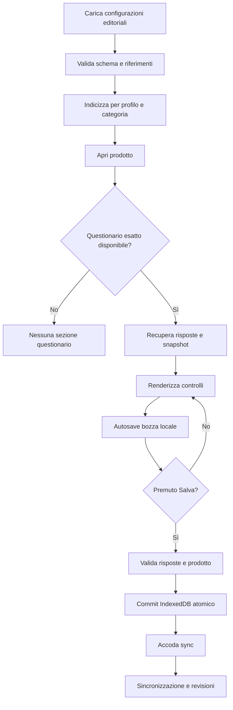

# ExpoTrack — 18. Motore dei questionari dinamici

## Aggiornamento mobile — risposte A1–A9

**Contratto vigente per il web mobile da fiera:** [specifica UI mobile, risposte A1–A9](27_Specifiche_UI_Mobile.md#10-risposte-di-revisione-recepite). Questo aggiornamento prevale sui paragrafi, diagrammi, pseudocodice e casi di test precedenti incompatibili. In particolare, gli esempi con `drafts`, conferma finale «Salva», dettaglio mobile 08, foto stand o scelta manuale del conflitto descrivono la progettazione precedente e non vanno implementati nel mobile. Le parti compatibili e le funzioni desktop/post-fiera mantengono il proprio ambito.

Ogni risposta modifica direttamente il dato autosalvato e accoda sync quando valida. Nessuna bozza o pulsante Annulla/Salva risposta; ritorno non annulla. Spunta = risposta presente; voto assente distinto da 1. Sei tipi canonici, rating_1_10; alias rating normalizzato in lettura. Risposte dentro editor 05; matching esatto senza fallback generico.


> **Percorso previsto:** `docs/18-questionnaire-engine.md`  
> **Stato:** specifica funzionale e tecnica, **non implementazione**  
> **Progetto:** ExpoTrack, PWA privata offline-first per fiere; EICMA 2026 è il primo evento.  
> **Documenti collegati:** `06-categories-config.md`, `08-products-config.md`, `10-questionnaires-config.md`, `12-database.md`, `13-backend-api.md`, `14-frontend-ui.md`, `17-product-management.md`.  
> **Successivo:** `19-offline-storage.md`.

---

## 1. Scopo e confini

Il motore dei questionari consente di presentare, compilare, salvare e consultare domande personalizzate quando un profilo registra o modifica un prodotto visto presso uno stand. Le definizioni sono editoriali, provenienti da file JSON distinti per profilo, mentre le risposte sono dati dinamici personali. Il motore deve funzionare anche offline dopo il caricamento iniziale delle configurazioni.

**Invarianti già stabilite:**

- Il questionario dipende dal **profilo attivo** e dalla **categoria assegnata al prodotto**.
- Nessun questionario comune o globale condiviso automaticamente tra profili.
- Tutte le domande sono **facoltative**: si può salvare un prodotto senza rispondere.
- Sei tipi: `text`, `number`, `boolean` (sì/no), `single_choice`, `multiple_choice`, `rating` (1–10).
- Senza configurazione corrispondente, non mostrare la sezione questionario.
- La categoria del prodotto è **immutabile dopo il primo Salva**, anche se avvenuto offline.
- Salvataggio mobile automatico locale e outbox per valori validi, senza modalità bozza o conferma Salva finale; input invalidi conservati localmente secondo §5.1 del documento 27.
- Le risposte appartengono al prodotto e al profilo, non allo stand condiviso.
- Un questionario compilato deve rimanere interpretabile se la definizione JSON cambia.
- Concorrenza mobile LWW per record in ordine di accettazione server; revisioni monotone, idempotenza e protezione delle tombstone.

Questo documento non crea i file `config/questionnaires/me.json` o `father.json`, non impone contenuti specifici delle domande e non avvia lo sviluppo.

## 2. Glossario

| Termine | Significato |
|---|---|
| Definizione | Schema editoriale delle domande letto da JSON. |
| Questionario | Insieme ordinato di domande applicabile a una coppia profilo/categoria. |
| Domanda | Elemento con ID stabile, testo e tipo di risposta. |
| Risposta | Valore personale salvato per una domanda e un prodotto. |
| Bozza | Modifiche locali non confermate dal pulsante Salva. |
| Answer set | Insieme delle risposte confermate relative a un prodotto e una definizione. |
| Snapshot | Copia della definizione usata per interpretare risposte storiche. |
| Revisione | Versione del record sincronizzato per il controllo dei conflitti. |
| Categoria esatta | Categoria il cui ID coincide con `product.categoryId`. |

## 3. Origine delle definizioni

File previsti:

```text
config/
└── questionnaires/
    ├── me.json
    └── father.json
```

Ogni file deve dichiarare il `profileId` corrispondente al nome del file e a un profilo esistente in `profiles.json`. Un profilo creato dall'app può non avere un file di questionari: in quel caso **nessun questionario predefinito**. Non inventare domande generiche.

Il contratto JSON definitivo resta quello di `10-questionnaires-config.md`. Gli esempi seguenti illustrano il comportamento del motore e **non sostituiscono lo schema canonico** se la nomenclatura precisa differisce.

### 3.1 Esempio puramente illustrativo

```json
{
  "schemaVersion": 1,
  "profileId": "me",
  "questionnaires": [
    {
      "id": "demo-helmets",
      "categoryId": "full-face-helmets",
      "version": 1,
      "questions": [
        {
          "id": "comfort",
          "type": "rating",
          "label": "Quanto è comodo?"
        },
        {
          "id": "weight-grams",
          "type": "number",
          "label": "Peso dichiarato in grammi"
        },
        {
          "id": "visor-notes",
          "type": "text",
          "label": "Osservazioni sulla visiera"
        },
        {
          "id": "pinlock",
          "type": "boolean",
          "label": "Pinlock incluso?"
        },
        {
          "id": "fit",
          "type": "single_choice",
          "label": "Vestibilità",
          "options": [
            { "id": "tight", "label": "Stretta" },
            { "id": "good", "label": "Corretta" },
            { "id": "loose", "label": "Larga" }
          ]
        },
        {
          "id": "features",
          "type": "multiple_choice",
          "label": "Caratteristiche osservate",
          "options": [
            { "id": "sun-visor", "label": "Visierino parasole" },
            { "id": "emergency-release", "label": "Sgancio guanciali" }
          ]
        }
      ]
    }
  ]
}
```

Gli ID e i dati sono fittizi; non sono affermazioni su prodotti o stand EICMA 2026.

## 4. Pipeline del motore



**Importante:** il motore non deve dipendere dalla rete durante il rendering, la compilazione, la validazione o il primo salvataggio, se lo snapshot editoriale è già disponibile.

## 5. Risoluzione del questionario

### 5.1 Chiave di selezione

La chiave logica minima è `(profileId, categoryId)`. Per gli eventi multipli, l'eventuale specificità per evento va prevista soltanto se definita dallo schema editoriale: non introdurla implicitamente.

**Regola proposta per la v1:** *corrispondenza esatta* tra `product.categoryId` e `questionnaire.categoryId`.

Esempio: un prodotto assegnato a `full-face-helmets` utilizza il questionario per `full-face-helmets`, non automaticamente quello di `helmets` o `rider-equipment`.

L'ereditarietà dalle categorie padre è **una decisione aperta** già richiamata nei documenti precedenti. Se sarà approvata, serviranno regole esplicite per precedenza, fusione, ID duplicati e versionamento.

### 5.2 Matrice di comportamento

| Condizione | Risultato |
|---|---|
| Profilo e categoria con definizione | Mostrare questionario. |
| Categoria senza definizione | Non mostrare sezione. |
| Profilo dinamico senza JSON | Non mostrare sezione. |
| Profilo `father` con questionario, `me` senza | Mostrare solo per `father`. |
| Categoria padre con questionario, prodotto in figlia | Nessuna ereditarietà automatica nella proposta v1. |
| Due questionari attivi per stessa chiave | Configurazione ambigua: errore di validazione. |
| Configurazione corrotta dopo aggiornamento | Conservare ultimo snapshot valido; segnalare errore. |
| Prodotto con risposte storiche ma questionario corrente assente | Mostrare storico in sola lettura usando snapshot, senza perdere dati. |

### 5.3 Indicizzazione

```ts
interface QuestionnaireLookupKey {
  profileId: string;
  categoryId: string;
}

function keyOf(profileId: string, categoryId: string): string {
  return JSON.stringify([profileId, categoryId]);
}

// Map<string, QuestionnaireDefinition>
// Costruita solo dopo validazione dell'intero snapshot editoriale.
```

Usare una chiave composta non ambigua; evitare concatenazioni con separatori che possono comparire negli ID.

## 6. Modello TypeScript di dominio

Il seguente modello è un **contratto interno proposto**: i nomi possono essere adattati allo schema JSON definito in `10-questionnaires-config.md`.

```ts
type QuestionType =
  | "text"
  | "number"
  | "boolean"
  | "single_choice"
  | "multiple_choice"
  | "rating";

type QuestionOption = {
  id: string;
  label: string;
};

type BaseQuestion = {
  id: string;
  label: string;
  description?: string;
  // Tutte le domande sono facoltative nella v1.
};

type QuestionDefinition =
  | (BaseQuestion & { type: "text" })
  | (BaseQuestion & { type: "number" })
  | (BaseQuestion & { type: "boolean" })
  | (BaseQuestion & {
      type: "single_choice";
      options: QuestionOption[];
    })
  | (BaseQuestion & {
      type: "multiple_choice";
      options: QuestionOption[];
    })
  | (BaseQuestion & { type: "rating" });

type QuestionnaireDefinition = {
  id: string;
  categoryId: string;
  version: number;
  questions: QuestionDefinition[];
};

type AnswerValue = string | number | boolean | string[];

type ProductAnswerSet = {
  id: string;
  productId: string;
  profileId: string;
  questionnaireId: string;
  questionnaireVersion: number;
  answers: Record<string, AnswerValue>;
  definitionSnapshot: QuestionnaireDefinition;
  revision: number | null;
};
```

L'assenza di una risposta è rappresentata preferibilmente con **chiave omessa**. Il valore `false` per una domanda sì/no significa «No», non «nessuna risposta».

### 6.1 ID stabili

- `questionnaire.id` identifica il questionario.
- `question.id` identifica la domanda **all'interno del questionario**.
- `option.id` identifica l'opzione; l'etichetta può cambiare senza cambiare identità.
- Evitare di usare testo domanda o posizione come chiave di risposta.
- Non riciclare un ID per una domanda semanticamente diversa.

## 7. Tipi di domanda: rendering e validazione

### 7.1 Testo — `text`

Componente: campo testo o textarea a seconda delle opzioni ammesse dallo schema canonico. Il testo è facoltativo; stringa vuota può essere normalizzata ad assenza di risposta.

Validare tipo stringa, limiti di lunghezza **se definiti** e codifica. Non rimuovere arbitrariamente accenti o caratteri speciali. Per la visualizzazione, trattare il testo come testo, non HTML eseguibile.

### 7.2 Numero — `number`

Componente: input numerico con tastiera adatta su smartphone. Il valore persistito è numerico, non una stringa formattata locale.

- `0` è una risposta valida, distinta da campo vuoto.
- In italiano l'utente può digitare la virgola decimale; il parser deve convertirla senza ambiguità.
- Non accettare `NaN`, `Infinity`, stringhe arbitrarie o numeri fuori dai limiti previsti.
- Non introdurre un'unità di misura implicita: «grammi», «litri» o altro devono essere esplicitati dalla domanda/configurazione.
- Vincoli min/max/precisione sono applicabili solo se supportati dallo schema concordato.

### 7.3 Sì/No — `boolean`

Componente: selezione a tre stati concettuali: **non risposto**, **Sì**, **No**. Evitare uno switch con valore iniziale `false`, che confonderebbe l'assenza di risposta con un «No» esplicito.

```ts
// undefined = non risposto
// true = Sì
// false = No
type BooleanAnswer = boolean | undefined;
```

### 7.4 Scelta singola — `single_choice`

Componente: radio group o select, con un'opzione «Nessuna risposta» o azione «Cancella selezione». Persistenza: **ID opzione**, non etichetta.

- L'ID deve appartenere alle opzioni della definizione utilizzata.
- Nessuna scelta obbligatoria.
- Non salvare una selezione predefinita se l'utente non l'ha compiuta.

### 7.5 Scelta multipla — `multiple_choice`

Componente: checkbox. Persistenza: array di ID opzione univoci.

- Un array vuoto può essere normalizzato ad assenza di risposta.
- Non accettare ID duplicati o sconosciuti.
- L'ordine delle opzioni visualizzate viene dalla definizione; l'ordine delle scelte non deve diventare significativo senza un requisito specifico.
- Se la configurazione cambia, preservare gli ID storici nel relativo snapshot.

### 7.6 Valutazione — `rating`

Componente: scelta intera da **1 a 10**, senza valore preselezionato. Il valore è indipendente dal **voto generale del prodotto**, che è un campo separato.

```ts
function isRating(value: unknown): value is number {
  return typeof value === "number"
    && Number.isInteger(value)
    && value >= 1
    && value <= 10;
}
```

Nessuna media automatica tra voti di questionario e voto generale, salvo futuro requisito esplicito.

## 8. Validazione editoriale all'avvio

Il bootstrap deve validare **l'intero snapshot** prima di renderlo attivo. Un errore in un file non deve lasciare un catalogo di domande parzialmente aggiornato.

Verifiche minime:

1. `schemaVersion` supportato.
2. `profileId` valido e coerente con il file.
3. Identificativi di questionari, domande e opzioni non vuoti e stabili.
4. `categoryId` presente in `categories.json`.
5. Unicità della coppia profilo/categoria secondo il matching adottato.
6. `version` intera positiva.
7. Tipo domanda appartenente ai sei tipi ammessi.
8. Opzioni obbligatorie per scelta singola/multipla; nessun duplicato.
9. Testi etichetta non vuoti.
10. Nessun attributo che renda una domanda obbligatoria nella v1.
11. Nessuna referenza a un profilo sconosciuto.
12. Dimensioni e profondità ragionevoli per proteggere client mobili.

### 8.1 Errori di configurazione

| Codice proposto | Significato |
|---|---|
| `QUESTIONNAIRE_SCHEMA_UNSUPPORTED` | Versione schema sconosciuta. |
| `QUESTIONNAIRE_PROFILE_MISMATCH` | Profilo nel file non corrispondente. |
| `QUESTIONNAIRE_CATEGORY_UNKNOWN` | Categoria non definita. |
| `QUESTIONNAIRE_DUPLICATE_TARGET` | Due definizioni per stessa coppia. |
| `QUESTIONNAIRE_DUPLICATE_QUESTION_ID` | ID domanda duplicato. |
| `QUESTIONNAIRE_DUPLICATE_OPTION_ID` | Opzione duplicata. |
| `QUESTIONNAIRE_TYPE_UNKNOWN` | Tipo non supportato. |
| `QUESTIONNAIRE_OPTIONS_INVALID` | Opzioni mancanti o non valide. |
| `QUESTIONNAIRE_REQUIRED_NOT_SUPPORTED` | Domanda obbligatoria non consentita. |

Se il client ha uno snapshot precedente valido, continuare a usarlo e segnalare l'errore. Non cancellare risposte o bozze a causa di un JSON invalido.

## 9. Validazione delle risposte

La validazione deve essere identica, per semantica, nel client e nel backend. Il backend non deve fidarsi del payload ricevuto.

```ts
type ValidationIssue = {
  questionId: string;
  code: string;
  message: string;
};

type ValidationResult =
  | { ok: true; normalizedAnswers: Record<string, AnswerValue> }
  | { ok: false; issues: ValidationIssue[] };
```

Algoritmo proposto:

1. Caricare la **definizione specifica** cui si riferiscono le risposte.
2. Rifiutare chiavi sconosciute, salvo percorso di migrazione esplicito.
3. Per ogni domanda, accettare assenza di risposta.
4. Se una risposta esiste, verificarne il tipo e i limiti.
5. Per le scelte, verificare ID opzione esistenti nella versione appropriata.
6. Normalizzare i campi vuoti senza trasformare `false` in assenza.
7. Restituire errori puntuali per domanda.
8. Consentire il Salva se tutte le risposte **presenti** sono valide, anche se nessuna domanda è compilata.

**Attenzione:** una risposta storica valida per la versione 1 non deve essere invalidata soltanto perché un'opzione è stata rimossa nella versione 2. Validare la risposta storica contro il suo snapshot; usare la definizione nuova solo in un processo esplicito di aggiornamento.

## 10. Stato UI e salvataggio automatico delle risposte

Ogni modifica intenzionale viene persistita automaticamente sul dispositivo. Per dati validi, record e mutazione outbox sono scritti nella stessa transazione; la rete interviene dopo. Non esistono store o modalità bozza né conferma Salva finale. Nome, stand e categoria restano obbligatori per la prima registrazione prodotto: i valori iniziali incompleti sono recuperabili nello stesso record locale, senza essere contati o inviati come prodotto valido. Categoria e stand si bloccano alla prima registrazione locale valida. Un input successivamente invalido resta recuperabile senza sostituire l’ultima versione valida sincronizzabile. Vedere [§5.1 della specifica mobile](27_Specifiche_UI_Mobile.md#51-salvataggio-automatico-validazione-e-recupero).

Dichiarare «Salvato sul dispositivo» solo dopo commit riuscito; errori quota o transazione mantengono l’input e non producono falso successo. Prima di cambio vista/profilo completare la persistenza, senza dialogo di conferma per modifiche già autosalvate. «Fine»/indietro non annullano scritture effettuate.

Ogni controllo scrive direttamente la risposta valida e accoda la mutazione. Tornare da 05a a 05 non annulla. Rimuovere «Annulla» e «Salva risposta» come commit separato; la spunta indica solo risposta presente. Valore assente distinto da 1 o da No. Nessuna foto nello step domanda e nessun commento aggiuntivo per rating non previsto dal JSON.

## 11. Prima registrazione valida e categoria

La categoria è scelta manualmente prima della prima registrazione locale valida e poi immutabile. Le risposte sono associate a definizione/versione del questionario della categoria effettiva; non riutilizzare per coincidenza di ID risposte di un’altra definizione. Matching esatto categoria/profilo; nessun fallback generico. Il nome rating canonico è `rating_1_10`; normalizzare in lettura l’alias storico `rating` degli esempi.

## 12. Persistenza e snapshot storico

### 12.1 Record confermato

Il modello proposto in `12-database.md` è `product_answer_sets`, con:

- `product_id`, `profile_id`;
- `questionnaire_id`, `questionnaire_version`;
- `answers` JSONB;
- `definition_snapshot` JSONB;
- `revision`, `updated_at` e gestione eliminazione.

Lo snapshot evita di perdere il significato di una risposta se una domanda viene rinominata, eliminata o modificata.

### 12.2 Esempio di payload concettuale

```json
{
  "productId": "demo-product-id",
  "profileId": "me",
  "questionnaireId": "demo-helmets",
  "questionnaireVersion": 1,
  "answers": {
    "comfort": 8,
    "weight-grams": 1450,
    "pinlock": false,
    "fit": "good",
    "features": ["sun-visor"]
  }
}
```

La domanda `visor-notes` non compare perché non è stata compilata. `pinlock: false` è una risposta valida e intenzionale.

### 12.3 Assenza di questionario

Se il prodotto non ha un questionario applicabile, non creare risposte fittizie. È lecito che non esista alcun answer set. Se esiste uno storico di un questionario precedentemente configurato, conservarlo in sola lettura.

## 13. Versionamento delle definizioni

Una modifica editoriale può riguardare:

| Modifica | Impatto | Comportamento proposto |
|---|---|---|
| Correzione ortografica label | Presentazione | Nuova versione editoriale secondo policy; storico leggibile. |
| Aggiunta domanda | Nuovo campo facoltativo | Vecchie risposte preservate. |
| Rimozione domanda | Campo storico non più mostrato nel modulo corrente | Conservare risposta e snapshot. |
| Cambio tipo | Incompatibilità semantica | Nuovo ID domanda, migrazione esplicita se necessaria. |
| Cambio ID opzione | Possibile perdita di interpretazione | Evitare; usare nuovo ID e snapshot. |
| Rinomina opzione | Presentazione | ID invariato, storico leggibile. |
| Cambio categoria target | Nuova applicabilità | Non riassegnare retroattivamente i prodotti. |
| Rimozione questionario | Nessuna nuova compilazione | Storico disponibile in lettura. |

### 13.1 Due modalità da non confondere

**Visualizzazione storica:** renderizzare le risposte con la definizione originaria.

**Modifica corrente:** decidere esplicitamente se continuare a usare la versione storica o proporre l'aggiornamento alla versione nuova. La raccomandazione v1 è **non migrare automaticamente risposte incompatibili**.

### 13.2 Decisione aperta: editing dopo aggiornamento

Proposta prudente:

- le risposte esistenti sono sempre consultabili;
- domande ancora compatibili possono essere proposte nel modulo corrente;
- risposte a domande rimosse rimangono nello storico;
- un eventuale pulsante «Aggiorna questionario» deve spiegare il cambiamento e conservare la versione precedente;
- non mescolare silenziosamente definizioni con ID uguali ma semantica diversa.

La scelta definitiva va concordata con `10-questionnaires-config.md`, `12-database.md` e `20-synchronization.md`.

## 14. API e contratto backend

Gli endpoint concreti sono definiti in `13-backend-api.md`. Il motore deve poter:

- ottenere uno snapshot editoriale validato e versionato;
- leggere l'answer set confermato di un prodotto;
- creare/aggiornare risposte con `operationId` idempotente e `baseRevision`;
- ricevere revisione server e stato di sincronizzazione;
- ottenere entrambe le versioni in caso di conflitto;
- leggere snapshot storici senza reinterpretarli con definizioni incompatibili.

### 14.1 Validazioni lato server

Il backend verifica `profileId`, appartenenza del prodotto, categoria immutabile, compatibilità della definizione, ID delle domande, tipo dei valori e revisione attesa.

Il profilo selezionato **non è autenticazione**. Senza login, l'isolamento tra profili è logico e non una garanzia di identità personale; la protezione dell'accesso all'app va trattata in `25-security.md`.

### 14.2 Operazione atomica

Se un singolo Salva modifica prodotto e risposte, il client deve preservare la coerenza fra i due record. La strategia API (mutazione composita o operazioni dipendenti) va definita in modo che un fallimento intermedio non lasci un prodotto apparentemente sincronizzato con risposte mancanti.

## 15. Offline e sincronizzazione

### 15.1 Lettura offline

La definizione applicabile deve essere disponibile da snapshot IndexedDB. Se il primo accesso avviene senza aver mai scaricato il JSON, non fingere di conoscere le domande: segnalare che la configurazione non è disponibile.

### 15.2 Scrittura offline

Le risposte confermate vengono salvate localmente insieme al prodotto e a un'operazione di outbox. L'utente può continuare a leggere e modificare i propri dati senza rete.

### 15.3 Sincronizzazione differita

La sincronizzazione è automatica quando l'app è attiva e online, con possibilità di avvio manuale. Non promettere che il browser eseguirà sempre operazioni in background dopo la chiusura dell'app.

### 15.4 Configurazione aggiornata mentre il client è offline

Il client deve registrare la versione/hash dello snapshot usato per creare le risposte. Al ritorno online il server deve distinguere:

- risposta valida per versione precedente e ancora accettabile;
- definizione incompatibile che richiede migrazione;
- conflitto di revisione del prodotto/answer set;
- errore di configurazione editoriale.

Non etichettare ogni incompatibilità come conflitto tra dispositivi.

## 16. Concorrenza delle risposte

La policy mobile è **LWW per record nell’ordine di accettazione server**, con revisioni monotone assegnate in transazione. Una revisione di base obsoleta su un record vivo non apre una scelta manuale: l’ultima nuova mutazione valida accettata prevale come record intero, senza merge per campo. Il timestamp del telefono è solo diagnostico. Vincoli di dominio e integrità restano applicati.

Il retry della stessa `operationId` e dello stesso payload restituisce l’esito già registrato, senza diventare una nuova scrittura; stesso ID con hash diverso è errore. Il client serializza le operazioni dello stesso record e non sovrascrive modifiche locali più recenti quando applica una conferma o un pull remoto.

Un update contro una tombstone viene respinto senza resuscitare il record. Conservare payload e riferimenti media necessari al recupero; offrire «Recupera come nuovo elemento», con nuovo ID e dipendenze valide. Nessun dialogo «versione locale/versione server» per i normali aggiornamenti concorrenti. Conservare audit per diagnosi senza promettere recupero automatico di ogni versione storica.

Un answer set è un record con versione della definizione; LWW non converte automaticamente risposte incompatibili con un nuovo schema.

## 17. Interfaccia mobile-first

### 17.1 Sezione nel dettaglio prodotto

- Titolo del questionario, se presente.
- Domande in ordine editoriale.
- Etichette chiare, eventuale descrizione e unità di misura se definite.
- Controlli touch sufficientemente grandi.
- Indicazione discreta «Facoltativo» a livello di sezione; non ripetere un obbligo inesistente.
- Nessuna preselezione di radio, sì/no o rating.
- Feedback puntuale su valori non validi.
- Salvataggio mobile automatico locale e outbox per valori validi, senza modalità bozza o conferma Salva finale; input invalidi conservati localmente secondo §5.1 del documento 27.

### 17.2 Navigazione

Il questionario è parte del flusso prodotto, non una schermata obbligatoria separata. Non impedire il salvataggio del prodotto quando tutte le risposte sono vuote.

### 17.3 Accessibilità

- Associare ogni label al proprio input.
- Raggruppare scelte con `fieldset`/`legend` o semantica equivalente.
- Annunciare gli errori ai lettori di schermo.
- Supportare tastiera e focus visibile.
- Non affidarsi solo al colore per indicare selezione, errore o sync.
- Per il rating, rendere comprensibili i valori 1–10 e l'assenza di risposta.

## 18. Consultazione e confronto desktop

Nel dettaglio prodotto, mostrare le risposte come coppie **domanda → valore leggibile**, usando etichette dello snapshot corretto. Per sì/no, visualizzare «Sì», «No» o «Non compilato»; per scelte, risolvere gli ID alle etichette della versione appropriata.

Nel confronto affiancato di prodotti **della stessa categoria**, le risposte possono occupare righe comparabili quando condividono la stessa definizione e gli stessi ID domanda.

Se i questionari differiscono per versione:

- mostrare esplicitamente la versione/snapshot;
- evitare allineamenti ingannevoli tra domande con significato diverso;
- visualizzare «Non disponibile» dove una domanda non esiste in una versione;
- non attribuire automaticamente zero a una risposta mancante.

La comparazione è prevista per desktop; non introdurre una versione mobile complessa senza richiesta.

## 19. Esportazione PDF e JSON

L'esportazione per profilo deve poter includere:

- definizione/versione o snapshot sufficiente a interpretare i valori;
- domanda e risposta leggibile;
- domande non compilate omesse o indicate esplicitamente, secondo impostazione di export;
- risposte storiche anche se la domanda non è più nel questionario corrente;
- separazione tra voto generale prodotto e voti delle singole domande.

Nel JSON esportato preservare gli ID stabili e la versione del questionario; nel PDF usare etichette comprensibili. Non implementare import: non è previsto nella v1.

## 20. Gestione errori e casi limite

| Caso | Comportamento atteso |
|---|---|
| JSON questionari mancante per profilo dinamico | Nessuna sezione, nessun errore bloccante. |
| JSON presente ma invalido | Rifiutare aggiornamento, mantenere snapshot valido. |
| Domanda con ID duplicato | Errore editoriale prima della pubblicazione. |
| `false` in sì/no | Salvare «No», non eliminare il valore. |
| `0` in numero | Salvare zero. |
| `0` in rating | Rifiutare, range 1–10. |
| Opzione non presente nella definizione corrente | Verificare versione storica; non cancellare automaticamente. |
| Categoria cambiata nella bozza prodotto | Ricalcolare questionario e isolare vecchie risposte. |
| Categoria cambiata dopo primo Salva | Vietato. |
| Nessuna risposta compilata | Salvataggio consentito. |
| Quota IndexedDB esaurita | Errore esplicito; non mostrare Salva riuscito. |
| Rete persa durante Salva locale | Commit locale valido; sync pendente. |
| Server non raggiungibile | Dati locali preservati e retry. |
| Due dispositivi modificano lo stesso answer set | Conflitto manuale. |
| Profilo cambiato con bozza aperta | Avviso, bozza preservata e isolamento. |
| Definizione rimossa dopo risposte esistenti | Storico leggibile tramite snapshot. |
| Foto di prodotto in caricamento | Non bloccare indebitamente il rendering delle domande. |
| Aggiornamento PWA durante compilazione | Bozza persistente e recuperabile. |
| Numero digitato con virgola | Parsing locale senza cambiare il valore numerico. |
| Browser chiuso subito dopo un input | Non garantire scrittura se l'evento non è stato persistito; gestire debounce e flush ove possibile. |

## 21. Strategia di test

### 21.1 Validazione configurazione

| ID | Scenario | Atteso |
|---|---|---|
| QE-001 | JSON valido | Snapshot accettato. |
| QE-002 | `schemaVersion` sconosciuto | Rifiuto esplicito. |
| QE-003 | `profileId` errato | Rifiuto. |
| QE-004 | Categoria sconosciuta | Rifiuto. |
| QE-005 | Due definizioni per stessa coppia profilo/categoria | Rifiuto. |
| QE-006 | ID domanda duplicato | Rifiuto. |
| QE-007 | ID opzione duplicato | Rifiuto. |
| QE-008 | Tipo domanda sconosciuto | Rifiuto. |
| QE-009 | Scelta senza opzioni | Rifiuto. |
| QE-010 | Profilo dinamico senza file | Nessun questionario. |
| QE-011 | Snapshot aggiornato invalido | Snapshot precedente intatto. |
| QE-012 | Domanda marcata obbligatoria | Rifiuto secondo policy v1. |

### 21.2 Risoluzione e profili

| ID | Scenario | Atteso |
|---|---|---|
| QE-013 | Categoria esatta presente | Questionario corretto. |
| QE-014 | Solo categoria padre configurata | Nessuna ereditarietà automatica. |
| QE-015 | Profilo `me` e `father` stessa categoria | Definizioni indipendenti. |
| QE-016 | Nessuna definizione | Sezione nascosta. |
| QE-017 | Cambio profilo | Nessuna contaminazione risposte. |
| QE-018 | Stesso ID domanda in questionari diversi | Nessuna collisione. |
| QE-019 | Evento diverso, stessa categoria | Applicazione coerente con schema globale. |

### 21.3 Tipi di risposta

| ID | Scenario | Atteso |
|---|---|---|
| QE-020 | Testo vuoto | Campo omesso/assente. |
| QE-021 | Testo con accenti | Preservato. |
| QE-022 | Numero zero | Valido. |
| QE-023 | Numero con virgola decimale | Parsing corretto. |
| QE-024 | Numero `NaN`/`Infinity` | Rifiuto. |
| QE-025 | Boolean non selezionato | Assente. |
| QE-026 | Boolean `false` | Salvato come «No». |
| QE-027 | Scelta singola valida | ID opzione salvato. |
| QE-028 | Scelta singola sconosciuta | Rifiuto. |
| QE-029 | Scelta multipla vuota | Valida/assente. |
| QE-030 | Scelta multipla con duplicati | Rifiuto o normalizzazione esplicita. |
| QE-031 | Scelta multipla con ID sconosciuto | Rifiuto. |
| QE-032 | Rating 1 e 10 | Validi. |
| QE-033 | Rating 0 e 11 | Rifiuto. |
| QE-034 | Nessuna risposta compilata | Salva consentito. |
| QE-035 | Risposta con tipo errato | Errore per domanda. |

### 21.4 Bozze e salvataggio offline

| ID | Scenario | Atteso |
|---|---|---|
| QE-036 | Digitazione senza Salva | Solo bozza locale. |
| QE-037 | Riapertura prodotto | Bozza recuperabile. |
| QE-038 | Salva offline | Commit locale e outbox. |
| QE-039 | Commit IndexedDB fallisce | Nessun falso successo. |
| QE-040 | Cambio categoria prima del primo Salva | Questionario ricalcolato. |
| QE-041 | Cambio categoria dopo primo Salva | Vietato. |
| QE-042 | Cambio profilo con bozza | Isolamento e avviso. |
| QE-043 | Rete assente dopo Salva | Risposte visibili, sync pendente. |
| QE-044 | Retry stessa operazione | Nessun duplicato. |
| QE-045 | Riapertura PWA offline | Questionario da cache valida. |

### 21.5 Versioni, conflitti, storico

| ID | Scenario | Atteso |
|---|---|---|
| QE-046 | Aggiunta nuova domanda | Vecchie risposte intatte. |
| QE-047 | Rimozione domanda | Storico leggibile. |
| QE-048 | Rinomina opzione con stesso ID | Valore interpretabile. |
| QE-049 | Cambio tipo senza nuovo ID | Segnalazione incompatibilità. |
| QE-050 | Questionario rimosso | Storico sola lettura. |
| QE-051 | Conflitto stesso answer set | Due versioni preservate. |
| QE-052 | Conflitto su domande differenti | Nessun merge automatico. |
| QE-053 | Snapshot storico mancante | Errore esplicito, non reinterpretazione arbitraria. |
| QE-054 | Config aggiornata durante offline | Compatibilità verificata al sync. |
| QE-055 | Conflitto risolto | Nuova revisione versionata. |

### 21.6 UI, confronto, export

| ID | Scenario | Atteso |
|---|---|---|
| QE-056 | Radio senza default | Nessuna scelta iniziale. |
| QE-057 | Boolean senza default | «Non risposto». |
| QE-058 | Rating senza default | Nessun voto. |
| QE-059 | Tastiera e screen reader | Controlli accessibili. |
| QE-060 | Confronto prodotti stessa categoria | Righe comparabili. |
| QE-061 | Confronto con versioni diverse | Differenze esplicite. |
| QE-062 | PDF con risposte storiche | Etichette corrette. |
| QE-063 | JSON export | ID e versione conservati. |
| QE-064 | Voto prodotto e voto domanda | Non confusi. |
| QE-065 | Mobile offline | Compilazione completa senza rete. |

## 22. Criteri di accettazione

- [ ] Il motore usa esclusivamente il questionario del profilo e della categoria pertinenti.
- [ ] La mancata configurazione non genera un questionario generico.
- [ ] Il matching esatto è applicato finché non viene approvata l'ereditarietà.
- [ ] Sono supportati tutti e sei i tipi di domanda.
- [ ] Ogni domanda è facoltativa.
- [ ] Boolean `false`, numero `0` e risposta assente sono distinti.
- [ ] Rating sempre intero 1–10.
- [ ] Scelte persistite per ID, non per etichetta.
- [ ] Definizioni validate prima della pubblicazione.
- [ ] Snapshot editoriale invalido non sostituisce quello valido.
- [ ] Risposte personali isolate per profilo/prodotto.
- [ ] Nessuna categoria modificabile dopo primo Salva locale.
- Salvataggio mobile automatico locale e outbox per valori validi, senza modalità bozza o conferma Salva finale; input invalidi conservati localmente secondo §5.1 del documento 27.
- [ ] Salva conferma localmente anche offline.
- [ ] Operazioni di sync idempotenti e versionate.
- [ ] Conflitti conservano entrambe le versioni fino alla risoluzione.
- [ ] Storico leggibile anche dopo aggiornamenti/rimozioni delle domande.
- [ ] UI mobile accessibile e senza valori preselezionati.
- [ ] Confronto desktop evita accostamenti ingannevoli fra versioni.
- [ ] Export PDF/JSON mantiene il significato delle risposte.
- [ ] Test unitari, integrazione, offline ed E2E coprono i casi descritti.

## 23. Decisioni ancora aperte

| Decisione | Proposta prudente | Impatto |
|---|---|---|
| Ereditarietà categorie | Solo match esatto v1 | Risoluzione e configurazione. |
| Modifica risposte dopo aggiornamento JSON | Nessuna migrazione automatica incompatibile | Storico e UX. |
| Persistenza snapshot | Snapshot per answer set o archivio versionato equivalente | DB e spazio. |
| Formato preciso JSON | Rispettare `10-questionnaires-config.md` | Parser e schema. |
| Eventuali limiti min/max numerici | Solo se dichiarati nello schema | Validazione. |
| Limiti lunghezza testo | Definire esplicitamente, senza troncare dati | UX/API. |
| Rendering textarea/input | Configurabile se previsto | UI. |
| Granularità dei conflitti | Answer set intero, senza merge automatico | Sync. |
| Strategia per domande rimosse | Storico sola lettura | UI/export. |
| Integrazione Salva prodotto+risposte | Transazione locale atomica, sync coordinata | Backend. |

Queste proposte devono essere armonizzate con i documenti già redatti prima di produrre codice o configurazioni definitive.

## 24. Dipendenze e passaggio al prossimo documento

Il motore dipende da:

- **`06-categories-config.md`** per identificativi e albero categorie;
- **`10-questionnaires-config.md`** per schema e versioni dei JSON;
- **`12-database.md`** per answer set, snapshot e revisioni;
- **`13-backend-api.md`** per endpoint e validazione server;
- **`17-product-management.md`** per Salva prodotto, categoria immutabile e navigazione;
- **`19-offline-storage.md`** per IndexedDB, bozze, quota e cache;
- **`20-synchronization.md`** per outbox, retry e conflitti;
- **`22-comparison.md`** e **`23-export.md`** per uso delle risposte a valle.

**Prossimo:** `docs/19-offline-storage.md` — specifica dettagliata della persistenza locale IndexedDB, caching PWA, migrazioni, quota, fotografie offline e recupero delle bozze.
