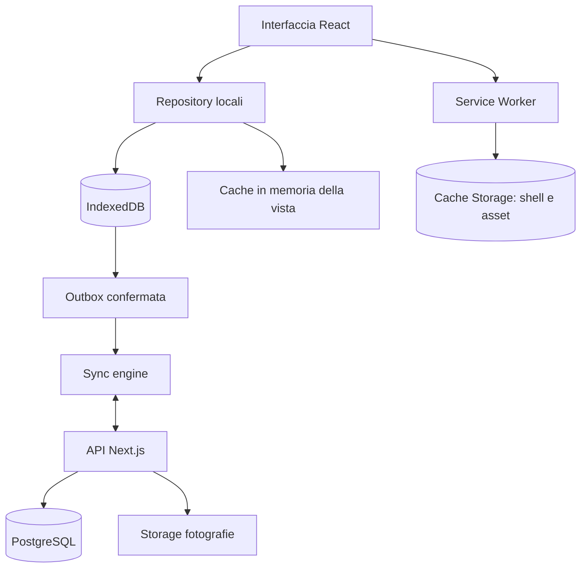

# 19 — Offline Storage: IndexedDB, cache PWA, salvataggio automatico e resilienza

## Aggiornamento mobile — risposte A1–A9

**Contratto vigente per il web mobile da fiera:** [specifica UI mobile, risposte A1–A9](27_Specifiche_UI_Mobile.md#10-risposte-di-revisione-recepite). Questo aggiornamento prevale sui paragrafi, diagrammi, pseudocodice e casi di test precedenti incompatibili. In particolare, gli esempi con `drafts`, conferma finale «Salva», dettaglio mobile 08, foto stand o scelta manuale del conflitto descrivono la progettazione precedente e non vanno implementati nel mobile. Le parti compatibili e le funzioni desktop/post-fiera mantengono il proprio ambito.

Nessuno store drafts. Gli store entità conservano input locali, ultima versione valida e metadati di validazione; soltanto payload validi entrano nell’outbox con transazione atomica. Flush prima della navigazione; nessun Salva finale. Errori quota non dichiarano successo. Il recupero dopo refresh riguarda dati autosalvati, non una lista bozze. Concorrenza LWW e tombstone protette.


> **Progetto:** ExpoTrack · **Documento:** `docs/19-offline-storage.md` · **Stato:** specifica tecnica proposta per v1  
> **Precedente:** [`18-questionnaire-engine.md`](18-questionnaire-engine.md) · **Successivo:** [`20-synchronization.md`](20-synchronization.md)  
> **Ambito:** persistenza sul dispositivo, lettura offline, transazioni, bozze, foto, service worker, limiti del browser, migrazioni e recupero.

---

## 1. Scopo e confini

ExpoTrack è una PWA mobile-first, utilizzabile anche senza rete dopo un primo caricamento riuscito. È pensata per fiere, inizialmente EICMA 2026, dove la connettività può essere intermittente e l'utente deve poter consultare stand e prodotti, scrivere note, compilare questionari e aggiungere fotografie.

**Regola centrale:** il salvataggio locale confermato deve funzionare senza Internet. La sincronizzazione con il server è successiva, indipendente e non deve bloccare il lavoro sul posto.

Il presente documento definisce **come** conservare i dati sul dispositivo. Il protocollo client/server, l'ordine delle mutazioni e la risoluzione dei conflitti sono approfonditi in `20-synchronization.md`. Il modello server è in `12-database.md`, le API in `13-backend-api.md`, le fotografie in `21-photo-management.md`.

### 1.1 Cosa deve funzionare offline

- Aprire l'app se il codice e gli asset necessari sono stati memorizzati.
- Selezionare e cambiare un profilo già disponibile localmente.
- Consultare catalogo stand, padiglioni, categorie, interessi e questionari dello snapshot disponibile.
- Cercare, filtrare e ordinare stand e prodotti memorizzati localmente.
- Creare e modificare stand personali, priorità, cose da vedere, note e stati di visita.
- Creare e modificare prodotti e risposte ai questionari.
- Scattare/selezionare foto e renderle disponibili localmente **dopo il salvataggio**.
- Salvataggio mobile automatico locale e outbox per valori validi, senza modalità bozza o conferma Salva finale; input invalidi conservati localmente secondo §5.1 del documento 27.
- Premere **Salva** e ottenere una conferma locale verificabile.
- Eliminare entità con conferma, registrando una mutazione recuperabile.
- Visualizzare dashboard e contatori coerenti con i dati locali confermati.
- Consultare lo stato delle operazioni pendenti e degli errori.

### 1.2 Cosa non è garantito offline

- Primo avvio su un browser che non ha mai caricato l'app.
- Download di nuove versioni editoriali e aggiornamenti del codice.
- Sincronizzazione con PostgreSQL, accesso ai dati presenti solo su altri dispositivi.
- Recupero di foto non ancora scaricate e mai memorizzate localmente.
- Esportazione PDF che dipenda da risorse server o librerie non presenti nella cache: va progettata esplicitamente se la si vuole offline.
- Persistenza assoluta in caso di cancellazione dati del sito, modalità privata, spazio esaurito, perdita del dispositivo o intervento del browser.
- Sincronizzazione in background con la PWA chiusa: non è universalmente supportata né affidabile.

### 1.3 Vincoli funzionali consolidati

- Nessun account o login interno nella v1: profilo selezionato all'avvio, scelta ricordata localmente.
- Profili `me` e `father` configurati da JSON; profili dinamici possibili.
- Catalogo stand editoriale condiviso, stand aggiunti dall'app privati al profilo creatore.
- Prodotti personali collegati a uno stand, con una categoria **immutabile dal primo Salva**, anche offline.
- Priorità stand 1–10; stato `to_visit`/`visited`/`revisit`; note e fotografie per profilo.
- Questionari per profilo e categoria, con tutte le domande facoltative.
- Salvataggio mobile automatico locale e outbox per valori validi, senza modalità bozza o conferma Salva finale; input invalidi conservati localmente secondo §5.1 del documento 27.
- Concorrenza mobile LWW per record in ordine di accettazione server; revisioni monotone, idempotenza e protezione delle tombstone.

---

## 2. Architettura di persistenza



**Distinzioni essenziali:**

| Livello | Responsabilità | Non deve fare |
|---|---|---|
| Memoria React | Stato UI transitorio, filtri e visualizzazione | Essere unica fonte persistente |
| IndexedDB | Dati editoriali offline, record personali, bozze, outbox, metadati e blob | Conservare password o segreti server |
| Cache Storage | Shell applicativa e asset statici | Sostituire IndexedDB per dati personali strutturati |
| Service worker | Servire asset offline e gestire policy cache | Decidere da solo che una bozza sia salvata |
| Outbox IndexedDB | Conservare mutazioni confermate da inviare | Inviare bozze non confermate |
| PostgreSQL | Stato server condiviso fra dispositivi | Impedire salvataggi locali senza rete |
| Storage media server | Foto sincronizzate | Essere l'unica copia di foto appena salvate offline |

### 2.1 Scelta di libreria

**Proposta:** usare `idb` oppure Dexie come wrapper tipizzato di IndexedDB. Non è un requisito irrevocabile. La libreria scelta deve supportare transazioni multi-store, migrazioni, indici e test automatizzati. Non creare una seconda astrazione che nasconda errori e confini delle transazioni.

### 2.2 Origine web e accesso

IndexedDB e Cache Storage sono legati all'**origin** (schema, host, porta). Cambiare dominio Cloudflare o usare un altro sottodominio può produrre un archivio locale separato. Pianificare un URL stabile per ExpoTrack e documentare che la migrazione dell'origin non trasferisce automaticamente i dati offline.

---

## 3. Cataloghi editoriali e snapshot coerenti

I file JSON editoriali sono:

```text
config/app.json
config/profiles.json
config/pavilions.json
config/categories.json
config/events/eicma-2026-stands.json
config/interests/me.json
config/interests/father.json
config/questionnaires/me.json
config/questionnaires/father.json
```

La configurazione degli interessi e dei questionari è specifica del profilo, mentre stand, padiglioni e categorie costituiscono il catalogo condiviso. Non esiste `config/products.json`: i prodotti sono dinamici.

### 3.1 Snapshot atomico

Non aggiornare singolarmente i file di configurazione nella cache attiva, perché una versione nuova delle categorie potrebbe non essere compatibile con una versione vecchia degli stand.

**Procedura proposta:**

1. Scaricare manifest/snapshot completo e versione/hash.
2. Validare sintassi e schema dei file.
3. Verificare tutte le referenze incrociate (`eventId`, `profileId`, `categoryId`, `standId`, `hall`).
4. Scrivere un nuovo snapshot in IndexedDB.
5. Impostarlo come attivo **solo quando completo**.
6. Conservare lo snapshot precedente finché il nuovo non è attivato correttamente.
7. Riconciliare seed e override personali senza sovrascrivere modifiche dell'utente.

Se uno dei passaggi fallisce, mantenere attivo lo snapshot valido precedente e segnalare l'errore.

### 3.2 Versioni separate

Non confondere:

- `schemaVersion` dei file JSON;
- versione/hash dello snapshot editoriale;
- versione dello schema IndexedDB;
- versione delle API;
- revisione server di un record personale.

Queste grandezze evolvono indipendentemente.

### 3.3 Riferimenti rimossi

Un aggiornamento editoriale non deve eliminare note, prodotti, foto o stati personali associati a uno stand/categoria che non compare più. Se la migrazione non è definita, mantenere i dati e segnalare un riferimento non risolto, invece di cancellarli.

### 3.4 Nessuna posizione inventata

Per EICMA 2026, padiglione e numero stand restano facoltativi finché non sono verificati. La cache non deve generare ubicazioni o percorsi.

---

## 4. Schema IndexedDB proposto

Nome database: `expotrack-local`. La versione iniziale è una decisione di implementazione (ad esempio `1`); non dipende dall'anno della fiera.

| Object store | Primary key | Contenuto | Indici principali |
|---|---|---|---|
| `config_snapshots` | `snapshotId` | Config validata e hash | `createdAt`, `eventIds` se utile |
| `app_meta` | `key` | Snapshot attivo, profilo scelto, versione locale | — |
| `profiles` | `id` | Profili dinamici e proiezione locale | `source`, `enabled` |
| `personal_stands` | `id` | Stand personali confermati | `[ownerProfileId,eventId]` |
| `stand_states` | `id` | Stato visita e note personali | `[profileId,eventId]`, chiave stand |
| `interest_overrides` | `id` | Priorità e cose da vedere modificate | `[profileId,eventId]`, chiave stand |
| `products` | `id` | Prodotti confermati | `[profileId,eventId]`, categoria, stand, preferiti |
| `answer_sets` | `id` | Risposte questionari confermate | `productId`, `profileId` |
| `photo_metadata` | `id` | Stato foto e metadati | `ownerRef`, `profileId`, `uploadState` |
| `photo_blobs` | `id` | Blob foto locali | — |
| Metadati locali sulle entità | Chiave entità | Input pendenti di validazione, ultima versione valida, sequenza locale | Non inviati al server |
| `outbox` | `operationId` | Operazioni confermate pendenti | `status`, `queuedAt`, `entityRef` |
| `recovery_entries` | `operationId` | Payload respinti per tombstone e riferimenti recuperabili | `profileId`, `eventId`, `entityRef` |
| `sync_meta` | `key` | Cursor, revisioni, ultimo sync | — |

**Nota progettuale:** la forma precisa delle chiavi e degli indici deve essere testata su browser target; gli array composti IndexedDB hanno una semantica propria. Evitare chiavi stringa concatenate senza escaping che possano collidere.

### 4.1 Perimetro obbligatorio

Ogni record personale deve includere `profileId` e `eventId` oppure un collegamento verificabile a un'entità che li contenga. Le query di UI devono filtrare **entrambi**. L'assenza di login rende ancora più importante evitare contaminazioni accidentali tra profili, pur senza creare una falsa promessa di sicurezza.

### 4.2 Record editoriali e dinamici

Non duplicare in `personal_stands` gli stand JSON. Usare un riferimento discriminato:

```ts
type StandRef =
  | { source: "catalog"; eventId: string; standId: string }
  | { source: "personal"; eventId: string; standId: string; ownerProfileId: string };
```

Lo stand personale può essere visto e modificato soltanto nel contesto del profilo proprietario. Lo stand editoriale è visibile nel catalogo condiviso, ma interessi e stati restano personali.

---

## 5. Modelli TypeScript di riferimento

Le interfacce seguenti descrivono il **contratto logico proposto**, non file di implementazione.

<details>
<summary>Esempio della progettazione precedente: gestione bozze superata nel mobile (non implementare)</summary>

```ts
type ISODateTime = string;
type EntityType =
  | "profile"
  | "personalStand"
  | "standState"
  | "interestOverride"
  | "product"
  | "answerSet"
  | "photo";

type OutboxStatus =
  | "pending"
  | "in_flight"
  | "failed"
  | "conflict"
  | "synced";

interface LocalRecordMeta {
  id: string;
  profileId: string;
  eventId: string;
  localUpdatedAt: ISODateTime;
  serverRevision: number | null;
  pendingSync: boolean;
  deletedAt?: ISODateTime | null;
}

interface LocalDraft<T = unknown> {
  draftId: string;
  profileId: string;
  eventId: string;
  entityType: EntityType;
  entityId: string;
  baseServerRevision: number | null;
  values: T;
  updatedAt: ISODateTime;
  photoDraftIds?: string[];
}

interface OutboxOperation<T = unknown> {
  operationId: string;
  profileId: string;
  eventId: string;
  entityType: EntityType;
  entityId: string;
  action: "create" | "update" | "delete";
  baseServerRevision: number | null;
  payload: T;
  status: OutboxStatus;
  attempts: number;
  queuedAt: ISODateTime;
  lastError?: string;
  dependsOn?: string[];
}

interface PhotoLocalMeta {
  id: string;
  profileId: string;
  eventId: string;
  ownerType: "stand" | "product";
  ownerId: string;
  mimeType: string;
  byteSize: number;
  localBlobAvailable: boolean;
  uploadState: "local" | "pending" | "uploading" | "uploaded" | "failed";
  remoteStorageKey?: string;
}
```

</details>

**Vincolo:** le proprietà `pendingSync` e `serverRevision` non devono essere interpretate come prova di upload completato di tutte le foto. I media possono avere uno stato di trasferimento separato.

---

## 6. Stati del salvataggio automatico

| Stato | Persistenza e comportamento |
|---|---|
| Input in validazione | Valori iniziali/parziali conservati nel record locale; nessun payload invalido in outbox |
| Salvato sul dispositivo | Transazione locale completata, operazione valida in coda |
| Sincronizzato | Operazione confermata dal server e revisione registrata localmente |
| Errore locale | Scrittura non riuscita; mantenere input e mostrare riprova |
| Errore sync | Record locale resta salvato; dettaglio errore e retry secondo tipo |
| Recupero richiesto | Update respinto per tombstone; payload conservato, possibile nuovo elemento |

## 7. Persistenza automatica degli input

Ogni modifica intenzionale viene persistita automaticamente sul dispositivo. Per dati validi, record e mutazione outbox sono scritti nella stessa transazione; la rete interviene dopo. Non esistono store o modalità bozza né conferma Salva finale. Nome, stand e categoria restano obbligatori per la prima registrazione prodotto: i valori iniziali incompleti sono recuperabili nello stesso record locale, senza essere contati o inviati come prodotto valido. Categoria e stand si bloccano alla prima registrazione locale valida. Un input successivamente invalido resta recuperabile senza sostituire l’ultima versione valida sincronizzabile. Vedere [§5.1 della specifica mobile](27_Specifiche_UI_Mobile.md#51-salvataggio-automatico-validazione-e-recupero).

Dichiarare «Salvato sul dispositivo» solo dopo commit riuscito; errori quota o transazione mantengono l’input e non producono falso successo. Prima di cambio vista/profilo completare la persistenza, senza dialogo di conferma per modifiche già autosalvate. «Fine»/indietro non annullano scritture effettuate.

Ogni record mantiene separati dati validi sincronizzabili, eventuali campi locali ancora invalidi e metadati di revisione. Questi metadati locali non si inviano nel payload API. Se si adotta debounce breve, completarlo prima delle transizioni; un evento di chiusura browser non è l’unico punto in cui tentare la scrittura.

Le query restano isolate per profilo/evento; budget per profilo/categoria. Filtri e ordinamenti sono stato UI: conservarli tornando alla stessa lista, ripristinare i default entrando nuovamente dal tab.

## 8. Transazione automatica record e outbox

1. Leggere l’input corrente e verificare proprietà immutabili.
2. Persistire i valori locali anche se incompleti, senza accodare payload invalidi.
3. Per ogni modifica valida preparare snapshot del record e un nuovo `operationId` stabile.
4. Scrivere in un’unica transazione gli store entità coinvolti e l’outbox; per foto includere metadati e blob, già preparati fuori transazione.
5. Attendere il commit reale; solo allora aggiornare feedback e conteggi.
6. Richiedere sync senza bloccare la navigazione sulla rete. Preservare l’ordine delle operazioni per record e le dipendenze stand/prodotto/foto.
7. Applicare ack/pull senza perdere input invalidi conservati o modifiche locali di sequenza successiva.

Nessuna cancellazione di drafts o transizione draft→confirmed. Non tenere transazioni IndexedDB aperte durante richieste HTTP o elaborazione asincrona delle immagini.

## 9. Prima creazione del prodotto e categoria immutabile

Un prodotto ha una categoria selezionata manualmente. La categoria non può essere modificata **dopo il primo Salva esplicito**, anche se il dispositivo era offline.

### 9.1 Regola operativa

- **Bozza nuova:** categoria modificabile liberamente.
- **Primo Salva locale riuscito:** `categoryId` fissato.
- **Modifica successiva:** categoria mostrata come non modificabile.
- **Sync server:** verifica e rifiuta eventuali tentativi di cambio categoria.
- **Errore di sync:** non riabilita il campo categoria.
- **Eliminazione e ricreazione:** operazione distinta, con conferma; non usare per aggirare la protezione silenziosamente.

### 9.2 Coerenza delle categorie

La categoria deve esistere nello snapshot editoriale attivo. Se un aggiornamento la rimuove mentre ci sono prodotti offline, conservare i record e richiedere una migrazione, senza riassegnazione automatica.

---

## 10. Foto offline: dati binari e metadati

### 10.1 Separazione

Conservare in IndexedDB:

- `photo_metadata`: ID, proprietario, dimensioni, MIME, stato locale/remoto, riferimento al blob;
- `photo_blobs`: `Blob` o `File` effettivo, necessario per visualizzare la foto offline.

L'anteprima generata con `URL.createObjectURL` è temporanea e **non** sostituisce il blob persistito. Revocare gli object URL quando non servono più.

### 10.2 Flusso di acquisizione

1. Selezione o scatto foto.
2. Verifica dimensione, tipo e decodificabilità.
3. Eventuale ridimensionamento/compressione sul dispositivo.
4. Creazione anteprima temporanea.
5. Persistenza della foto in staging locale.
6. Associazione alla bozza.
7. Premendo Salva, conferma di metadati e blob.
8. Inserimento nella coda di upload.
9. Dopo conferma server, aggiornamento stato remoto.

### 10.3 Staging e pulizia

Le foto aggiunte a una bozza poi abbandonata non devono occupare spazio indefinitamente. Definire garbage collection delle **sole** foto non confermate e non referenziate, dopo una finestra di sicurezza. Mai cancellare foto confermate soltanto perché non ancora sincronizzate.

### 10.4 Download delle foto remote

Una foto già presente sul server ma non scaricata localmente può essere visualizzabile solo online. Distinguere `remoteAvailable` e `localBlobAvailable`; offrire una funzione di preparazione offline se necessaria, senza promettere disponibilità di ogni foto su ogni dispositivo.

### 10.5 Limiti e compressione

Il limite per file, le dimensioni massime, i formati accettati, la gestione EXIF e la generazione di miniature sono definiti in `21-photo-management.md`. Non imporre in questo documento numeri arbitrari non ancora approvati.

---

## 11. Service worker e Cache Storage

### 11.1 Ruoli

Il service worker deve consentire il caricamento della shell PWA senza rete **dopo l'installazione corretta**, mantenendo separati gli asset pubblici dai dati personali.

### 11.2 Policy suggerite

| Risorsa | Strategia proposta | Motivo |
|---|---|---|
| Asset con hash (JS/CSS/font locali) | Cache-first | Versioni immutabili |
| Shell HTML/navigazione | Network-first con fallback offline, oppure precache coerente | Aggiornamento e avvio offline |
| Config editoriali | Scarica e valida in IndexedDB; non affidarsi solo alla cache HTTP | Snapshot atomico |
| API dati personali | Repository IndexedDB; rete gestita dal sync engine | Nessuna risposta cache obsoleta scambiata per dato autorevole |
| Upload foto | Outbox/queue dedicata | Retry e idempotenza |
| Immagini decorative | Cache limitata con eviction | Ridurre consumo spazio |
| Fotografie personali | Blob IndexedDB e media service dedicato | Disponibilità offline esplicita |

**Nota Next.js:** la strategia per navigazioni e route dinamiche va verificata con App Router e con la configurazione PWA scelta. Non assumere che tutte le route SSR funzionino offline automaticamente.

### 11.3 Cache versionate

Usare nomi di cache con versione build e cancellare soltanto le cache obsolete **dell'app**. Non usare una pulizia generica che cancelli IndexedDB, outbox o foto personali.

### 11.4 Aggiornamenti della PWA

Quando è disponibile una nuova versione, avvisare l'utente se ci sono bozze, operazioni pendenti o modifiche incompatibili. Evitare un reload forzato durante la compilazione di un questionario o il caricamento di foto.

---

## 12. Bootstrap e prima installazione

### 12.1 Primo accesso online

1. Caricare la shell applicativa.
2. Verificare che IndexedDB sia disponibile.
3. Scaricare e validare lo snapshot editoriale completo.
4. Memorizzare i file necessari all'avvio offline.
5. Creare/aggiornare le proiezioni locali dei profili.
6. Far scegliere il profilo o recuperare quello già selezionato.
7. Caricare lo stato personale dal server, se disponibile.
8. Segnalare quando il dispositivo è **pronto per l'uso offline**.

### 12.2 Primo accesso senza rete

Se la PWA non è mai stata caricata, non garantire il funzionamento. Se la shell esiste ma lo snapshot non è stato completato, mostrare una schermata di preparazione incompleta e non inventare cataloghi.

### 12.3 Profilo ricordato

Il profilo scelto può essere registrato in `app_meta` o in uno storage leggero. Deve essere verificato contro l'elenco dei profili disponibili: se è stato disabilitato o eliminato, mostrare nuovamente la selezione, senza cancellare dati.

---

## 13. Operazioni pendenti e outbox

### 13.1 Outbox persistente

Ogni Salva confermato crea una mutazione con ID idempotente e base revision. La coda deve sopravvivere a riavvii, refresh e periodi offline.

### 13.2 Stati

- `pending`: in attesa di invio;
- `in_flight`: invio avviato;
- `failed`: errore recuperabile o da esaminare;
- `conflict`: revisione divergente, richiede intervento;
- `synced`: conferma server ricevuta, operazione archiviabile.

Se l'app termina mentre una voce è `in_flight`, il riavvio deve riportarla a uno stato ritentabile **senza duplicare gli effetti**: l'idempotenza server è obbligatoria.

### 13.3 Dipendenze

Esempi: creare uno stand personale prima di sincronizzare il prodotto che lo referenzia; caricare i media dopo aver confermato il proprietario, secondo il protocollo scelto. L'ordine di invio deve rispettare le dipendenze senza impedire l'uso locale.

### 13.4 Non usare soltanto `navigator.onLine`

`navigator.onLine` è un indizio, non prova di raggiungibilità delle API. Gestire timeout, DNS, Cloudflare Access, risposte HTTP, errori applicativi e ripetizioni con backoff.

### 13.5 Chiusura app

Non promettere sync dopo la chiusura. Quando l'app torna attiva, riprendere la coda. Background Sync, se disponibile, è solo un'ottimizzazione e non una garanzia.

---

## 14. Concorrenza e recupero locale

La policy mobile è **LWW per record nell’ordine di accettazione server**, con revisioni monotone assegnate in transazione. Una revisione di base obsoleta su un record vivo non apre una scelta manuale: l’ultima nuova mutazione valida accettata prevale come record intero, senza merge per campo. Il timestamp del telefono è solo diagnostico. Vincoli di dominio e integrità restano applicati.

Il retry della stessa `operationId` e dello stesso payload restituisce l’esito già registrato, senza diventare una nuova scrittura; stesso ID con hash diverso è errore. Il client serializza le operazioni dello stesso record e non sovrascrive modifiche locali più recenti quando applica una conferma o un pull remoto.

Un update contro una tombstone viene respinto senza resuscitare il record. Conservare payload e riferimenti media necessari al recupero; offrire «Recupera come nuovo elemento», con nuovo ID e dipendenze valide. Nessun dialogo «versione locale/versione server» per i normali aggiornamenti concorrenti. Conservare audit per diagnosi senza promettere recupero automatico di ogni versione storica.

## 15. Seed editoriali e override personali

### 15.1 Priorità e cose da vedere

Gli interessi di `config/interests/me.json` e `config/interests/father.json` costituiscono valori iniziali. L'utente può modificarli dall'app; gli override vengono conservati separatamente.

### 15.2 Valore assente vs cancellazione volontaria

Tre casi diversi:

1. **Nessun override:** usare il valore seed se presente.
2. **Override impostato:** usare il valore personale.
3. **Override di cancellazione:** mantenere assente il valore anche se il seed viene aggiornato.

Una lista `whatToSee` volutamente svuotata non deve essere ripopolata da un aggiornamento JSON. La stessa regola vale per la priorità cancellata.

### 15.3 Stand di interesse e catalogo

La dashboard deve contare gli **stand effettivamente seguiti** dal profilo, non tutto il catalogo. Uno stand editoriale può essere consultabile senza essere nei propri interessi. L'utente può aggiungerlo manualmente agli interessi anche offline.

### 15.4 Stato visita predefinito

Per uno stand seguito senza stato salvato, lo stato effettivo è `to_visit`. Non è necessario creare una riga locale per ogni stand editoriale.

---

## 16. Quota, persistenza ed espulsione dei dati

### 16.1 Rischi concreti

- Spazio insufficiente sul telefono.
- Limiti variabili per browser e sistema operativo.
- Cancellazione manuale dei dati del sito.
- Pulizia automatica dei dati considerati non persistenti.
- Modalità privata o browser embedded con comportamento limitato.
- Foto troppo grandi o molte foto accumulate.
- Cambio dominio/origin.

### 16.2 Monitoraggio

Quando disponibile, usare `navigator.storage.estimate()` per una stima di uso e quota. Il valore è indicativo e può essere approssimato. Usare `navigator.storage.persist()` per **richiedere** persistenza, senza dichiarare che sarà sempre concessa.

### 16.3 Livelli di criticità

| Situazione | Comportamento |
|---|---|
| Quota abbondante | Funzionamento normale |
| Spazio in diminuzione | Avviso e consigli di gestione foto |
| Scrittura bozza fallita | Errore esplicito, non dichiarare bozza salvata |
| Commit Salva fallito | Non mostrare successo, mantenere contenuto in memoria e consentire retry |
| Cache shell espulsa | Richiedere nuovo accesso online per reinstallazione |
| IndexedDB eliminato | Mostrare procedura di ripristino da server, chiarendo che modifiche mai sincronizzate possono essere perse |

### 16.4 Cosa eliminare per liberare spazio

Priorità prudente: cache decorative ricostruibili, miniature rigenerabili, snapshot editoriali obsoleti non referenziati, foto remote già sincronizzate e recuperabili **solo con conferma o policy chiara**.

**Non eliminare automaticamente:** bozze, outbox, conflitti, foto locali non caricate, record personali non sincronizzati.

---

## 17. Integrità e recupero dopo crash

### 17.1 Invarianti locali

- Un record confermato che richiede sync ha una mutazione in outbox oppure una conferma server già registrata.
- Una foto dichiarata disponibile offline ha un blob leggibile.
- Ogni bozza appartiene a un profilo/evento precisi.
- Un prodotto confermato mantiene la categoria iniziale.
- Nessuna operazione con ID già usato viene ricreata con payload diverso.
- Un conflitto non risolto conserva entrambe le versioni.

### 17.2 Recovery all'avvio

1. Aprire IndexedDB e completare eventuali migrazioni.
2. Validare `app_meta` e snapshot attivo.
3. Verificare operazioni rimaste `in_flight` dopo una chiusura improvvisa.
4. Ripristinare gli stati ritentabili senza perdere gli ID idempotenti.
5. Rilevare metadati foto privi di blob e segnalare la condizione.
6. Non eliminare automaticamente bozze apparentemente vecchie.
7. Ricostruire i contatori dashboard dai dati confermati.
8. Riprendere sync solo quando raggiungibilità e versione API lo permettono.

### 17.3 Scritture parziali di foto

Se il browser termina durante la preparazione di una foto, usare staging e marker di completamento. I blob incompleti o non referenziati possono essere puliti dopo verifica, mai assumendo che un upload sia riuscito.

---

## 18. Migrazioni IndexedDB

### 18.1 Regole

- Versionare lo schema locale indipendentemente da PostgreSQL e JSON.
- Scrivere upgrade deterministici e testabili.
- Non cancellare store con dati personali per risolvere un errore di schema.
- Preservare bozze, outbox, foto e conflitti.
- Considerare tab aperte con una versione precedente.
- Mostrare un messaggio chiaro quando l'upgrade è bloccato da un'altra scheda.

### 18.2 Migrazione di esempio

<details>
<summary>Esempio della progettazione precedente: gestione bozze superata nel mobile (non implementare)</summary>

```ts
// Pseudocodice con API simile a idb, non codice di produzione.
const db = await openDB("expotrack-local", 2, {
  upgrade(database, oldVersion, newVersion, transaction) {
    if (oldVersion < 1) {
      database.createObjectStore("app_meta", { keyPath: "key" });
      database.createObjectStore("drafts", { keyPath: "draftId" });
      database.createObjectStore("outbox", { keyPath: "operationId" });
      // ... altri store iniziali
    }
    if (oldVersion < 2) {
      const store = transaction.objectStore("outbox");
      store.createIndex("by_status", "status");
    }
  },
});
```

</details>

**Nota:** in un progetto reale, la migrazione deve creare tutti gli store iniziali richiesti e rispettare i tipi della libreria. Il frammento è intenzionalmente incompleto.

### 18.3 Compatibilità tra versioni

Se il server viene aggiornato mentre un dispositivo è offline, la PWA deve conservare il lavoro locale. In caso di incompatibilità, bloccare l'invio con un errore esplicito, non cancellare l'outbox.

---

## 19. Prestazioni su smartphone

### 19.1 Liste e query

- Indicizzare per `profileId`, `eventId`, `categoryId` e riferimento stand.
- Non leggere tutte le foto binarie per costruire una lista prodotti.
- Caricare metadati e miniature separatamente dai blob originali.
- Applicare filtri e ordinamenti in memoria solo quando il dataset è ragionevole.
- Evitare di serializzare grandi blob in JSON.

### 19.2 Scritture

- Debounce delle bozze senza perdere l'ultimo valore.
- Batch di aggiornamenti quando possibile.
- Transazioni brevi e coerenti.
- Compressione foto fuori dalle transazioni IndexedDB.
- Evitare render React globali per ogni battitura.

### 19.3 RAM e dispositivi limitati

Il frontend deve funzionare su telefoni comuni; non presupporre un dispositivo potente. La gestione di foto multiple non deve decodificare contemporaneamente tutti i file originali.

---

## 20. Sicurezza e privacy locale

### 20.1 Limiti della separazione per profilo

Senza login interno, chi usa lo stesso browser può selezionare un altro profilo. I filtri `profileId` evitano contaminazioni accidentali, **non** costituiscono isolamento di sicurezza tra persone.

### 20.2 Dati sensibili

Note e fotografie potrebbero contenere informazioni personali. Non inserirle in log di debug, analytics o messaggi di errore. Non conservare token Cloudflare o segreti server in IndexedDB come se fosse un vault sicuro.

### 20.3 Cache e API

Non usare cache HTTP condivise per risposte personali senza una policy esplicita. Non includere dati privati nei nomi di file cache pubblici. Evitare di servire blob personali come asset statici pubblici.

### 20.4 Cancellazione dati del dispositivo

Una funzione di reset locale, se introdotta, deve avvertire chiaramente che eliminerà **anche dati non sincronizzati**. Prevedere doppia conferma e riepilogo di bozze, foto e outbox pendenti. Non aggiungerla come scorciatoia per risolvere errori.

---

## 21. Accessibilità e comunicazione degli stati

L'utente deve distinguere facilmente:

- «Offline» dalla presenza di operazioni in attesa.
- Salvataggio mobile automatico locale e outbox per valori validi, senza modalità bozza o conferma Salva finale; input invalidi conservati localmente secondo §5.1 del documento 27.
- «Salvato sul dispositivo» da «Sincronizzato».
- «Errore di sincronizzazione» da «Salvataggio locale non riuscito».
- «Conflitto» da un generico errore di rete.

Non affidarsi soltanto ai colori. Accompagnare gli indicatori con testo, icone accessibili e annunci appropriati per screen reader. Evitare notifiche invasive a ogni autosalvataggio di bozza.

### 21.1 Esempi di microcopy

| Evento | Messaggio suggerito |
|---|---|
| Bozza modificata | `Modifiche non salvate` |
| Bozza autosalvata | `Bozza conservata su questo dispositivo` (discreto) |
| Salva locale riuscito | `Salvato sul dispositivo` |
| Salva locale riuscito, offline | `Salvato sul dispositivo. Sarà sincronizzato quando tornerai online.` |
| Sync riuscita | `Sincronizzato` |
| Sync fallita | `Dati salvati sul dispositivo. Sincronizzazione da riprovare.` |
| Quota esaurita | `Spazio insufficiente: il salvataggio non è riuscito.` |
| Conflitto | `Sono presenti due versioni. Scegli quale conservare.` |

---

## 22. Esempi di flusso

### 22.1 Stand visitato senza rete

1. Il profilo `me` apre uno stand già nel catalogo locale.
2. Cambia stato da `to_visit` a `visited`.
3. L'app conserva la modifica come bozza fino a Salva, secondo la UI scelta.
4. Salva scrive `stand_states` e `outbox` nella stessa transazione.
5. La dashboard aggiorna il conteggio localmente.
6. Il badge mostra «In attesa di sincronizzazione».
7. Al ritorno della rete, il sync engine invia la mutazione.

### 22.2 Prodotto con tre fotografie offline

1. L'utente seleziona uno stand e crea un prodotto.
2. Compila nome, categoria, prezzo e note.
3. Scatta tre foto; i blob sono salvati nello staging locale.
4. La bozza resta recuperabile anche se la pagina viene riaperta.
5. Premendo Salva, il prodotto e i riferimenti alle tre foto diventano confermati.
6. Le foto sono visualizzabili senza rete.
7. Le mutazioni e gli upload vengono eseguiti successivamente.
8. Se una foto fallisce l'upload, le altre non vengono dichiarate fallite e il prodotto resta salvato.

### 22.3 Chiusura improvvisa

1. Il dispositivo si spegne dopo un Salva locale riuscito ma prima della sync.
2. Al riavvio, IndexedDB contiene record e outbox.
3. La coda riparte usando lo stesso `operationId`.
4. Il server restituisce l'esito originale se aveva già elaborato la richiesta.
5. Non si crea un prodotto duplicato.

### 22.4 Aggiornamento JSON incompatibile

1. Arriva un nuovo snapshot che elimina una categoria ancora usata da prodotti locali.
2. La validazione segnala la referenza non risolta.
3. L'app conserva lo snapshot precedente e i prodotti.
4. Mostra un errore di aggiornamento editoriale senza cancellare dati.
5. L'amministratore prepara una migrazione esplicita.

### 22.5 Due profili sullo stesso telefono

1. Il profilo `me` compila una bozza prodotto.
2. Passa a `father` dopo avviso.
3. La bozza di `me` resta conservata ma non compare nella vista di `father`.
4. `father` salva una propria nota stand offline.
5. Tornando a `me`, l'app recupera la bozza originaria.

---

## 23. Strategia di test

### 23.1 Test unitari dei repository

| ID | Caso | Atteso |
|---|---|---|
| OS-01 | Salvataggio bozza incompleta | Accettato |
| OS-02 | Bozza senza `profileId` | Rifiutata |
| OS-03 | Bozza per profilo diverso | Non visibile |
| OS-04 | Nuovo prodotto senza nome, Salva | Validazione fallita |
| OS-05 | Nuovo prodotto senza categoria, Salva | Validazione fallita |
| OS-06 | Primo Salva prodotto | Categoria congelata |
| OS-07 | Cambio categoria dopo Salva offline | Rifiutato |
| OS-08 | Prezzo `null` | Accettato |
| OS-09 | Prezzo zero | Accettato |
| OS-10 | Rating 0 o 11 | Rifiutato |
| OS-11 | Stato visita non presente | Effettivo `to_visit` |
| OS-12 | Priorità 1 e 10 | Accettate |
| OS-13 | Priorità fuori range | Rifiutata |
| OS-14 | `whatToSee` svuotato volontariamente | Seed non ripristinato |
| OS-15 | Foto con blob mancante | Non dichiarata offline disponibile |
| OS-16 | Record personale con evento diverso | Non mescolato |

### 23.2 Test transazionali

| ID | Caso | Atteso |
|---|---|---|
| TX-01 | Commit record + outbox + rimozione bozza | Atomico |
| TX-02 | Errore durante inserimento outbox | Rollback record |
| TX-03 | Quota superata durante commit | Nessun falso successo |
| TX-04 | Refresh subito dopo Salva | Record recuperabile |
| TX-05 | Browser chiuso durante Salva | Stato precedente o nuovo, mai metà commit |
| TX-06 | Doppio clic su Salva | Nessun duplicato |
| TX-07 | Foto nuova associata a prodotto | Blob e metadati coerenti |
| TX-08 | Errore scrittura foto | Nessun riferimento «salvato» senza blob |
| TX-09 | Eliminazione offline | Tombstone e outbox coerenti |
| TX-10 | Più modifiche sequenziali stesso record | Ordine/dependency coerenti |

### 23.3 Test PWA e cache

| ID | Caso | Atteso |
|---|---|---|
| PWA-01 | Primo avvio online | Snapshot e shell preparati |
| PWA-02 | Riavvio offline dopo bootstrap | App consultabile |
| PWA-03 | Primo avvio mai preparato, offline | Errore esplicito |
| PWA-04 | Config scaricata a metà | Snapshot precedente attivo |
| PWA-05 | Nuovo snapshot invalido | Nessuna sostituzione |
| PWA-06 | Asset statico mancante offline | Fallback corretto |
| PWA-07 | Aggiornamento PWA con bozza aperta | Nessuna perdita |
| PWA-08 | Due tab aperte durante upgrade IDB | Gestione versione bloccata |
| PWA-09 | Cambio dominio | Limite origin documentato |
| PWA-10 | Cache decorativa eliminata | Dati personali preservati |

### 23.4 Test sincronizzazione e recovery

| ID | Caso | Atteso |
|---|---|---|
| SY-01 | Offline dopo Salva | Outbox pendente |
| SY-02 | Ritorno online | Retry avviato |
| SY-03 | `navigator.onLine=true` ma API irraggiungibile | Errore recuperabile |
| SY-04 | Timeout dopo invio accettato | Retry idempotente |
| SY-05 | App chiusa durante invio | Operazione ripresa |
| SY-06 | Due dispositivi stessa revisione base | Conflitto manuale |
| SY-07 | Versione server diversa | Nessuna sovrascrittura automatica |
| SY-08 | Conflitto con foto | Riferimenti conservati |
| SY-09 | Bozza aperta mentre arriva update | Bozza non sovrascritta |
| SY-10 | Dipendenza stand personale → prodotto | Ordine corretto |
| SY-11 | Upload foto fallito | Foto locale preservata |
| SY-12 | Profilo differente | Nessun conflitto incrociato |

### 23.5 Test quota, migrazioni e sicurezza

| ID | Caso | Atteso |
|---|---|---|
| Q-01 | Storage quota esaurita | Errore locale visibile |
| Q-02 | `persist()` non supportato | Degrado elegante |
| Q-03 | `persist()` negato | Nessuna falsa garanzia |
| Q-04 | Cancellazione dati del sito | Limite comunicato |
| Q-05 | Foto non sincronizzate | Mai eliminate da pulizia automatica |
| Q-06 | Snapshot editoriale vecchio | Recuperabile finché necessario |
| Q-07 | Migrazione IDB con outbox | Outbox preservata |
| Q-08 | Migrazione IDB con bozze | Bozze preservate |
| Q-09 | Migrazione IDB con conflitti | Conflitti preservati |
| Q-10 | Profilo `father` selezionato | Nessuna bozza `me` mostrata |
| Q-11 | Reset locale richiesto | Doppia conferma e avviso perdita |
| Q-12 | Dati personali nei log | Non presenti |

### 23.6 Test browser e dispositivi reali

Testare almeno Chrome/Edge Android, Safari iOS/iPadOS e browser desktop usati dai profili. La disponibilità delle API di storage, il comportamento in background e l'espulsione dei dati possono differire. I test automatizzati con IndexedDB simulato non sostituiscono prove su dispositivi reali, specialmente per foto e quota.

---

## 24. Criteri di accettazione

- [ ] App utilizzabile offline dopo bootstrap completo.
- [ ] Primo bootstrap incompleto non produce un catalogo fittizio.
- [ ] Snapshot editoriali aggiornati atomicamente.
- [ ] IndexedDB contiene dati personali, bozze, outbox e foto locali.
- [ ] Cache Storage usata per shell/asset, non come fonte unica dei record.
- [ ] Dati sempre filtrati per profilo ed evento.
- [ ] Stand personali isolati dal profilo creatore.
- [ ] Catalogo condiviso distinto dagli interessi personali.
- [ ] Seed aggiornati senza cancellare override espliciti.
- Salvataggio mobile automatico locale e outbox per valori validi, senza modalità bozza o conferma Salva finale; input invalidi conservati localmente secondo §5.1 del documento 27.
- Salvataggio mobile automatico locale e outbox per valori validi, senza modalità bozza o conferma Salva finale; input invalidi conservati localmente secondo §5.1 del documento 27.
- [ ] Salva locale atomico e conferma solo dopo commit.
- [ ] Salva non dipende da una chiamata HTTP.
- [ ] Categoria prodotto bloccata dal primo Salva locale.
- [ ] Foto confermate consultabili offline tramite blob persistente.
- [ ] Foto non caricate mai eliminate automaticamente.
- [ ] Outbox persistente e operazioni idempotenti.
- [ ] Retry dopo riavvio senza duplicazione.
- [ ] Conflitti conservano entrambe le versioni.
- [ ] Migrazioni non cancellano dati personali.
- [ ] Errori di quota e persistenza comunicati correttamente.
- [ ] Nessuna garanzia impropria di sync con app chiusa.
- [ ] Nessuna pretesa di isolamento di sicurezza fra profili senza login.
- [ ] Filtri e ordinamenti delle liste resettati alla riapertura.
- [ ] Test su browser e dispositivi reali completati.

---

## 25. Decisioni aperte

| Tema | Proposta v1 | Da confermare in |
|---|---|---|
| Wrapper IndexedDB | `idb` o Dexie, scegliere uno | Implementazione |
| Versione iniziale schema | `1` | Implementazione |
| Formato snapshot editoriale | Manifest con hash e file validati atomicamente | `03-app-config.md`, `13-backend-api.md` |
| Staging foto | Blob temporaneo + marker di commit | `21-photo-management.md` |
| Limiti foto e compressione | Nessun numero arbitrario ora | `21-photo-management.md` |
| Pulizia foto remote locali | Solo con policy esplicita | `21-photo-management.md` |
| Persistenza storage | Richiesta best-effort | `24-deployment.md` |
| Supporto Safari iOS | Test reale obbligatorio | `26-testing.md` |
| PWA/service worker | Scelta tool compatibile con Next.js | `01-architecture.md`, `24-deployment.md` |
| Export PDF offline | Verificare librerie e asset disponibili | `23-export.md` |
| Gestione upgrade incompatibili | Bloccare sync, preservare outbox | `20-synchronization.md` |
| Background Sync | Ottimizzazione opzionale | `20-synchronization.md` |
| Eliminazione stand con prodotti | Bloccare salvo policy esplicita | `16-stand-management.md` |
| Sicurezza accesso | Valutare Cloudflare Access | `25-security.md` |

---

## 26. Riferimenti e prossimo documento

**Documenti correlati:**

- `03-app-config.md`: manifest eventi e configurazioni.
- `04-profiles-config.md`: profili e budget.
- `07-stands-config.md`: catalogo stand.
- `08-products-config.md`: modello dei prodotti dinamici.
- `09-interests-config.md`: seed e override personali.
- `10-questionnaires-config.md`: questionari per profilo/categoria.
- `11-visit-statuses-config.md`: stati visita.
- `12-database.md`: PostgreSQL e modello relazionale.
- `13-backend-api.md`: endpoint e contratti.
- `14-frontend-ui.md`: componenti e microcopy.
- `15-dashboard.md`: contatori e liste.
- `16-stand-management.md`: flussi stand.
- `17-product-management.md`: flussi prodotti.
- `18-questionnaire-engine.md`: compilazione e versioni risposte.
- `20-synchronization.md`: protocollo di sincronizzazione.
- `21-photo-management.md`: gestione immagini.
- `23-export.md`: esportazioni JSON/PDF.
- `24-deployment.md`: server, volumi e backup.
- `25-security.md`: protezione e limiti dell'assenza di login.
- `26-testing.md`: test end-to-end.

**Prossimo:** `docs/20-synchronization.md`, con protocollo dettagliato di pull/push, cursor, revisioni, outbox, dipendenze, idempotenza, conflitti, retry, cancellazioni e sincronizzazione foto.
