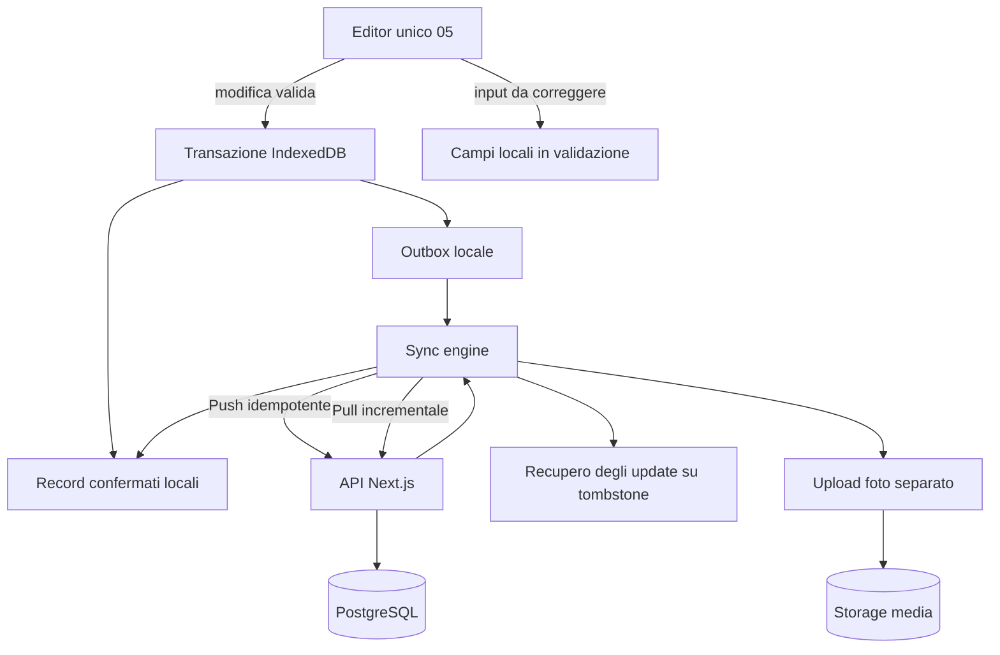

# 20 — Sincronizzazione offline-first: IndexedDB ↔ PostgreSQL

## Aggiornamento mobile — risposte A1–A9

**Contratto vigente per il web mobile da fiera:** [specifica UI mobile, risposte A1–A9](27_Specifiche_UI_Mobile.md#10-risposte-di-revisione-recepite). Questo aggiornamento prevale sui paragrafi, diagrammi, pseudocodice e casi di test precedenti incompatibili. In particolare, gli esempi con `drafts`, conferma finale «Salva», dettaglio mobile 08, foto stand o scelta manuale del conflitto descrivono la progettazione precedente e non vanno implementati nel mobile. Le parti compatibili e le funzioni desktop/post-fiera mantengono il proprio ambito.

Sync automatica sempre attiva ad app aperta e server raggiungibile, più avvio manuale, entrambe le reti. Mutazioni valide accodate dall’autosalvataggio, senza drafts. LWW per record in ordine di accettazione server; retry idempotente non diventa una nuova scrittura. Delete protette; recupero come nuovo elemento. Contatore di tutte le operazioni pendenti sul dispositivo, foto già incluse.


> **Progetto:** ExpoTrack · **Documento:** `docs/20-synchronization.md` · **Stato:** specifica tecnica proposta, non implementazione  
> **Dipendenze:** `12-database.md`, `13-backend-api.md`, `19-offline-storage.md` · **Successivo:** `21-photo-management.md`

## 1. Scopo e principi

ExpoTrack è una PWA privata, mobile-first, utilizzabile durante EICMA 2026 e altre fiere anche in assenza di rete. La sincronizzazione deve trasferire al server i dati **già confermati localmente** e ricevere le modifiche degli altri dispositivi, senza confondere la sincronizzazione con il salvataggio.

Tre passaggi automatici distinti:

1. **Modifica:** persistenza locale immediata degli input; nessuna modalità bozza.
2. **Valore valido:** transazione atomica record e outbox, senza conferma Salva finale. Input iniziali incompleti restano recuperabili localmente e non generano payload invalidi.
3. **Sync:** invio automatico della coda, ricezione ack/revisioni e pull remoto; «Sincronizzato» solo dopo conferma registrata localmente.

**Non è garantito** che il browser esegua sync in background a PWA chiusa. L'app deve riprendere correttamente quando torna attiva.

### 1.1 Invarianti

- Salvataggio mobile automatico locale e outbox per valori validi, senza modalità bozza o conferma Salva finale; input invalidi conservati localmente secondo §5.1 del documento 27.
- Ogni mutazione confermata offline è durevole nel database locale prima di essere annunciata come salvata.
- Ogni operazione ha un ID idempotente stabile e non viene persa dopo crash/retry.
- I profili sono perimetri logici distinti; `me` e `father` non condividono note, priorità, prodotti o stati.
- Un profilo selezionato **non equivale ad autenticazione**: il server non può verificarne l'identità senza un sistema di accesso.
- Sul record vivo prevale l’ultima nuova mutazione valida accettata dal server, con revisione monotona.
- Conservare audit delle scritture e payload respinti per tombstone, senza scelta manuale della versione ordinaria.
- Le eliminazioni hanno tombstone e revisioni: un dispositivo vecchio non deve resuscitare record cancellati.
- Le fotografie richiedono un protocollo specifico: metadati e binari non sono la stessa cosa.
- La categoria di un prodotto resta immutabile **dalla prima registrazione locale valida**, anche se il server non ha ancora ricevuto il prodotto.
- Gli stand editoriali sono JSON condivisi; gli stand aggiunti dall'app sono privati del profilo.
- Le configurazioni editoriali non sono modificabili mediante la normale sync dei record personali.

## 2. Perimetro dei dati

| Oggetto | Origine autorevole | Cache/operazioni offline | Considerazioni |
|---|---|---|---|
| Configurazioni eventi/categorie/stand | JSON editoriali pubblicati dal server | Snapshot validato IndexedDB | Aggiornamento atomico e compatibilità ID |
| Profili iniziali | `profiles.json` | Cache locale | Non cancellabili via UI |
| Profili dinamici | PostgreSQL | IndexedDB + outbox | Creati offline con ID generabile localmente |
| Interessi iniziali | `interests/<profileId>.json` | Snapshot + override | Le cancellazioni esplicite non vengono ripristinate dal seed |
| Priorità e `whatToSee` modificati | PostgreSQL | Override + outbox | Separati per profilo/evento/stand |
| Stati visita, note stand | PostgreSQL | IndexedDB + outbox | Default `to_visit` se nessun record |
| Stand personali | PostgreSQL | IndexedDB + outbox | Proprietario = profilo creatore |
| Prodotti | PostgreSQL | IndexedDB + outbox | Categoria immutabile dopo prima registrazione locale valida |
| Risposte questionari | PostgreSQL | IndexedDB + outbox | Conservare versione/definizione storica |
| Foto | Volume media + metadati PostgreSQL | Blob + metadati + coda upload | Upload recuperabile, riferimenti stabili |
| Input incompleti | Client | Campi locali del record | Recuperabili, non inviati finché invalidi |
| Recupero da tombstone | Server + client | Payload respinti e riferimenti | Recupero con nuovo ID |

Il protocollo è **multi-evento**: ogni mutazione include `eventId` quando l'entità appartiene a una fiera.

## 3. Architettura logica



Il **sync engine** è un modulo client, non una dipendenza dei componenti UI. Le viste leggono da IndexedDB e dai suoi selettori reattivi; la rete non deve bloccare la consultazione del catalogo.

## 4. Vocabolario operativo

- **Input in validazione:** campi locali incompleti, recuperabili ma non inviabili al server.
- **Committed local:** record validato e salvato in IndexedDB.
- **Pending:** operazione presente nell'outbox e non ancora confermata dal server.
- **In flight:** invio in corso; stato recuperabile dopo crash.
- **Acknowledged:** server ha applicato o riconosciuto idempotentemente l'operazione.
- **Pulled:** revisione remota scaricata e applicata localmente.
- **Recovery required:** update respinto perché il record è cancellato; payload locale recuperabile come nuovo elemento.
- **Tombstone:** informazione versionata che un record è stato eliminato.
- **Cursor:** token opaco che identifica un punto nel flusso ordinato dei cambiamenti server.
- **Snapshot:** configurazione editoriale validata con versione/hash.

## 5. Identificatori e versioni

### 5.1 Identificatori

I record dinamici hanno UUID creati dal client, validi offline. La chiave logica per gli stand deve discriminare origine e contesto:

```ts
type StandRef =
  | { source: 'catalog'; eventId: string; standId: string }
  | { source: 'personal'; eventId: string; standId: string; ownerProfileId: string };
```

Un riferimento a uno stand personale di altro profilo deve essere rifiutato.

### 5.2 Revisioni server

Ogni record dinamico sincronizzabile ha `revision: number` monotona, gestita dal server. Non usare il timestamp del telefono come criterio per decidere il vincitore.

### 5.3 Versione di base

L'operazione indica `baseRevision`: revisione server conosciuta quando è nata la modifica. Per una creazione nuova è `null`. Per aggiornamenti concatenati offline dello stesso record, il client deve conservare una catena di dipendenze, non inventare revisioni server.

### 5.4 Versione del protocollo

Le richieste dichiarano `protocolVersion` (proposta: `1`) separata da `schemaVersion` JSON, schema IndexedDB e migrazioni SQL. Un client incompatibile riceve un errore esplicito e **mantiene** l'outbox.

## 6. Contratto TypeScript proposto

I tipi seguenti sono **esempi di contratto da allineare** con `13-backend-api.md`, non codice definitivo.

```ts
type EntityType =
  | 'dynamicProfile'
  | 'personalStand'
  | 'standState'
  | 'interestOverride'
  | 'product'
  | 'answerSet'
  | 'photoMetadata';

type MutationAction = 'create' | 'update' | 'delete';

type OutboxStatus =
  | 'pending'
  | 'inFlight'
  | 'acknowledged'
  | 'recoveryRequired'
  | 'blockedByDependency'
  | 'failedRetryable'
  | 'failedPermanent';

interface SyncMutation {
  operationId: string;
  protocolVersion: 1;
  profileId: string;
  eventId?: string;
  entityType: EntityType;
  entityId: string;
  action: MutationAction;
  baseRevision: number | null;
  dependsOn: string[];
  payload: unknown;
  payloadHash: string;
  clientCommittedAt: string; // audit/UX, non per decidere conflitti
}

interface OutboxEntry {
  mutation: SyncMutation;
  status: OutboxStatus;
  attempts: number;
  lastAttemptAt?: string;
  nextAttemptAt?: string;
  lastErrorCode?: string;
}
```

**Attenzione:** se la rappresentazione server usa `upsert` anziché `create/update`, concordare un unico contratto; evitare traduzioni implicite che rendano ambigua l'operazione di creazione.

## 7. Commit locale automatico e atomico

Ogni modifica intenzionale viene persistita automaticamente sul dispositivo. Per dati validi, record e mutazione outbox sono scritti nella stessa transazione; la rete interviene dopo. Non esistono store o modalità bozza né conferma Salva finale. Nome, stand e categoria restano obbligatori per la prima registrazione prodotto: i valori iniziali incompleti sono recuperabili nello stesso record locale, senza essere contati o inviati come prodotto valido. Categoria e stand si bloccano alla prima registrazione locale valida. Un input successivamente invalido resta recuperabile senza sostituire l’ultima versione valida sincronizzabile. Vedere [§5.1 della specifica mobile](27_Specifiche_UI_Mobile.md#51-salvataggio-automatico-validazione-e-recupero).

Dichiarare «Salvato sul dispositivo» solo dopo commit riuscito; errori quota o transazione mantengono l’input e non producono falso successo. Prima di cambio vista/profilo completare la persistenza, senza dialogo di conferma per modifiche già autosalvate. «Fine»/indietro non annullano scritture effettuate.

Per ogni mutazione valida: preparare `operationId` e payload fuori transazione, scrivere entità più outbox, attendere commit, avviare sync. Nessuna transazione su `drafts`. All’ack applicare la revisione solo allo snapshot corrispondente, mantenendo le modifiche locali successive in coda; processare serialmente lo stesso record.

## 8. Coda outbox: struttura e regole

### 8.1 Persistenza

L'outbox è durevole in IndexedDB; non usare soltanto memoria, Redux o localStorage.

### 8.2 Ordine

- Preservare l'ordine delle operazioni che modificano **lo stesso record**.
- Consentire parallelismo limitato tra record indipendenti.
- Uno stand personale va sincronizzato prima dei prodotti che lo referenziano, oppure il server deve supportare transazioni atomiche con dipendenze esplicite.
- I metadati foto devono seguire un protocollo che garantisca la presenza del blob prima di dichiarare la foto disponibile sul server.

### 8.3 Coalescenza

È possibile comprimere più modifiche locali **non ancora inviate** dello stesso record in una mutazione finale, ma solo se:

- non si perdono dipendenze o riferimenti;
- l'ID dell'operazione già inviata non cambia payload;
- la base revision rimane corretta;
- le foto, eliminazioni e conflitti sono trattati esplicitamente;
- la logica è testata con crash e retry.

**Raccomandazione v1:** evitare coalescenza complessa; preferire una coda deterministica e serializzata per entità.

### 8.4 Stati persistenti

| Stato | Significato | Transizione tipica |
|---|---|---|
| `pending` | Pronta | → `inFlight` |
| `inFlight` | Inviata, esito non ancora registrato | → `acknowledged`, `failedRetryable`, `recoveryRequired` |
| `acknowledged` | Confermata | → rimozione sicura dall'outbox dopo commit locale |
| `failedRetryable` | Errore temporaneo | → `pending` dopo backoff |
| `blockedByDependency` | Aspetta un'entità correlata | → `pending` quando la dipendenza è risolta |
| `recoveryRequired` | Update respinto per record cancellato | → recupero esplicito come nuovo elemento |
| `failedPermanent` | Errore di validazione/compatibilità | → correzione guidata, non retry infinito |

All'avvio, un `inFlight` senza conferma deve essere ritentato **con lo stesso `operationId` e lo stesso payload**.

## 9. Push: invio delle mutazioni

### 9.1 Endpoint suggerito

`POST /api/sync/push` (nome proposto; allineare a `13-backend-api.md`).

```json
{
  "protocolVersion": 1,
  "profileId": "me",
  "operations": [
    {
      "operationId": "f7c1c816-0000-4000-8000-000000000001",
      "entityType": "standState",
      "entityId": "a1111111-0000-4000-8000-000000000001",
      "eventId": "eicma-2026",
      "action": "update",
      "baseRevision": 3,
      "dependsOn": [],
      "payload": { "visitStatus": "visited" }
    }
  ]
}
```

Gli UUID e la revisione sono dimostrativi, non dati reali.

### 9.2 Risposta per operazione

```json
{
  "protocolVersion": 1,
  "results": [
    {
      "operationId": "f7c1c816-0000-4000-8000-000000000001",
      "status": "applied",
      "entityId": "a1111111-0000-4000-8000-000000000001",
      "serverRevision": 4,
      "serverChangeCursor": "opaque-cursor"
    }
  ]
}
```

Status possibili proposti: `applied`, `alreadyApplied`, `deleted`, `dependencyPending`, `rejected`, `retryLater`.

### 9.3 Batch

Un batch può avere risultati misti. **Non** trattare HTTP 200 come prova che tutte le operazioni siano state applicate: verificare ogni `operationId` e stato.

La granularità transazionale (intero batch vs singola operazione) deve essere esplicitata dall'API. Proposta v1: operazioni atomiche individualmente, risultati separati, con dipendenze rispettate.

### 9.4 Idempotenza server

La tabella `sync_operations` conserva `operationId`, hash canonico del payload, stato e risultato. Per lo stesso ID:

- stesso payload: restituire il risultato già registrato;
- payload diverso: errore `IDEMPOTENCY_KEY_REUSED`;
- richiesta simultanea: serializzare o usare un vincolo unico per evitare doppia applicazione.

L'applicazione della mutazione e la registrazione dell'idempotenza devono avvenire nella **stessa transazione PostgreSQL**.

## 10. Pull: modifiche dal server

### 10.1 Endpoint suggerito

`GET /api/sync/pull?profileId=me&cursor=<token>&limit=...` (proposta).

Il cursor deve essere **opaco**, stabile e non basato sull'orologio del client. Deve identificare un ordine globale delle modifiche visibili al profilo, inclusi tombstone.

### 10.2 Risposta

```json
{
  "changes": [
    {
      "changeId": "server-change-123",
      "entityType": "product",
      "entityId": "d3b9ed8e-0000-4000-8000-000000000001",
      "profileId": "me",
      "eventId": "eicma-2026",
      "revision": 8,
      "deleted": false,
      "payload": { "name": "Prodotto dimostrativo" }
    }
  ],
  "nextCursor": "opaque-next-cursor",
  "hasMore": false
}
```

Un `changeId` deve permettere deduplicazione. `nextCursor` va memorizzato **nella stessa transazione locale** che applica i cambiamenti. Altrimenti un crash può avanzare il cursore senza aver salvato i record.

### 10.3 Applicazione locale

Per ogni cambio remoto:

1. controllare profilo/evento e schema;
2. individuare eventuali operazioni locali pendenti sulla stessa entità;
3. se non esistono modifiche locali concorrenti, applicare revisione o tombstone;
4. se esistono, non sovrascrivere il record locale: conservare cambio remoto e aprire un conflitto o rinviare l'applicazione secondo la semantica concordata;
5. avanzare il cursor solo dopo commit di **tutti** i cambiamenti del batch.

### 10.4 Snapshot iniziale e cursor scaduto

Per un nuovo dispositivo, prevedere bootstrap con snapshot dinamico completo per profilo e un cursor coerente con quello snapshot.

Se il server non conserva più la storia richiesta, rispondere con `CURSOR_EXPIRED` e offrire **resync controllato**: prima mettere al sicuro outbox, input locali e payload recuperabili, poi ricostruire la cache remota. Non cancellare dati locali non sincronizzati.

## 11. Sequenza consigliata push/pull

Per una sessione online:

1. Verificare compatibilità protocollo e snapshot JSON.
2. Eseguire push delle operazioni pronte, rispettando dipendenze.
3. Registrare in IndexedDB i risultati delle singole operazioni.
4. Eseguire pull incrementale fino a `hasMore=false`.
5. Ricalcolare viste e indicatori.
6. Ripetere se nuove operazioni sono state confermate durante la sync.

**Non** presumere che «push poi pull» elimini ogni race: revisioni e cursor devono restare corretti anche con scritture concorrenti. Per dispositivi con molte operazioni o foto pendenti, il pull può procedere separatamente, purché non sovrascriva dati locali in attesa.

## 12. LWW per record e protezione delle cancellazioni

La policy mobile è **LWW per record nell’ordine di accettazione server**, con revisioni monotone assegnate in transazione. Una revisione di base obsoleta su un record vivo non apre una scelta manuale: l’ultima nuova mutazione valida accettata prevale come record intero, senza merge per campo. Il timestamp del telefono è solo diagnostico. Vincoli di dominio e integrità restano applicati.

Il retry della stessa `operationId` e dello stesso payload restituisce l’esito già registrato, senza diventare una nuova scrittura; stesso ID con hash diverso è errore. Il client serializza le operazioni dello stesso record e non sovrascrive modifiche locali più recenti quando applica una conferma o un pull remoto.

Un update contro una tombstone viene respinto senza resuscitare il record. Conservare payload e riferimenti media necessari al recupero; offrire «Recupera come nuovo elemento», con nuovo ID e dipendenze valide. Nessun dialogo «versione locale/versione server» per i normali aggiornamenti concorrenti. Conservare audit per diagnosi senza promettere recupero automatico di ogni versione storica.

## 13. Eliminazioni e tombstone

### 13.1 Eliminazione locale

Dopo conferma dell'utente, il record viene marcato come eliminato localmente e una mutazione `delete` entra nell'outbox. La UI normale lo nasconde, ma lo conserva per sync e recupero conflitti.

### 13.2 Eliminazione server

Il server registra `deleted_at`, incrementa la revisione ed emette un evento nel feed di pull.

### 13.3 Race tipiche

- A elimina, B modifica offline: B riceve conflitto con tombstone.
- A elimina una foto, B modifica il prodotto: la policy di dipendenza deve evitare riferimenti orfani.
- A elimina uno stand personale con prodotti: seguire la decisione conservativa di `16-stand-management.md`, evitando cascata automatica senza consenso.
- A elimina un interesse seed: conservare un override/tombstone che impedisca la ricomparsa dopo aggiornamento JSON.

### 13.4 Retention

Non eliminare tombstone dal server finché esistono client che potrebbero ancora basarsi su revisioni precedenti, oppure imporre un resync completo quando il cursor scade. Il periodo concreto di retention è una **decisione aperta**.

## 14. Interessi JSON e override

Gli interessi di `me` e `father` sono seed editoriali separati. La sync riguarda soltanto le modifiche personali, non il file JSON originario.

Per ogni `(profileId, eventId, standRef)` distinguere:

- assenza di override → usare il seed;
- `priority=set` → usare valore personale 1–10;
- `priority=clear` → priorità volutamente rimossa;
- `whatToSee=replace` → lista personale, anche vuota se così definita;
- `whatToSee=clear` → lista volutamente svuotata;
- rimozione esplicita dall'elenco interessi → tombstone/override persistente, non semplice eliminazione della riga.

Un aggiornamento JSON può aggiungere nuovi interessi, ma **non deve cancellare le modifiche personali**. Il protocollo deve distinguere aggiornamento editoriale e modifica utente.

## 15. Stati visita e dashboard

Lo stato `to_visit` è il default **quando manca un record personale**; `visited` e `revisit` sono modifiche esplicite. La dashboard deve contare soltanto gli stand effettivamente tracciati come interessi personali, più gli stand aggiunti/seguiti secondo le regole del progetto, **non tutto il catalogo editoriale**.

I contatori vengono ricalcolati immediatamente dopo Salva locale e dopo pull. Una mutazione in attesa non deve impedire l'aggiornamento della dashboard.

Evitare doppi conteggi tra catalogo e stand personali; il riferimento completo include evento e origine.

## 16. Prodotti e questionari

### 16.1 Categoria immutabile

Il client valida e blocca `categoryId` al primo Salva locale. Il server deve rifiutare aggiornamenti successivi alla categoria, anche se la richiesta arriva da un altro dispositivo.

### 16.2 Questionari versionati

Le risposte devono riferirsi a un questionario identificabile per profilo/categoria/versione. Il server conserva lo snapshot storico o una definizione versionata. Se il JSON cambia mentre il client è offline, le risposte precedenti devono restare interpretabili.

### 16.3 Risposte facoltative

Non inserire valori predefiniti o domande obbligatorie nel protocollo. Un answer set può contenere zero risposte.

### 16.4 Prezzi e valutazioni

Prezzo assente `null` distinto da zero; rating facoltativo 1–10; preferito booleano. La validazione è ripetuta sia al Salva locale sia lato server.

## 17. Sincronizzazione fotografie

### 17.1 Problema

Le fotografie sono blob potenzialmente grandi. Inserirle direttamente nel batch JSON delle mutazioni renderebbe fragile la sincronizzazione.

### 17.2 Flusso proposto

1. L'utente acquisisce/seleziona foto.
2. Il blob è conservato localmente in IndexedDB; metadati e riferimento sono persistiti in modo coerente.
3. Premendo Salva, l'associazione alla scheda viene confermata localmente.
4. Quando online, il client richiede un upload con `photoId` stabile.
5. Trasferisce il blob (eventualmente a blocchi se necessario).
6. Il server valida MIME, dimensione e hash, memorizza il file in storage persistente.
7. Il server registra metadati e associazione, restituisce ricevuta/revisione.
8. Solo dopo conferma durabile il client può considerare la foto sincronizzata.

**La foto deve restare visibile offline dopo Salva**, anche se il server non la possiede ancora.

### 17.3 Stati foto

`localOnly`, `uploadPending`, `uploading`, `uploaded`, `failedRetryable`, `conflict`, `deletedPending` (proposta).

### 17.4 Deduplicazione e retry

Usare `photoId` stabile e hash SHA-256 per verificare il contenuto; non dedurre che due foto uguali appartengano allo stesso prodotto. Un upload ripetuto deve essere idempotente.

### 17.5 Pulizia

Non eliminare il blob locale prima di aver verificato l'esistenza remota e la politica di cache offline. Non cancellare blob necessari a recuperi o upload pendenti. La strategia di compressione e quota è dettagliata in `21-photo-management.md`.

## 18. Motore di sincronizzazione: scheduling

### 18.1 Trigger

- avvio dell'app dopo inizializzazione IndexedDB;
- ritorno online (`online` come **segnale**, non prova di raggiungibilità API);
- ritorno in primo piano;
- Salva di una nuova mutazione;
- pressione del pulsante «Sincronizza»;
- intervalli di retry **mentre l'app è attiva**.

### 18.2 Lock per evitare doppie esecuzioni

Più tab o finestre dello stesso origin potrebbero inviare contemporaneamente. Usare un coordinatore (ad esempio Web Locks API dove supportata, con fallback e idempotenza server obbligatoria). Non affidarsi a un semplice booleano in memoria condivisa tra componenti.

### 18.3 Retry

Usare exponential backoff con jitter, limite di tentativi per finestra e rispetto di `Retry-After` se presente. Gli errori permanenti non devono generare retry infiniti.

### 18.4 Timeout

Un timeout non significa che il server non abbia applicato l'operazione. Ritentare con **identico operationId/payload**.

### 18.5 Connettività

Distinguere:

- browser offline;
- Internet disponibile ma server non raggiungibile;
- errore HTTP temporaneo;
- errore di validazione;
- conflitto;
- incompatibilità protocollo;
- media upload incompleto.

## 19. Stato di sincronizzazione nella UI

Stati visibili consigliati:

| Etichetta | Condizione |
|---|---|
| **Salvato sul dispositivo** | Commit IndexedDB completato |
| **Da sincronizzare** | Outbox con operazioni pendenti |
| **Sincronizzazione in corso** | Invio/pull/upload attivo |
| **Sincronizzato** | Nessuna mutazione locale pendente e ultime conferme registrate |
| **Offline** | Rete indisponibile, dati locali consultabili |
| **Errore di sincronizzazione** | Errore da correggere o ritentare |
| **Conflitto da risolvere** | Almeno un conflitto aperto |

L'etichetta «Sincronizzato» non garantisce che **tutti gli altri dispositivi** abbiano già scaricato le modifiche; significa che il dispositivo corrente ha completato le operazioni note.

Nel menu Profilo mostrare dettagli: ultimo tentativo, ultimo successo, numero operazioni pendenti, foto pendenti, conflitti e comando manuale. Non esporre errori tecnici grezzi come unica spiegazione.

## 20. Sicurezza e privacy

### 20.1 Nessun login nella v1

La selezione profilo è un meccanismo UX, **non una prova d'identità**. Chi accede all'app può potenzialmente scegliere un altro profilo. Cloudflare Tunnel da solo non fornisce controllo accessi; valutare Cloudflare Access per il perimetro privato.

### 20.2 Validazione server

Validare `profileId`, `eventId`, `standRef`, categoria, valori, dimensioni payload e tipo entità; impedire associazioni tra profili incoerenti. Non fidarsi dei dati in IndexedDB.

### 20.3 Trasporto e credenziali

Usare HTTPS end-to-end nel perimetro previsto; credenziali PostgreSQL mai nel browser. Non inserire segreti nei JSON editoriali o nel bundle frontend.

### 20.4 Foto e metadati

Evitare di esporre percorsi filesystem, metadati non necessari o URL permanenti pubblici. Definire controlli di accesso coerenti con il perimetro dell'app.

### 20.5 Log

Loggare ID operazione, tipo, esito, durata e codice errore, senza copiare indiscriminatamente note private, risposte e immagini nei log.

## 21. Gestione errori: tassonomia

| Codice | Reazione client |
|---|---|
| `NETWORK_UNAVAILABLE` | Conserva outbox, riprova |
| `SERVER_UNAVAILABLE` | Backoff, comando manuale |
| `RATE_LIMITED` | Rispetta `Retry-After` |
| `REVISION_CONFLICT` | Blocca operazione, crea conflitto |
| `ENTITY_DELETED` | Conflitto/tombstone, nessuna ricreazione |
| `IDEMPOTENCY_KEY_REUSED` | Errore grave: non modificare payload dello stesso ID |
| `DEPENDENCY_NOT_READY` | Attendi dipendenza |
| `UNKNOWN_CATALOG_STAND` | Verifica snapshot/migrazione |
| `UNKNOWN_CATEGORY` | Verifica snapshot/migrazione |
| `CATEGORY_IMMUTABLE` | Errore permanente; preserva dati locali |
| `INVALID_PAYLOAD` | Correzione guidata, non retry infinito |
| `PROTOCOL_VERSION_UNSUPPORTED` | Aggiornamento app necessario, conserva outbox |
| `CURSOR_EXPIRED` | Resync controllato senza perdita di dati locali |
| `MEDIA_UPLOAD_FAILED` | Retry upload indipendente |
| `LOCAL_STORAGE_QUOTA_EXCEEDED` | Blocca falso salvataggio; guida liberazione spazio |

Non cancellare mai l'outbox come risposta generica a un errore.

## 22. Scenari end-to-end

### 22.1 Primo utilizzo online

1. Caricare configurazioni editoriali validate.
2. Salvare snapshot locale.
3. Selezionare profilo.
4. Ottenere snapshot dinamico + cursor coerente.
5. Applicare atomically i record locali e il cursor.
6. Rendere la dashboard disponibile anche senza rete.

### 22.2 Un prodotto creato offline

1. Ogni campo viene conservato localmente; nessuna creazione all’apertura del modulo.
2. Al primo insieme valido nome/stand/categoria, transazione automatica prodotto e outbox; categoria/stand bloccati.
3. UI aggiornata senza attendere rete; le modifiche successive generano nuove mutazioni ordinate.
4. Al ritorno online, push idempotente, ack/revisione locale e pull; nessun pulsante Salva necessario.

### 22.3 Cambio di stato offline

Uno stand di interesse passa da `to_visit` a `visited`; la dashboard lo riflette subito. L'operazione entra nell'outbox. Un secondo dispositivo vedrà il cambio soltanto dopo il push del primo e il proprio pull.

### 22.4 Aggiornamenti concorrenti delle descrizioni

A e B partono da revisione 3. A sincronizza e il server assegna 4. B invia un nuovo update valido basato su 3: il record vivo viene aggiornato secondo LWW e riceve revisione 5. Nessuna scelta manuale; il timestamp client non arbitra. Il retry dell’operazione di A restituisce il vecchio esito senza riscrivere il record. Se invece A aveva eliminato il record, l’update B è respinto e conservato per recupero come nuovo elemento.

### 22.5 Crash dopo push, prima della conferma locale

Il server ha applicato l'operazione, ma il client si chiude prima di registrare la risposta. Alla riapertura, ritenta con stesso `operationId`. Il server risponde `alreadyApplied`; nessuna duplicazione.

### 22.6 Crash durante pull

I cambiamenti e il cursor devono essere committati nella stessa transazione locale. Se la transazione fallisce, il cursor non avanza; il batch può essere ripetuto.

### 22.7 Nuovo profilo creato offline

Il client genera un ID stabile; salva profilo dinamico localmente; eventuali dati collegati dipendono dalla creazione del profilo. Il push rispetta l'ordine; nessun JSON iniziale interessi/questionari viene inventato.

### 22.8 Foto acquisita offline

Blob salvato localmente, metadati confermati, upload pendente. Il prodotto e la foto sono visibili offline. Al ritorno online, upload e associazione vengono confermati separatamente.

### 22.9 Catalogo aggiornato durante assenza di rete

Il client conserva lo snapshot precedente. Al ritorno online scarica un nuovo snapshot solo dopo validazione completa. Se una categoria o uno stand referenziato è stato rimosso, non elimina i record personali: richiede compatibilità/migrazione.

## 23. Pseudocodice orchestratore

```ts
async function synchronize(profileId: string): Promise<void> {
  if (!(await acquireSyncLease(profileId))) return;
  try {
    await assertProtocolCompatibility();
    await refreshEditorialSnapshotIfSafe();

    const ready = await outbox.getReadyOperations(profileId);
    for (const batch of groupByDependencies(ready)) {
      const results = await api.push(batch);
      await db.transaction(
        ['outbox', 'products', 'stand_states', 'conflicts', 'sync_meta'],
        'readwrite',
        tx => applyPushResults(tx, results)
      );
    }

    let hasMore = true;
    while (hasMore) {
      const cursor = await syncMeta.getCursor(profileId);
      const page = await api.pull({ profileId, cursor });
      await db.transaction(
        ['products', 'stand_states', 'personal_stands',
         'interest_overrides', 'answer_sets', 'photos',
         'conflicts', 'sync_meta'],
        'readwrite',
        tx => applyPageAndCursorAtomically(tx, page)
      );
      hasMore = page.hasMore;
    }

    await uploadPendingPhotos(profileId);
  } finally {
    await releaseSyncLease(profileId);
  }
}
```

**Solo pseudocodice:** store e ordine definitivi dipendono dai contratti dei documenti `13`, `19`, `21`. Il lock non deve restare bloccato indefinitamente dopo un crash. Una transazione IndexedDB non deve contenere chiamate HTTP.

## 24. Osservabilità e diagnostica

Misurare, senza raccogliere contenuti privati inutilmente:

- numero operazioni pending, retryable, conflict, permanent;
- età massima dell'operazione pendente;
- ultimo push/pull riuscito;
- cursor corrente e versione protocollo;
- numero foto non caricate;
- durata media push/pull/upload;
- numero retry e fallimenti per codice;
- spazio locale approssimativo utilizzato;
- numero di resync completi;
- conflitti aperti e risolti.

Prevedere una vista diagnostica locale semplice per l'uso privato e log server strutturati con correlation ID. Non stampare nei log l'intero payload di prodotti, note o risposte.

## 25. Prestazioni e limiti

- Batch di mutazioni con dimensione massima configurabile e payload limitati.
- Pull paginato, mai un'unica risposta illimitata.
- Concorrenza upload foto limitata, per non saturare connessioni mobili.
- Priorità UX ai record testuali rispetto a upload pesanti, purché le dipendenze restino corrette.
- Retry con jitter per evitare raffiche quando torna la rete.
- Nessuna promessa di sincronizzazione in background a browser chiuso.
- L'app deve restare consultabile e navigabile durante il sync.
- Testare anche connessioni lente, captive portal, timeout e spazio disco quasi pieno.

I limiti numerici (dimensione batch, foto, retry, retention) sono **parametri da decidere**, non valori fittizi da fissare in questa specifica.

## 26. Test: salvataggio e outbox

| ID | Scenario | Esito atteso |
|---|---|---|
| SYNC-01 | Modifica senza Salva | Commit automatico locale e outbox per valori validi; sync quando raggiungibile |
| SYNC-02 | Salva offline | Record + outbox atomici |
| SYNC-03 | Crash prima del commit locale | Nessun falso successo; ultime scritture già persistite recuperabili |
| SYNC-04 | Crash dopo commit locale | Operazione recuperata |
| SYNC-05 | Quota IndexedDB esaurita | Errore esplicito; nessun falso salvataggio |
| SYNC-06 | Salva categoria prodotto | Categoria immutabile subito |
| SYNC-07 | Cambio profilo | Commit locale completato e outbox/input isolati |
| SYNC-08 | Due modifiche stesso record offline | Ordine rispettato |
| SYNC-09 | Dipendenza stand personale | Prodotto inviato solo quando valido |
| SYNC-10 | Retry con stesso ID/payload | Una sola applicazione |
| SYNC-11 | Retry stesso ID/payload diverso | Errore idempotenza |
| SYNC-12 | HTTP 200 con risultato misto | Stato gestito per operazione |
| SYNC-13 | Timeout dopo applicazione server | Retry `alreadyApplied` |
| SYNC-14 | Errore permanente | Outbox preservata, niente retry infinito |
| SYNC-15 | App chiusa | Nessuna promessa background sync |

## 27. Test: pull e revisioni

| ID | Scenario | Esito atteso |
|---|---|---|
| SYNC-16 | Primo bootstrap | Snapshot e cursor coerenti |
| SYNC-17 | Pull paginato | Nessuna modifica saltata |
| SYNC-18 | Crash prima del commit pull | Cursor non avanzato |
| SYNC-19 | Ripetizione pagina pull | Applicazione idempotente |
| SYNC-20 | Cursor scaduto | Resync senza perdere outbox/input locali/payload recuperabili |
| SYNC-21 | Update remoto senza modifiche locali | Applicato |
| SYNC-22 | Update remoto con operazione locale | Non sovrascrive silenziosamente |
| SYNC-23 | Due dispositivi stessa revisione | Conflitto al secondo push |
| SYNC-24 | Due profili stesso stand | Nessun conflitto incrociato |
| SYNC-25 | LWW e retry concorrente | Ultima nuova mutazione accettata prevale; replay non riapplica |
| SYNC-26 | Nuova modifica durante risoluzione | Nuovo conflitto, non force overwrite |
| SYNC-27 | Delete remoto e update locale | Tombstone/conflitto |
| SYNC-28 | Client offline molto vecchio | Compatibilità o resync controllato |
| SYNC-29 | Due tab aperte | Nessuna duplicazione applicativa |
| SYNC-30 | Orari client differenti | Nessun last-write-wins per timestamp |

## 28. Test: foto, JSON, dashboard e sicurezza

| ID | Scenario | Esito atteso |
|---|---|---|
| SYNC-31 | Foto salvata offline | Blob consultabile |
| SYNC-32 | Upload interrotto | Retry senza duplicati |
| SYNC-33 | Metadati ricevuti, blob mancante | Foto non marcata completa |
| SYNC-34 | Foto con conflitto | Blob preservato |
| SYNC-35 | Foto eliminata da altro device | Nessuna resurrezione |
| SYNC-36 | Seed interessi aggiornato | Override preservati |
| SYNC-37 | Priorità seed cancellata dall'utente | Non ripristinata |
| SYNC-38 | Stato stand assente | `to_visit` effettivo |
| SYNC-39 | Stato salvato offline | Dashboard aggiornata subito |
| SYNC-40 | Stand catalogo non interessato | Non contato automaticamente come da visitare |
| SYNC-41 | Nuovo profilo offline | ID stabile, dipendenze rispettate |
| SYNC-42 | Stand personale di altro profilo | Riferimento rifiutato |
| SYNC-43 | Categoria rimossa da JSON | Dati personali preservati |
| SYNC-44 | Questionario aggiornato | Risposte storiche interpretabili |
| SYNC-45 | Prodotto rating 11 | Validazione rifiuta |
| SYNC-46 | Prezzo zero vs null | Distinzione mantenuta |
| SYNC-47 | Tunnel senza Access | Non dichiarato autenticato |
| SYNC-48 | Payload manipolato in IndexedDB | Server valida e rifiuta |
| SYNC-49 | Server non raggiungibile ma navigator online | Backoff e UI corretta |
| SYNC-50 | Ripristino backup DB+media | Dati e foto coerenti |

## 29. Criteri di accettazione

- [ ] Il salvataggio locale non dipende dalla disponibilità della rete.
- Salvataggio mobile automatico locale e outbox per valori validi, senza modalità bozza o conferma Salva finale; input invalidi conservati localmente secondo §5.1 del documento 27.
- [ ] Record e outbox sono committati atomicamente.
- [ ] Nessuna operazione è persa in caso di crash/retry.
- [ ] Il server garantisce idempotenza per `operationId` e payload.
- [ ] Le revisioni sono controllate lato server.
- Concorrenza mobile LWW per record in ordine di accettazione server; revisioni monotone, idempotenza e protezione delle tombstone.
- [ ] Le versioni in conflitto rimangono recuperabili.
- [ ] I cursor di pull avanzano solo con i dati applicati.
- [ ] Un cursor scaduto non causa cancellazione di dati locali non sincronizzati.
- [ ] Le tombstone impediscono la ricomparsa di record eliminati.
- [ ] Il profilo e l'evento delimitano ogni operazione.
- [ ] Gli stand personali non sono accessibili tramite riferimenti di altri profili.
- [ ] La categoria prodotto resta immutabile dal primo Salva.
- [ ] I questionari storici restano leggibili.
- [ ] Le fotografie sono visibili offline dopo Salva.
- [ ] Le foto non vengono considerate sincronizzate prima della conferma del server.
- [ ] La UI distingue salvato localmente, pendente, sincronizzato, errore e conflitto.
- [ ] La dashboard si aggiorna dai dati locali, senza attendere il server.
- [ ] Le configurazioni JSON sono aggiornate in modo atomico e non cancellano override personali.
- [ ] Le incompatibilità di protocollo vengono segnalate preservando l'outbox.
- [ ] I limiti di sicurezza dovuti all'assenza di login sono dichiarati chiaramente.
- [ ] Tutti i test di crash, offline, concorrenza e retry sono automatizzati dove possibile.

## 30. Decisioni aperte e coordinamento con gli altri documenti

| Decisione | Raccomandazione | Documento collegato |
|---|---|---|
| Nomi definitivi endpoint push/pull | Unificare contratti prima dell'implementazione | `13-backend-api.md` |
| Modello `create/update` vs `upsert` | Preferire azioni esplicite | `13-backend-api.md` |
| Granularità batch | Atomica per operazione con esiti distinti | `13-backend-api.md` |
| Store IndexedDB esatti | Allineare transazioni e nomi | `19-offline-storage.md` |
| Coordinamento multi-tab | Web Locks + fallback + idempotenza | `19-offline-storage.md` |
| Cursor e retention tombstone | Cursor opaco, resync se scaduto | `12-database.md` |
| Concorrenza mobile | LWW per record, revisioni server e recupero da tombstone | `27_Specifiche_UI_Mobile.md` |
| Eliminazione stand personale con prodotti | Bloccare finché esistono prodotti, salvo scelta diversa | `16-stand-management.md` |
| Upload foto e limiti | Definire dimensioni, compressione, MIME e cache | `21-photo-management.md` |
| Protezione perimetro | Valutare Cloudflare Access | `25-security.md` |
| Test end-to-end | Due dispositivi, rete intermittente, crash | `26-testing.md` |

Le scelte indicate come **proposte** non devono essere interpretate come decisioni definitive dell'utente. Prima di implementare, verificare che nomi di campi, endpoint e stati coincidano con gli altri documenti.

---

## 31. Documento successivo

**`docs/21-photo-management.md`** approfondirà acquisizione immagini da smartphone, anteprime, compressione, metadati, storage locale e server, upload recuperabile, eliminazione sicura, limiti di spazio, backup e integrazione con prodotti/stand e PDF.
