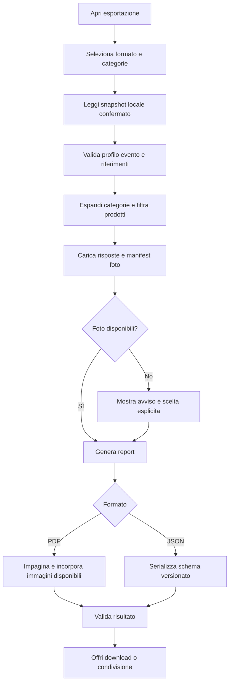

# 23 — Esportazione PDF e JSON

> **Progetto:** ExpoTrack · **Documento:** `docs/23-export.md` · **Stato:** specifica tecnica proposta per v1  
> **Precedente:** [`22-comparison.md`](22-comparison.md) · **Successivo:** [`24-deployment.md`](24-deployment.md)

## 1. Scopo e principi

ExpoTrack consente a chi visita una fiera di esportare i propri dati in **PDF**, per consultarli e condividerli, e in **JSON**, per conservarne una copia strutturata. L'esportazione riguarda un **solo profilo e un solo evento alla volta** e non introduce importazione, Excel o sincronizzazione attraverso file.

Requisiti fondamentali:

- Il profilo è selezionato all'avvio dell'app e può essere cambiato; non esiste login interno nella v1.
- L'utente può esportare **tutte le categorie** oppure **una selezione**.
- Il PDF presenta un **riepilogo per categoria e sottocategoria** e **schede prodotto dettagliate**, comprendenti, se presenti, fotografie, prezzo, valutazione, note e risposte ai questionari.
- Il JSON preserva i dati personali e i riferimenti necessari a interpretarli, con un formato versionato e documentato.
- Il prodotto appartiene a una sola categoria, immutabile dopo il primo Salva; il confronto desktop resta una funzione separata dall'esportazione.
- I dati non confermati nel pulsante **Salva** sono bozze e **non entrano nell'esportazione**.
- I dati salvati localmente ma non ancora sincronizzati **possono essere esportati**, con indicazione trasparente dello stato della copia.
- L'esportazione non deve modificare prodotti, interessi, stati, foto, outbox o revisioni.

**Decisione progettuale raccomandata:** costruire l'export da uno snapshot coerente dei dati confermati disponibili sul dispositivo, anche offline. Se il dispositivo non possiede tutte le fotografie, informare l'utente prima della generazione e offrire l'esportazione parziale esplicitamente contrassegnata, senza immagini inventate.

## 2. Confini della funzionalità

### Incluso nella v1

1. Esportazione PDF del profilo attivo e dell'evento selezionato.
2. Esportazione JSON con schema stabile e versione.
3. Filtro per categorie e sottocategorie, con scelta «tutte» o «selezionate».
4. Riepilogo aggregato e dettaglio dei prodotti osservati.
5. Note, risposte ai questionari, valutazioni e fotografie quando disponibili.
6. Dati degli stand pertinenti ai prodotti esportati; opzionalmente riepilogo degli stand di interesse, secondo una decisione esplicita dell'utente.
7. Indicazione di esportazione offline, dati in attesa di sync, media mancanti e conflitti irrisolti.
8. Condivisione o salvataggio tramite le capacità del browser/dispositivo.

### Escluso dalla v1

- Importazione di file JSON o PDF.
- Excel, CSV e documenti Word.
- Esportazione di tutti i profili insieme come impostazione predefinita.
- Pubblicazione automatica su servizi esterni.
- Invio email o condivisione automatica.
- Certificazione che un export sia un backup completo dell'installazione server.
- Modifica dei dati attraverso il PDF.
- Generazione di mappe, percorsi o itinerari.

## 3. Modello di sicurezza e privacy

La scelta del profilo **non costituisce autenticazione**. L'applicazione è privata, ma chiunque acceda all'interfaccia può selezionare un altro profilo, salvo protezioni di accesso esterne. Il Tunnel Cloudflare, da solo, non autentica gli utenti.

Pertanto:

- Mostrare sempre il **nome del profilo** e l'**evento** prima di esportare.
- Non includere automaticamente dati di altri profili, neppure se gli stessi stand sono condivisi.
- Non inserire cookie, token, credenziali, chiavi Cloudflare, endpoint privati o percorsi filesystem nel JSON.
- Evitare EXIF sensibili delle fotografie; non includere coordinate GPS originali per impostazione predefinita.
- Considerare il file scaricato **fuori dal controllo dell'app**: chi lo riceve può conservarlo o inoltrarlo.
- Non inviare dati a servizi di conversione PDF esterni.
- Applicare limiti di dimensione e sanificazione dei testi, anche contro l'inserimento di HTML nel rendering.

## 4. Flusso utente

### 4.1 Accesso

Punto di accesso consigliato: **Profilo → Esporta dati**, con eventuale collegamento secondario dalla Dashboard. Il menu non deve diventare una quinta voce della navigazione inferiore mobile.

### 4.2 Configurazione

L'utente vede:

- Profilo attivo e fiera corrente, non modificabili durante il singolo job.
- Formato: **PDF** o **JSON**.
- Ambito categorie: **Tutte** oppure **Seleziona categorie**.
- Albero categorie/sottocategorie, ricercabile se necessario.
- Anteprima dei conteggi: prodotti inclusi, categorie coinvolte, fotografie note, media disponibili offline, conflitti.
- Avviso se alcuni dati non sono sincronizzati o alcune immagini non sono disponibili.
- Pulsante **Genera esportazione**.

La scelta delle categorie non deve alterare i filtri correnti delle schermate Stand e Prodotti.

### 4.3 Completamento

Al termine mostrare nome del file, dimensione indicativa e opzioni di download/condivisione supportate dal browser. Non affermare che il file sia stato salvato sul dispositivo se il browser non ne conferma l'esito.

### 4.4 Annullamento

L'utente può annullare un job in corso. Il job annullato non produce un file presentato come completo. I dati originali non vengono modificati.

## 5. Regole di selezione categorie

Le categorie sono definite da `config/categories.json` tramite `id` e `parentId` opzionale. Il catalogo può avere profondità arbitraria, generalmente 2–3 livelli.

**Proposta di semantica:**

- Selezionare una categoria padre include i prodotti assegnati **direttamente al padre** e quelli assegnati a **tutti i discendenti**.
- Selezionare una sottocategoria include quella sottocategoria e i suoi discendenti, non i fratelli.
- Selezionare due rami sovrapposti non duplica prodotti.
- Il riepilogo raggruppa ogni prodotto **una sola volta**, in base alla sua categoria assegnata.
- La selezione vuota è invalida quando è attiva la modalità «Selezionate».
- Le categorie senza prodotti possono essere omesse dal PDF, salvo opzione esplicita per includerle.
- Se un prodotto usa un ID categoria storico non più presente nel catalogo, non eliminarlo: presentarlo in **Categoria non più disponibile**, con ID originale e avviso di compatibilità.

### 5.1 Esempio

```text
Abbigliamento e protezioni
├── Caschi
│   └── Caschi integrali
└── Guanti moto

Moto
└── Naked
```

Se l'utente seleziona `Caschi`, esporta prodotti in `Caschi` e `Caschi integrali`, ma non `Guanti moto` né `Naked`.

### 5.2 Algoritmo TypeScript indicativo

```ts
interface CategoryNode {
  id: string;
  name: string;
  parentId?: string;
}

function expandSelectedCategories(
  categories: CategoryNode[],
  selectedIds: ReadonlySet<string>
): Set<string> {
  const children = new Map<string, string[]>();
  for (const category of categories) {
    if (!category.parentId) continue;
    const list = children.get(category.parentId) ?? [];
    list.push(category.id);
    children.set(category.parentId, list);
  }

  const included = new Set<string>();
  const visit = (id: string): void => {
    if (included.has(id)) return;
    included.add(id);
    for (const childId of children.get(id) ?? []) visit(childId);
  };
  for (const id of selectedIds) visit(id);
  return included;
}
```

L'albero deve essere validato contro cicli e riferimenti a genitori inesistenti nel caricamento della configurazione; la funzione assume un catalogo valido.

## 6. Fonte dati e consistenza

### 6.1 Fonte primaria

Per un export richiesto sul dispositivo, la fonte consigliata è lo **snapshot locale confermato** in IndexedDB, unito allo snapshot editoriale validato già disponibile. Questo permette di includere record salvati offline e di generare un PDF senza rete.

### 6.2 Snapshot atomico

La raccolta deve leggere in una transazione IndexedDB `readonly` coerente, per quanto supportato dall'implementazione, almeno:

- prodotti e relativi answer set;
- riferimenti agli stand e stati personali;
- interessi/override rilevanti;
- metadati delle foto;
- configurazione categorie/questionari e relativo hash;
- metadati sync e conflitti.

I blob fotografici possono richiedere lettura separata; memorizzare un manifest di ID/hash e segnalare se un blob non è più disponibile. **Non** leggere un prodotto prima e le sue risposte molto dopo senza protezione contro cambiamenti incoerenti.

### 6.3 Cosa escludere

- Bozze non confermate.
- Tombstone già applicate come cancellazioni correnti.
- Dati di altri profili o eventi.
- Foto temporanee non associate a un salvataggio confermato.
- Credenziali, log di debug, coda outbox grezza e dettagli tecnici dei conflitti non necessari al report.

### 6.4 Conflitti

Per una versione esportabile, scegliere esplicitamente la **versione locale confermata** e marcare l'export come contenente conflitti irrisolti. Non unire silenziosamente campi divergenti. Il JSON può contenere un elenco di riferimenti ai conflitti, senza esporre indiscriminatamente payload duplicati; l'esportazione integrale delle due versioni è una funzione separata da definire.

## 7. Formato PDF: struttura

Il PDF deve essere leggibile su smartphone e stampabile su A4, con attenzione alla resa di testi lunghi e immagini.

### 7.1 Copertina

- Nome app: ExpoTrack.
- Nome evento: per esempio EICMA 2026.
- Nome profilo.
- Data e ora di generazione in fuso locale, con timezone esplicita o ISO nel metadato.
- Ambito: tutte le categorie oppure elenco delle categorie selezionate.
- Stato dati: sincronizzati / modifiche locali pendenti / conflitti / foto non disponibili.

Non inventare date di fiera, padiglioni o numeri stand non verificati.

### 7.2 Sommario

- Numero di prodotti esportati.
- Numero di categorie e sottocategorie rappresentate.
- Numero di prodotti preferiti.
- Numero di prodotti con prezzo, valutazione e fotografie.
- Eventuali avvisi di incompletezza.

**Non** usare la somma dei prezzi come «spesa»: i prezzi sono prezzi osservati, non acquisti effettuati. Non confondere budget con importi effettivamente spesi.

### 7.3 Riepilogo per categoria/sottocategoria

Per ciascuna categoria rappresentata:

- percorso gerarchico, per esempio `Abbigliamento e protezioni / Caschi / Caschi integrali`;
- numero prodotti;
- elenco compatto di prodotti con nome, stand, prezzo (se presente), voto (se presente), preferito;
- eventuali statistiche di prezzo chiaramente etichettate come **prezzi osservati** e solo se utili.

### 7.4 Schede prodotto

Ogni prodotto ha una scheda con:

| Campo | Regola |
|---|---|
| Nome | Sempre presente |
| Categoria completa | Sempre presente; ID storico se non risolvibile |
| Stand | Nome editoriale o personale; ID di fallback se mancante |
| Padiglione/posizione | Solo se presenti e validati; mai inventati |
| Prezzo | `€ 0,00` se zero; `Non indicato` se assente |
| Valutazione generale | `x/10` se presente; altrimenti non indicata |
| Preferito | Indicazione solo se true, o stato esplicito coerente |
| Note | Testo completo con impaginazione sicura |
| Questionario | Domande e risposte effettivamente salvate |
| Fotografie | Immagini disponibili, con didascalie opzionali |

Le domande senza risposta possono essere omesse o mostrate come «Non compilata»: **scelta UI da stabilire**, ma mai trasformate in risposte negative.

### 7.5 Impaginazione

- A4 verticale come default proposto.
- Margini adeguati e intestazione/piede con evento, profilo, pagina.
- Indice o segnalibri per documenti lunghi, se supportati dalla libreria scelta.
- Evitare di spezzare titoli e righe di questionario in modo illeggibile.
- Fotografie con proporzioni mantenute, senza distorsioni.
- Testi lunghi su più pagine; nessun troncamento silenzioso.
- Font Unicode per caratteri italiani e simboli comuni; incorporamento solo se consentito dalla licenza.
- Nessuna dipendenza da connessione Internet per completare la generazione offline.

## 8. Fotografie nel PDF

### 8.1 Disponibilità

Per ogni foto, distinguere:

- `available_local`: blob disponibile sul dispositivo;
- `available_remote`: presente sul server ma non in cache locale;
- `pending_upload`: confermata localmente, upload non completato;
- `missing`: metadati presenti ma blob non reperibile;
- `deleted`: foto eliminata, non esportare.

Un'immagine `available_remote` può essere scaricata **solo se la connessione è disponibile e l'utente consente di completare il download**. Offline non è garantita.

### 8.2 Politica di incompletezza

Prima di generare il PDF, mostrare:

> «3 fotografie non sono disponibili su questo dispositivo. Puoi riprovare online oppure generare il PDF senza queste immagini. Il documento segnalerà le fotografie mancanti.»

Non inserire immagini casuali o segnaposto che sembrino fotografie originali. Un riquadro testuale con ID foto e motivo dell'assenza è accettabile.

### 8.3 Compressione

Usare versioni ridimensionate adatte al PDF, senza degradare eccessivamente cartellini e testi fotografati. Conservare gli originali in storage: la generazione del report non deve riscriverli.

### 8.4 Foto dello stand

Le foto stand possono comparire in un'eventuale sezione stand oppure essere elencate come materiale collegato allo stand; **non attribuirle automaticamente a un singolo prodotto**.

## 9. Questionari nel PDF

I questionari sono specifici per **profilo e categoria**, con domande facoltative e tipologie:

1. testo;
2. numero;
3. sì/no;
4. scelta singola;
5. scelta multipla;
6. voto 1–10.

La scheda deve usare lo **snapshot storico** della definizione questionario associato alle risposte, quando disponibile. Se le opzioni di un questionario sono cambiate, mostrare le etichette della versione utilizzata, non reinterpretare gli ID attraverso il JSON corrente.

| Tipo | Esempio di visualizzazione |
|---|---|
| Testo | `Comfort: Molto buono` |
| Numero | `Peso dichiarato: 1.450 g` se unità definita |
| Sì/no | `Visiera parasole: Sì` |
| Scelta singola | `Materiale: Fibra` |
| Scelta multipla | `Dotazioni: Pinlock, Sacca` |
| Voto | `Vestibilità: 8/10` |

Gli esempi sono **fittizi** e non rappresentano prodotti o stand verificati a EICMA 2026.

Una risposta non compilata non è uguale a `false`, `0` o lista vuota quando questi valori hanno un significato distinto nello schema della domanda.

## 10. Esportazione JSON: contratto

### 10.1 Obiettivi

Il JSON è un **export strutturato**, non un file di configurazione editoriale né un pacchetto di importazione automaticamente supportato. Deve essere leggibile da software esterni e sufficientemente auto-descrittivo.

### 10.2 Schema proposto

```ts
interface ExpoTrackExportV1 {
  format: "expotrack-export";
  exportSchemaVersion: 1;
  generatedAt: string;             // ISO 8601
  appVersion?: string;
  event: {
    id: string;
    name: string;
  };
  profile: {
    id: string;
    name: string;
  };
  selection: {
    mode: "all" | "selected";
    selectedCategoryIds: string[];
    resolvedCategoryIds: string[];
  };
  provenance: {
    source: "local-confirmed";
    editorialSnapshotHash?: string;
    hasPendingSync: boolean;
    hasUnresolvedConflicts: boolean;
    hasMissingMedia: boolean;
  };
  categories: ExportCategory[];
  stands: ExportStand[];
  products: ExportProduct[];
  mediaManifest: ExportMedia[];
  warnings: ExportWarning[];
}

interface ExportCategory {
  id: string;
  name: string;
  parentId?: string;
}

interface ExportStand {
  id: string;
  source: "catalog" | "personal";
  eventId: string;
  name: string;
  hallId?: string;
  booth?: string;
}

interface ExportProduct {
  id: string;
  profileId: string;
  eventId: string;
  stand: { source: "catalog" | "personal"; id: string };
  name: string;
  categoryId: string;
  price: null | { amountMinor: number; currency: "EUR" };
  rating: number | null;
  favorite: boolean;
  notes: string;
  answers: ExportAnswerSet[];
  photoIds: string[];
  createdAt: string;
  updatedAt: string;
}

interface ExportAnswerSet {
  questionnaireId: string;
  questionnaireVersion: number;
  definitionSnapshot?: unknown;
  answers: Record<string, unknown>;
}

interface ExportMedia {
  id: string;
  ownerType: "product" | "stand";
  mimeType: string;
  byteSize?: number;
  sha256?: string;
  availability: "local" | "remote-only" | "pending" | "missing";
  includedBinary: false;
}

interface ExportWarning {
  code: string;
  message: string;
  entityIds?: string[];
}
```

**Nota:** il campo `includedBinary: false` esplicita che il JSON v1 non incorpora automaticamente fotografie come Base64. Un eventuale **archivio ZIP con JSON + immagini** sarebbe una funzionalità aggiuntiva da decidere separatamente, non inclusa nei requisiti correnti.

### 10.3 Esempio JSON illustrativo

```json
{
  "format": "expotrack-export",
  "exportSchemaVersion": 1,
  "generatedAt": "2026-10-27T12:00:00.000Z",
  "event": { "id": "evento-demo", "name": "Fiera dimostrativa" },
  "profile": { "id": "me", "name": "Io" },
  "selection": {
    "mode": "selected",
    "selectedCategoryIds": ["helmets"],
    "resolvedCategoryIds": ["helmets", "full-face-helmets"]
  },
  "provenance": {
    "source": "local-confirmed",
    "hasPendingSync": true,
    "hasUnresolvedConflicts": false,
    "hasMissingMedia": false
  },
  "categories": [
    { "id": "helmets", "name": "Caschi", "parentId": "rider-equipment" },
    { "id": "full-face-helmets", "name": "Caschi integrali", "parentId": "helmets" }
  ],
  "stands": [
    { "id": "stand-demo", "source": "catalog", "eventId": "evento-demo", "name": "Stand dimostrativo" }
  ],
  "products": [
    {
      "id": "demo-product-1",
      "profileId": "me",
      "eventId": "evento-demo",
      "stand": { "source": "catalog", "id": "stand-demo" },
      "name": "Casco dimostrativo",
      "categoryId": "full-face-helmets",
      "price": { "amountMinor": 25000, "currency": "EUR" },
      "rating": 8,
      "favorite": true,
      "notes": "Da riprovare con gli occhiali",
      "answers": [],
      "photoIds": [],
      "createdAt": "2026-10-27T10:00:00.000Z",
      "updatedAt": "2026-10-27T10:30:00.000Z"
    }
  ],
  "mediaManifest": [],
  "warnings": []
}
```

Gli identificativi e i dati di questo esempio sono **inventati a scopo tecnico**; non implicano l'esistenza di espositori, posizioni o prodotti EICMA 2026.

### 10.4 Precisione monetaria

Gli importi nel JSON sono espressi in **unità minori della valuta** (`amountMinor`, centesimi per EUR), come nel database. Non serializzare prezzi con floating point non arrotondato.

### 10.5 Foto e JSON

Il manifest indica le fotografie correlate, ma **non** garantisce che il solo `.json` sia sufficiente a ricostruire i file binari. Non definire questo export come backup fotografico completo.

### 10.6 Compatibilità futura

- Incrementare `exportSchemaVersion` quando cambia il contratto.
- Non riutilizzare campi esistenti con significato differente.
- Consentire ai lettori di ignorare campi aggiuntivi sconosciuti, dove compatibile.
- Validare il documento prima di offrire il download.
- Mantenere una specifica JSON Schema separata in fase di implementazione, se utile.

## 11. Riepilogo stand: ambito proposto

L'utente ha richiesto principalmente esportazione di prodotti e informazioni raccolte. È ragionevole includere **solo gli stand associati ai prodotti esportati** nel JSON e nel PDF di base.

**Opzione da confermare:** aggiungere «Includi anche i miei stand di interesse», con stato visita, priorità, cose da vedere, note e foto stand. Questa opzione richiede regole di filtro chiare: uno stand con più categorie non deve essere incluso arbitrariamente quando l'utente seleziona un ramo non pertinente.

Se l'opzione non viene approvata, l'export v1 deve comunque conservare il riferimento allo stand di ogni prodotto.

## 12. Generazione lato client o server

### 12.1 Opzione raccomandata: client

Generare PDF e JSON nel browser a partire da IndexedDB consente l'export offline e include dati confermati ma non ancora sincronizzati. La libreria deve essere compatibile con Next.js/PWA e con i browser mobile previsti.

### 12.2 Limiti

- Un PDF con molte foto può consumare memoria sul telefono.
- Le librerie PDF possono non supportare correttamente tutte le lingue/font o la paginazione complessa.
- La generazione deve avere progressi visibili e poter essere interrotta.
- I blob vanno elaborati a lotti, non caricati tutti simultaneamente senza limiti.

### 12.3 Fallback server

Un endpoint server opzionale può generare report voluminosi, ma **non** può includere dati non sincronizzati finché non li riceve. Non sostituire silenziosamente il report locale con una versione server incompleta.

**Decisione aperta:** scelta concreta della libreria PDF e soglie di fallback. Non vincolare oggi il progetto a una libreria specifica.

## 13. Pipeline tecnica



### 13.1 Fasi

1. Congelare il contesto `profileId`, `eventId`, formato e selezione.
2. Leggere record confermati e snapshot editoriale.
3. Validare struttura e referenze, senza mutare i dati.
4. Calcolare l'insieme di categorie discendenti.
5. Filtrare e ordinare i prodotti in modo deterministico.
6. Risolvere nomi di categorie, stand e questionari.
7. Preparare media e warning.
8. Generare il documento.
9. Validare che il file sia leggibile e non vuoto.
10. Esporre il file al download/condivisione.
11. Rilasciare URL temporanei e memoria, se possibile.

### 13.2 Ordinamento

Proposta predefinita:

1. categoria secondo `sortOrder` e poi nome;
2. sottocategoria con la stessa regola;
3. prodotti preferiti per primi;
4. nome prodotto alfabetico;
5. ID come tie-break stabile.

Il PDF e il JSON devono usare un ordinamento riproducibile per gli stessi dati. Non usare ordinamento casuale o l'ordine di inserimento di IndexedDB.

## 14. Tipi TypeScript del job

```ts
type ExportFormat = "pdf" | "json";

type ExportCategorySelection =
  | { mode: "all" }
  | { mode: "selected"; categoryIds: string[] };

interface ExportRequest {
  profileId: string;
  eventId: string;
  format: ExportFormat;
  categories: ExportCategorySelection;
  includeStandInterestSummary?: boolean;
  missingMediaPolicy: "ask" | "omit-with-warning";
}

type ExportJobState =
  | { phase: "idle" }
  | { phase: "collecting"; progress?: number }
  | { phase: "validating" }
  | { phase: "awaiting-media-decision"; missingPhotoIds: string[] }
  | { phase: "rendering"; progress?: number }
  | { phase: "ready"; filename: string; blob: Blob }
  | { phase: "cancelled" }
  | { phase: "failed"; code: string; message: string };
```

Le opzioni proposte devono essere coerenti con le decisioni effettive dell'interfaccia. `Blob` è un tipo browser: non serializzarlo direttamente in IndexedDB come record del job se non necessario.

## 15. Nomi file e metadati

Schema consigliato:

```text
expotrack-eicma-2026-me-2026-10-27.pdf
expotrack-eicma-2026-father-2026-10-27.json
```

Regole:

- usare ID stabili sanificati, non nomi liberi contenenti caratteri pericolosi;
- includere data locale e, se più esportazioni nello stesso giorno, ora/minuti o suffisso univoco;
- non includere informazioni personali sensibili nel nome file;
- `application/pdf` per PDF e `application/json; charset=utf-8` per JSON;
- nome file leggibile e coerente su Windows, Android, iOS e Linux.

## 16. Offline e sincronizzazione

### 16.1 Stati da mostrare

| Stato | Comportamento |
|---|---|
| Tutto sincronizzato | Esportazione normale |
| Operazioni locali pendenti | Esportazione consentita, avviso «Include modifiche non sincronizzate» |
| Offline | Esportazione consentita da dati locali disponibili |
| Conflitti irrisolti | Esportazione consentita con avviso esplicito |
| Foto solo sul server | Richiedere rete oppure omettere con avviso |
| Configurazione locale mancante | Errore, non inventare categorie o etichette |
| Migrazione IndexedDB in corso | Attendere fine migrazione o mostrare errore recuperabile |

### 16.2 Coerenza rispetto alla sync

Se una sincronizzazione termina durante l'esportazione, il documento deve rappresentare lo **snapshot iniziale**, non una miscela arbitraria di revisioni. Una nuova esportazione può riflettere i dati aggiornati.

### 16.3 Nessuna sincronizzazione implicita obbligatoria

Non richiedere la connessione o forzare la sincronizzazione come prerequisito per esportare. L'utente può scegliere di sincronizzare prima, ma deve poter esportare i dati confermati locali.

## 17. Errori e messaggi

| Codice | Causa | UX proposta |
|---|---|---|
| `EXPORT_NO_CATEGORIES` | Nessuna categoria selezionata | Chiedere di selezionarne almeno una |
| `EXPORT_EMPTY_RESULT` | Nessun prodotto nel filtro | Consentire report vuoto solo con conferma o bloccare con messaggio chiaro |
| `EXPORT_PROFILE_CHANGED` | Profilo cambiato durante il job | Annullare e chiedere di ripartire |
| `EXPORT_EVENT_CHANGED` | Evento cambiato | Annullare e ripartire |
| `EXPORT_CONFIG_UNAVAILABLE` | Snapshot editoriale assente/invalido | Mostrare problema e possibilità di riprovare |
| `EXPORT_MEDIA_MISSING` | Foto non disponibile | Consentire omissione consapevole |
| `EXPORT_STORAGE_ERROR` | Lettura IndexedDB fallita | Nessun file parziale presentato come completo |
| `EXPORT_OUT_OF_MEMORY` | Memoria insufficiente | Ridurre foto o selezione, riprovare |
| `EXPORT_RENDER_FAILED` | Errore PDF | Messaggio e possibilità di retry |
| `EXPORT_SERIALIZATION_FAILED` | JSON invalido | Bloccare il download |
| `EXPORT_CANCELLED` | Utente annulla | Nessun dato modificato |
| `EXPORT_DOWNLOAD_UNSUPPORTED` | Browser non supporta il flusso | Offrire alternativa disponibile |

## 18. Accessibilità e UX mobile

- Pulsanti e checkbox con etichette esplicite.
- Albero categorie navigabile da tastiera e screen reader.
- Stati del job annunciati con messaggi accessibili, senza aggiornamenti vocali eccessivi.
- Contrasto adeguato per avvisi offline/conflitti.
- Non affidarsi solo ai colori per indicare preferiti o stato sync.
- Su schermi piccoli, riepilogo delle categorie selezionate sempre verificabile prima di generare.
- Non bloccare l'interfaccia per lunghi periodi senza feedback.
- Gestire correttamente rotazione schermo, background dell'app e interruzioni del sistema operativo.

## 19. Performance e limiti

### 19.1 Dimensione del PDF

I fattori principali sono numero di prodotti, quantità di testo e fotografie. Stimare la dimensione prima della generazione solo come valore approssimativo.

### 19.2 Strategie

- Generare miniature PDF da blob locali, preservando originali.
- Limitare la risoluzione per pagina, non la qualità del dato originale.
- Rilasciare i buffer quando non più necessari.
- Considerare un worker per calcoli/serializzazione se la libreria lo consente.
- Verificare supporto a browser mobile reali prima di fissare soglie.

### 19.3 Casi estremi

- Migliaia di prodotti.
- Centinaia di fotografie.
- Note di molte pagine.
- Questionari con molte opzioni e risposte lunghe.
- Categorie profonde e nomi molto lunghi.
- Dispositivi con RAM limitata.

Nessun dato deve essere troncato silenziosamente per rientrare in una dimensione predefinita.

## 20. Coerenza con il resto del progetto

| Documento | Dipendenza |
|---|---|
| `03-app-config.md` | Evento e file di configurazione |
| `04-profiles-config.md` | Profilo e budget per categoria |
| `06-categories-config.md` | Albero categorie e ordinamento |
| `07-stands-config.md` | Stand editoriali |
| `08-products-config.md` | Modello prodotto dinamico |
| `09-interests-config.md` | Interessi personali e override |
| `10-questionnaires-config.md` | Definizioni delle domande |
| `12-database.md` | Dati confermati, media e revisioni |
| `13-backend-api.md` | Eventuale generazione server e download |
| `14-frontend-ui.md` | Schermata e componenti UI |
| `15-dashboard.md` | Conteggi coerenti e navigazione |
| `17-product-management.md` | Prezzi, rating, foto e preferiti |
| `18-questionnaire-engine.md` | Snapshot e interpretazione risposte |
| `19-offline-storage.md` | Lettura IndexedDB e bozze |
| `20-synchronization.md` | Dati pendenti e conflitti |
| `21-photo-management.md` | Blob locali, media remoti, EXIF |
| `22-comparison.md` | Distinzione export vs confronto desktop |
| `24-deployment.md` | Risorse server se fallback |
| `25-security.md` | Privacy e protezione file |
| `26-testing.md` | Test end-to-end |

## 21. Test funzionali: selezione e dataset

| ID | Scenario | Risultato atteso |
|---|---|---|
| EXP-01 | Esporta tutte le categorie | Tutti i prodotti attivi del profilo/evento |
| EXP-02 | Seleziona categoria padre | Include prodotti assegnati al padre e ai discendenti |
| EXP-03 | Seleziona una sottocategoria | Esclude categorie sorelle |
| EXP-04 | Seleziona padre e figlio | Nessun duplicato |
| EXP-05 | Nessuna categoria selezionata | Validazione chiara |
| EXP-06 | Categoria senza prodotti | Report coerente, nessun prodotto inventato |
| EXP-07 | Prodotto in categoria storica | Avviso e dati conservati |
| EXP-08 | Profilo `me` | Esclude dati `father` |
| EXP-09 | Profilo `father` | Esclude dati `me` |
| EXP-10 | Due eventi con stessi ID stand | Nessuna contaminazione |
| EXP-11 | Prodotto eliminato | Non compare |
| EXP-12 | Bozza non confermata | Non compare |
| EXP-13 | Prodotto salvato offline | Compare |
| EXP-14 | Prodotto senza prezzo | Campo assente/«Non indicato» |
| EXP-15 | Prodotto con prezzo zero | Visualizza zero, non assente |
| EXP-16 | Prodotto senza voto | Non inventa valutazione |
| EXP-17 | Preferito true | Etichetta corretta |
| EXP-18 | Stand editoriale | Nome risolto dal catalogo |
| EXP-19 | Stand personale | Nome risolto dal dato dinamico |
| EXP-20 | Padiglione sconosciuto | Nessuna posizione inventata |

## 22. Test PDF

| ID | Scenario | Risultato atteso |
|---|---|---|
| PDF-01 | Documento con un prodotto | PDF apribile e leggibile |
| PDF-02 | Documento con molte categorie | Riepilogo raggruppato correttamente |
| PDF-03 | Note molto lunghe | Impaginazione completa |
| PDF-04 | Risposte testuali lunghe | Nessun troncamento silenzioso |
| PDF-05 | Domande sì/no non compilate | Nessun falso «No» |
| PDF-06 | Scelta multipla | Tutte le opzioni selezionate |
| PDF-07 | Questionario storico | Etichette coerenti con versione originale |
| PDF-08 | Foto verticale | Proporzioni corrette |
| PDF-09 | Foto orizzontale | Proporzioni corrette |
| PDF-10 | Foto non disponibile | Avviso, nessuna immagine fittizia |
| PDF-11 | Foto solo remota e offline | Scelta esplicita |
| PDF-12 | Centinaia di foto | Memoria controllata o errore recuperabile |
| PDF-13 | Accenti e simboli euro | Rendering corretto |
| PDF-14 | Numeri pagina | Coerenti |
| PDF-15 | Avviso sync pendente | Visibile |
| PDF-16 | Conflitto irrisolto | Avviso visibile |
| PDF-17 | Nome categoria molto lungo | Layout non rotto |
| PDF-18 | Report con zero prodotti | Comportamento esplicito |
| PDF-19 | Annullamento a metà | Nessun file dichiarato completo |
| PDF-20 | Download mobile | File apribile su dispositivo supportato |

## 23. Test JSON, offline e sicurezza

| ID | Scenario | Risultato atteso |
|---|---|---|
| JSON-01 | Export standard | JSON valido |
| JSON-02 | `exportSchemaVersion` | Presente e corretto |
| JSON-03 | Prezzo 250,00 EUR | `amountMinor: 25000` |
| JSON-04 | Prezzo assente | `price: null` |
| JSON-05 | Foto presente | Manifest coerente |
| JSON-06 | Foto non presente | Nessun binario inventato |
| JSON-07 | Snapshot questionario | Risposte interpretabili |
| JSON-08 | Dati di altro profilo | Non presenti |
| JSON-09 | Cookie e token | Non presenti |
| JSON-10 | ID editoriale rimosso | Warning e dati conservati |
| JSON-11 | Caratteri speciali nelle note | Escape JSON corretto |
| JSON-12 | File JSON grande | Generazione o errore recuperabile |
| OFF-21 | Avvio offline con cache | Export disponibile |
| OFF-22 | Sync durante export | Snapshot coerente |
| OFF-23 | Cambio profilo durante export | Annullamento o blocco del cambio |
| OFF-24 | Quota IndexedDB insufficiente | Errore chiaro |
| OFF-25 | Foto caricata da altro dispositivo | Disponibilità non presunta |
| SEC-01 | HTML nelle note | Nessuna esecuzione di script |
| SEC-02 | EXIF GPS originale | Non incluso per default |
| SEC-03 | Nome file con caratteri pericolosi | Sanificato |
| SEC-04 | Servizio PDF esterno | Nessun invio automatico |
| SEC-05 | File scaricato | Avviso di responsabilità/privacy adeguato |

## 24. Criteri di accettazione

- [ ] Esportazione PDF e JSON per il profilo e l'evento attivi.
- [ ] Scelta tra tutte le categorie e categorie selezionate.
- [ ] Selezione categoria padre include discendenti senza duplicazioni.
- [ ] Il PDF contiene riepilogo per categoria/sottocategoria e schede prodotto.
- [ ] Le schede mostrano prezzo, voto, preferito, note e questionari quando presenti.
- [ ] Le foto disponibili vengono incorporate nel PDF senza distorsione.
- [ ] Le foto mancanti sono segnalate, mai inventate.
- [ ] Il JSON è versionato e include riferimenti a stand, categorie e questionari.
- [ ] Il JSON non promette di includere i file fotografici binari.
- [ ] Le bozze non confermate sono escluse.
- [ ] I salvataggi locali non sincronizzati sono inclusi con avviso.
- [ ] I conflitti irrisolti sono segnalati e non uniti automaticamente.
- [ ] Nessun dato di altri profili o eventi entra nell'export.
- [ ] Non sono esportati segreti, cookie o percorsi privati.
- [ ] L'export funziona offline dopo bootstrap e con dati locali disponibili.
- [ ] Generazione e annullamento non modificano i dati originari.
- [ ] I file sono validi e apribili nei browser/dispositivi supportati.
- [ ] I report con testi lunghi e molte fotografie non perdono dati silenziosamente.
- [ ] Gli avvisi di incompletezza sono visibili prima e dentro il report.
- [ ] Nessun Excel, importazione o servizio cloud esterno introdotto nella v1.

## 25. Decisioni ancora aperte

1. **Riepilogo stand:** includere soltanto gli stand collegati ai prodotti o offrire anche una sezione opzionale per tutti gli stand di interesse?
2. **Domande non compilate nel PDF:** ometterle oppure mostrarle come «Non compilata»?
3. **PDF molto grandi:** generazione esclusivamente client oppure fallback server opzionale?
4. **Libreria PDF:** quale scegliere dopo test di qualità, compatibilità e consumo RAM?
5. **Foto mancanti:** offrire solo omissione con avviso oppure anche una fase di download selettivo quando online?
6. **JSON e fotografie:** confermare che v1 includa solo il manifest, rinviando un eventuale ZIP completo.
7. **Report vuoti:** permettere un PDF senza prodotti con copertina e messaggio, oppure chiedere di modificare la selezione?
8. **Budget nel PDF:** includere un riepilogo per categoria solo se esplicitamente richiesto, evitando di confonderlo con spesa reale?

Queste decisioni non devono essere interpretate come funzionalità già approvate.

## 26. Collegamento al prossimo documento

Il prossimo file, **[`24-deployment.md`](24-deployment.md)**, definirà la distribuzione privata su Debian/Linux con Docker, PostgreSQL, volumi persistenti, Cloudflare Tunnel, backup e aggiornamenti, considerando anche i requisiti di generazione PDF e conservazione dei media.

---

**Fine specifica `docs/23-export.md`.**
