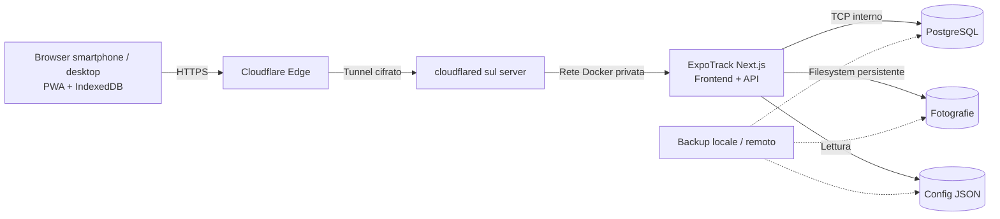

# ExpoTrack — 24. Deployment, Docker, Cloudflare Tunnel e operatività

## Aggiornamento mobile — risposte A1–A9

**Contratto vigente per il web mobile da fiera:** [specifica UI mobile, risposte A1–A9](27_Specifiche_UI_Mobile.md#10-risposte-di-revisione-recepite). Questo aggiornamento prevale sui paragrafi, diagrammi, pseudocodice e casi di test precedenti incompatibili. In particolare, gli esempi con `drafts`, conferma finale «Salva», dettaglio mobile 08, foto stand o scelta manuale del conflitto descrivono la progettazione precedente e non vanno implementati nel mobile. Le parti compatibili e le funzioni desktop/post-fiera mantengono il proprio ambito.

Backup coerente PostgreSQL e originali foto prodotto; le dimensioni disco vanno misurate considerando originali conservati. Nessuna dipendenza di deployment da uno store drafts o risolutore manuale conflitti. Outbox durevole e ripresa con app aperta; nessuna garanzia di sync a PWA chiusa. L’aggiornamento non cambia la distribuzione Docker/Cloudflare.


> **Percorso previsto:** `docs/24-deployment.md`  
> **Stato:** specifica tecnica di progettazione, non procedura già eseguita  
> **Ambiente:** server privato Debian/Linux con Docker Compose; accesso mobile tramite HTTPS e Cloudflare Tunnel  
> **Dipendenze:** `01-architecture.md`, `02-project-structure.md`, `12-database.md`, `13-backend-api.md`, `19-offline-storage.md`, `20-synchronization.md`, `21-photo-management.md`, `23-export.md`  
> **Prossimo documento:** `docs/25-security.md`

---

## 1. Scopo e principi

Questo documento definisce **come distribuire e mantenere ExpoTrack** su un server Linux privato, inizialmente per due persone (profili `me` e `father`), senza introdurre servizi gestiti non necessari. Il deployment deve essere ripetibile, verificabile e recuperabile dopo guasti o aggiornamenti.

ExpoTrack è una **PWA offline-first**, non una semplice pagina web che richiede connettività continua. Il server ospita il backend Next.js, PostgreSQL, file fotografici e configurazioni editoriali JSON. Il browser conserva dati e bozze in IndexedDB; quando torna online sincronizza le modifiche confermate.

I requisiti essenziali sono:

- Deploy mediante **Docker Compose** sul server Debian/Linux dell'utente.
- Accesso remoto con **Cloudflare Tunnel** senza esporre porte applicative al pubblico.
- **PostgreSQL persistente**, separato dal ciclo di vita dei container.
- **Fotografie persistenti** su volume o directory host con backup coordinato al database.
- Configurazioni editoriali **da file JSON**, senza pannello di amministrazione obbligatorio.
- Profili selezionabili senza login applicativo nella v1; distinguere questo comportamento dalla sicurezza del perimetro.
- Compatibilità con browser mobile e desktop, installazione PWA e utilizzo offline dopo il primo bootstrap.
- Aggiornamenti che non cancellino database, foto, bozze e operazioni non sincronizzate.
- Nessuna mappa, itinerario o servizio di geolocalizzazione richiesto.

**Nota di sicurezza:** Cloudflare Tunnel stabilisce il collegamento, ma **non autentica automaticamente i visitatori**. La protezione dell'accesso è una decisione separata, approfondita in `25-security.md`.

---

## 2. Architettura di distribuzione



### 2.1 Componenti e responsabilità

| Componente | Ruolo | Persistenza | Accesso esterno |
|---|---|---|---|
| `app` | Next.js: UI, API, validazione, export | Nessuno stato essenziale nel container | Solo tramite tunnel |
| `postgres` | Database dei dati personali e dinamici | Volume PostgreSQL | **Mai** pubblico |
| `cloudflared` | Tunnel outbound verso Cloudflare | Credenziali/secret di tunnel | Connessione in uscita |
| `media` | Foto e miniature sincronizzate | Bind mount o volume dedicato | Servite dall'API con controlli |
| `config` | JSON editoriali per evento/profilo | File versionati, montati in sola lettura | Mai esposti come directory |
| `backup` | Dump DB e copie coerenti dei media | Directory distinta, preferibilmente anche remota | Non pubblico |

### 2.2 Perché un solo servizio applicativo

Per un uso privato, un singolo container Next.js con API integrate riduce complessità, memoria e manutenzione. Un backend separato non è necessario finché le esigenze funzionali e prestazionali non lo giustificano. PostgreSQL resta separato.

### 2.3 Opzioni non richieste nella v1

Non introdurre automaticamente Kubernetes, Redis, code distribuite, S3, microservizi, un proxy pubblico o un sistema di login applicativo. Sono possibili evoluzioni, ma non prerequisiti.

---

## 3. Prerequisiti del server

### 3.1 Sistema e strumenti

- Debian supportato e aggiornato.
- Docker Engine e plugin Docker Compose installati da repository affidabili.
- Architettura CPU compatibile con le immagini impiegate (tipicamente `linux/amd64` oppure `linux/arm64`).
- Accesso amministrativo tramite SSH e possibilità di gestire firewall, utenti e backup.
- Account Cloudflare con dominio gestito e Tunnel configurabile.
- Spazio disco sufficiente per database, immagini, backup e crescita nel tempo.
- Orologio del server sincronizzato via NTP.

**Non presumere** che l'hardware sia Raspberry Pi o mini PC: il progetto deve essere indipendente dalla macchina. Verificare CPU, RAM, storage e versione Docker sul dispositivo effettivo prima di distribuire.

### 3.2 Dimensionamento iniziale orientativo

Per pochi utenti e un carico limitato, si può partire da una macchina con **2 vCPU, 2–4 GB RAM** e storage SSD. È una stima prudenziale, **non un requisito certificato**; Next.js, generazione PDF, conversione immagini e altre applicazioni già presenti sul server possono aumentare i picchi. Verificare i consumi reali con test.

Lo storage va dimensionato soprattutto per le foto. Esempio puramente illustrativo: 2.000 foto da 2 MB occupano circa 4 GB, senza contare miniature, backup e spazio temporaneo.

### 3.3 Rete

- Il server deve poter effettuare connessioni **in uscita** verso Cloudflare.
- PostgreSQL deve ascoltare solo sulla rete Docker privata.
- Il container `app` può essere raggiungibile internamente da `cloudflared` senza pubblicare `3000:3000` sull'host.
- Non è necessario aprire porte 80/443 sul router domestico per il tunnel.

---

## 4. Organizzazione delle directory

Struttura **proposta** sul server:

```text
/opt/expotrack/
├── compose.yaml
├── .env                         # segreti e parametri: NON versionare
├── .env.example                 # nomi variabili, valori fittizi
├── config/
│   ├── app.json
│   ├── profiles.json
│   ├── pavilions.json
│   ├── categories.json
│   ├── events/
│   │   └── eicma-2026-stands.json
│   ├── interests/
│   │   ├── me.json
│   │   └── father.json
│   └── questionnaires/
│       ├── me.json
│       └── father.json
├── data/
│   ├── postgres/
│   └── media/
├── backups/
│   ├── database/
│   ├── media/
│   └── manifests/
└── ops/
    ├── backup.sh
    ├── restore.sh
    └── verify.sh
```

Il codice sorgente e il Dockerfile possono risiedere in un repository separato. I file `ops/*.sh` sono **previsti come artefatti futuri**, non creati in questa fase.

### 4.1 Permessi

- `.env`: leggibile solo dall'utente/servizio autorizzato.
- `config/`: montaggio in sola lettura nell'app; modifiche effettuate con workflow controllato.
- `data/postgres/`: proprietario e permessi compatibili con l'UID del processo PostgreSQL.
- `data/media/`: scrittura soltanto per il servizio applicativo.
- `backups/`: accesso ristretto e protezione contro cancellazioni accidentali.

Non applicare indiscriminatamente `chmod 777` o `chown -R` a tutto il progetto.

---

## 5. Immagine applicativa

### 5.1 Dockerfile multi-stage proposto

Esempio **illustrativo**, da adattare al gestore pacchetti e alla struttura Next.js effettiva:

```dockerfile
# syntax=docker/dockerfile:1
FROM node:22-alpine AS deps
WORKDIR /app
COPY package.json package-lock.json ./
RUN npm ci

FROM node:22-alpine AS builder
WORKDIR /app
COPY --from=deps /app/node_modules ./node_modules
COPY . .
ENV NEXT_TELEMETRY_DISABLED=1
RUN npm run build

FROM node:22-alpine AS runner
WORKDIR /app
ENV NODE_ENV=production
ENV NEXT_TELEMETRY_DISABLED=1
ENV PORT=3000
ENV HOSTNAME=0.0.0.0
RUN addgroup -S app && adduser -S app -G app
COPY --from=builder --chown=app:app /app/public ./public
COPY --from=builder --chown=app:app /app/.next/standalone ./
COPY --from=builder --chown=app:app /app/.next/static ./.next/static
USER app
EXPOSE 3000
CMD ["node", "server.js"]
```

**Presupposti dell'esempio:** `package-lock.json` presente, `output: 'standalone'` configurato in Next.js e build compatibile con Alpine. Verificare la disponibilità delle dipendenze native per immagini/PDF. In alternativa usare immagini Debian slim. La versione Node deve essere compatibile con la versione Next.js scelta al momento dell'implementazione; `22` è qui un esempio di baseline, non un blocco permanente.

### 5.2 `.dockerignore`

```gitignore
node_modules
.next
.git
.env
.env.*
!.env.example
backups
data
*.log
```

Non copiare segreti, database, media o backup nell'immagine. Le configurazioni JSON editoriali vengono montate al runtime, non incorporate obbligatoriamente nella build.

### 5.3 Build riproducibile

- Versionare `Dockerfile` e lockfile.
- Usare tag immagine espliciti o digest, evitando `latest` in produzione.
- Eseguire lint, typecheck e test prima del deploy.
- Annotare commit Git, versione applicativa, schema DB e schema config nel manifest di release.
- Verificare che la PWA serva correttamente manifest, icone e service worker in HTTPS.

---

## 6. Docker Compose: esempio di riferimento

**Non è un file già pronto per la produzione**: credenziali, healthcheck, tag e percorsi devono essere validati. In particolare la configurazione effettiva del tunnel dipende dalla modalità scelta in Cloudflare.

```yaml
services:
  app:
    image: expotrack:${EXPOTRACK_VERSION}
    restart: unless-stopped
    environment:
      NODE_ENV: production
      DATABASE_URL: ${DATABASE_URL}
      APP_BASE_URL: ${APP_BASE_URL}
      CONFIG_DIR: /app/config
      MEDIA_DIR: /app/media
    volumes:
      - ./config:/app/config:ro
      - ./data/media:/app/media
    depends_on:
      postgres:
        condition: service_healthy
    networks:
      - private
    healthcheck:
      test: ["CMD", "node", "healthcheck.js"]
      interval: 30s
      timeout: 5s
      retries: 3
      start_period: 30s

  postgres:
    image: postgres:16-alpine
    restart: unless-stopped
    environment:
      POSTGRES_DB: ${POSTGRES_DB}
      POSTGRES_USER: ${POSTGRES_USER}
      POSTGRES_PASSWORD: ${POSTGRES_PASSWORD}
    volumes:
      - ./data/postgres:/var/lib/postgresql/data
    networks:
      - private
    healthcheck:
      test: ["CMD-SHELL", "pg_isready -U $$POSTGRES_USER -d $$POSTGRES_DB"]
      interval: 10s
      timeout: 5s
      retries: 10

  cloudflared:
    image: cloudflare/cloudflared:${CLOUDFLARED_VERSION}
    restart: unless-stopped
    command: tunnel --no-autoupdate run --token ${CLOUDFLARE_TUNNEL_TOKEN}
    depends_on:
      app:
        condition: service_started
    networks:
      - private

networks:
  private:
    driver: bridge
```

### 6.1 Limiti da non ignorare

- `healthcheck.js` è un **segnaposto**: il file e la sua logica andranno implementati, oppure sostituiti con un comando effettivamente disponibile nell'immagine.
- `DATABASE_URL` deve puntare all'hostname Docker `postgres`, non a `localhost` dal container `app`.
- Il token del tunnel in `command` può risultare visibile nei metadati del container e in strumenti di diagnostica. **Preferire una modalità con file credenziali/secret o meccanismo equivalente** quando supportato dalla configurazione scelta, e limitare l'accesso all'host Docker.
- La password DB può essere esposta attraverso variabili d'ambiente agli amministratori Docker: considerare Docker secrets o secret file per un hardening successivo.
- `depends_on` controlla l'ordine e la readiness iniziale, **non** sostituisce la gestione delle disconnessioni nel codice.
- `app` e `postgres` non espongono `ports:`. Questa è una scelta intenzionale.
- Le immagini andranno fissate a versioni/digest verificate e aggiornate con procedura controllata.
- Se il container `app` usa UID non root, la directory `data/media` deve essere scrivibile da quell'UID.

### 6.2 Esempio `.env.example`

```dotenv
EXPOTRACK_VERSION=0.1.0
CLOUDFLARED_VERSION=<versione-da-verificare>
APP_BASE_URL=https://expo.example.com
POSTGRES_DB=expotrack
POSTGRES_USER=expotrack_app
POSTGRES_PASSWORD=<segreto-forte>
DATABASE_URL=postgresql://expotrack_app:<password-url-encoded>@postgres:5432/expotrack
CLOUDFLARE_TUNNEL_TOKEN=<token-segreto>
```

Non copiare i placeholder letterali in produzione. Se la password contiene caratteri riservati, effettuare correttamente l'URL encoding della parte credenziali di `DATABASE_URL`.

### 6.3 Separazione reti

La rete `private` è sufficiente per il progetto iniziale. In una variante più rigorosa si possono usare due reti (`edge` e `db`) in modo che `cloudflared` non abbia accesso diretto a PostgreSQL. Questa **segmentazione è raccomandata** e andrà preferita nella Compose definitiva.

---

## 7. Cloudflare Tunnel

### 7.1 Flusso previsto

1. Creare un tunnel nel proprio account Cloudflare.
2. Associare un hostname dedicato, ad esempio `expo.example.com`.
3. Configurare l'origine HTTP interna come `http://app:3000` quando `cloudflared` gira sulla stessa rete Docker.
4. Avviare il connettore `cloudflared`.
5. Verificare accesso HTTPS esterno, API e risorse PWA.
6. Applicare le politiche di accesso appropriate prima di utilizzare dati personali.

Il dominio è un **esempio**, non un hostname realmente esistente o configurato.

### 7.2 Sicurezza del tunnel

- Non pubblicare PostgreSQL.
- Non rendere accessibile un pannello di debug o endpoint amministrativi.
- Valutare **Cloudflare Access** per proteggere l'app privata; l'assenza di login ExpoTrack non implica che il sito debba essere pubblico.
- Verificare il comportamento delle politiche Access con la PWA e con le richieste di sincronizzazione.
- Prevedere sessioni scadute e login Access richiesto mentre esistono modifiche offline: l'outbox **non deve essere cancellata**.

### 7.3 PWA e service worker

L'app deve essere servita con HTTPS valido e URL stabili. Testare:

- manifest e icone;
- installazione su Android e browser desktop;
- caching dell'app shell;
- accesso offline dopo un caricamento iniziale riuscito;
- aggiornamenti del service worker;
- esclusione dal caching indiscriminato delle API personali e dei token.

### 7.4 DNS e tunnel non disponibili

Se Cloudflare è temporaneamente irraggiungibile, la PWA già installata deve permettere le funzioni offline. Non promettere primo accesso offline senza che asset e configurazioni siano stati scaricati prima.

---

## 8. Configurazioni JSON e pubblicazione

### 8.1 Fonte editoriale

Le configurazioni rimangono file separati:

```text
config/app.json
config/profiles.json
config/pavilions.json
config/categories.json
config/events/eicma-2026-stands.json
config/interests/me.json
config/interests/father.json
config/questionnaires/me.json
config/questionnaires/father.json
```

Non creare un `products.json`: i prodotti sono dati dinamici salvati dall'app.

### 8.2 Processo di aggiornamento consigliato

1. Modificare i JSON in un branch o directory di staging.
2. Validare sintassi, `schemaVersion`, unicità ID e riferimenti incrociati.
3. Verificare che non siano stati rimossi ID ancora referenziati da prodotti o dati offline.
4. Generare un manifest/snapshot con hash.
5. Pubblicare **atomicamente** la nuova configurazione.
6. Consentire ai client di aggiornare la cache in modo coerente, senza mescolare file di versioni diverse.
7. Conservare almeno la versione precedente per rollback.

### 8.3 Aggiornamento senza rebuild

Montare `config/` in sola lettura permette di aggiornare i JSON senza ricostruire l'immagine **se l'app supporta il reload o un riavvio controllato**. Non assumere che Next.js rilegga automaticamente ogni file: definire esplicitamente strategia di caricamento e invalidazione cache.

### 8.4 Niente posizioni inventate

Il file EICMA 2026 può includere padiglione e stand soltanto quando verificati. Un campo sconosciuto resta assente: il deployment non deve inventare coordinate, padiglioni o numeri di stand.

---

## 9. Preparazione e bootstrap del database

### 9.1 Migrazioni

- Applicare migrazioni SQL versionate prima di rendere disponibile una nuova versione applicativa che le richiede.
- Preferire migrazioni compatibili durante il rollout.
- Registrare versione e risultato di ogni migrazione.
- Eseguire un backup verificato prima delle migrazioni distruttive.
- Non eseguire automaticamente reset del database all'avvio.

### 9.2 Profili editoriali

Al bootstrap, riconciliare i profili JSON (`me`, `father`) con eventuali proiezioni DB, **senza sovrascrivere** note, prodotti, interessi modificati o stati personali. I profili creati dinamicamente non vanno eliminati se assenti dal JSON.

### 9.3 Controlli post-migrazione

- Tabelle e indici previsti presenti.
- Collegamento PostgreSQL dall'app funzionante.
- Versione schema attesa.
- Referenze editoriali valide.
- Nessun record personale perso o ricreato erroneamente.
- Endpoint health e readiness con esiti coerenti.

---

## 10. Storage delle fotografie

### 10.1 Volume persistente

Usare una directory dedicata, ad esempio `data/media/`, non la filesystem layer effimera del container. Ogni foto deve avere un ID tecnico e un riferimento DB.

### 10.2 Sicurezza file

- Evitare traversal (`../`) e nomi originali non fidati.
- Validare MIME e contenuto.
- Imporre limiti di dimensione.
- Evitare di esporre direttamente la directory come file server pubblico.
- Limitare i permessi al processo applicativo.
- Prevedere miniature e compressione, secondo `21-photo-management.md`.

### 10.3 Sincronizzazione offline

Una foto acquisita offline può essere ancora presente solo in IndexedDB. Il backup server **non include** i file mai sincronizzati. La UI deve mostrarne lo stato e invitare alla sincronizzazione prima di sostituire o resettare il dispositivo.

### 10.4 Pulizia

La rimozione fisica di un file deve considerare tombstone, conflitti, operazioni pendenti e retention. Non eseguire un garbage collector che cancelli media ancora necessari per recuperare versioni concorrenti.

---

## 11. Backup: strategia operativa

### 11.1 Obiettivi

Per ExpoTrack i backup devono proteggere **database + fotografie + configurazioni**. Un dump SQL senza immagini non è un backup completo; una copia dei media senza metadati non permette di ricostruire tutte le associazioni.

### 11.2 Frequenze proposte

| Elemento | Frequenza iniziale proposta | Nota |
|---|---|---|
| Dump PostgreSQL | Giornaliera | Più frequente durante la fiera se utile |
| Media | Giornaliera + prima/dopo aggiornamenti | Incrementale se possibile |
| Config JSON | A ogni modifica + giornaliera | Versionamento Git raccomandato |
| Manifest backup | Ogni esecuzione | Timestamp, versioni, hash, esito |
| Test restore | Periodico, almeno prima della fiera | In ambiente isolato |

Le frequenze sono **proposte**, non attività già schedulate.

### 11.3 Esempio dump PostgreSQL

```bash
docker compose exec -T postgres \
  pg_dump -U "$POSTGRES_USER" -d "$POSTGRES_DB" -Fc \
  > "backups/database/expotrack-$(date -u +%Y%m%dT%H%M%SZ).dump"
```

Questo comando è **illustrativo**: le variabili devono essere definite nella shell, il percorso deve esistere, il file va controllato e il dump va testato con un restore. Per dati in modifica continua, pianificare un metodo che garantisca coerenza applicativa tra snapshot database e file media.

### 11.4 Regola 3-2-1

Raccomandare tre copie, su almeno due supporti, con una copia esterna al server. Un backup lasciato soltanto sullo stesso SSD del database non protegge da guasto o furto del dispositivo.

### 11.5 Cifratura e segreti

- Cifrare backup esterni contenenti note e foto.
- Custodire la chiave di ripristino separatamente.
- Non includere token Cloudflare e password DB nei dump esportati per l'utente.
- Conservare separatamente una procedura sicura per ricreare i secret necessari al restore.

---

## 12. Restore e disaster recovery

### 12.1 Procedura generale

1. Fermare o mettere in manutenzione le scritture applicative.
2. Salvare copia dello stato danneggiato per diagnosi.
3. Identificare un set coerente di dump DB, media e config.
4. Preparare ambiente PostgreSQL con versione compatibile.
5. Ripristinare database e media.
6. Applicare eventuali migrazioni necessarie.
7. Avviare app in ambiente isolato e verificare dati e foto.
8. Riaprire accesso dopo test funzionali.
9. Informare gli utenti del punto temporale recuperato e delle eventuali operazioni da risincronizzare.

### 12.2 Rischio di client offline

Dopo un restore server, alcuni browser possono avere revisioni o cursor di sync successivi allo stato ripristinato. **Non** forzare una risincronizzazione distruttiva. Il protocollo deve riconoscere il ripristino (per esempio tramite `serverInstanceId`/`restoreEpoch`) e richiedere una riconciliazione sicura che preservi outbox, bozze e conflitti.

### 12.3 Test minimi di ripristino

- Profilo `me` e `father` presenti.
- Stand personali e stati corretti.
- Prodotti, preferiti, note e risposte recuperati.
- Fotografie originali e miniature accessibili.
- Tombstone rispettate.
- Migrazioni coerenti.
- Nuova sincronizzazione possibile senza duplicati.

---

## 13. Aggiornamenti applicativi

### 13.1 Pipeline proposta

```text
Modifica codice/config
       ↓
Lint + typecheck + test
       ↓
Build immagine versionata
       ↓
Backup e verifica spazio
       ↓
Migrazioni compatibili
       ↓
Deploy controllato
       ↓
Healthcheck + smoke test
       ↓
Monitoraggio e eventuale rollback
```

### 13.2 Comandi operativi indicativi

```bash
# Validare sintassi della Compose
docker compose config

# Visualizzare lo stato
docker compose ps

# Seguire i log applicativi
docker compose logs -f --tail=100 app

# Avviare o aggiornare i servizi
docker compose up -d
```

Non eseguire `docker compose down -v` in produzione: **`-v` elimina volumi Docker gestiti dalla Compose**, con possibile perdita irreversibile di dati. Anche con bind mount, usare procedure esplicite e backup.

### 13.3 Rollback

Conservare l'immagine precedente. Un rollback dell'app non garantisce il rollback del database: per questo le migrazioni devono essere pianificate con compatibilità all'indietro o un piano di restore.

### 13.4 Service worker e client vecchi

I browser possono mantenere asset e codice precedente. Prevedere:

- versionamento delle API;
- compatibilità per client offline;
- aggiornamento PWA senza cancellare IndexedDB;
- messaggio di aggiornamento disponibile;
- divieto di attivare una nuova release che invalida senza migrazione la coda offline.

---

## 14. Healthcheck, readiness e monitoraggio

### 14.1 Endpoint proposti

| Endpoint | Scopo | Visibilità |
|---|---|---|
| `/api/health/live` | Processo web in esecuzione | Interno o risposta minima |
| `/api/health/ready` | DB, config e media disponibili | Interno/protetto |
| `/api/version` | Versione app/API/schema compatibili | Metadati minimi, no secret |

**Attenzione:** non includere password, stringhe di connessione, percorsi sensibili o contenuti personali nelle risposte.

### 14.2 Segnali da osservare

- Container riavviati frequentemente.
- Errori di connessione PostgreSQL.
- Saturazione CPU/RAM e spazio disco.
- Quota e dimensione media.
- Operazioni di sync in errore o in attesa da molto tempo.
- Conflitti non risolti.
- Fallimenti di backup e restore.
- Errori 5xx dell'API.
- Disponibilità del tunnel.

### 14.3 Log

Usare log strutturati e rotazione per evitare che riempiano il disco. Non registrare foto, token, password, risposte complete ai questionari o note personali in chiaro senza necessità diagnostica esplicita.

---

## 15. Prestazioni, memoria e concorrenza

### 15.1 Risorse condivise

Se il server ospita anche Home Assistant, Nextcloud, Guacamole o altri servizi, il dimensionamento deve considerare il carico **complessivo**. Non assumere che ExpoTrack abbia RAM o CPU dedicate.

### 15.2 Limiti proposti

- Limite upload per foto e richiesta.
- Limite di dimensione per export PDF.
- Timeout per operazioni lunghe.
- Pool connessioni PostgreSQL controllato.
- Compressione immagini in job limitati per evitare picchi.
- Backoff sulla sincronizzazione, senza polling aggressivo.

### 15.3 PDF

La generazione PDF con molte fotografie può consumare memoria. Valutare generazione server-side oppure client-side in base ai requisiti offline definiti in `23-export.md`. Un export offline non può dipendere esclusivamente da un servizio server.

---

## 16. Sicurezza operativa minima

Questa sezione non sostituisce `25-security.md`.

1. Aggiornare sistema operativo, Docker e immagini con un processo controllato.
2. Non pubblicare la porta PostgreSQL.
3. Limitare accesso SSH e membership nel gruppo Docker.
4. Proteggere file `.env`, credenziali tunnel e backup.
5. Eseguire l'app come utente non root dove praticabile.
6. Montare `config` in sola lettura.
7. Limitare la scrittura alle directory strettamente necessarie.
8. Usare HTTPS e validare host/origin delle richieste.
9. Applicare limiti di upload e validazione dei media.
10. Valutare Cloudflare Access per un'app privata.
11. Non considerare la selezione del profilo una forma di autenticazione.
12. Testare il recupero da furto/smarrimento di dispositivo e da backup compromesso.

---

## 17. Procedure di manutenzione

### 17.1 Giornaliera durante EICMA

- Verificare che il tunnel sia attivo.
- Verificare che app e DB rispondano.
- Controllare eventuali errori di sincronizzazione.
- Controllare spazio disco e stato backup.
- Evitare aggiornamenti non urgenti durante l'uso in fiera.

### 17.2 Settimanale

- Esaminare log e riavvii.
- Verificare dimensione dei media.
- Verificare rotazione e conservazione backup.
- Controllare aggiornamenti di sicurezza da pianificare.

### 17.3 Prima della fiera

- Installare la PWA su ogni dispositivo.
- Aprirla almeno una volta online con il profilo corretto.
- Scaricare catalogo, interessi e questionari.
- Eseguire prova in modalità aereo.
- Creare e salvare un prodotto di test offline.
- Tornare online e verificarne la sincronizzazione.
- Testare foto e recupero bozza.
- Verificare spazio libero sui dispositivi.
- Eseguire un backup e un test restore del server.

---

## 18. Modalità manutenzione e indisponibilità

Se il server è in manutenzione:

- L'app già installata deve restare utilizzabile offline nei limiti della cache disponibile.
- Le operazioni confermate devono restare nella coda locale.
- Non mostrare «sincronizzato» quando il server non ha confermato.
- Non cancellare la coda a seguito di un errore 502/503/504.
- Al ripristino, sincronizzare con retry idempotenti e risoluzione dei conflitti.

Se il primo avvio avviene senza rete, non promettere il bootstrap completo.

---

## 19. Esempio di checklist pre-deploy

- [ ] Server e architettura CPU identificati.
- [ ] Docker Engine e Compose verificati.
- [ ] Directory dati su disco persistente.
- [ ] Backup recente disponibile e testato.
- [ ] Immagine applicativa versionata e testata.
- [ ] JSON editoriali validati con riferimenti incrociati.
- [ ] Nessun padiglione/numero stand EICMA inventato.
- [ ] Database inizializzato e migrazioni applicate.
- [ ] Config montata in sola lettura.
- [ ] Media scrivibili dall'UID applicativo.
- [ ] Nessuna porta DB pubblica.
- [ ] Tunnel attivo e hostname corretto.
- [ ] Politica di accesso valutata e configurata.
- [ ] HTTPS valido.
- [ ] Healthcheck e log funzionanti.
- [ ] Installazione PWA verificata.
- [ ] Salvataggio offline verificato.
- [ ] Sync e conflitti verificati.
- [ ] Foto e PDF verificati.
- [ ] Piano rollback documentato.

---

## 20. Scenari di test — deployment

| ID | Test | Esito atteso |
|---|---|---|
| DEP-01 | `docker compose config` | Config valida |
| DEP-02 | Primo avvio con volumi vuoti | DB inizializzato senza perdita |
| DEP-03 | Riavvio app | Prodotti e media persistenti |
| DEP-04 | Riavvio PostgreSQL | Dati persistenti |
| DEP-05 | Ricreazione container app | Nessun dato essenziale perso |
| DEP-06 | Riavvio host | Servizi ripartono secondo policy |
| DEP-07 | DB non disponibile | Readiness fallisce, errore gestito |
| DEP-08 | Config JSON invalida | Release rifiutata, precedente conservata |
| DEP-09 | Foto salvata | File e metadata persistenti |
| DEP-10 | Foto con percorso malevolo | Upload rifiutato |
| DEP-11 | Porta PostgreSQL dall'esterno | Non raggiungibile |
| DEP-12 | Hostname Cloudflare | HTTPS funzionante |
| DEP-13 | Tunnel spento | PWA già installata resta offline |
| DEP-14 | Cloudflare Access scaduto | Outbox conservata |
| DEP-15 | App offline al primo avvio | Messaggio esplicito, niente falsa disponibilità |
| DEP-16 | App offline dopo bootstrap | Catalogo e dati locali disponibili |
| DEP-17 | Nuovo prodotto offline | Salva locale riuscito |
| DEP-18 | Rete ripristinata | Sync idempotente |
| DEP-19 | Timeout dopo commit server | Nessun duplicato al retry |
| DEP-20 | Conflitto tra due dispositivi | Entrambe le versioni preservate |
| DEP-21 | Backup database | Dump verificabile |
| DEP-22 | Backup fotografie | File presenti e coerenti |
| DEP-23 | Restore completo | Note, foto, prodotti e profili recuperati |
| DEP-24 | Restore server con client più recente | Nessuna cancellazione locale automatica |
| DEP-25 | Aggiornamento app | IndexedDB e outbox preservati |
| DEP-26 | Rollback app | Compatibilità o piano restore applicato |
| DEP-27 | Migrazione DB fallita | Deploy interrotto e dati preservati |
| DEP-28 | Riavvio durante upload | Ripresa senza duplicati |
| DEP-29 | Disco media pieno | Errore chiaro, nessun successo falso |
| DEP-30 | Disco DB pieno | Errore controllato e alert |
| DEP-31 | Log ad alto volume | Rotazione evita saturazione |
| DEP-32 | Foto grande | Limiti applicati |
| DEP-33 | Export PDF voluminoso | Limite/errore gestito |
| DEP-34 | Cambio profilo | Dati non mescolati |
| DEP-35 | Aggiornamento JSON interessi | Override preservati |
| DEP-36 | Aggiornamento stand con ID stabile | Prodotti collegati preservati |
| DEP-37 | Stand editoriale rimosso con dati | Migrazione richiesta |
| DEP-38 | Browser con vecchia versione PWA | API compatibile o messaggio esplicito |
| DEP-39 | Endpoint health | Nessun secret esposto |
| DEP-40 | Utente Docker non root | Scrive solo dove previsto |
| DEP-41 | Backup remoto cifrato | Restore possibile con chiave autorizzata |
| DEP-42 | Token tunnel revocato | Accesso remoto interrotto senza perdita dati |
| DEP-43 | Foto non ancora sincronizzata | Backup server non la dichiara inclusa |
| DEP-44 | Aggiornamento senza backup | Procedura blocca il rollout rischioso |
| DEP-45 | Test completo prima della fiera | App usabile su dispositivi reali |

---

## 21. Criteri di accettazione

- [ ] ExpoTrack avviabile con una Compose riproducibile.
- [ ] Nessuna dipendenza obbligatoria da Kubernetes o servizi cloud a pagamento.
- [ ] PostgreSQL e foto persistono alla ricreazione dei container.
- [ ] JSON editoriali esterni all'immagine e validati prima della pubblicazione.
- [ ] Nessuna porta PostgreSQL esposta pubblicamente.
- [ ] Accesso HTTPS tramite Cloudflare Tunnel funzionante.
- [ ] Limiti di sicurezza del tunnel chiaramente documentati.
- [ ] Secret esclusi da repository, immagini e log.
- [ ] L'app è installabile come PWA e funziona offline dopo bootstrap.
- [ ] Le bozze non vengono inviate al server prima di Salva.
- [ ] Le operazioni confermate offline sopravvivono al riavvio del browser.
- [ ] Le foto locali restano disponibili offline quando salvate.
- [ ] Il sync riparte dopo un'interruzione senza duplicazioni.
- [ ] Conflitti manuali preservati.
- [ ] Aggiornamenti e rollback non cancellano dati personali.
- [ ] Backup comprende database, media e configurazioni.
- [ ] Un restore è stato testato su ambiente separato.
- [ ] Il piano di recupero considera i client offline dopo un restore.
- [ ] Log, healthcheck e spazio disco sono osservabili.
- [ ] La procedura pre-fiera è verificata sui dispositivi reali.

---

## 22. Decisioni aperte

| Questione | Raccomandazione iniziale | Da confermare |
|---|---|---|
| Hardware di produzione | Server Debian esistente, misurare risorse | CPU, RAM, storage disponibili |
| Database | PostgreSQL 16+ con immagine versionata | Versione precisa e strategia upgrade |
| Container app | Next.js standalone multi-stage | Compatibilità librerie native |
| Tunnel | `cloudflared` in Compose | Token o credenziali file |
| Accesso privato | Cloudflare Access consigliato | Modalità per te e tuo padre |
| Directory dati | Bind mount `/opt/expotrack/data` | Percorso e filesystem effettivi |
| Backup | DB + media + config, copia remota cifrata | Destinazione e retention |
| Generazione PDF | Offline possibile | Scelta client/server o ibrida |
| Aggiornamento config | Snapshot atomici | Meccanismo reload effettivo |
| Gestione immagini | Compressione e miniature | Limiti e librerie |
| Monitoraggio | Health + log + spazio disco | Strumenti già presenti sul server |
| Ripristino | Identificatore restore/epoch | Contratto sync definitivo |

---

## 23. Relazione con gli altri documenti

- `12-database.md`: schema, indici, tombstone, backup e migrazioni.
- `13-backend-api.md`: endpoint, healthcheck, versioni e validazioni.
- `19-offline-storage.md`: IndexedDB, cache PWA, quota e bozze.
- `20-synchronization.md`: outbox, push/pull, idempotenza e conflitti.
- `21-photo-management.md`: compressione, upload e retention foto.
- `23-export.md`: PDF/JSON e requisiti offline.
- `25-security.md`: threat model, protezione dell'accesso, hardening e gestione dei secret.
- `26-testing.md`: suite automatizzate, prove di restore e criteri di rilascio.

## 24. Passo successivo

Il documento **`docs/25-security.md`** dovrà approfondire la protezione di un'app privata senza autenticazione interna: Cloudflare Access, autorizzazioni e limiti della selezione profilo, sicurezza API, upload fotografie, isolamento dei dati, segreti Docker, protezione dei backup, rischi di dispositivi condivisi e controlli prima della pubblicazione.

**Questa specifica non avvia servizi, non modifica il server e non crea configurazioni reali.** Tutti i comandi e i file mostrati sono esempi da verificare durante la futura implementazione.
