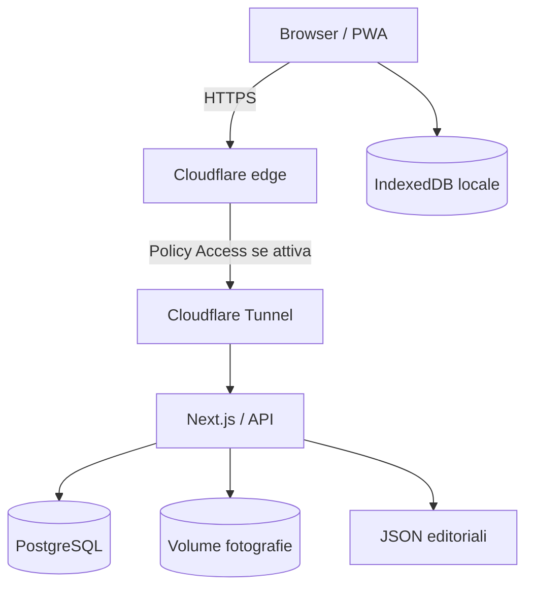

# ExpoTrack — 25. Sicurezza, privacy e protezione dei dati

> **Percorso previsto:** `docs/25-security.md`  
> **Stato:** specifica tecnica di progettazione, non audit di sicurezza né configurazione già applicata  
> **Ambiente:** Next.js + React + TypeScript, PostgreSQL, IndexedDB, Docker Compose su Debian/Linux, Cloudflare Tunnel  
> **Dipendenze:** `01-architecture.md`, `03-app-config.md`, `04-profiles-config.md`, `12-database.md`, `13-backend-api.md`, `19-offline-storage.md`, `20-synchronization.md`, `21-photo-management.md`, `23-export.md`, `24-deployment.md`  
> **Prossimo documento:** `docs/26-testing.md`

---

## 1. Scopo

Definire un modello di sicurezza **realistico e verificabile** per ExpoTrack, una PWA privata, offline-first, pensata per una fiera (pilota EICMA 2026), accessibile da smartphone e desktop e ospitata su un server privato.

L'applicazione prevede **profili selezionabili senza login interno**, inizialmente `me` e `father`, oltre a profili dinamici. Ogni profilo ha propri interessi, stati visita, note, prodotti, fotografie, risposte ai questionari e preferiti. L'assenza di autenticazione applicativa è una scelta funzionale: **non deve essere presentata come isolamento di sicurezza tra persone**.

Questo documento copre:

- protezione dell'accesso pubblico tramite Cloudflare;
- superfici di attacco di Next.js e delle API;
- separazione logica dei profili e limitazioni;
- sicurezza di PostgreSQL e dei volumi Docker;
- riservatezza delle fotografie;
- rischi dell'archiviazione offline in IndexedDB;
- integrità di configurazioni JSON, sincronizzazione ed esportazioni;
- gestione dei segreti, logging, backup, aggiornamenti e incidenti;
- criteri di accettazione e test.

**Non si implementano funzionalità in questa fase.** Esempi e configurazioni sono proposte da validare durante lo sviluppo.

---

## 2. Principi non negoziabili

1. **Cloudflare Tunnel non è autenticazione.** Pubblicare un hostname tramite Tunnel, senza ulteriori regole, può rendere il servizio accessibile a chi conosce l'indirizzo.
2. **Il profilo scelto non è un'identità verificata.** Se l'app consente di selezionare «Papà», non può garantire che chi lo seleziona sia effettivamente il padre.
3. **Il browser non è un ambiente attendibile.** Payload, identificativi profilo, URL, tipi MIME e campi JSON devono essere convalidati lato server.
4. **Offline-first non equivale a dati cifrati.** IndexedDB e cache browser possono essere leggibili da chi controlla il dispositivo o il relativo profilo OS.
5. **Salva locale e sincronizzazione sono stati distinti.** Un salvataggio confermato in IndexedDB non dimostra che i dati siano stati trasferiti al server.
6. **I backup devono includere database e media**, e devono essere verificati mediante ripristino.
7. **Ridurre i privilegi e la superficie esposta.** Non pubblicare PostgreSQL, directory media, pannelli Docker o endpoint amministrativi.
8. **La sicurezza non deve provocare perdite silenziose.** Un errore di accesso, un aggiornamento o una sessione scaduta non deve cancellare bozze o operazioni pendenti.

---

## 3. Ambito e confini di fiducia

### 3.1 Componenti

| Componente | Ruolo | Livello di fiducia |
|---|---|---|
| Browser/PWA | UI, IndexedDB, cache, foto temporanee, outbox | Non attendibile verso il server |
| Cloudflare edge | TLS, eventuale Access/WAF | Perimetro esterno |
| Cloudflare Tunnel (`cloudflared`) | Connessione outbound verso origin | Trasporto, non autenticazione di per sé |
| Next.js backend | API, validazioni, autorizzazioni logiche, sync | Componente fidato dopo validazione |
| PostgreSQL | Dati dinamici persistenti | Accessibile solo al backend/rete privata |
| Volume media | Fotografie e file derivati | Accessibile tramite servizio applicativo |
| File JSON editoriali | Catalogo, profili, interessi iniziali, questionari | Fidati solo dopo validazione e controllo modifiche |
| Backup | Copia dati e media | Materiale sensibile da proteggere |

### 3.2 Flusso principale



La policy Access, se scelta, va applicata **prima** di esporre il servizio agli utenti remoti. L'origin deve evitare percorsi alternativi che aggirino il perimetro.

### 3.3 Dati da proteggere

- Prodotti annotati, prezzi osservati, valutazioni, preferiti e note.
- Fotografie, che possono contenere persone, badge, codici, ubicazioni o dati personali incidentali.
- Identificativi profilo, cronologia delle modifiche, conflitti e bozze.
- Token di sessione eventualmente emessi dal perimetro Cloudflare Access.
- Credenziali PostgreSQL, token Cloudflare Tunnel, chiavi di backup e segreti del deployment.
- Export JSON/PDF che aggregano informazioni personali.

---

## 4. Modello delle minacce

### 4.1 Avversari e incidenti plausibili

| Scenario | Possibile effetto | Difesa principale |
|---|---|---|
| URL pubblico raggiungibile senza Access | Lettura/modifica di tutti i dati | Cloudflare Access e origin non esposto |
| Utente autorizzato sceglie altro profilo | Accesso ai dati dell'altro profilo | Limite noto della v1; non promettere isolamento |
| Dispositivo smarrito/sbloccato | Lettura IndexedDB e foto offline | Protezione OS, blocco schermo, riduzione cache |
| XSS nel frontend | Lettura/modifica dati accessibili alla pagina | Escaping, CSP, niente HTML non sanificato |
| CSRF contro API con cookie | Mutazioni involontarie | SameSite, verifica Origin, protezioni CSRF |
| Upload malevolo | File non immagine, decompression bomb, esaurimento disco | Validazione contenuto, limiti, decoding controllato |
| API invocata con `profileId` arbitrario | Accesso logico incrociato | Scope applicativo coerente; autentificazione vera se necessaria |
| Retry concorrenti | Duplicati o sovrascritture | Idempotenza e revisioni |
| Compromissione credenziali DB | Lettura o cancellazione dati | Segreti protetti, privilegi minimi, rete interna |
| Config JSON manomessa | Referenze false o dati ingannevoli | Schema validation, revisioni e controlli di pubblicazione |
| Backup rubato | Esposizione dati e fotografie | Cifratura, permessi, retention |
| Aggiornamento difettoso | Perdita dati, blocco sync | Backup, migrazioni, rollback e test |

### 4.2 Fuori ambito v1

Non è previsto un sistema di ruoli aziendali, autenticazione multiutente interna, audit forense completo, protezione contro un amministratore del server malevolo o garanzia crittografica end-to-end. Se in futuro servirà **privacy reale tra profili**, occorrerà introdurre identità verificate e autorizzazioni server-side.

---

## 5. Cloudflare Tunnel e controllo accessi

### 5.1 Tunnel: cosa fa e cosa non fa

Cloudflare Tunnel permette a `cloudflared` di stabilire una connessione **in uscita** dal server verso Cloudflare. Può evitare l'apertura di porte in ingresso sul router, ma **non rende privato l'hostname per il solo fatto di usare un tunnel**.

L'hostname applicativo deve essere protetto da una misura esplicita se si vuole evitare accesso indiscriminato.

### 5.2 Opzione consigliata: Cloudflare Access

Per l'utilizzo privato si propone di applicare una policy Cloudflare Access che consenta soltanto identità o indirizzi email espressamente autorizzati. È un **controllo di accesso all'intera applicazione**, non un sistema di profili ExpoTrack.

Esempio concettuale:

```text
Utente apre expotrack.example.tld
  → Cloudflare Access verifica la sessione/identità
  → Access consente o nega il passaggio
  → Tunnel raggiunge Next.js
  → ExpoTrack mostra la selezione profilo
```

**Da decidere:** modalità di accesso (OTP via email, identity provider supportato, altro), elenco autorizzati e durata delle sessioni. Non codificare email personali nella documentazione o nel repository.

### 5.3 Limite tra Access e profili

Anche con Access attivo, se due persone possono entrare nell'app, **entrambe possono selezionare `me` o `father`**. La policy protegge il servizio dagli estranei, non separa i dati dei profili all'interno dell'app.

Se questo limite non è accettabile, aggiungere un'associazione server-side tra identità Access e profili autorizzati: sarebbe un'estensione del requisito «senza account interno», da progettare esplicitamente.

### 5.4 Origin e bypass

- Non esporre porte Next.js o PostgreSQL su Internet.
- Se si pubblica una porta host per manutenzione locale, limitarla a loopback o a una rete di gestione controllata.
- Evitare un secondo hostname non protetto che raggiunga lo stesso servizio.
- Verificare che eventuali endpoint di upload, download, sync e health non siano raggiungibili aggirando Access.
- Non fidarsi di header di identità inviati dal browser: accettarli solo da un percorso di rete/proxy attendibile e verificato.

### 5.5 Sessioni Access e offline

Quando la sessione Cloudflare Access scade mentre il telefono è offline:

- l'app deve continuare a funzionare sui dati già disponibili localmente;
- le operazioni restano in outbox;
- al ritorno online può essere necessaria una nuova verifica Access;
- una risposta di accesso negato **non** deve essere interpretata come eliminazione o conflitto dati;
- la UI deve distinguere «serve riaccedere» da «server non raggiungibile».

Le politiche di caching di risposte protette e service worker devono essere testate con la configurazione effettiva di Access.

---

## 6. Sicurezza dell'app Next.js

### 6.1 Input e validazione

Tutte le API devono validare:

- struttura e tipo dei payload;
- lunghezze di stringhe e numero di elementi;
- ID di evento, profilo, stand e categoria;
- appartenenza dello stand personale al profilo;
- priorità 1–10, rating 1–10 e importi validi;
- versione del questionario e tipo delle risposte;
- revisioni e chiavi di idempotenza;
- dimensioni massime di richieste e upload.

Preferire uno schema condiviso TypeScript/Zod o equivalente, ma la **validazione server resta obbligatoria** anche quando esiste quella client.

### 6.2 XSS e rendering

- Renderizzare note e campi JSON come testo, non HTML.
- Evitare `dangerouslySetInnerHTML`; se inevitabile, usare sanitizzazione robusta.
- Non interpolare stringhe non fidate in URL `javascript:`, attributi o CSS.
- Limitare le sorgenti esterne per script, frame e immagini.
- Testare la visualizzazione di nomi stand, note, domande e risposte contenenti markup ostile.

### 6.3 Content Security Policy

Progettare una CSP compatibile con Next.js e la PWA. In produzione, preferire script autorizzati tramite nonce/hash ove praticabile, limitare `connect-src` agli endpoint necessari e non usare `unsafe-eval` per comodità.

**Non copiare una CSP esemplificativa in produzione senza verificarla** contro bundle, service worker, immagini e Cloudflare Access.

### 6.4 CSRF, CORS e cookie

Se le richieste usano cookie di sessione:

- impostare `Secure`, `HttpOnly` quando applicabile, e `SameSite` coerente con il flusso;
- verificare `Origin` sulle mutazioni;
- adottare token CSRF o una strategia equivalente quando necessaria;
- non aprire CORS con credenziali a origini arbitrarie;
- non usare `GET` per operazioni che modificano dati.

La cookie di selezione profilo **non è un token di autenticazione** e può essere modificata dal client.

### 6.5 Headers e HTTPS

Applicare HTTPS end-to-end nel percorso pubblico, HSTS se coerente con l'hostname, `X-Content-Type-Options: nosniff`, una policy `Referrer-Policy` restrittiva e limitazioni `Permissions-Policy` non incompatibili con la fotocamera quando usata.

Non assumere che la terminazione TLS sull'edge renda sicuro qualunque collegamento origin: proteggere anche rete interna e configurazione del Tunnel.

### 6.6 Rate limit e dimensionamento

Anche per due utenti, imporre limiti ragionevoli a:

- upload;
- creazione massiva di record;
- richieste di sync;
- esportazioni PDF;
- payload JSON;
- richieste ripetute con errori.

Distinguere un dispositivo che riprova legittimamente da un abuso: non perdere outbox a causa di un `429 Too Many Requests`.

---

## 7. Profili: separazione logica e limiti

### 7.1 Profilo attivo

L'app salva localmente il profilo scelto e lo usa per filtrare dashboard, stand personali, prodotti, note, foto e questionari.

**Regola tecnica:** ogni query e mutazione deve includere il perimetro di `profileId` ed `eventId`. L'interfaccia non deve mostrare temporaneamente dati del profilo precedente durante il cambio.

### 7.2 Protezione contro errori accidentali

- Verificare la corrispondenza tra profilo attivo e proprietario del record.
- Non accettare ID stand personali appartenenti a un altro profilo.
- Invalidate le cache UI al cambio profilo.
- Mantenere bozze separate per profilo/evento.
- Richiedere conferme per eliminazioni e azioni distruttive.

### 7.3 Cosa non è garantito

Poiché chiunque abbia accesso all'app può scegliere un profilo, non è corretto affermare che «i dati del padre sono protetti dall'utente» o viceversa. I filtri applicativi riducono gli errori, **non impediscono un accesso intenzionale**.

### 7.4 Decisione futura

Se serve una separazione reale, valutare una delle seguenti evoluzioni:

- identità Cloudflare Access associate a un insieme di profili autorizzati;
- autenticazione applicativa e ACL;
- installazioni/istanze separate.

Non introdurre di nascosto un login in v1: richiede una decisione di prodotto.

---

## 8. PostgreSQL e integrità dei dati

### 8.1 Isolamento di rete

PostgreSQL deve essere raggiungibile soltanto dai servizi che ne hanno bisogno sulla rete Docker privata. Non pubblicare `5432` su interfacce esterne.

### 8.2 Ruoli e privilegi

- Ruolo amministrativo distinto da quello applicativo.
- Ruolo applicativo senza privilegi di superuser.
- Migrazioni eseguite con privilegi necessari, non permanentemente concessi al runtime.
- Password lunghe e uniche.
- Nessuna credenziale hardcoded nel repository o nei file JSON editoriali.

### 8.3 Query e concorrenza

Usare query parametrizzate o un query builder/ORM che produca statement sicuri. Applicare vincoli SQL per prezzi, rating, chiavi uniche, categorie immutabili e integrità delle foto.

La protezione da **sovrascritture accidentali** è parte della sicurezza dei dati: usare revisioni ottimistiche, idempotenza e conflitti manuali, come nei documenti `12-database.md` e `20-synchronization.md`.

### 8.4 RLS

La Row-Level Security può essere una difesa aggiuntiva, ma non è sufficiente per isolare le persone se il `profileId` proviene liberamente dal browser. Un sistema RLS realmente efficace richiede un'identità attendibile associata alla richiesta.

### 8.5 Audit minimo

Registrare eventi tecnici essenziali (operazione, entità, esito, revisione, timestamp, ID di correlazione), evitando di copiare note, risposte personali e contenuti foto nei log.

---

## 9. Sicurezza dei file JSON editoriali

### 9.1 Confine di fiducia

I JSON controllano catalogo, categorie, profili iniziali, interessi e questionari. Un errore può produrre:

- riferimenti a stand inesistenti;
- domande incompatibili con risposte storiche;
- dati mostrati nel profilo sbagliato;
- aggiornamenti che sembrano cancellare interessi;
- contenuti testuali malevoli.

### 9.2 Pubblicazione sicura

Prima di attivare uno snapshot:

1. validare JSON sintatticamente;
2. validare schema e `schemaVersion`;
3. controllare unicità degli ID;
4. verificare referenze tra eventi, categorie, padiglioni, stand e profili;
5. verificare compatibilità con dati dinamici già salvati;
6. produrre un hash/versione dello snapshot;
7. pubblicare lo snapshot **atomicamente**;
8. conservare l'ultimo snapshot valido per rollback.

### 9.3 Provenienza

I JSON devono essere modificabili solo da persone/processi autorizzati sul server. Evitare endpoint pubblici che permettano di cambiare la configurazione senza controlli.

### 9.4 Dati esterni

Non considerare affidabile il testo copiato da siti di espositori, volantini o cataloghi. Trattarlo come dato, non come HTML eseguibile o istruzioni per il sistema.

---

## 10. Sicurezza IndexedDB, cache e PWA

### 10.1 Minacce locali

IndexedDB può contenere prodotti, note, risposte, foto, bozze e conflitti. Chi accede al browser o al profilo OS potrebbe leggerli.

**Non promettere cifratura end-to-end o protezione con password se non implementate.**

### 10.2 Contromisure pratiche

- Bloccare il dispositivo con PIN/biometria OS.
- Evitare dispositivi condivisi non attendibili.
- Non salvare segreti server in IndexedDB o localStorage.
- Limitare la cache ai dati necessari.
- Mostrare chiaramente quali dati sono offline e quali solo server.
- Valutare un'azione esplicita «Rimuovi dati locali» con conferma e avviso sui dati non sincronizzati.

### 10.3 Persistenza e cancellazione

Il browser può eliminare dati locali in alcune condizioni. Richiedere storage persistente quando disponibile, monitorare quota e gestire errori di scrittura.

Una cancellazione manuale dei dati del sito, la disinstallazione della PWA o la perdita del dispositivo possono distruggere operazioni non sincronizzate.

### 10.4 Service worker

Il service worker deve:

- cacheare asset e snapshot editoriali secondo strategie definite;
- evitare di archiviare risposte sensibili in cache condivise non necessarie;
- non trasformare risposte HTML di login/Access in dati API validi;
- gestire aggiornamenti senza eliminare outbox e bozze;
- non promettere sincronizzazione affidabile a browser chiuso.

### 10.5 Cambio profilo

Alla selezione di un nuovo profilo, cancellare i dati in memoria del profilo precedente dalle viste React. Non eliminare automaticamente IndexedDB, perché le bozze offline dell'altro profilo devono rimanere disponibili.

---

## 11. Fotografie e media

### 11.1 Validazione upload

Non fidarsi di estensione o `Content-Type` forniti dal client. Verificare dimensione, firma/formato e possibilità di decodifica con una libreria affidabile.

Prevedere limiti per:

- dimensione del singolo file;
- risoluzione in pixel;
- numero di foto per entità;
- volume totale per profilo/evento;
- tempo e memoria di elaborazione.

### 11.2 Trasformazioni

- Preferire la generazione di miniature e versioni ottimizzate.
- Gestire orientamento EXIF correttamente.
- Valutare rimozione di GPS e altri metadati sensibili per le copie esportate o condivise.
- Non modificare o cancellare silenziosamente l'originale senza una policy definita.

### 11.3 Archiviazione

- File fuori dalla directory pubblica statica di Next.js.
- Nomi storage opachi, non derivati da filename forniti dall'utente.
- Protezione contro path traversal (`../`), symlink e accessi arbitrari.
- Lettura tramite endpoint che verifichi la coerenza di profilo/evento e del riferimento.
- Header `Content-Disposition` e MIME appropriati.
- Evitare di eseguire o interpretare contenuti caricati.

### 11.4 Download e cache

Le immagini scaricate su un secondo dispositivo possono essere disponibili solo online. La UI deve distinguere «presente sul server» da «già disponibile offline».

Non inserire URL con credenziali permanenti nelle esportazioni.

### 11.5 Eliminazioni e sincronizzazione

La cancellazione di una foto deve essere versionata. Non eliminare subito i blob server se possono servire a un conflitto irrisolto o a un ripristino previsto.

---

## 12. API, sincronizzazione e abusi

### 12.1 Idempotenza

Ogni mutazione offline inviata al server deve avere un `operationId` stabile. Un retry con stesso ID e payload non deve duplicare l'effetto; stesso ID con payload differente deve essere rifiutato.

### 12.2 Revisioni

Usare la revisione server per impedire aggiornamenti basati su uno stato obsoleto. Non risolvere automaticamente conflitti in base all'orologio del dispositivo.

### 12.3 Payload di sync

Validare:

- profilo/evento;
- tipo di entità;
- azione consentita;
- appartenenza e referenze;
- revisione base;
- idempotency key;
- schema e dimensione del payload;
- dipendenze da altre operazioni.

### 12.4 Conflitti

Le versioni locale e server devono essere conservate finché non viene scelta una risoluzione. Non includere dati personali nei log tecnici del conflitto.

### 12.5 Replay e operazioni obsolete

Le tombstone e il registro delle operazioni devono impedire che un dispositivo offline ripristini silenziosamente un prodotto eliminato altrove.

### 12.6 Protezione dagli errori di autenticazione del perimetro

Se una richiesta API riceve una pagina di Cloudflare Access al posto di JSON, il client deve identificarla come necessità di autenticazione/riaccesso, **non** come payload applicativo valido.

### 12.7 Coda offline e sicurezza

Non cancellare operazioni pendenti per errori `401`, `403`, `429` o `5xx`. Mostrare uno stato chiaro e ritentare soltanto secondo regole appropriate.

---

## 13. Esportazioni PDF e JSON

### 13.1 Ambito

L'esportazione riguarda un profilo e un evento. I dati di un altro profilo non devono essere inclusi accidentalmente per errori di query o cache.

### 13.2 Rischi

- PDF/JSON lasciati nella cartella Download.
- Foto con metadati EXIF sensibili.
- Nomi di file costruiti con input non sanificato.
- Export enorme che esaurisce memoria o CPU.
- Inclusione di token, segreti, percorsi filesystem o dati di altri profili.

### 13.3 Contromisure

- Selezione esplicita delle categorie da esportare.
- Anteprima del perimetro e conteggio degli elementi.
- Nomi file sicuri.
- Nessun segreto o URL autenticato permanente nell'output.
- Limiti ragionevoli di risorse.
- Messaggi chiari sulla presenza di dati salvati solo localmente.
- Gestione di fotografie non disponibili offline senza generare file ingannevoli.

### 13.4 Esportazione non è backup completo

Il PDF è un documento consultabile; il JSON di esportazione non include necessariamente i file originali delle foto e **non è una funzione di import**. Non presentarlo come ripristino completo.

---

## 14. Docker e host Debian/Linux

### 14.1 Superficie esposta

- Evitare `ports:` pubblici per PostgreSQL.
- Next.js accessibile da `cloudflared` sulla rete privata prevista.
- Non montare `/var/run/docker.sock` nel container applicativo.
- Non eseguire il processo applicativo come root se non necessario.
- Montare configurazioni JSON in sola lettura, quando compatibile con il flusso di aggiornamento.
- Separare volume DB, media e backup.

### 14.2 Hardening dei container

Valutare:

- `read_only: true` per filesystem container, con directory temporanee esplicite;
- `cap_drop: [ALL]` quando possibile;
- `no-new-privileges`;
- utente non root;
- healthcheck;
- limiti di risorse;
- immagini base minimali;
- pinning delle versioni e scansione vulnerabilità.

Le impostazioni devono essere testate: alcune librerie Next.js o di elaborazione immagini richiedono percorsi scrivibili.

### 14.3 Host

- Aggiornamenti regolari del sistema.
- Firewall host coerente con le porte realmente necessarie.
- SSH con accesso limitato e credenziali forti.
- Permessi filesystem restrittivi.
- Spazio disco monitorato.
- Separazione tra utenti OS e account amministrativi.
- Protezione dei volumi e dei backup.

### 14.4 Segreti

Evitare segreti in `config/*.json`, repository, log e build frontend. Usare segreti Docker o file d'ambiente protetti con permessi adeguati; documentare rotazione e revoca.

**Non** mettere token Cloudflare Tunnel, password DB o chiavi di backup in variabili `NEXT_PUBLIC_*`, perché queste possono finire nel bundle client.

---

## 15. Backup, restore e disaster recovery

### 15.1 Cosa salvare

1. Dump o backup coerente di PostgreSQL.
2. Volume delle fotografie e relative miniature/derivati necessari.
3. Configurazioni JSON editoriali effettivamente distribuite.
4. Metadati di deployment e versioni immagini, **senza esporre segreti in chiaro**.
5. Documentazione delle procedure di ripristino.

### 15.2 Cifratura e destinazioni

Proteggere copie locali e remote con accessi minimi e cifratura appropriata. Non lasciare backup non cifrati in directory pubblicamente servite da Next.js o dal reverse proxy.

### 15.3 Coerenza

Un backup PostgreSQL senza foto produce record con media mancanti. Un backup foto senza DB perde associazioni, note e revisioni.

Definire una procedura che produca un insieme recuperabile coerente, con eventuale finestra di manutenzione o strategia snapshot coordinata.

### 15.4 Test restore

Almeno periodicamente ripristinare su un ambiente separato e verificare:

- conteggi prodotti e stand;
- foto apribili;
- risposte questionari leggibili;
- versioni/migrazioni;
- correttezza dei riferimenti;
- possibilità di riprendere il servizio.

### 15.5 Limite dei backup server

Le bozze e le operazioni non ancora sincronizzate **esistono soltanto sul dispositivo**. Non saranno presenti in un backup del server. Esplicitare questo rischio nell'interfaccia e nelle procedure operative.

---

## 16. Log, osservabilità e privacy

### 16.1 Log utili

- Timestamp, livello, route, durata, esito HTTP.
- ID richiesta/correlazione.
- Tipo di operazione di sync.
- Stato della coda e conteggio conflitti.
- Errori database, upload, migrazioni e backup.

### 16.2 Log da evitare

Non registrare in chiaro:

- password, cookie di sessione, token Access;
- header `Authorization`;
- payload completi di note e questionari;
- foto e dati EXIF;
- stringhe di connessione con password;
- esportazioni complete.

### 16.3 Retention

Definire durata dei log e rotazione per evitare crescita illimitata. Per un'app privata, conservare il minimo necessario alla diagnosi.

### 16.4 Metriche

Monitorare errori 5xx, upload falliti, backup mancanti, disco quasi pieno, conflitti irrisolti e operazioni di sync ferme.

---

## 17. Gestione degli incidenti

### 17.1 Casi da prevedere

- Token Cloudflare compromesso.
- Credenziali PostgreSQL esposte.
- Accesso non autorizzato all'hostname.
- Upload malevolo.
- Volume media o DB cancellato.
- Dispositivo con dati offline perso.
- Config JSON errata.
- Aggiornamento con regressione di sincronizzazione.

### 17.2 Procedura minima

1. **Contenere:** bloccare accessi, revocare token o isolare il servizio.
2. **Preservare evidenze tecniche:** log essenziali senza diffondere dati sensibili.
3. **Valutare impatto:** quali profili, record, foto o backup sono coinvolti.
4. **Ripristinare:** backup verificato e versione applicativa compatibile.
5. **Ruotare credenziali** se necessario.
6. **Verificare client offline:** evitare sincronizzazioni distruttive dopo il ripristino.
7. **Documentare causa e correzione.**

### 17.3 Ripristino da backup con client offline

Un restore server può riportare le revisioni a uno stato precedente mentre alcuni telefoni possiedono modifiche più recenti. Il protocollo di sync deve riconoscere il cambio di generazione/epoch server o una condizione equivalente, evitando di applicare automaticamente operazioni contro uno storico non coerente.

Questo è un punto da coordinare con `20-synchronization.md` e `26-testing.md`.

---

## 18. Esempi di policy applicative

### 18.1 Risorsa prodotto

```ts
type ResourceScope = {
  profileId: string;
  eventId: string;
};

function sameScope(
  resource: ResourceScope,
  request: ResourceScope
): boolean {
  return resource.profileId === request.profileId
      && resource.eventId === request.eventId;
}
```

**Attenzione:** `sameScope` previene errori di perimetro, ma non autentica il chiamante. Se `request.profileId` è scelto liberamente, non costituisce autorizzazione personale.

### 18.2 Riferimento stand personale

```ts
type StandReference =
  | { source: "catalog"; eventId: string; standId: string }
  | {
      source: "personal";
      eventId: string;
      standId: string;
      ownerProfileId: string;
    };
```

Prima di creare un prodotto su uno stand personale, verificare lato server che `ownerProfileId` corrisponda al profilo del prodotto e al proprietario effettivo dello stand.

### 18.3 Configurazione server

```ts
// Esempio concettuale: il nome della variabile NON rende segreto un valore.
const databaseUrl = process.env.DATABASE_URL;
if (!databaseUrl) {
  throw new Error("DATABASE_URL non configurata");
}
```

Non loggare `databaseUrl`, non restituirla via API e non esportarla con prefisso `NEXT_PUBLIC_`.

---

## 19. Checklist pre-pubblicazione

### Perimetro e rete

- [ ] Hostname protetto da una policy di accesso adeguata.
- [ ] Nessun hostname alternativo bypassa la policy.
- [ ] PostgreSQL non esposto pubblicamente.
- [ ] Next.js non raggiungibile da Internet al di fuori del percorso previsto.
- [ ] HTTPS verificato.
- [ ] Token Cloudflare e segreti fuori dal repository.

### Applicazione

- [ ] Input API validati lato server.
- [ ] Nessun HTML non attendibile renderizzato come eseguibile.
- [ ] CSP e header di sicurezza testati.
- [ ] Cookie e protezione CSRF coerenti con le API.
- [ ] Limiti upload e payload applicati.
- [ ] Query parametrizzate.
- [ ] Revisione e idempotenza operative.
- [ ] Endpoint di export e media rispettano il perimetro logico.

### Offline e media

- [ ] Dati offline isolati per profilo nelle viste.
- [ ] Bozze non inviate prima di Salva.
- [ ] Errore Access non elimina l'outbox.
- [ ] Foto validate per contenuto, dimensioni e proprietà.
- [ ] File media non accessibili direttamente tramite path.
- [ ] Foto offline disponibili quando promesso.
- [ ] UI comunica chiaramente cosa è solo locale.

### Operatività

- [ ] Backup DB + media + configurazioni.
- [ ] Restore testato.
- [ ] Migrazioni provate con client offline.
- [ ] Log privi di segreti e dati personali non necessari.
- [ ] Aggiornamenti delle dipendenze pianificati.
- [ ] Procedure di revoca credenziali documentate.

---

## 20. Scenari di test di sicurezza

| ID | Test | Esito atteso |
|---|---|---|
| SEC-01 | Visita hostname senza autorizzazione Access | Accesso negato prima dell'app |
| SEC-02 | Accesso autorizzato | App raggiungibile |
| SEC-03 | Tentativo di bypass tramite hostname alternativo | Non consentito |
| SEC-04 | Porta PostgreSQL da Internet | Non raggiungibile |
| SEC-05 | Porta Next.js da Internet fuori dal Tunnel | Non raggiungibile |
| SEC-06 | Cookie profilo alterata | Nessuna garanzia di identità; comportamento documentato |
| SEC-07 | Cambio profilo durante caricamento | Nessun dato precedente mostrato per errore |
| SEC-08 | Prodotto con `profileId` diverso dal record | Rifiuto per incoerenza |
| SEC-09 | Stand personale di altro profilo | Rifiuto |
| SEC-10 | Note contenenti `<script>` | Visualizzate come testo inerte |
| SEC-11 | Payload JSON malformato | Errore validazione |
| SEC-12 | Payload molto grande | Rifiuto controllato |
| SEC-13 | Rating fuori 1–10 | Rifiuto |
| SEC-14 | Prezzo negativo | Rifiuto |
| SEC-15 | Categoria prodotto cambiata | Rifiuto |
| SEC-16 | Operazione sync duplicata | Un solo effetto |
| SEC-17 | Stesso operationId con payload diverso | Errore |
| SEC-18 | Revisione obsoleta | Conflitto manuale |
| SEC-19 | Record eliminato e client offline | Nessuna resurrezione silenziosa |
| SEC-20 | File `.exe` rinominato `.jpg` | Upload rifiutato |
| SEC-21 | Immagine con dimensioni eccessive | Upload rifiutato |
| SEC-22 | Filename con `../` | Nessun path traversal |
| SEC-23 | Foto richiesta con ID inesistente | Errore controllato |
| SEC-24 | Foto richiesta con perimetro incoerente | Rifiuto logico |
| SEC-25 | Foto non scaricata su secondo device offline | Placeholder corretto |
| SEC-26 | Sessione Access scaduta mentre offline | Bozze preservate |
| SEC-27 | Sync riceve HTML Access anziché JSON | Stato «riaccesso necessario» |
| SEC-28 | Errore `403` durante push | Outbox conservata |
| SEC-29 | Errore `429` durante push | Retry controllato |
| SEC-30 | XSS in domanda di questionario JSON | Nessuna esecuzione |
| SEC-31 | JSON editoriale con ID duplicati | Snapshot rifiutato |
| SEC-32 | JSON con categoria mancante | Snapshot rifiutato |
| SEC-33 | Aggiornamento JSON invalido | Ultimo snapshot valido mantenuto |
| SEC-34 | Export JSON | Nessun token o password |
| SEC-35 | Export PDF | Nessun percorso server interno |
| SEC-36 | Export del profilo `me` | Nessun dato di `father` per errore di query |
| SEC-37 | Dispositivo offline con memoria piena | Nessun falso «Salvato» |
| SEC-38 | Cancellazione dati browser | Rischio comunicato; nessuna falsa garanzia |
| SEC-39 | Backup senza volume media | Test restore fallisce |
| SEC-40 | Restore DB+media | Dati e foto coerenti |
| SEC-41 | Credenziali in log | Assenti |
| SEC-42 | Credenziali in bundle client | Assenti |
| SEC-43 | Container app con Docker socket | Montaggio assente |
| SEC-44 | Processo PostgreSQL come superuser applicativo | Non consentito |
| SEC-45 | Config editoriali modificate senza controllo | Pubblicazione impedita |
| SEC-46 | Dispositivo con outbox e restore server | Nessuna applicazione inconsapevole |
| SEC-47 | Sessione Access attiva ma profilo diverso selezionato | Limite privacy v1 riconosciuto |
| SEC-48 | File media eliminato con conflitto irrisolto | Versione necessaria preservata |
| SEC-49 | Ripetuti export pesanti | Rate/risorse limitate |
| SEC-50 | Health endpoint | Nessun dato sensibile |
| SEC-51 | Modifica CSRF da origine estranea | Rifiutata |
| SEC-52 | CORS con credenziali da origine non autorizzata | Rifiutata |
| SEC-53 | Backup rubato | Contenuto protetto secondo policy cifratura |
| SEC-54 | Token Cloudflare revocato | Connessione precedente non riutilizzabile |
| SEC-55 | App aggiornata con browser offline | Compatibilità o errore esplicito |
| SEC-56 | Profilo dinamico eliminato | Doppia conferma e trattamento dati coerente |
| SEC-57 | Profilo JSON eliminato via API | Rifiuto |
| SEC-58 | Risposte questionario storiche | Versione interpretata correttamente |
| SEC-59 | Immagine con EXIF GPS | Policy di rimozione/conservazione rispettata |
| SEC-60 | Stato sincronizzazione dopo riaccesso | Ripresa senza perdita |

---

## 21. Decisioni aperte

| Tema | Proposta iniziale | Impatto |
|---|---|---|
| Attivazione Cloudflare Access | **Consigliata prima della pubblicazione remota** | Protezione perimetro |
| Metodo di identità Access | Email OTP o provider supportato | Esperienza accesso |
| Utenti autorizzati | Elenco ristretto gestito fuori repo | Privacy |
| Separazione reale profili | **Non prevista nella v1** | Rischio accesso incrociato |
| Cifratura locale IndexedDB | Non garantita; valutare solo con modello chiavi | Complessità e recupero |
| Limite upload foto | Da definire con test smartphone | Risorse |
| Gestione EXIF | Rimozione GPS nelle copie condivise consigliata | Privacy |
| Retention backup | Da stabilire | Recupero e costi |
| Cifratura backup | Raccomandata | Sicurezza copie |
| CSP | Da definire e testare sul bundle reale | Mitigazione XSS |
| Rate limit | Da tarare su uso privato | Abusi vs offline retry |
| Audit applicativo | Log tecnici minimali | Diagnostica |
| Protezione media | Endpoint autenticato al perimetro + scope logico | Riservatezza |
| Rotazione segreti | Procedura documentata | Operatività |
| Restore e generazione sync | Introdurre identificatore di generazione server | Integrità dopo restore |

Le decisioni vanno chiuse prima della messa in produzione, senza alterare automaticamente il requisito di selezione profilo senza account interno.

---

## 22. Criteri di accettazione

- [ ] Il sistema distingue chiaramente accesso alla PWA, selezione profilo e autenticazione.
- [ ] Il Tunnel non è presentato come meccanismo di login.
- [ ] L'accesso remoto è protetto da una policy esplicita, se richiesto privato.
- [ ] Non esistono percorsi alternativi pubblici verso origin o database.
- [ ] Tutte le API validano input e referenze lato server.
- [ ] I record sono sempre trattati nel contesto profilo/evento.
- [ ] È documentato che i profili non sono isolati crittograficamente o tramite identità.
- [ ] Note, domande e risposte non possono eseguire script.
- [ ] Cookie, CORS e CSRF sono gestiti coerentemente.
- [ ] Fotografie validate e archiviate fuori dalla directory pubblica.
- [ ] Non sono esposti token, credenziali o percorsi sensibili.
- [ ] Le bozze offline restano locali fino al Salva esplicito.
- [ ] Le operazioni di sync sono idempotenti e revisionate.
- [ ] I conflitti non provocano perdita di versioni.
- [ ] I JSON editoriali vengono validati prima della pubblicazione.
- [ ] Backup e restore includono dati e fotografie.
- [ ] I client offline sono gestiti correttamente dopo un restore server.
- [ ] Le esportazioni non contengono dati di altri profili per errore.
- [ ] I test di sicurezza previsti sono riproducibili e documentati.

---

## 23. Collegamenti e passo successivo

**Documenti correlati:**

- [`12-database.md`](12-database.md): vincoli SQL, revisioni, tombstone, backup.
- [`13-backend-api.md`](13-backend-api.md): endpoint, validazioni e risposte d'errore.
- [`19-offline-storage.md`](19-offline-storage.md): IndexedDB, cache e bozze.
- [`20-synchronization.md`](20-synchronization.md): protocollo offline e conflitti.
- [`21-photo-management.md`](21-photo-management.md): acquisizione, storage e sync fotografie.
- [`23-export.md`](23-export.md): esportazioni PDF/JSON.
- [`24-deployment.md`](24-deployment.md): Docker Compose, Cloudflare Tunnel e restore.

**Prossimo documento:** [`26-testing.md`](26-testing.md), che consoliderà il piano di test unitari, integrazione, end-to-end, offline, sincronizzazione, sicurezza, regressione e criteri di rilascio di ExpoTrack.
