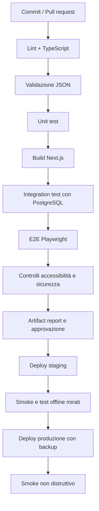

# ExpoTrack — 26. Strategia di test e criteri di rilascio

> **Percorso previsto:** `docs/26-testing.md`  
> **Stato:** specifica tecnica; non rappresenta test già eseguiti  
> **Ambito:** Next.js/React/TypeScript, PostgreSQL, IndexedDB, PWA, Docker, Cloudflare Tunnel  
> **Precedenti:** `00-overview.md`–`25-security.md`  
> **Prossimo documento:** `README.md` (indice generale e guida all'utilizzo della documentazione)

---

## 1. Obiettivo

Questo documento definisce come verificare **ExpoTrack**, web app privata mobile-first e offline-first per fiere, con EICMA 2026 come primo evento. Il prodotto consente di scegliere un profilo senza login interno, consultare stand editoriali da JSON, aggiungere stand personali, annotare interessi e stati di visita, salvare prodotti e fotografie, compilare questionari, confrontare prodotti su desktop, esportare PDF/JSON e sincronizzare dati tra browser e server.

L'obiettivo non è soltanto verificare che i pulsanti funzionino: i test devono dimostrare che **i dati non vengono persi o mescolati tra profili**, che le operazioni offline sopravvivono a riavvii e interruzioni, che i conflitti non sovrascrivono silenziosamente versioni diverse e che un deployment privato non espone dati o servizi.

La strategia comprende:

1. validazione statica e degli schemi JSON;
2. test unitari delle regole di dominio;
3. test di integrazione tra API, PostgreSQL, storage foto e configurazione;
4. test browser end-to-end per mobile e desktop;
5. test offline, PWA e IndexedDB;
6. test di sincronizzazione multi-dispositivo e conflitti;
7. test di sicurezza e privacy;
8. test di performance, accessibilità, backup e ripristino;
9. criteri di ingresso/uscita, regressione e rilascio.

**Non si sta implementando l'app:** framework, fixture, codice e pipeline descritti qui sono proposte da confermare quando inizierà lo sviluppo.

---

## 2. Principi fondamentali

- **La verità del prodotto è il contratto funzionale**, non l'implementazione attuale: i test devono fallire quando il codice viola i requisiti.
- **Le bozze autosalvate non sono dati confermati**: soltanto il pulsante **Salva** effettua il commit locale e accoda la sincronizzazione.
- **«Salvato sul dispositivo» non significa «Sincronizzato»**: ogni stato ha un test separato.
- **La categoria di un prodotto è immutabile dal primo Salva locale**, anche quando il dispositivo è offline.
- **Ogni dato personale è contestualizzato per profilo ed evento**; gli stand editoriali sono condivisi, gli stand creati nell'app sono privati del profilo.
- **Il catalogo completo non equivale alla lista personale di interessi**: la dashboard non deve conteggiare indiscriminatamente tutti gli stand editoriali come obiettivi di visita.
- **Le foto devono essere disponibili offline dopo il salvataggio locale riuscito**, salvo limiti esplicitamente gestiti.
- **La risoluzione dei conflitti è manuale**: non scegliere automaticamente una versione in base al timestamp.
- **I JSON non devono sovrascrivere le personalizzazioni salvate**; i valori cancellati intenzionalmente non devono ricomparire per effetto del seed.
- **Cloudflare Tunnel non è autenticazione**: il test della protezione remota richiede una policy esplicita, ad esempio Cloudflare Access.
- **Il profilo selezionabile non è un'identità verificata**: i test di isolamento logico non vanno descritti come prova di autorizzazione personale.
- **Non inventare padiglioni, stand o numeri di booth EICMA 2026**: tutte le fixture di espositori devono essere chiaramente fittizie.

---

## 3. Matrice requisiti → livelli di test

| Area | Unitari | Integrazione | E2E | Offline/multi-device | Sicurezza |
|---|---|---|---|---|---|
| JSON editoriali | Sì | Sì | Bootstrap | Aggiornamento snapshot | Integrità contenuti |
| Profili | Sì | Sì | Selezione/cambio | Cache isolata | Limite identità |
| Catalogo stand | Sì | Sì | Ricerca e dettaglio | Cache offline | Referenze |
| Stand personali | Sì | Sì | CRUD | Tombstone/sync | Scope profilo |
| Interessi | Sì | Sì | Priorità e obiettivi | Override seed | Scope |
| Stati visita | Sì | Sì | Tre stati | Conflitti | Integrità |
| Dashboard | Sì | Sì | Contatori/shortcut | Stato locale | Privacy |
| Prodotti | Sì | Sì | CRUD | Categoria immutabile | Validazione |
| Questionari | Sì | Sì | Sei tipi | Versioni storiche | Input ostile |
| Fotografie | Sì | Sì | Acquisizione/galleria | Blob e upload | MIME/EXIF |
| Confronto | Sì | Facoltativo | Desktop | Dati locali | Scope |
| Esportazioni | Sì | Sì | PDF/JSON | Offline | Dati sensibili |
| Sincronizzazione | Sì | Sì | Indicatori | Conflitti/retry | Idempotenza |
| Deployment | No | Smoke | Smoke | Ripristino | Rete/Access |

Per ogni requisito deve esistere almeno un test automatizzato o, se tecnicamente impossibile, una verifica manuale tracciata con responsabile ed evidenza.

---

## 4. Stack di test suggerito

| Strumento | Impiego proposto | Note |
|---|---|---|
| **Vitest** | Unit test TypeScript, hook e servizi | Alternativa Jest se preferita dal progetto |
| **React Testing Library** | Comportamento componenti | Verificare interazioni, non dettagli DOM interni |
| **Playwright** | E2E Chromium/Firefox/WebKit, emulazione mobile | Browser reali per PWA e IndexedDB |
| **MSW** | Simulazione API e errori rete nei test frontend | Non sostituisce integrazione reale |
| **PostgreSQL temporaneo** | Integrazione DB, vincoli, migrazioni | Versione allineata al deployment |
| **Docker Compose test** | Servizi integrati, storage e smoke | Ambiente isolato da produzione |
| **axe-core / axe-playwright** | Controlli accessibilità automatici | Completare con test manuali |
| **Lighthouse** | Segnali PWA, accessibilità, performance | Non usarlo come unica prova di correttezza |
| **k6 o equivalente** | Carichi limitati su API/upload/export | Solo se necessario per v1 |

**Decisione aperta:** la scelta definitiva dei framework. I test devono essere indipendenti dalla preferenza per uno specifico ORM (Prisma, Drizzle o SQL diretto).

### 4.1 Esempio di organizzazione

```text
tests/
├── unit/
│   ├── domain/
│   ├── config/
│   ├── dashboard/
│   ├── questionnaires/
│   └── comparison/
├── integration/
│   ├── api/
│   ├── database/
│   ├── sync/
│   └── media/
├── e2e/
│   ├── profiles/
│   ├── stands/
│   ├── products/
│   ├── questionnaires/
│   ├── offline/
│   ├── comparison/
│   └── export/
├── security/
├── fixtures/
│   ├── config/
│   ├── api/
│   ├── photos/
│   └── database/
└── helpers/
```

Questo è un **layout indicativo**, da armonizzare con `02-project-structure.md` prima di creare cartelle reali.

---

## 5. Ambienti e dispositivi

### 5.1 Ambienti

- **Unit:** nessun database e nessuna rete reale; funzioni pure e mock mirati.
- **Integration:** PostgreSQL temporaneo, filesystem media temporaneo, configurazioni JSON fixture.
- **E2E:** build Next.js di test con database e storage isolati, dati ripristinabili tra test.
- **Staging:** Docker Compose il più simile possibile al server privato, hostname separato se necessario.
- **Production smoke:** verifiche non distruttive dopo deployment, senza manipolare dati personali reali.

### 5.2 Browser e form factor

| Contesto | Verifiche essenziali |
|---|---|
| Android / Chrome mobile | PWA, fotocamera, IndexedDB, bottom nav, offline |
| iPhone / Safari mobile | Persistenza, limitazioni PWA, upload foto, tastiera virtuale |
| Desktop Chromium | Confronto prodotti, tabelle, export, tastiera |
| Desktop Firefox | Form, download, storage, accessibilità |
| Desktop Safari/WebKit | Compatibilità UI e storage |
| Tablet | Layout intermedio, orientamento e scroll |

L'utilizzo principale è su smartphone; i test devono includere un dispositivo fisico Android rappresentativo, non solo emulazione. Non assumere che API di storage e background sync abbiano lo stesso comportamento su tutti i browser.

### 5.3 Matrice di rete

- online stabile;
- offline fin dal caricamento, **dopo** un bootstrap riuscito;
- rete lenta e ad alta latenza;
- timeout della richiesta dopo che il server ha già eseguito il commit;
- connessione intermittente durante upload foto;
- cambio online/offline durante una modifica;
- sessione Cloudflare Access scaduta;
- server disponibile ma PostgreSQL temporaneamente indisponibile.

**Primo accesso completamente offline senza alcun bootstrap precedente:** non promettere la disponibilità dei cataloghi; mostrare un messaggio corretto e recuperabile.

---

## 6. Fixture editoriali e dati di test

### 6.1 Fixture minima multi-evento

Usare eventi fittizi, ad esempio `fiera-demo-2027` e `fiera-demo-2028`, per testare collisioni di ID. Includere:

- profili editoriali `me` e `father`;
- un profilo dinamico `usr-...`;
- almeno due padiglioni fittizi;
- categorie ad albero (padre, figlia, nipote);
- stand editoriali con e senza padiglione/booth;
- stand con più categorie;
- uno stand personale per profilo;
- interessi seed diversi per `me` e `father`;
- questionari diversi per profilo e categoria;
- prodotti con e senza prezzo, voto, foto e risposte;
- almeno una categoria senza questionario.

**Non associare a EICMA 2026 padiglioni o numeri di stand inventati.** Le fixture demo devono essere etichettate come tali.

### 6.2 Fixture limite

Preparare varianti per:

- ID duplicati e referenze mancanti;
- nomi con accenti, emoji, apostrofi e caratteri speciali;
- testo molto lungo e stringhe vuote;
- prezzi zero, nulli, negativi, valori non numerici;
- rating 1, 10, 0, 11;
- domande a scelta con opzioni rimosse o rinominate;
- foto grandi, corrotte, HEIC, con EXIF GPS;
- prodotti con stessa categoria ma stand diversi;
- prodotti di categorie diverse ma stesso genitore;
- modifiche concorrenti e tombstone.

### 6.3 Determinismo

- Generare UUID stabili nelle fixture quando serve riproducibilità.
- Congelare il tempo nei test unitari che dipendono da timestamp.
- Non usare dati personali reali.
- Non condividere DB e cache browser tra test che dovrebbero essere indipendenti.
- Ogni test deve pulire i dati che crea, anche se fallisce.

---

## 7. Validazione dei JSON editoriali

### 7.1 File da verificare

```text
config/app.json
config/profiles.json
config/pavilions.json
config/categories.json
config/events/eicma-2026-stands.json
config/interests/me.json
config/interests/father.json
config/questionnaires/me.json
config/questionnaires/father.json
```

I file qui elencati sono **contratti previsti**, non file da generare in questa fase.

### 7.2 Verifiche

1. JSON sintatticamente valido.
2. `schemaVersion` supportata.
3. ID stabili, univoci e nel formato consentito.
4. `defaultEventId` esistente.
5. Profili referenziati realmente definiti.
6. Padiglioni validi per evento.
7. Albero categorie senza cicli, genitori inesistenti o collisioni.
8. Stand con ID univoci nell'evento.
9. Categorie stand esistenti.
10. Interessi che puntano a stand editoriali esistenti.
11. Priorità intere da 1 a 10.
12. `whatToSee` senza elementi vuoti dopo trim.
13. Questionari con ID domande univoci e tipi supportati.
14. Opzioni di scelta coerenti con il tipo.
15. Nessun riferimento a file inesistenti.
16. Aggiornamento editoriale che non elimina ID ancora referenziati senza migrazione esplicita.

### 7.3 Test di snapshot atomico

Se un nuovo JSON è malformato, il client e il server devono **continuare a utilizzare l'ultimo snapshot coerente**, senza mescolare versioni vecchie e nuove di categorie, stand e questionari.

### 7.4 Esempio di contratto testabile

```ts
interface ValidationIssue {
  file: string;
  path: string;
  code: string;
  message: string;
}

interface ConfigValidationResult {
  valid: boolean;
  issues: ValidationIssue[];
  snapshotHash?: string;
}
```

L'implementazione della funzione di validazione è fuori ambito qui; il test deve verificarne output e comportamento per file validi e invalidi.

---

## 8. Test unitari di dominio

### 8.1 Profili e perimetro

- Selezione profilo persistente nel browser.
- Cambio profilo non altera dati e bozze del precedente.
- Profilo editoriale disabilitato nascosto dalla selezione, dati conservati.
- Profilo dinamico creato con ID non collidente.
- Profilo editoriale non eliminabile tramite UI.
- Profilo dinamico eliminabile solo dopo doppia conferma.

### 8.2 Stati visita

La funzione di calcolo dello stato effettivo restituisce `to_visit` quando non esiste un override; accetta `visited` e `revisit` come stati distinti. Lo stato non modifica prodotti, note o foto.

### 8.3 Interessi e dashboard

- Catalogo condiviso ≠ lista interessi personale.
- Un interesse seed senza override usa priorità e obiettivi del JSON.
- Un override di priorità ha precedenza sul seed.
- Un valore **cancellato volontariamente** non viene ripristinato dal seed.
- Un `whatToSee` svuotato esplicitamente resta vuoto.
- Rimuovere un interesse non cancella osservazioni collegate.
- Conteggi dashboard calcolati sul perimetro definito in `15-dashboard.md`.
- Statistiche cliccabili producono filtri coerenti.

### 8.4 Prodotti

- Categoria obbligatoria e unica.
- Categoria immutabile dopo il primo Salva locale.
- Nome non vuoto dopo trim.
- Prezzo facoltativo: `null` diverso da zero.
- Rating facoltativo, intero 1–10.
- Preferito indipendente dal rating.
- Associazione a stand e profilo valida.
- Eliminazione con conferma e senza resurrezione da sync obsoleta.

### 8.5 Questionari

- Selezione per profilo e categoria esatta, secondo la regola proposta in `10-questionnaires-config.md`.
- Nessun questionario => nessuna sezione da compilare.
- Domande tutte facoltative.
- Testo, numero, sì/no, scelta singola, scelta multipla, rating 1–10.
- Nessuna risposta preselezionata.
- Risposte precedenti interpretabili dopo modifica della definizione.
- Non confondere voto generale del prodotto e voto a una domanda.

### 8.6 Confronto

- Stesso profilo, stesso evento, **stessa categoria esatta**.
- Categorie figlie diverse non sono equivalenti.
- Valori assenti mostrati come assenti, non come zero.
- Risposte questionari versionate non vengono reinterpretate con etichette sbagliate.
- Non assegnare un vincitore automatico.
- Limite iniziale proposto di quattro prodotti, se confermato.

---

## 9. Test di integrazione PostgreSQL e API

### 9.1 Database

Usare migrazioni reali su un database temporaneo. Verificare:

- vincoli di unicità e FK disponibili;
- validazione applicativa per riferimenti ai JSON;
- transazioni atomiche;
- trigger o regole che impediscono cambio categoria;
- timestamp UTC e revisioni monotone;
- soft delete/tombstone;
- indici delle query principali;
- isolamento di eventi e profili;
- compatibilità migrazioni con dati esistenti.

### 9.2 Contratti API

Per ogni endpoint di `13-backend-api.md`, testare almeno:

1. richiesta valida e risposta attesa;
2. input mancante;
3. tipo non valido;
4. referenza sconosciuta;
5. record inesistente;
6. record eliminato;
7. revisione obsoleta;
8. richiesta ripetuta con stessa idempotency key;
9. stessa chiave con payload diverso;
10. errore interno senza perdita di dati né esposizione di segreti.

### 9.3 Test delle transazioni

Simulare un errore a metà scrittura di prodotto e risposte: o tutte le modifiche previste vengono confermate, oppure nessuna modifica parziale viene presentata come successo.

### 9.4 Dati storici

Un prodotto salvato con questionario versione 1 deve restare leggibile dopo l'introduzione della versione 2, senza perdere risposte o associare opzioni sbagliate.

---

## 10. Test E2E: selezione profilo e navigazione

### 10.1 Primo accesso

1. Aprire l'app con storage vuoto.
2. Visualizzare la selezione profilo.
3. Scegliere `me`.
4. Verificare dashboard, nome e colore profilo.
5. Ricaricare l'app.
6. Verificare che la selezione sia ricordata.

### 10.2 Cambio profilo

1. Creare un prodotto nel profilo `me`.
2. Passare a `father`.
3. Verificare che il prodotto non compaia nella lista di `father`.
4. Creare un prodotto diverso in `father`.
5. Tornare a `me` e verificare la persistenza del primo.

Questo dimostra **separazione logica nella UI**, non autenticazione personale.

### 10.3 Navigazione mobile

Verificare la barra inferiore con **Dashboard, Stand, Prodotti, Profilo**; area touch, stato attivo, scroll, tastiera virtuale, orientamento e assenza di contenuti nascosti sotto la barra.

### 10.4 Filtri

Aprire lista stand, applicare categoria, padiglione, priorità e stato; verificare risultati e ordinamenti. Alla riapertura normale della schermata, i filtri si azzerano come previsto, salvo ingresso da una statistica dashboard che deve applicare il filtro richiesto.

---

## 11. Test E2E: stand e interessi

### 11.1 Stand editoriali

- Sono visibili a tutti i profili.
- Non sono eliminabili tramite UI.
- Padiglione e booth vengono mostrati solo quando presenti nei dati validati.
- Uno stand può appartenere a più categorie.
- La ricerca non richiede rete dopo bootstrap.

### 11.2 Stand personali

- Creati dal profilo `me`, non compaiono nel catalogo personale di `father`.
- Modifica di nome, descrizione e categorie.
- Eliminazione con conferma.
- Tentativo di eliminazione con prodotti collegati segue la regola definitiva concordata (proposta prudente: blocco).

### 11.3 Interessi

- Aggiungere uno stand editoriale ai propri interessi.
- Assegnare priorità 1 e 10.
- Rimuovere la priorità senza eliminare l'interesse.
- Modificare `whatToSee`.
- Rimuovere un interesse mantenendo prodotti, foto e note.
- Verificare che gli interessi di `father` non cambino.

### 11.4 Stati visita

Per ciascuno stand verificare le transizioni `to_visit → visited → revisit → to_visit`, l'aggiornamento della dashboard e l'assenza di effetti collaterali sui prodotti.

---

## 12. Test E2E: prodotti

### 12.1 Creazione

1. Aprire uno stand.
2. Avviare la creazione prodotto.
3. Inserire nome e categoria.
4. Impostare facoltativamente prezzo, voto, preferito, note e foto.
5. Premere Salva.
6. Verificare il prodotto nello stand, nella lista prodotti e nei conteggi dashboard.

### 12.2 Categoria immutabile

1. Creare un prodotto offline.
2. Premere Salva e attendere conferma locale.
3. Riaprire il prodotto.
4. Verificare che la categoria non sia modificabile.
5. Tentare la modifica tramite API e verificarne il rifiuto.

### 12.3 Prezzi e voti

Testare `null`, zero, decimali validi, importi non validi, rating 1, 10, valori fuori range e campi vuoti. Non arrotondare silenziosamente valori invalidi.

### 12.4 Eliminazione

Confermare che l'eliminazione richieda un'azione esplicita, aggiorni liste e dashboard e produca una tombstone sincronizzabile. Le fotografie collegate devono seguire la policy definita in `21-photo-management.md`.

---

## 13. Test E2E: questionari dinamici

### 13.1 Tipi di domanda

| Tipo | Input valido | Input da rifiutare/gestire |
|---|---|---|
| Testo | Stringa, anche vuota se facoltativa | Lunghezza oltre limite |
| Numero | Numero valido nel range configurato | Testo non numerico, fuori range |
| Sì/no | `true`, `false`, nessuna risposta | Valore ambiguo non previsto |
| Scelta singola | Una opzione valida o nessuna | ID opzione sconosciuto |
| Scelta multipla | Zero o più opzioni valide | Duplicati/ID inesistenti |
| Rating | Intero 1–10 o assente | 0, 11, decimali non previsti |

### 13.2 Profili e categorie

- `me` e `father` possono vedere domande diverse sulla stessa categoria.
- Una categoria senza definizione non mostra un questionario generico.
- Non applicare automaticamente il questionario del genitore se l'ereditarietà non è stata approvata.

### 13.3 Versioni

Salvare risposte con versione 1, aggiornare JSON alla versione 2, aprire il prodotto e verificare che la rappresentazione storica rimanga comprensibile. Nessuna risposta deve essere trasformata in un'altra opzione per semplice riordino.

---

## 14. Test offline: bootstrap, bozze e Salva

### 14.1 Bootstrap

- Primo avvio online: snapshot validato e memorizzato.
- Avvio successivo offline: app shell, catalogo e dati locali disponibili.
- Primo avvio offline senza cache: messaggio esplicito, non schermata vuota.
- Snapshot aggiornato ma non valido: ultimo snapshot valido conservato.

### 14.2 Bozze

1. Aprire un modulo prodotto.
2. Digitare un nome senza premere Salva.
3. Chiudere la schermata.
4. Verificare avviso di modifiche non confermate.
5. Riaprire e recuperare la bozza.
6. Verificare che non sia comparsa alcuna mutazione in outbox.

### 14.3 Commit locale atomico

1. Disattivare la rete.
2. Compilare il prodotto.
3. Premere Salva.
4. Verificare conferma «Salvato sul dispositivo» soltanto dopo commit IndexedDB.
5. Verificare presenza del record e dell'operazione outbox nella stessa transazione.
6. Ricaricare la PWA e ritrovare il prodotto.
7. Verificare che lo stato resti «Da sincronizzare».

### 14.4 Fallimento storage

Simulare quota esaurita o transazione abortita: il client **non** deve mostrare «Salvato» se record e outbox non sono stati scritti entrambi. La bozza va mantenuta se possibile e l'errore deve essere comprensibile.

### 14.5 Foto offline

Aggiungere una foto offline, premere Salva, ricaricare e verificare che il blob sia ancora visualizzabile senza rete. Una foto disponibile solo sul server e mai scaricata su quel dispositivo deve invece mostrare un placeholder appropriato.

---

## 15. Test di sincronizzazione multi-dispositivo

### 15.1 Topologia

Usare due contesti browser indipendenti, A e B, che selezionano lo **stesso profilo**. Ogni contesto deve avere IndexedDB, cache e sessione indipendenti. Il server e PostgreSQL sono condivisi nell'ambiente di test.

### 15.2 Scenario: aggiornamento lineare

1. A crea un prodotto e sincronizza.
2. B effettua pull e visualizza il prodotto.
3. B modifica una nota e sincronizza.
4. A effettua pull e vede la modifica.
5. Nessun conflitto e nessun duplicato.

### 15.3 Scenario: conflitto reale

1. A e B caricano revisione 7.
2. A cambia la nota e sincronizza: revisione 8.
3. B modifica la stessa nota offline, basandosi su revisione 7.
4. B torna online e tenta push.
5. Il server restituisce conflitto, **senza sovrascrivere A**.
6. B conserva entrambe le versioni.
7. L'utente risolve manualmente.
8. La risoluzione produce una nuova revisione e si propaga ad A.

### 15.4 Scenario: timeout dopo commit

1. A invia operazione con `operationId=X`.
2. Il server conferma in DB, ma la risposta viene persa.
3. A ritenta `X` con identico payload.
4. Il server restituisce lo stesso esito senza creare un duplicato.
5. Se `X` viene riutilizzato con payload differente, il server rifiuta.

### 15.5 Scenario: eliminazione concorrente

A elimina un prodotto mentre B lo modifica offline. B non deve ricrearlo silenziosamente. La UI deve mostrare un conflitto o un errore specifico, conservando la proposta locale.

### 15.6 Scenario: dipendenze

Un prodotto creato offline su uno stand personale creato offline deve sincronizzarsi rispettando l'ordine delle dipendenze, senza creare un prodotto orfano.

### 15.7 Scenario: foto

Interrompere un upload a metà, riprendere la connessione, ritentare e verificare assenza di duplicati, coerenza dei metadati e disponibilità sul secondo dispositivo dopo download.

### 15.8 Scenario: Cloudflare Access scaduto

Un errore di sessione non deve cancellare outbox, bozze o conflitti. Dopo il nuovo accesso, la sync riprende con le stesse operazioni idempotenti.

### 15.9 Scenario: restore server

Dopo un ripristino da backup precedente, i client con revisioni più recenti devono riconoscere il cambio di generazione/epoch o un meccanismo equivalente. Non applicare automaticamente modifiche su uno storico incompatibile.

---

## 16. Test dashboard e coerenza dei conteggi

### 16.1 Invarianti

Per il profilo/evento attivo:

```text
stand_tracciati = da_visitare + visitati + da_rivedere
prodotti_totali = numero prodotti attivi del profilo/evento
preferiti_totali = prodotti attivi con isFavorite=true
```

La prima formula si applica all'insieme di stand **tracciati** definito nel documento dashboard, non automaticamente a tutti gli espositori del catalogo.

### 16.2 Aggiornamento immediato

Dopo Salva locale offline, i conteggi cambiano senza attendere il server. Dopo un conflitto, la UI deve segnalare che il dato locale e quello server divergono, evitando di presentare un numero come definitivamente sincronizzato.

### 16.3 Filtri da statistiche

Toccare «Da rivedere» deve aprire la lista degli stand pertinenti, con il filtro applicato. Tornando alla schermata Stand da navigazione normale, i filtri devono rispettare la politica di reset definita.

### 16.4 Budget

Il budget per categoria non deve essere confuso con la spesa effettiva: i prezzi dei prodotti osservati sono dati di confronto, non transazioni di acquisto.

---

## 17. Test del confronto desktop

- Confrontare prodotti della stessa categoria esatta.
- Rifiutare la selezione di prodotti di categorie diverse.
- Non mescolare profili o eventi.
- Mostrare prezzo assente distinto da zero.
- Mostrare valutazione generale separata dalle risposte ai questionari.
- Supportare note lunghe, fotografie mancanti e questionari versionati.
- Verificare intestazioni fisse, scroll orizzontale e navigazione da tastiera.
- Gestire un prodotto eliminato mentre il confronto è aperto.
- Gestire un prodotto locale non ancora sincronizzato.
- Se il limite di quattro prodotti è confermato, testare selezione del quinto.
- Non generare automaticamente classifiche o vincitori.

---

## 18. Test esportazioni PDF e JSON

### 18.1 Perimetro

Verificare esportazione di:

- tutte le categorie;
- una sola categoria;
- più categorie selezionate;
- categoria senza prodotti;
- prodotti salvati localmente ma non sincronizzati;
- prodotti con foto e questionari storici;
- profilo `me` senza includere dati `father`.

### 18.2 PDF

Verificare struttura riepilogativa per categoria/sottocategoria, schede prodotto, prezzi, voti, note, fotografie e risposte ai questionari. Controllare impaginazione su più pagine, caratteri accentati, testo lungo e foto non disponibili.

### 18.3 JSON

Verificare struttura valida e versionata, ID e referenze coerenti, campi opzionali e assenza di credenziali, token e percorsi filesystem privati. Non presentare il JSON come archivio fotografico completo se contiene soltanto riferimenti ai media.

### 18.4 Errori

Simulare memoria insufficiente, generazione interrotta, file molto grande e download annullato. L'app deve mostrare un errore recuperabile senza modificare i dati sorgente.

---

## 19. Test fotografie

### 19.1 Formati e input

- JPEG, PNG e WebP validi.
- HEIC/HEIF dove supportato, con fallback documentato.
- File corrotto o MIME contraffatto.
- Immagine con dimensioni enormi.
- File non immagine rinominato `.jpg`.
- Foto con orientamento EXIF.
- Foto con metadati GPS.

### 19.2 Flusso

1. Acquisire o selezionare foto.
2. Visualizzare anteprima.
3. Salvare offline.
4. Riaprire offline.
5. Sincronizzare metadati e binario.
6. Scaricare sul secondo dispositivo.
7. Eliminare con conferma e verificare tombstone/policy media.

### 19.3 Sicurezza

Non accettare path traversal, non esporre i volumi media come directory pubblica, non inserire URL con credenziali permanenti negli export. Le foto devono essere associate al profilo/evento e al proprietario logico corretto.

---

## 20. Test sicurezza e privacy

La suite dedicata in `25-security.md` contiene 60 scenari. Questo documento li incorpora come **gate di rilascio**, con attenzione a:

- hostname remoto protetto da Access, se configurato come requisito di privacy;
- nessun bypass verso origin, PostgreSQL o volume media;
- payload e referenze validati lato server;
- escaping di note, domande, risposte e nomi stand;
- protezione CSRF/CORS e cookie appropriati;
- upload e download media controllati;
- nessun segreto in bundle client, log, PDF o JSON;
- idempotenza, revisioni e tombstone;
- sessione Access scaduta che non provoca perdita dati;
- backup cifrati secondo policy e restore verificato.

**Limite strutturale da non nascondere:** senza autenticazione interna o associazione identità-profilo, un utente ammesso nell'app può selezionare un altro profilo. Non scrivere un test «utente A non può accedere al profilo B» come requisito v1: sarebbe in contraddizione con il prodotto.

---

## 21. Test accessibilità

### 21.1 Requisiti minimi

- Navigazione completa da tastiera su desktop.
- Focus visibile e ordine coerente.
- Etichette accessibili per input e pulsanti.
- Errori associati ai campi e annunciati appropriatamente.
- Contrasto testo/sfondo verificato.
- Controlli touch sufficientemente grandi su smartphone.
- Non usare soltanto il colore per priorità, stato visita o sync.
- Dialoghi con focus gestito correttamente.
- Riduzione del movimento quando richiesta dal sistema.
- Zoom testo e viewport senza perdita di funzioni essenziali.

### 21.2 Test manuali

Completare un percorso reale con tastiera e, quando possibile, screen reader: selezione profilo, apertura stand, creazione prodotto, compilazione questionario, Salva, controllo stato sync ed esportazione.

Gli scanner automatici non rilevano tutte le problematiche di accessibilità.

---

## 22. Performance e affidabilità

### 22.1 Obiettivi iniziali proposti

I valori sotto sono **target di progetto da misurare**, non SLA garantiti:

| Operazione | Obiettivo iniziale | Condizioni |
|---|---|---|
| Apertura dashboard da cache | Percepita rapida, senza blocchi prolungati | Smartphone rappresentativo |
| Salva locale senza foto pesanti | Feedback entro circa 500 ms | Storage non saturo |
| Ricerca locale stand | Risposta fluida durante digitazione | Catalogo demo ampliato |
| Cambio profilo | Nessuna vista con dati misti | Cache già popolata |
| Scorrimento liste | Nessun blocco evidente | 500+ prodotti sintetici |
| Export PDF | Progresso/feedback e nessun crash | Dataset di test grande |
| Sync dopo rete ripristinata | Avvio automatico quando app attiva | Sessione Access valida |

Non trasformare questi target in requisiti rigidi prima di una misura su dispositivi reali.

### 22.2 Dataset di stress

- 1.000 stand editoriali fittizi;
- 500 prodotti per profilo;
- 5–10 fotografie per prodotto in un sottoinsieme;
- 100 operazioni outbox pendenti;
- decine di conflitti simulati;
- questionari con molte domande e risposte lunghe.

Verificare consumo memoria, dimensioni IndexedDB, spazio server, durata export, carico PostgreSQL e comportamento della UI.

### 22.3 Robustezza

- Ricarica della pagina durante una richiesta.
- Crash simulato dopo commit locale ma prima della risposta UI.
- Arresto del backend durante sync.
- Riavvio PostgreSQL.
- Disco media pieno.
- Quota browser esaurita.
- Service worker aggiornato mentre esistono bozze.

---

## 23. Migrazioni, aggiornamenti e regressione

### 23.1 Versionamenti indipendenti

Verificare separatamente:

1. migrazioni schema PostgreSQL;
2. upgrade IndexedDB;
3. aggiornamento `schemaVersion` dei JSON;
4. compatibilità API/client PWA;
5. versione delle definizioni dei questionari.

### 23.2 Scenari fondamentali

- Upgrade senza perdere bozze, outbox, conflitti e foto locali.
- Client vecchio offline che torna online dopo aggiornamento server.
- Nuovo JSON con categoria rinominata ma ID invariato.
- JSON con ID eliminato e dati dinamici che lo referenziano.
- Aggiornamento questionario con risposte già raccolte.
- Rollback applicativo compatibile con lo schema corrente o procedura di restore esplicita.
- Cache PWA vecchia che non mescola asset incompatibili.

### 23.3 Suite regressione obbligatoria

Prima di ogni rilascio eseguire almeno: validazione JSON, test dominio, integrazione API/DB, E2E mobile essenziali, offline Salva, retry idempotente, conflitto, foto, export e smoke deployment.

---

## 24. Pipeline CI proposta



### 24.1 Requisiti CI

- Database temporaneo e isolato.
- Credenziali di test separate da produzione.
- Nessuna fotografia personale nelle fixture.
- Report leggibili per test falliti, screenshot e trace Playwright quando utili.
- Nessun segreto nei log o negli artifact CI.
- Test deterministici: evitare `sleep` arbitrari e dipendenze da servizi pubblici.
- Distinguere test automatici da verifiche manuali prima del rilascio.

### 24.2 Test intermittenti

Un test flaky non va ignorato sistematicamente: isolare la causa (race condition, browser, rete simulata, fixture), registrare il difetto e correggerlo. I test offline e sync sono particolarmente sensibili a condizioni temporali.

---

## 25. Catalogo casi di test — configurazioni e profili

| ID | Scenario | Esito atteso |
|---|---|---|
| CFG-01 | `app.json` valido | Snapshot accettato |
| CFG-02 | `schemaVersion` non supportata | Errore esplicito |
| CFG-03 | Evento predefinito inesistente | Config rifiutata |
| CFG-04 | ID profilo duplicati | Config rifiutata |
| CFG-05 | Ciclo categorie | Config rifiutata |
| CFG-06 | Categoria stand inesistente | Config rifiutata |
| CFG-07 | Padiglione non valido per evento | Config rifiutata |
| CFG-08 | Stand editoriale senza booth | Accettato |
| CFG-09 | Stand con più categorie | Accettato |
| CFG-10 | Interesse verso stand inesistente | Config rifiutata |
| CFG-11 | Priorità 0/11 | Rifiutata |
| CFG-12 | `whatToSee` con stringa vuota | Rifiutata/normalizzata secondo schema |
| CFG-13 | Questionario con ID domanda duplicato | Rifiutato |
| CFG-14 | Questionario senza domande | Comportamento coerente con schema |
| CFG-15 | Snapshot nuovo invalido | Vecchio snapshot preservato |
| PRO-01 | Primo accesso | Selezione profilo |
| PRO-02 | Riapertura browser | Profilo ricordato |
| PRO-03 | Cambio `me`→`father` | Nessun dato misto |
| PRO-04 | Profilo disabilitato | Nascosto, dati preservati |
| PRO-05 | Profilo dinamico | Creabile senza JSON iniziali |
| PRO-06 | Eliminazione profilo JSON | Vietata |
| PRO-07 | Eliminazione profilo dinamico | Doppia conferma |
| PRO-08 | Bozze profili diversi | Separate |
| PRO-09 | Stesso ID stand in due eventi | Nessuna collisione |
| PRO-10 | Cambio evento | Perimetro dati corretto |

---

## 26. Catalogo casi di test — stand, dashboard e prodotti

| ID | Scenario | Esito atteso |
|---|---|---|
| STD-01 | Catalogo visibile in due profili | Condiviso |
| STD-02 | Stand personale `me` | Non appare in `father` |
| STD-03 | Stand editoriale eliminato via UI | Azione negata |
| STD-04 | Ricerca per nome | Risultati coerenti |
| STD-05 | Filtri combinati | Intersezione corretta |
| STD-06 | Reset filtri alla riapertura | Eseguito |
| STD-07 | Stato mancante | `to_visit` effettivo |
| STD-08 | Stato `visited` | Dashboard aggiornata |
| STD-09 | Stato `revisit` | Dashboard aggiornata |
| STD-10 | Stato modificato | Note e foto invariate |
| STD-11 | Interesse rimosso | Prodotti conservati |
| STD-12 | Priorità cancellata | Seed non la ripristina |
| STD-13 | `whatToSee` svuotato | Seed non lo ripristina |
| STD-14 | Stand con prodotti eliminato | Regola prudente applicata |
| STD-15 | Foto stand | Proprietario corretto |
| DASH-01 | Nessun interesse | Nessun conteggio catalogo indiscriminato |
| DASH-02 | Un interesse da visitare | Conteggio 1 |
| DASH-03 | Stato visitato | Conteggi aggiornati |
| DASH-04 | Statistica cliccata | Filtro pertinente |
| DASH-05 | Preferito aggiunto offline | Conteggio locale aggiornato |
| DASH-06 | Budget categoria | Non trattato come spesa |
| DASH-07 | Cambio profilo | Statistiche isolate |
| DASH-08 | Prodotto eliminato | Conteggi coerenti |
| PRD-01 | Prodotto valido | Salvataggio |
| PRD-02 | Nome vuoto | Rifiuto al Salva |
| PRD-03 | Categoria mancante | Rifiuto al Salva |
| PRD-04 | Cambio categoria dopo Salva | Impossibile |
| PRD-05 | Prezzo assente | Valido |
| PRD-06 | Prezzo zero | Valido e distinto da assente |
| PRD-07 | Prezzo negativo | Rifiutato |
| PRD-08 | Rating 1 e 10 | Validi |
| PRD-09 | Rating 0 e 11 | Rifiutati |
| PRD-10 | Preferito senza rating | Valido |
| PRD-11 | Prodotto su stand personale altrui | Rifiutato |
| PRD-12 | Modifica note | Persistente |
| PRD-13 | Eliminazione | Conferma + tombstone |
| PRD-14 | Prodotto offline | Visibile dopo riavvio |
| PRD-15 | Prodotto senza questionario | Nessuna sezione inventata |

---

## 27. Catalogo casi di test — questionari, confronto ed export

| ID | Scenario | Esito atteso |
|---|---|---|
| QST-01 | Testo facoltativo vuoto | Salvataggio valido |
| QST-02 | Numero valido | Accettato |
| QST-03 | Numero non valido | Errore campo |
| QST-04 | Sì/no non selezionato | Nessuna risposta |
| QST-05 | Scelta singola | Una opzione valida |
| QST-06 | Scelta multipla | Zero o più opzioni valide |
| QST-07 | Rating domanda 1–10 | Validato |
| QST-08 | Nessun questionario categoria | Sezione assente |
| QST-09 | Questionari diversi per profilo | Corretti |
| QST-10 | Versione questionario aggiornata | Risposte storiche leggibili |
| QST-11 | Opzione eliminata nella nuova versione | Storico preservato |
| QST-12 | Domanda XSS | Testo inerte |
| CMP-01 | Due prodotti stessa categoria | Confronto ammesso |
| CMP-02 | Categorie diverse | Confronto bloccato |
| CMP-03 | Stesso genitore, figli diversi | Confronto bloccato |
| CMP-04 | Prodotti profili diversi | Confronto bloccato |
| CMP-05 | Prezzo null vs zero | Distinzione visibile |
| CMP-06 | Questionari versionati | Etichette storiche corrette |
| CMP-07 | Foto non offline | Placeholder corretto |
| CMP-08 | Quinto prodotto, se limite 4 confermato | Limite rispettato |
| EXP-01 | PDF tutte categorie | Completo |
| EXP-02 | PDF categorie selezionate | Solo selezione |
| EXP-03 | PDF note e foto | Rendering corretto |
| EXP-04 | PDF questionari | Risposte storiche corrette |
| EXP-05 | JSON valido | Struttura versionata |
| EXP-06 | JSON senza token | Nessun segreto |
| EXP-07 | Export offline | Include record confermati locali |
| EXP-08 | Export profilo `me` | Nessun dato `father` |
| EXP-09 | Foto server non disponibile offline | Gestione esplicita |
| EXP-10 | Dataset grande | Errore/progresso controllato |

---

## 28. Catalogo casi di test — offline, sync, media e deploy

| ID | Scenario | Esito atteso |
|---|---|---|
| OFF-01 | Avvio online iniziale | Snapshot locale |
| OFF-02 | Avvio offline successivo | App utilizzabile |
| OFF-03 | Primo avvio offline | Messaggio chiaro |
| OFF-04 | Bozza non salvata | Non entra in outbox |
| OFF-05 | Riapertura bozza | Recuperabile |
| OFF-06 | Salva offline | Record + outbox atomici |
| OFF-07 | Commit fallito | Nessun falso successo |
| OFF-08 | Riavvio dopo Salva | Dato presente |
| OFF-09 | Foto salvata offline | Blob leggibile |
| OFF-10 | Upgrade IndexedDB | Bozze/outbox conservate |
| OFF-11 | Quota piena | Errore recuperabile |
| OFF-12 | App chiusa | Nessuna promessa di sync background |
| SYN-01 | Push normale | Revisione aggiornata |
| SYN-02 | Pull normale | Modifiche ricevute |
| SYN-03 | Timeout dopo commit | Retry idempotente |
| SYN-04 | Chiave idempotenza riusata con payload diverso | Rifiuto |
| SYN-05 | Due device stessa revisione | Conflitto |
| SYN-06 | Conflitto risolto manualmente | Nuova revisione |
| SYN-07 | Eliminazione concorrente | Nessuna resurrezione |
| SYN-08 | Dipendenza stand→prodotto | Ordine corretto |
| SYN-09 | Rete intermittente | Outbox conservata |
| SYN-10 | Access scaduto | Richiesta riaccesso |
| SYN-11 | Errore `429` | Retry controllato |
| SYN-12 | Restore server precedente | Compatibilità verificata |
| MED-01 | JPEG/PNG/WebP | Upload valido |
| MED-02 | File non immagine | Rifiuto |
| MED-03 | File troppo grande | Rifiuto |
| MED-04 | Foto offline | Disponibile dopo Salva |
| MED-05 | Upload interrotto | Ripresa senza duplicati |
| MED-06 | Foto su altro dispositivo | Scaricabile dopo sync |
| MED-07 | EXIF GPS | Policy rispettata |
| MED-08 | Eliminazione foto | Conferma e sync coerenti |
| DEP-01 | DB non esposto | Verificato |
| DEP-02 | Origin senza bypass | Verificato |
| DEP-03 | Access policy attiva, se prevista | Verificata |
| DEP-04 | Backup DB+media | Completato |
| DEP-05 | Restore | Dati e foto leggibili |
| DEP-06 | Migrazione su staging | Superata |
| DEP-07 | Deploy nuovo client con vecchio offline | Gestito |
| DEP-08 | Log | Nessun segreto |

---

## 29. Tracciabilità e gestione difetti

### 29.1 Scheda test

Ogni caso deve poter registrare:

```ts
interface TestCaseRecord {
  id: string;
  requirementRefs: string[];
  title: string;
  level: "unit" | "integration" | "e2e" | "manual";
  preconditions: string[];
  steps: string[];
  expectedResult: string;
  automationStatus: "planned" | "automated" | "manual";
  priority: "critical" | "high" | "medium" | "low";
}
```

### 29.2 Severità difetti

| Severità | Esempio | Rilascio |
|---|---|---|
| **Bloccante** | Perdita dati dopo Salva, dati di profilo mescolati, backup non ripristinabile | Vietato |
| **Alta** | Sync duplica prodotti, conflitti sovrascritti, upload espone file | Vietato |
| **Media** | Filtro errato, export incompleto con workaround chiaro | Valutazione esplicita |
| **Bassa** | Piccola imperfezione visiva senza impatto funzionale | Può essere pianificata |

Un bug «solo offline» può essere bloccante: ExpoTrack è progettato per essere utilizzato in fiera con connettività intermittente.

### 29.3 Evidenze

Per un difetto raccogliere ID test, versione app/API, browser, stato rete, profilo/evento fittizi, passi di riproduzione, log **redatti**, screenshot o trace privi di dati personali non necessari.

---

## 30. Gate di rilascio

### 30.1 Prima del primo utilizzo reale

**Obbligatori:**

- [ ] Tutti i JSON editoriali validi e coerenti.
- [ ] Nessun dato EICMA 2026 inventato presentato come ufficiale.
- [ ] Selezione profilo e isolamento logico UI funzionanti.
- [ ] Catalogo, interessi e dashboard coerenti.
- [ ] CRUD prodotti e immutabilità categoria verificati.
- [ ] Tutti i tipi di questionario testati.
- [ ] Bozze e Salva offline testati su smartphone reale.
- [ ] Foto offline disponibili dopo Salva.
- [ ] Push/pull, idempotenza e conflitti manuali testati.
- [ ] Nessuna perdita dati nei test di interruzione e riavvio.
- [ ] Export PDF/JSON validi e limitati al profilo.
- [ ] Protezione dell'hostname remoto definita e verificata.
- [ ] PostgreSQL e media non esposti pubblicamente.
- [ ] Backup e restore eseguiti con successo.
- [ ] Nessun difetto bloccante o alto aperto.
- [ ] Smoke test su deployment Docker completato.

### 30.2 Requisiti non bloccanti da pianificare

Ottimizzazioni avanzate, copertura browser marginali, grandi carichi sintetici e automazioni secondarie possono essere rinviate **solo** se non mettono a rischio integrità, privacy e funzioni principali. Documentare ogni rinvio.

### 30.3 Rilascio progressivo consigliato

1. **Alpha locale:** catalogo, profili, prodotti, questionari e salvataggio IndexedDB.
2. **Beta privata:** PostgreSQL, API, sync, foto, conflitti e export.
3. **Staging Docker:** Tunnel/Access, backup, migrazioni e test dispositivi.
4. **Produzione privata:** rollout controllato, verifica smoke, monitoraggio errori.

Queste fasi sono una proposta organizzativa, non l'inizio dell'implementazione.

---

## 31. Piano manuale sul campo (simulazione fiera)

Eseguire una prova di circa 45–60 minuti con due dispositivi e connettività intermittente:

1. Aprire ExpoTrack su telefono A, selezionare `me`.
2. Cercare uno stand demo, aggiungerlo agli interessi e impostare priorità 10.
3. Segnarlo come visitato e aggiungere note.
4. Disattivare la rete.
5. Creare un prodotto con categoria, prezzo, voto e fotografia.
6. Compilare alcune domande e lasciare altre vuote.
7. Premere Salva e chiudere completamente l'app.
8. Riaprire offline e verificare prodotto e foto.
9. Riattivare la rete e osservare la sync.
10. Aprire telefono B sullo stesso profilo e verificare il prodotto.
11. Modificare la stessa nota su A e B in modo concorrente.
12. Verificare conflitto e risoluzione manuale.
13. Passare a `father`, verificare assenza dei dati personali di `me` nella vista.
14. Tornare a `me` ed esportare un PDF e un JSON.
15. Verificare dati, foto, questionari e correttezza del profilo.

Annotare tempi percepiti, problemi di interazione, leggibilità all'aperto, uso con una mano e messaggi di stato. Questo test manuale **non sostituisce** la suite automatica.

---

## 32. Decisioni aperte da chiudere

| Tema | Proposta | Documento correlato |
|---|---|---|
| Test runner | Vitest + Playwright | `02-project-structure.md` |
| Browser supportati | Android Chrome, Safari iOS, desktop principali | `14-frontend-ui.md` |
| Soglie performance | Misurare su hardware reale prima di fissarle | `19-offline-storage.md` |
| Limiti fotografie | Definire e testare | `21-photo-management.md` |
| Confronto massimo 4 prodotti | Confermare o modificare | `22-comparison.md` |
| Ereditarietà questionari | Matching esatto finché non deciso diversamente | `10-questionnaires-config.md` |
| Eliminazione stand con prodotti | Bloccare inizialmente, salvo scelta diversa | `16-stand-management.md` |
| Versionamento sync post-restore | Definire meccanismo di generazione server | `20-synchronization.md` |
| Access remoto | Cloudflare Access consigliato | `25-security.md` |
| Privacy tra profili | Nessuna identità verificata in v1 | `25-security.md` |
| Retention tombstone | Definire con client offline | `12-database.md` |
| Frequenza backup e restore drill | Definire | `24-deployment.md` |
| Copertura automatizzata minima | Da concordare per livello e rischio | Questo documento |

Le decisioni ancora aperte devono restare evidenti: **non trasformarle silenziosamente in requisiti già approvati**.

---

## 33. Criteri di accettazione del documento

- [ ] Ogni funzionalità fondamentale ha almeno un livello di test identificato.
- [ ] Le fixture non inventano ubicazioni EICMA ufficiali.
- [ ] I test distinguono bozza, Salva locale e sincronizzazione.
- [ ] Sono verificati isolamento logico profilo ed evento e relativo limite di sicurezza.
- [ ] È testata la precedenza degli override sugli interessi seed.
- [ ] Lo stato stand assente è trattato come `to_visit` nel perimetro corretto.
- [ ] La categoria prodotto è immutabile dal primo Salva offline.
- [ ] Tutti i sei tipi di domanda e le versioni storiche sono coperti.
- [ ] Foto offline, upload interrotti ed eliminazioni sono coperti.
- [ ] Idempotenza, revisioni, conflitti e tombstone sono coperti.
- [ ] Gli export non includono dati di altri profili o segreti.
- [ ] Sono previsti test su browser/dispositivi reali.
- [ ] Sono previsti test di accessibilità, sicurezza, backup e restore.
- [ ] Esistono gate di rilascio espliciti e severità difetti definite.
- [ ] Le scelte tecniche non approvate sono segnalate come proposte.

---

## 34. Chiusura della serie e prossimo documento

Con `docs/26-testing.md` si conclude la serie dei **27 documenti tecnici numerati** (`00`–`26`). Resta da redigere il **`README.md` principale**, che deve:

- presentare ExpoTrack e il suo scopo;
- spiegare le scelte funzionali già definite;
- fornire l'indice navigabile dei 27 documenti;
- indicare i percorsi delle configurazioni JSON previste;
- distinguere decisioni consolidate e questioni ancora aperte;
- suggerire l'ordine di lettura e le fasi di implementazione;
- evitare di dichiarare che l'app o i file JSON siano già stati implementati.

**Stato complessivo dopo questo documento:** 27 documenti su 28, pari a circa il 96,4% della documentazione pianificata.
